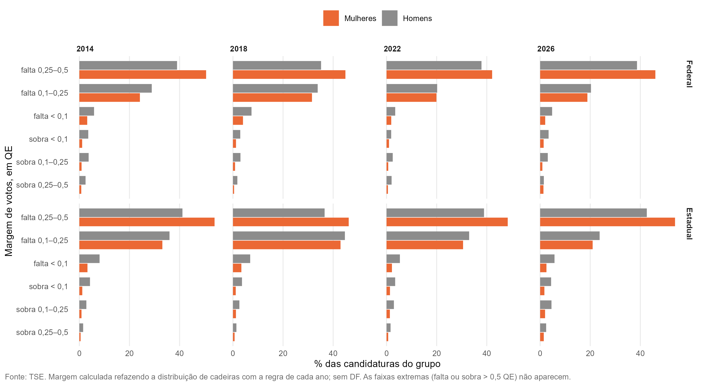
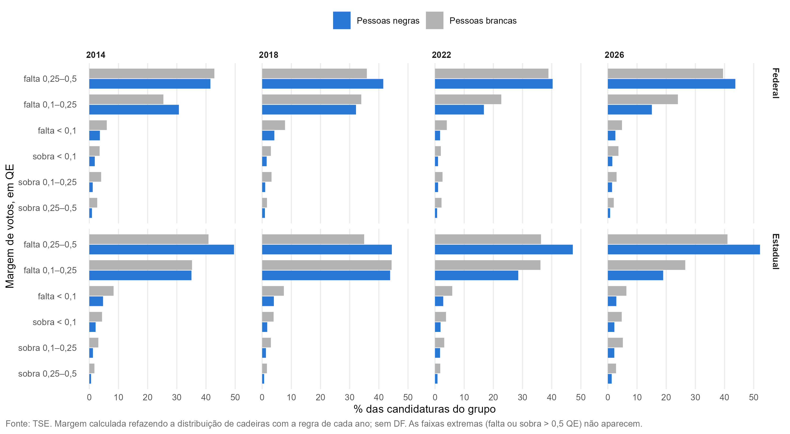
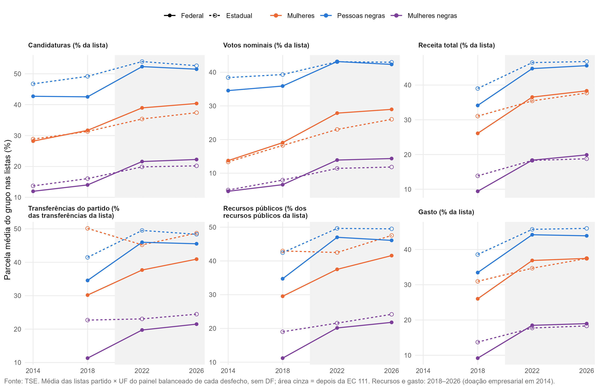
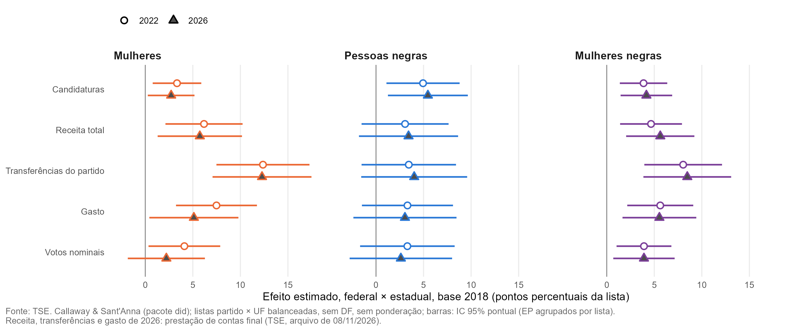
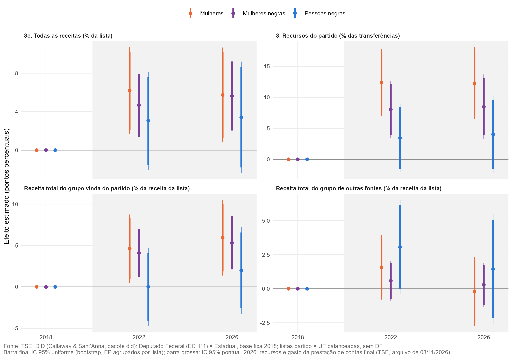
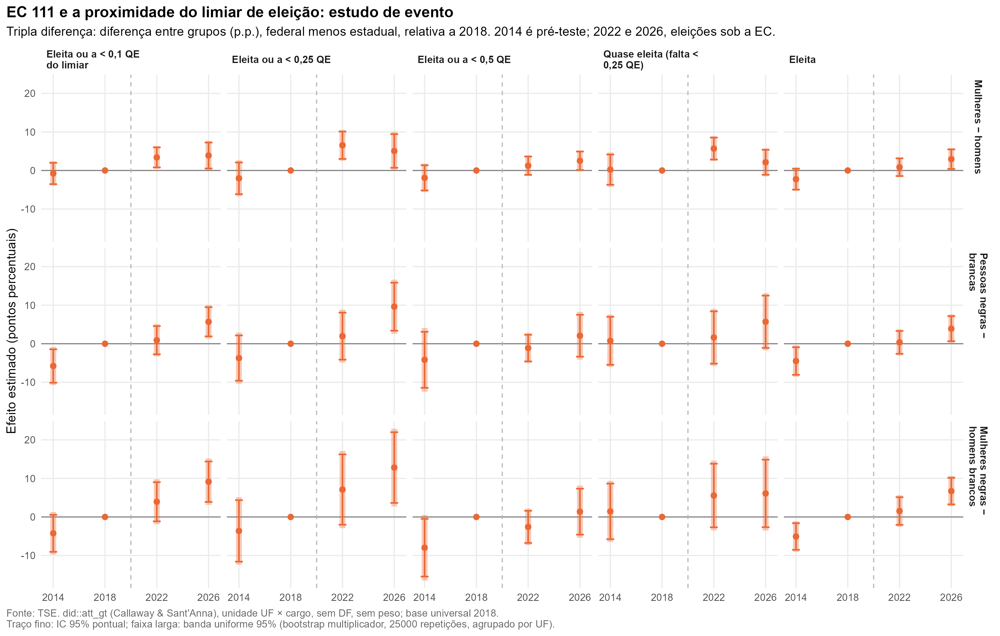
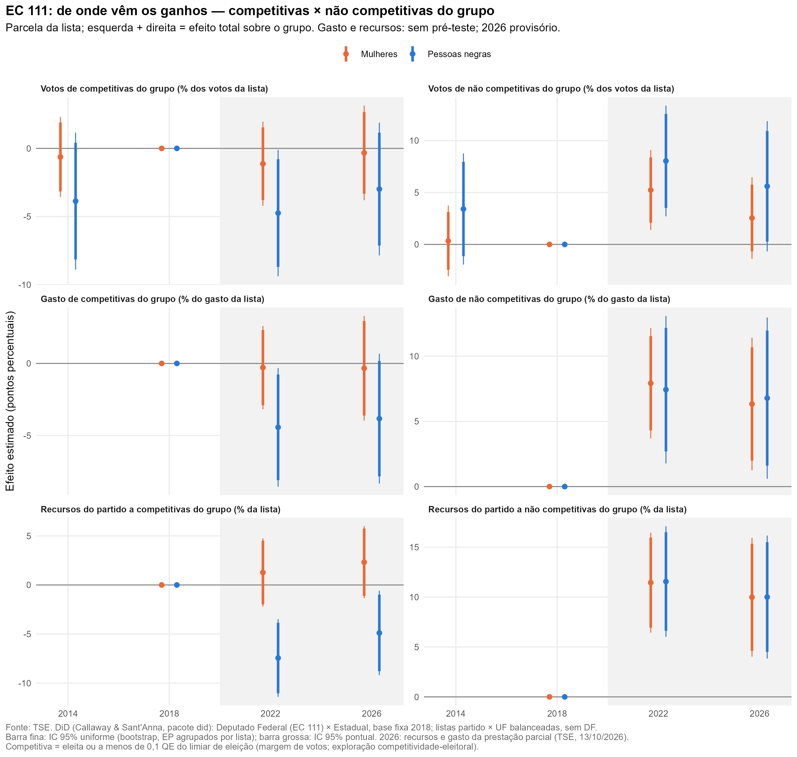
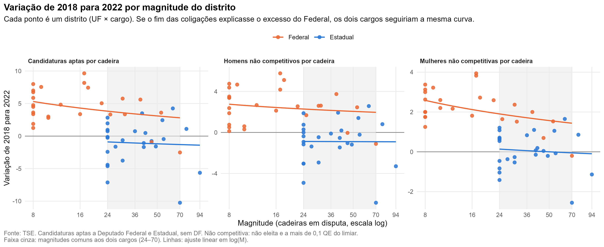

<!-- Este arquivo é derivado do capítulo do livro (Quarto/thesis/chapters/03-ec111-competitividade-eleitoral.qmd). Ao propagar edições, o capítulo do livro é a fonte; este arquivo é atualizado a partir dele. -->

## Introdução {#sec-introducao-ec111}

A Emenda Constitucional 111/2021, art. 2º, criou um incentivo financeiro inédito no sistema eleitoral brasileiro em favor da maior representação de mulheres e pessoas negras. Nas eleições de 2022 a 2030, os votos dados a candidaturas desses grupos para a Câmara dos Deputados contam em dobro na distribuição entre os partidos de parcela dos fundos públicos de financiamento disponíveis. Diferentemente de outras modalidades de ações afirmativas já discutidas no Capítulo 2, a regra não obriga o partido a nada. Ela altera, porém, o valor relativo de cada voto. Para o partido, no ciclo seguinte, um voto obtido por uma mulher ou por uma pessoa negra vale o dobro de um voto obtido por um homem branco. Este capítulo avalia como esse incentivo inovador foi implementado pelos partidos e quais os resultados obtidos nos dois primeiros ciclos eleitorais de sua vigência. A recompensa financeira direcionada aumentou a representação de mulheres e pessoas negras na política brasileira?

A efetividade do incentivo financeiro é medida ao longo do ciclo de vida de uma candidatura, do recrutamento até a efetiva ocupação de uma cadeira: quantas mulheres e pessoas negras os partidos recrutaram como candidatas em suas listas, quanto dinheiro elas arrecadaram e quanto desses recursos foi investido diretamente pelo próprio partido, quanto gastaram, quantos votos obtiveram, quão perto chegaram de se eleger e quantas se elegeram. A distinção entre esses estágios é central para entender a (limitada) efetividade da medida. No bônus criado pela emenda, um voto conta o mesmo esteja ele numa candidatura que se elege ou numa candidatura que termina muito longe da cadeira. O desenho da emenda premia o volume de votos, e não a eleição. É possível, portanto, que a EC 111 tenha alavancado a votação dessas candidaturas sem afetar a sua representação entre os eleitos. O objetivo que orienta o capítulo é compreender até onde o efeito chega e onde ele, eventualmente, se perde.

Com relação à literatura que avalia o impacto das ações afirmativas sobre a representação de gênero e raça no Brasil, este capítulo apresenta três contribuições. A primeira, mais evidente, é a inclusão dos resultados eleitorais de 2026 na análise, de forma a entender se as mudanças observadas em 2022 persistem ou se alteram. A segunda é o refinamento metodológico, e seu significado substantivo, das medidas de competitividade eleitoral. Em vez de um corte fixo de votos ou da posição na lista, uso a margem de votos de cada candidatura, isto é, quantos votos faltariam (ou sobrariam) para que ela mudasse de resultado, calculada refazendo a distribuição de cadeiras com a regra de cada eleição [@AvelinoBidermanDesposato2022_incumbency; @LuechingerSchelkerSchmid2024_closeness]. Dessa forma, a medida avalia a competitividade da candidatura tanto dentro quanto fora do partido em termos das chances de alterar o resultado eleitoral, sem usar a quantidade de votos obtida como simples aproximação. Foi testada também uma medida de competitividade baseada no gasto eleitoral, seguindo lógica equivalente. A margem de gasto estima qual seria o volume de gasto adicional necessário para alterar o resultado eleitoral daquela candidatura, considerando a competição dentro e fora do partido.

Para identificar o efeito do voto em dobro, sigo a estratégia de @FonsecaThomeGuedesNeto2026_money_talks e comparo as candidaturas a deputado federal, sujeitas ao incentivo, com as candidaturas a deputado estadual nas mesmas UFs e eleições, que não estão sujeitas a ele. Como as cotas de recursos para mulheres e pessoas negras valem para os dois cargos, a comparação separa o efeito específico da EC 111 das demais mudanças do período que atingem ambos. A terceira contribuição é estimar todos os estágios, da candidatura à cadeira, com o mesmo estimador de diferenças em diferenças [@CallawaySantAnna2021_did] e a mesma comparação, o que permite ver em que estágio o efeito se perde.

A resposta, adiantada aqui, é que o efeito se perde entre o dinheiro e a cadeira. O incentivo mudou de forma relevante a alocação de recursos partidários em favor das mulheres. Em 2022 e em 2026, a parcela das transferências do partido destinada a elas subiu cerca de 12 pontos percentuais nas candidaturas federais em comparação com as estaduais, e foi por essa via, e não por outras fontes de receita, que a arrecadação total das candidatas aumentou. Em 2022, parte desse efeito vem de uma queda da parcela das mulheres nas transferências do cargo estadual, o que sugere algum deslocamento de recursos entre os cargos, enquanto em 2026 ele vem quase todo da alta no cargo federal. Os partidos também lançaram mais mulheres e mais pessoas negras. Mas o dinheiro e os votos adicionais ficaram com candidaturas que terminaram longe do limiar da eleição. O acréscimo no investimento foi distribuído entre muitas candidatas, e a proporção de mulheres com recursos suficientes para disputar uma cadeira não aumentou. Pelo voto, as mulheres parecem ter se aproximado da eleição em 3 a 4 pontos percentuais. Essa aproximação, no entanto, não reflete o aumento da competitividade de mulheres, mas sim o aumento de candidaturas masculinas com poucas chances no cargo federal, reduzindo a taxa de competitividade dos homens. A presença de mulheres entre as candidaturas competitivas e entre os eleitos não mudou de forma detectável, e esse padrão se repete em 2026. Para pessoas negras e mulheres negras, a taxa de eleição e parte das medidas de competitividade já vinham melhorando no cargo federal antes da emenda, entre 2014 e 2018, e os ganhos observados nesses estágios não podem ser atribuídos ao voto em dobro.

O capítulo está organizado em mais seis seções, além desta introdução. A @sec-literatura-ec111 situa a EC 111/2021 entre as ações afirmativas de financiamento eleitoral, revisa os estudos sobre a emenda, discute o que a regra efetivamente premia e formula as hipóteses H1 a H6, uma para cada estágio do percurso da candidatura e uma para a persistência do efeito em 2026. A @sec-desenho-ec111 apresenta a estratégia de identificação, baseada na comparação entre os cargos de deputado federal e estadual, e os testes de falsificação, e define as variáveis, entre elas as margens de votos e de gasto. A @sec-medida-ec111 descreve as fontes de dados e a amostra. A @sec-resultados-ec111 reporta os resultados, em uma subseção para cada hipótese. A @sec-discussao-ec111 interpreta o conjunto dos resultados ao longo do percurso da candidatura e discute seus limites, e a @sec-conclusao-ec111 conclui.

## Revisão da Literatura {#sec-literatura-ec111}

Medidas para ampliar a presença de grupos sub-representados já são velhas conhecidas da política brasileira, mas não se resumem a cotas de candidaturas, de recursos ou de vagas. @Lovenduski2005_feminizing distingue três tipos de estratégia para a igualdade de gênero na representação política. A retórica da igualdade se limita a declarações de compromisso dos partidos. A promoção da igualdade oferece apoio e incentivos às candidatas, como formação e financiamento. As garantias de igualdade fixam resultados, como as cotas e as cadeiras reservadas. @KrookNorris2014_beyond_quotas ampliam esse quadro e mostram que, além das cotas, há estratégias que intervêm em cada etapa do recrutamento, da decisão de se candidatar à seleção pelos partidos e à eleição. Uma delas é a regulação do financiamento público, que vincula os recursos repassados pelo Estado aos partidos à presença de mulheres entre seus candidatos ou entre seus eleitos.

Esse tipo de mecanismo, que se pode chamar de ação afirmativa de financiamento eleitoral, existe hoje em cerca de 30 países [@Ohman2018_gender_targeted] e assume formas diferentes. Em alguns casos, o partido perde parte dos recursos públicos se não atinge um patamar mínimo de candidatas, como na França e na Irlanda. Em outros, recebe recursos adicionais se atinge esse patamar ou se elege mulheres, como na Geórgia e na Colômbia. Há ainda os recursos carimbados, em que parte do financiamento público deve ser gasta em atividades voltadas às mulheres, como no México, a forma mais comum no mundo [@KrookNorris2014_beyond_quotas; @Ohman2018_gender_targeted]. As avaliações disponíveis indicam que o desenho do mecanismo importa. No caso italiano, @FeoPiccio2020_party_funding mostram que regras mal desenhadas, sem sanções e recompensas capazes de mudar o comportamento dos partidos, se reduziram a política simbólica. Na comparação de 31 eleições em 17 países, @MuriaasMazurHoard2022_payments concluem que o equilíbrio de gênero melhora quando o incentivo financeiro se combina com outras condições. Nos casos bem-sucedidos em que o mecanismo foi implementado de cima para baixo, ele vinha acompanhado de cotas de gênero e de representação proporcional ou de um patamar mínimo de 15% de mulheres no parlamento.

Os modelos de corte e de bônus descritos acima recompensam ou penalizam os partidos pela composição das listas ou pela composição dos eleitos. O Brasil adotou até aqui a outra família, a dos recursos carimbados. Ele já aparece nas sínteses comparativas pela obrigação de destinar ao menos 5% do Fundo Partidário à promoção da participação política das mulheres [@KrookNorris2014_beyond_quotas; @Ohman2018_gender_targeted]. Desde 2018, além disso, uma parcela mínima dos recursos públicos de campanha é reservada às candidatas e, desde 2020, distribuída às candidaturas negras na proporção delas. A EC 111 acrescentou um desenho próximo ao dos bônus, que difere dos modelos anteriores em dois pontos. O primeiro é o objeto premiado. A emenda não recompensa nem a composição das listas nem a dos eleitos, e sim os votos, uma medida intermediária entre as duas, que o partido pode aumentar sem que a composição dos eleitos mude. O segundo é o alcance. A emenda vale também para pessoas negras. Até onde foi verificado, as sínteses comparativas disponíveis não registram mecanismo equivalente voltado à representação racial ou étnica, o que torna o caso brasileiro relevante também para essa literatura.

No caso brasileiro, a literatura sobre a emenda ainda é pequena e trata só de 2022. Dois trabalhos são descritivos. @EvangelistaEtAl2024_candidaturas_regras comparam as eleições para a Câmara de 2014, 2018 e 2022 e registram aumento das candidaturas e dos eleitos de mulheres, de pessoas negras e de pessoas LGBTQIA+ em 2022, além de maior participação de homens e mulheres negros nas receitas. @Trindade2025_subrepresentacao_camara avalia em conjunto a ADI 5.617 e as Emendas 111/2021 e 117/2022 e encontra, em 2022, aumento das candidaturas de mulheres negras e de homens negros, queda das de homens brancos e aumento da taxa de sucesso apenas entre mulheres negras. Nenhum dos dois separa o efeito do voto em dobro do efeito das cotas de recursos, adotadas no mesmo período. @FonsecaThomeGuedesNeto2026_money_talks são os primeiros a isolar a EC 111, com o mesmo contraste entre deputado federal e estadual usado aqui, para 2018 e 2022. Encontram aumento de votos e de recursos para mulheres e pessoas negras, mas concentrado em candidaturas pouco competitivas, definidas pela posição na lista.

Para entender esses resultados é preciso olhar o que, exatamente, a emenda premia. O voto em dobro entra no cálculo dos dois fundos públicos distribuídos aos partidos, mas com pesos diferentes. No Fundo Partidário, a quase totalidade dos recursos é dividida pela votação para a Câmara dos Deputados. No FEFC, a votação responde por 35% do total, e os demais 65% são divididos em partes iguais (2%) e pelo tamanho das bancadas na Câmara (48%) e no Senado (15%) (Lei 9.504/1997, art. 16-D). A dobra vale só para a parcela que segue os votos, e o voto de uma mulher negra conta em dobro uma única vez, sem acúmulo pelas duas condições. O incentivo tem, assim, três propriedades que importam para a análise. Primeiro, ele é dirigido ao partido, e não à candidatura, e quem decide quantas mulheres e pessoas negras lançar e quanto dinheiro destinar a cada uma é a direção partidária. Segundo, ele premia votos, e não cadeiras. Para o bônus, um voto de uma candidata que termina com 2% do quociente eleitoral vale o mesmo que um voto de uma candidata eleita, enquanto a parte do FEFC que segue as cadeiras continua a premiar quem já as ocupa. Terceiro, o incentivo vale só para deputado federal, o que permite comparar as listas federais com as estaduais dos mesmos partidos, nas mesmas UFs e eleições.

Dirigido ao partido e indexado aos votos, o incentivo pode ser capturado sem que a composição dos eleitos mude. Os partidos funcionam, nessa lógica, como donos de máquinas caça-níqueis, e as candidaturas, como as máquinas. Cada candidatura de uma mulher ou de uma pessoa negra coleta votos e, portanto, dinheiro público para o partido que a explora, ainda que quase nunca leve a cadeira. Basta ao partido espalhar recursos por muitas candidaturas desses grupos com chance baixa, sem deslocar os candidatos competitivos que já tem. Chamo essas candidaturas de *candidatos caça-níqueis*.

A história legislativa da emenda torna a estratégia dos candidatos caça-níqueis mais do que uma possibilidade teórica. @Gatto2025_resistance_quotas mostra que o voto em dobro foi negociado pela relatora da reforma eleitoral de 2021, a mesma liderança partidária que havia proposto suprimir a obrigatoriedade da cota de candidaturas, e que especialistas já previam à época um benefício concentrado em incumbentes e em seus partidos.

Este capítulo parte do desenho de @FonsecaThomeGuedesNeto2026_money_talks e o estende em três direções. Mede a competitividade pela distância até o limiar de eleição, em votos e em reais, e não pela posição na lista. Acompanha todos os estágios, da candidatura à cadeira, com o mesmo estimador. E acrescenta a eleição de 2026. O incentivo atua sobre a decisão partidária, e por isso o primeiro lugar onde ele deveria aparecer é naquilo que o partido controla diretamente, isto é, em quem lança e para quem envia dinheiro. Daí em diante, cada estágio depende cada vez menos do partido e cada vez mais do eleitor e da concorrência. As hipóteses seguem essa ordem. Em todas, o efeito é medido no cargo de deputado federal em relação ao de deputado estadual, e os grupos são mulheres, pessoas negras e mulheres negras.

-   **H1 (candidaturas).** A EC 111 aumentou a parcela de candidaturas dos grupos nas listas partidárias.
-   **H2 (recursos e gasto).** A EC 111 aumentou a parcela da receita, das transferências do partido e do gasto das listas destinada aos grupos, e esse aumento veio das transferências do partido, não de outras fontes de receita.
-   **H3 (votos).** A EC 111 aumentou a parcela dos votos nominais das listas obtida pelos grupos.
-   **H4 (competitividade).** A EC 111 aumentou, em relação ao grupo de comparação (homens, pessoas brancas, homens brancos), a proporção de candidaturas dos grupos que terminam perto do limiar de eleição, medida pelo voto e pelo gasto.
-   **H5 (eleição).** A EC 111 aumentou a taxa de eleição dos grupos e a sua parcela das cadeiras.
-   **H6 (persistência).** Os efeitos observados em 2022 se mantêm em 2026, quando partidos e candidaturas já conheciam a regra.

Se a resposta dos partidos for o lançamento de candidatos caça-níqueis, H1 a H3 devem ser confirmadas e H4 e H5 não, e os ganhos de recursos e de votos devem se concentrar em candidaturas que terminam longe do limiar. Se o incentivo tiver levado os partidos a investir em candidaturas viáveis, o efeito deve se propagar até a competitividade e a cadeira, e H4 e H5 também devem ser confirmadas. As duas leituras não são excludentes em sentido estrito, porque o incentivo pode ter produzido algumas candidaturas competitivas e muitas não competitivas. O que as distingue é onde está a massa do efeito.

## Metodologia {#sec-desenho-ec111}

### Estimação {#sec-estimacao-ec111}

Para estimar o efeito da medida em implementação, observam-se as variáveis de interesse comparando a relação entre deputados federais, sujeitos ao tratamento, e deputados estaduais dentro do mesmo distrito eleitoral, que acabam por funcionar como contrafactual para essa avaliação. Com quatro eleições (2014 e 2018 antes, 2022 e 2026 depois) e uma única data de adoção, o desenho é de diferenças em diferenças com dois grupos e vários períodos, como em @FonsecaThomeGuedesNeto2026_money_talks. @tbl-esquema-ec111 resume o que cada comparação mede.

| Cargo | 2014 | 2018 | 2022 | 2026 |
|:---|:---:|:---:|:---:|:---:|
| Deputado federal (tratamento) | pré-teste | referência | efeito de 2022 | efeito de 2026 |
| Deputado estadual (controle) | pré-teste | referência | controle | controle |

: Esquema do desenho: cada efeito compara a mudança do cargo federal entre 2018 e o ano indicado com a mudança do cargo estadual no mesmo intervalo. Recursos e gasto começam em 2018 e não têm pré-teste. {#tbl-esquema-ec111}

Para um desfecho $Y$ medido na unidade $u$ (lista ou disputa, conforme o desfecho) no ano $t$, o modelo é a regressão de diferenças em diferenças com efeitos fixos de unidade e de ano [@Cunningham2021_mixtape, cap. 9]

$$
Y_{ut} = \mu_u + \lambda_t + \delta\,(\text{Federal}_u \times \text{Pós}_t) + \varepsilon_{ut}, \qquad t \in \{2018, 2022, 2026\},
$$ {#eq-reg-ec111}

em que Pós vale 1 em 2022 e em 2026. O efeito fixo de unidade, $\mu_u$, elimina o que é permanente em cada lista ou disputa, como o tamanho da UF e o perfil do partido no estado. O efeito fixo de ano, $\lambda_t$, elimina o que muda no período para os dois cargos, como as cotas de recursos e o ambiente político nacional. O coeficiente $\delta$ é a diferença em diferenças, ou seja, a mudança média do cargo federal entre 2018 e o período posterior à emenda menos a mesma mudança no cargo estadual. Com o painel balanceado e um único período anterior, ele é igual à média dos efeitos de 2022 e de 2026.

Para separar as duas eleições e examinar o período anterior à emenda, o mesmo modelo é estimado na forma de estudo de evento,

$$
Y_{ut} = \mu_u + \lambda_t + \sum_{k \in \{2014,\,2022,\,2026\}} \delta_k\,(\text{Federal}_u \times \mathbb{1}[t = k]) + \varepsilon_{ut},
$$ {#eq-att-ec111}

com 2018, a última eleição antes da emenda, como referência. Os coeficientes $\delta_{2022}$ e $\delta_{2026}$ são os efeitos de cada eleição, e $\delta_{2014}$ é o pré-teste discutido adiante. A referência no último período anterior ao tratamento segue @Cunningham2021_mixtape, para quem a comparação deve partir de um período em que nenhuma unidade foi tratada. Pela mesma razão, 2014 não entra no período anterior da @eq-reg-ec111. Se entrasse, uma diferença de tendência entre os cargos de 2014 para 2018 seria somada ao efeito, justamente nos desfechos em que o pré-teste falha. Os coeficientes por ano são numericamente iguais aos do estimador de @CallawaySantAnna2021_did sem covariáveis, usado aqui para obter bandas de confiança uniformes para os vários anos e a função de influência da medida de persistência. O uso desse estimador não decorre do problema das regressões com efeitos fixos duplos sob adoção escalonada, que fazem comparações indevidas entre unidades já tratadas [@RothEtAl2023_trending_did] e que não se coloca aqui, porque todas as unidades tratadas recebem o tratamento ao mesmo tempo. Os desfechos são parcelas e taxas em %, e os efeitos são lidos em pontos percentuais.

A hipótese de identificação é a de *tendências paralelas*, segundo a qual, sem a emenda, a diferença entre federal e estadual teria evoluído da mesma forma depois de 2018. Ela não pode ser observada depois de 2022, mas pode ser examinada antes. O efeito "de 2014", calculado com a mesma conta entre 2014 e 2018, quando não havia voto em dobro, funciona como *pré-teste*. Um coeficiente próximo de zero indica que os dois cargos evoluíam de forma parecida antes da emenda. Ele não prova a hipótese, que agora precisa valer por oito anos [@Roth2022_pretest]. Para receita, transferências e gasto não há pré-teste. Em 2014 ainda valiam as doações de empresas, proibidas a partir de 2015, e a mudança de 2014 para 2018 mostraria o fim desse regime de financiamento, não a tendência anterior dos dois cargos. Nesses desfechos, que incluem o resultado mais forte do capítulo, a hipótese de tendências paralelas é suposta sem checagem direta.

O pré-teste não esgota o exame do desenho. @Cunningham2021_mixtape recomenda complementá-lo com *testes de falsificação*, que verificam se o mesmo procedimento encontra efeito onde a emenda não deveria ter efeito algum. Há dois tipos. No primeiro, o desfecho é o mesmo, mas o grupo é um que a política não deveria afetar. No segundo, o grupo é o mesmo, mas o desfecho é um que a política não deveria mover. Um efeito nesses casos indicaria que outro fator, e não a emenda, está agindo sobre o cargo federal e provavelmente também sobre o resultado principal. O capítulo usa três testes desse tipo. O primeiro é o próprio pré-teste, que aplica o desenho a um intervalo, de 2014 para 2018, em que não havia voto em dobro. O segundo é a tripla diferença, descrita adiante, que toma como referência, dentro de cada disputa, os grupos que a emenda não beneficia (homens, pessoas brancas e homens brancos). Um choque que atingisse todas as candidaturas do cargo federal afetaria os dois lados da comparação e não apareceria como efeito. O terceiro é a receita que as candidatas obtêm fora do partido, por doações de pessoas físicas, recursos próprios e financiamento coletivo. O voto em dobro altera o incentivo do partido, e não o dos doadores, de modo que um efeito sobre essa receita indicaria uma mudança mais ampla na capacidade de arrecadação das candidatas, sem relação com a regra.

A *persistência* (H6) é medida pela diferença entre os efeitos de 2026 e de 2022, $\Delta = \delta_{2026} - \delta_{2022}$. Uma comparação direta de 2022 com 2026 mediria só essa diferença, não o efeito [@Roth2024_interpreting_event_studies]. Aqui ela é calculada a partir das duas estimativas com base em 2018, com erro-padrão obtido da função de influência das duas, somada no mesmo nível de agrupamento dos erros. Uma diferença próxima de zero indica que o efeito de 2022 se repetiu em 2026.

O capítulo combina duas análises com o mesmo desenho e unidades diferentes. Nos *desfechos de parcela* (candidaturas, receita, transferências, gasto e votos), a unidade é a lista partido × UF × cargo, e cada desfecho é a parcela do grupo na lista, em %. Os erros são agrupados por lista. Nos *desfechos de taxa* (competitividade pelo voto e pelo gasto, eleição), a unidade é a disputa UF × cargo (26 UFs × 2 cargos), e o desfecho é a diferença, em pontos percentuais, entre a taxa do grupo e a do grupo de comparação na disputa: mulheres e homens, pessoas negras e brancas, mulheres negras e homens brancos. O estimador aplicado a essa diferença é, portanto, uma *tripla diferença* (grupo × cargo × período), isto é, o modelo da @eq-reg-ec111 e da @eq-att-ec111 aplicado a $Y_{u,c,t} = \text{taxa}^{\,\text{grupo}}_{u,c,t} - \text{taxa}^{\,\text{comparação}}_{u,c,t}$ na UF $u$ e no cargo $c$. As bandas de confiança são uniformes, por bootstrap multiplicador com 25.000 repetições e agrupamento por UF. A taxa de competitivas é estimada na disputa, e não na lista, porque as listas federais perderam competitividade em geral em relação às estaduais entre 2018 e 2022, e a parcela de candidaturas competitivas de qualquer grupo numa lista federal cai mecanicamente. A diferença entre grupos dentro da mesma disputa elimina esse componente comum.

A inferência exige um cuidado adicional. Em diferenças em diferenças, os desfechos de uma mesma unidade são correlacionados ao longo do tempo, e erros-padrão convencionais subestimam a incerteza [@BertrandDufloMullainathan2004_did]. A correção usual é agrupar os erros no nível em que o tratamento varia, o que se faz aqui por lista nos desfechos de parcela e por UF nos de taxa. Essa correção se apoia numa aproximação que funciona melhor com muitos grupos, e, com 26 UFs e um único cargo tratado em todas elas ao mesmo tempo, os intervalos podem subestimar a incerteza [@ConleyTaber2011_few_policy_changes], limite retomado na Discussão.

O caso impõe três limites ao desenho. O primeiro é a *ausência de variação no tratamento*. Não há UFs ou partidos que recebem a regra e outros que não, e qualquer mudança específica do cargo federal depois de 2018 se confunde com a emenda. Pela mesma razão, os intervalos de confiança medem a variação entre as 26 UFs em torno de um contraste nacional, e choques nacionais do cargo federal, comuns a todas as UFs, não entram no erro-padrão. O segundo é o *transbordamento* entre os cargos. Federal e estadual dividem o orçamento do partido e o mesmo conjunto de potenciais candidatas. Se o voto em dobro levou o partido a deslocar mulheres e recursos do estadual para o federal, o controle é afetado pelo tratamento e o efeito é superestimado, porque o tratado sobe e o controle cai. Os níveis de cada cargo, apresentados junto com os resultados, permitem avaliar essa possibilidade. O terceiro são as *mudanças concorrentes* do período. As que valem para os dois cargos são eliminadas pela comparação, como a reserva de recursos e de tempo de propaganda para mulheres, de no mínimo 30%, em vigor desde 2018 e constitucionalizada pela EC 117/2022, e a distribuição proporcional de recursos a candidaturas negras, desde 2020. As ameaças são as mudanças que podem atingir só o cargo federal ou interagir com o incentivo.

São três. O fim das coligações proporcionais (EC 97/2017, aplicado a partir de 2020), somado ao limite de M + 1 candidaturas por partido (Lei 14.211/2021), altera o número de candidaturas por cadeira de forma que depende da magnitude do distrito, menor em média no federal. A cláusula de desempenho, medida só pelos votos para deputado federal (2% em 2022 e 2,5% em 2026), incentiva partidos ameaçados a maximizar votos no cargo tratado. A EC 133/2024 exige pelo menos 30% do FEFC e do Fundo Partidário para candidaturas negras nos dois cargos. É um choque comum, mas pode interagir com o voto em dobro se os partidos cumprirem a cota alocando recursos no federal. As duas primeiras são testadas diretamente nos resultados de H4 (@sec-h4-denominador-ec111).

Como são muitos desfechos para três grupos e duas eleições, defino um desfecho principal por estágio, ou dois no caso dos recursos (coluna "Papel" da @tbl-variaveis-ec111), para evitar que um coeficiente isolado conduza a conclusão. Os demais desfechos são lidos como mecanismo ou como secundários.

### Variáveis {#sec-variaveis-ec111}

@tbl-variaveis-ec111 descreve as variáveis. As dependentes são medidas para cada grupo. A independente é a única variável de tratamento do desenho.

| Variável | Definição | Unidade | Anos | Papel |
|:---|:---|:---|:---|:---|
| *Dependentes: parcelas* |  |  |  |  |
| Candidaturas | % das candidaturas aptas da lista que são do grupo | lista | 2014–2026 | principal |
| Receita total | % da receita de todas as fontes da lista recebida pelo grupo | lista | 2018–2026 | principal |
| Transferências do partido | % dos recursos recebidos da direção partidária pela lista que foram para o grupo | lista | 2018–2026 | principal |
| Receita vinda do partido e de outras fontes | % da receita total da lista recebida pelo grupo, separada pela origem | lista | 2018–2026 | mecanismo |
| Recursos públicos | % do FEFC e do Fundo Partidário da lista recebidos pelo grupo, qualquer que seja o intermediário | lista | 2018–2026 | mecanismo |
| Gasto | % da despesa contratada da lista feita pelo grupo, sem doações a outras candidaturas e partidos | lista | 2018–2026 | principal |
| Votos nominais | % dos votos nominais da lista obtidos pelo grupo | lista | 2014–2026 | principal |
| Cadeiras | % dos eleitos da disputa que são do grupo | disputa | 2014–2026 | secundário |
| *Dependentes: taxas (diferença entre o grupo e o de comparação)* |  |  |  |  |
| Competitiva pelo voto | % das candidaturas eleitas ou a menos de 0,1 QE do limiar pela margem de votos | disputa | 2014–2026 | principal |
| Competitiva pelo gasto | % das candidaturas que se elegeriam pelo gasto ou ficariam a menos de 0,1 QE de gasto do limiar | disputa | 2018–2026 | principal |
| Eleita | % das candidaturas eleitas | disputa | 2014–2026 | principal |
| *Dependentes: composição* |  |  |  |  |
| Parcela do grupo entre as competitivas | % das candidaturas competitivas pelo voto que são do grupo | disputa | 2014–2026 | mecanismo |
| *Independente* |  |  |  |  |
| Tratamento | 1 para o cargo de deputado federal em 2022 e 2026; 0 nos demais casos | lista ou disputa | 2014–2026 | — |

: Variáveis dependentes e independente e o seu papel na análise: desfecho principal (um por estágio, dois nos recursos), mecanismo ou secundário. Grupos: mulheres, pessoas negras (pretas e pardas) e mulheres negras; grupos de comparação nas taxas: homens, pessoas brancas e homens brancos. {#tbl-variaveis-ec111}

A variável de tratamento é a interação entre o cargo federal e o período posterior à emenda (Federal × Pós na @eq-reg-ec111). Os termos Federal e Pós, sozinhos, absorvem as diferenças permanentes entre os cargos e as mudanças comuns aos dois. O desenho não usa variáveis de controle. O que é fixo em cada lista ou disputa e o que muda no período para os dois cargos já é eliminado pelas diferenças. Características que a própria emenda pode ter alterado, como o número de candidaturas, o gasto ou a incumbência depois de 2018, não podem entrar como controle sem mascarar parte do efeito.

As duas medidas de competitividade exigem descrição mais longa, porque são construídas. As análises anteriores desta tese classificam como competitiva a candidatura eleita ou com pelo menos 10% do quociente eleitoral (QE), e @FonsecaThomeGuedesNeto2026_money_talks usam a posição da candidatura na ordem de votação da lista. O corte é simples e comparável entre UFs, mas não diz o quão perto da cadeira a candidatura chegou. Em lista aberta, a distância até a eleição depende dos votos da própria candidatura, dos votos dos colegas de lista e da distribuição de cadeiras entre as listas. Uma candidata com 15% do QE numa lista que elege três pessoas pode estar mais perto da vaga do que outra com 40% do QE numa lista que não elege ninguém.

A *margem de votos* resolve esse problema. Ela responde a uma pergunta contrafactual. Mantidos os votos de todas as demais candidaturas, quantos votos a mais (para quem não se elegeu) ou a menos (para quem se elegeu) mudariam o resultado desta candidatura? A medida foi formalizada para a lista aberta brasileira por @AvelinoBidermanDesposato2022_incumbency, no contexto de desenhos de regressão descontínua sobre incumbência, e generalizada para sistemas proporcionais por @LuechingerSchelkerSchmid2024_closeness, que consideram todos os números possíveis de cadeiras da lista e não apenas a mudança de uma cadeira. As duas propostas trazem fórmulas fechadas para regras genéricas (D'Hondt, maiores restos), mas a regra brasileira tem pisos que dependem do próprio QE: a exigência individual de 10% do QE desde 2018, a restrição das sobras a listas com 80% do QE e candidaturas com 20% do QE a partir de 2022, além das federações. Somar votos a uma candidatura muda o QE e pode ligar ou desligar essas cláusulas. Por isso a margem foi calculada por busca. Para cada candidatura, procura-se o menor número inteiro de votos que, somado ou retirado, muda o resultado, refazendo a cada passo a distribuição completa de cadeiras com a regra do ano. Como o resultado é monótono nos votos da própria candidatura, a busca binária é válida.[^validacao-margem]

[^validacao-margem]: A rotina de distribuição de cadeiras reproduz 100% dos eleitos registrados pelo TSE nos 216 distritos (UF × cargo × ano) de 2014 a 2026. Em 2022, a base do TSE já traz os eleitos recalculados após as ADIs 7228, 7263 e 7325, que abriram a terceira fase das sobras a todas as listas. Para deputado federal em 2014, 5.796 das 6.165 candidaturas da base de replicação de @AvelinoBidermanDesposato2022_incumbency foram pareadas, e o resultado eleito ou não eleito coincide em 99,98% dos casos. Entre os eleitos, a diferença mediana na medida é de 0,009, e, perto do limiar (margem menor que 0,1 QE em valor absoluto), 66% das candidaturas coincidem até a segunda casa decimal.

A margem é dividida pelo QE do distrito, o que dá uma escala comum entre os dois cargos da mesma UF. *Competitiva* é a candidatura eleita ou a menos de 0,1 QE do limiar de eleição. Bandas mais largas (0,25 e 0,5 QE) foram descartadas como desfecho principal porque saturam. Numa lista grande, a distância de uma candidatura fraca até o limiar é determinada mais pelos colegas de lista do que pelos votos dela. Entre as candidaturas com menos de 0,5% do QE, 27,6% ficam "a menos de 0,25 QE" do limiar, mas só 0,8% a menos de 0,1 QE. @fig-faixas-margem-genero e @fig-faixas-margem-raca mostram a distribuição das candidaturas por faixa de margem. Em 2018, último ano antes da emenda, 7,1% das candidatas a deputada federal e 15,9% dos candidatos se elegeram ou ficaram a menos de 0,1 QE do limiar. Entre pessoas negras e brancas, a distância era parecida, de 8,2% contra 16,6%.

{#fig-faixas-margem-genero width="100%"}

{#fig-faixas-margem-raca width="100%"}

A margem de votos tem uma limitação. É uma medida *ex post*, que depende do resultado, e por isso mede a proximidade do limiar depois da eleição, sem dizer em que posição o partido colocou a candidatura antes dela. Para medir essa posição uso o dinheiro. A *margem de gasto* faz a mesma pergunta da margem de votos num mundo contrafactual em que o gasto faz o papel do voto. Nesse mundo, as listas recebem cadeiras pelo gasto total das suas candidaturas, com a regra do ano aplicada ao "QE de gasto" (gasto do distrito dividido pelas cadeiras), e dentro de cada lista as candidaturas são ordenadas pelo gasto. A margem é quantos reais faltariam ou sobrariam para a candidatura mudar de resultado nesse mundo, dividida pelo QE de gasto. Competitiva pelo gasto é a candidatura que se elegeria pelo gasto ou ficaria a menos de 0,1 QE de gasto do limiar. A medida usa a mesma rotina de distribuição da margem de votos, validada reproduzindo a margem de votos quando os votos substituem o gasto. Sozinho, o gasto elege de 50% a 66% dos eleitos reais, e a margem de gasto tem correlação de 0,51 a 0,75 com a margem de votos, o que indica que as duas medem coisas relacionadas, mas distintas.

Usar o gasto para classificar candidaturas como viáveis seria circular aqui, porque o gasto é um dos desfechos que a EC 111 altera. A margem de gasto, porém, entra como desfecho. A pergunta é se a emenda colocou mais mulheres e pessoas negras em posição de disputar uma cadeira em dinheiro, algo que a parcela do gasto não mede. A parcela mede *volume*, isto é, quanto do dinheiro da lista foi para o grupo. A margem mede *concentração*, isto é, se esse dinheiro chegou, em alguma candidatura, a ponto de fazê-la disputar a vaga, ou se foi pulverizado entre muitas.

## Dados {#sec-medida-ec111}

Os dados são do TSE e cobrem as candidaturas aptas a deputado federal e estadual em 2014, 2018, 2022 e 2026, nas 26 UFs que elegem os dois cargos (o Distrito Federal não elege deputados estaduais). Gênero e cor/raça são os autodeclarados no registro. Pessoas negras são as que se declaram pretas ou pardas, e mulheres negras, a interseção dos dois grupos. Para 2026, os votos vêm do arquivo de votação republicado pelo TSE em 09/11/2026, o registro de candidaturas do arquivo de 08/11/2026 e as receitas e despesas do arquivo de prestação de contas de 08/11/2026, que já traz a prestação final de mais de 99% das candidaturas. As siglas foram harmonizadas para as vigentes em 2026.

Os recursos vêm da prestação de contas das candidaturas. A receita total se divide em duas partes que somam o todo: a que veio do partido e a de *outras fontes* (doações de pessoas físicas, recursos próprios, financiamento coletivo e repasses de outras candidaturas). Nos arquivos do TSE, cada despesa e cada receita é um item de um documento (nota fiscal, contrato, recibo), e um mesmo documento reúne vários itens. Por isso, todos os itens são somados, e só as linhas idênticas em todas as colunas, cópias do mesmo registro, são descartadas. Receita e gasto não coincidem. Parte do que a candidatura recebe pode ser repassada a outras candidaturas ou ao partido, os recursos não utilizados são devolvidos (as sobras do FEFC, ao Tesouro Nacional) e despesas acima da receita podem ser assumidas pelo partido como dívida de campanha. Por isso uso as duas medidas. A receita registra o que o partido e os demais financiadores destinaram a cada candidatura, e o gasto, o que de fato foi empregado na campanha, base da margem de gasto. Recursos e gasto entram de 2018 em diante, porque em 2014 vigorava a doação empresarial, outro regime de financiamento.

@tbl-amostra-ec111 resume a amostra. Em cada ano há 26 disputas por cargo. O painel de listas usado nos desfechos de candidaturas, votos e competitividade é balanceado e reúne as 799 listas (413 federais e 386 estaduais) presentes nas quatro eleições. Nos desfechos de recursos e gasto, que começam em 2018, o painel balanceado reúne as listas presentes de 2018 a 2026 em que o desfecho existe nos três anos, isto é, em que a lista teve aquele tipo de recurso, o que dá de 770 listas (transferências do partido) a 850 (receita total).

<!-- Cópia de ../thesis/chapters/_tabelas-cap3/amostra.md (gerada por 05_tabela_amostra.R), com \hspace{0pt} no cabeçalho para permitir a hifenização em coluna estreita no PDF. -->

| Cargo | Ano | `\hspace{0pt}`{=latex}Candidaturas aptas | % mulheres | % pessoas negras | % mulheres negras | Listas | Listas no painel balanceado |
|:---|:---|---:|---:|---:|---:|---:|---:|
| Federal | 2014 | 5.749 | 29,3 | 39,7 | 12,6 | 585 | 413 |
| Federal | 2018 | 7.466 | 31,7 | 40,7 | 13,6 | 697 | 413 |
| Federal | 2022 | 9.280 | 35,2 | 47,8 | 18,2 | 605 | 413 |
| Federal | 2026 | 7.065 | 36,9 | 46,1 | 18,3 | 556 | 413 |
| Estadual | 2014 | 14.308 | 29,0 | 45,2 | 13,5 | 604 | 386 |
| Estadual | 2018 | 16.021 | 31,1 | 48,5 | 15,3 | 681 | 386 |
| Estadual | 2022 | 15.209 | 33,6 | 51,8 | 18,3 | 579 | 386 |
| Estadual | 2026 | 10.618 | 34,8 | 49,4 | 18,4 | 493 | 386 |

: Amostra por cargo e eleição: candidaturas aptas a deputado federal e estadual e listas. Sem o DF (26 disputas por cargo e ano). Listas = partido (sigla vigente em 2026) × UF; painel balanceado = listas presentes nas quatro eleições. Fonte: TSE; elaboração própria (explorations/ec111-did-2026/R/05_tabela_amostra.R). {#tbl-amostra-ec111}

Duas características da amostra importam para a leitura dos resultados. O número de candidaturas caiu em 2026 cerca de 24% no federal e 30% no estadual, depois do pico de 2022 no federal. A parcela de mulheres e de pessoas negras entre as candidaturas cresce nos dois cargos ao longo do período, o que mostra que parte do aumento observado no federal ocorreu também onde não havia voto em dobro.

A cobertura dos dados financeiros (@tbl-cobertura-ec111) é alta, mas não completa. De 90% a 94% das candidaturas têm receita registrada, e a proporção com gasto subiu de 72% a 77% em 2018 para 85% a 90% em 2022 e 2026, com cobertura algo menor entre pessoas negras. Em 2026, cerca de 400 candidaturas ainda constavam só com prestação parcial ou relatórios financeiros no arquivo de 08/11/2026.



## Resultados {#sec-resultados-ec111}

Antes das estimativas, @fig-niveis-ec111 mostra os dados brutos, com a parcela média de cada grupo nas listas federais e estaduais em cada eleição, como recomenda @Cunningham2021_mixtape. Para as mulheres, as linhas dos dois cargos correm juntas até 2018, nas candidaturas e nos votos, e se afastam depois. Para pessoas negras, já se afastavam nas candidaturas de 2014 para 2018, porque a parcela crescia no estadual e não no federal. Nas transferências do partido, a distância que se abre entre as linhas das mulheres em 2022 vem tanto da alta no federal quanto da queda no estadual, ponto retomado em H2.

{#fig-niveis-ec111 width="100%"}

@fig-funil-sintese-ec111 resume os efeitos de 2022 e de 2026 sobre os desfechos de parcela, das candidaturas aos votos. As estimativas estão em duas tabelas, separadas pela existência de pré-teste. @tbl-funil-ec111 traz candidaturas, votos e cadeiras, que têm pré-teste em 2014, e @tbl-funil-recursos-ec111, nos resultados de H2, traz receita, transferências, recursos públicos e gasto, que não têm. Os desfechos de competitividade e de eleição estão em @tbl-ddd-ec111, nos resultados de H4. Em todas, as colunas por ano são os coeficientes da @eq-att-ec111, e a coluna Federal × Pós traz o termo único da @eq-reg-ec111. Os resultados são apresentados na ordem das hipóteses.

{#fig-funil-sintese-ec111 width="100%"}

| Desfecho | Grupo | Pré-teste 2014 | 2022 | 2026 | Diferença 2026 − 2022 | Federal × Pós |
|:---|:---|---:|---:|---:|---:|---:|
| Candidaturas (% da lista) | Mulheres | −1,0 | +3,2\* | +2,6\* | −0,6 | +2,9\* |
|  | Pessoas negras | +2,6 | +5,0\* | +5,5\* | +0,5 | +5,3\* |
|  | Mulheres negras | +0,3 | +3,8\* | +4,1\* | +0,3 | +3,9\* |
| Votos nominais (% da lista) | Mulheres | −0,4 | +4,0\* | +2,1 | −1,9 | +3,1 |
|  | Pessoas negras | −0,5 | +3,5 | +2,8 | −0,7 | +3,1 |
|  | Mulheres negras | +1,0 | +3,8\* | +3,9\* | 0,0 | +3,9\* |
| Cadeiras (% dos eleitos da UF) | Mulheres | −1,9 | −2,1 | +1,8 | +3,9 | −0,2 |
|  | Pessoas negras | −3,6 | −5,0 | +1,9 | +6,9 | −1,6 |
|  | Mulheres negras | +0,1 | +0,5 | +3,5\* | +3,0 | +2,0 |

: Efeito do voto em dobro sobre candidaturas, votos e cadeiras, federal × estadual, base 2018 (pontos percentuais). Candidaturas e votos: listas partido × UF, painel balanceado, sem ponderação; cadeiras: UF × cargo. O pré-teste é a mesma conta feita entre 2014 e 2018. \* IC de 95% exclui zero (erros agrupados por lista; por UF nas cadeiras). Federal × Pós: termo único da @eq-reg-ec111 (2018 contra 2022 e 2026), com \* quando o IC de 95% exclui zero. {#tbl-funil-ec111}

### H1 · Candidaturas {#sec-candidaturas-ec111}

H1 é confirmada para os três grupos (@tbl-funil-ec111). A parcela de mulheres nas listas federais sobe cerca de 3 pontos em relação às estaduais, em 2022 e em 2026, com pré-teste próximo de zero. Partindo de 31,7% em 2018, é um aumento modesto. A parcela de pessoas negras sobe cerca de 5 pontos, e a de mulheres negras, cerca de 4 pontos, sobre uma base de 14,0% em 2018. No termo único, os efeitos são de 2,9, 5,3 e 3,9 pontos para mulheres, pessoas negras e mulheres negras.

### H2 · Recursos e gasto {#sec-recursos-ec111}

H2 é confirmada para mulheres e mulheres negras e não é confirmada para pessoas negras (@tbl-funil-recursos-ec111). O efeito pretendido pela emenda, a mudança na alocação de recursos, aparece com clareza para as mulheres e se mantém em 2026. No federal, em relação ao estadual, a parcela das transferências partidárias destinada a mulheres sobe 12,4 pontos percentuais em 2022 e 12,2 em 2026, sobre uma base de 30,2% em 2018. A parcela dos recursos públicos sobe 8,4 e 7,4 pontos; a da receita total, 6,1 e 5,6; a do gasto, 7,1 e 5,0. Entre as fontes de receita, o efeito é maior quanto mais a fonte é controlada pelo partido. Para mulheres negras, o padrão é o mesmo, com cerca de dois terços da magnitude. Para pessoas negras, só os recursos públicos de 2022 sobem de forma distinguível de zero.

| Desfecho (% da lista) | Grupo | 2022 | 2026 | Diferença 2026 − 2022 | Federal × Pós |
|:---|:---|---:|---:|---:|---:|
| Receita total | Mulheres | +6,1\* | +5,6\* | −0,5 | +5,8\* |
|  | Pessoas negras | +3,2 | +3,7 | +0,5 | +3,4 |
|  | Mulheres negras | +4,5\* | +5,6\* | +1,0 | +5,0\* |
| Transferências do partido | Mulheres | +12,4\* | +12,2\* | −0,2 | +12,3\* |
|  | Pessoas negras | +3,4 | +4,1 | +0,7 | +3,7 |
|  | Mulheres negras | +8,1\* | +8,4\* | +0,3 | +8,2\* |
| Recursos públicos (FEFC + FP) | Mulheres | +8,4\* | +7,4\* | −1,0 | +7,9\* |
|  | Pessoas negras | +5,1\* | +4,3 | −0,8 | +4,7\* |
|  | Mulheres negras | +6,4\* | +5,4\* | −0,9 | +5,9\* |
| Gasto | Mulheres | +7,1\* | +5,0\* | −2,2 | +6,1\* |
|  | Pessoas negras | +3,6 | +3,0 | −0,6 | +3,3 |
|  | Mulheres negras | +5,3\* | +5,2\* | −0,1 | +5,2\* |

: Efeito do voto em dobro sobre recursos e gasto, federal × estadual, base 2018 (pontos percentuais). Listas partido × UF, painel balanceado, sem ponderação. \* IC de 95% exclui zero. Sem pré-teste, porque em 2014 vigorava a doação empresarial. Federal × Pós: termo único da @eq-reg-ec111 (2018 contra 2022 e 2026), com \* quando o IC de 95% exclui zero. {#tbl-funil-recursos-ec111}

Os níveis de cada cargo mostram de onde vem o efeito sobre as transferências e permitem avaliar o transbordamento discutido na Metodologia. Nas listas do painel, a parcela das transferências do partido destinada a mulheres passou, no federal, de 30,2% em 2018 para 37,7% em 2022 e 40,9% em 2026. No estadual, ela era de 50,1% em 2018, caiu para 45,2% em 2022 e voltou a 48,7% em 2026. Cerca de 40% do efeito de 2022 (4,9 dos 12,4 pontos) vem, portanto, da queda no cargo de controle, enquanto em 2026 quase todo o efeito vem da alta no federal (10,7 pontos). A queda de 2022 é compatível com um deslocamento de recursos das candidatas estaduais para as federais. A reserva de recursos para mulheres é aferida sobre o total do FEFC do partido, em âmbito nacional, sem separação por cargo. Desde 2022, o mínimo é a proporção de candidatas do partido, nunca inferior a 30% (Resolução TSE 23.605/2019, art. 6º, na redação da Resolução TSE 23.664/2021). Em 2018, as candidatas estaduais recebiam metade das transferências das suas listas. Com o voto em dobro, os partidos podem ter passado a cumprir a reserva mais no federal e menos no estadual. Se essa for a explicação, o efeito de 2022 está superestimado, e a alta no federal, de 7,5 pontos, é uma referência mais conservadora, embora sem o desconto das mudanças comuns aos dois cargos. Para as mulheres negras, o problema não aparece. A parcela no estadual fica estável (22,7%, 23,1% e 24,5%), e o efeito vem da alta no federal, de 11,3% para 19,7% e 21,5%.

A receita total do grupo se divide em duas partes que somam o efeito: a que veio do partido e a de outras fontes. @tbl-receita-ec111 mostra a divisão. Para as mulheres, o aumento da receita total vem do partido. Das receitas das listas federais, a parte que chega às candidatas como transferência partidária sobe 4,5 pontos em 2022 e 5,8 em 2026, enquanto a parte que chega de outras fontes não muda (+1,5 e −0,2, sem significância). O mesmo vale para mulheres negras (+4,0 e +5,3 vindos do partido, contra +0,6 e +0,3 de outras fontes). O que a emenda mudou foi quanto o partido repassa às candidatas, sem alterar a capacidade delas de arrecadar fora dele (@fig-receita-ec111).

| Parte da receita total da lista recebida pelo grupo | 2022 | 2026 |
|:---|---:|---:|
| *Mulheres* |  |  |
| Receita total | +6,1\* | +5,6\* |
| Vinda do partido | +4,5\* | +5,8\* |
| De outras fontes | +1,5 | −0,2 |
| Do partido, a competitivas | −1,2 | −0,5 |
| Do partido, a não competitivas | +5,7\* | +6,3\* |
| De outras fontes, a competitivas | +0,7 | +0,4 |
| De outras fontes, a não competitivas | +0,8 | −0,6 |
| *Pessoas negras* |  |  |
| Receita total | +3,2 | +3,7 |
| Vinda do partido | +0,2 | +2,1 |
| De outras fontes | +3,0 | +1,5 |
| Do partido, a competitivas | −6,5\* | −4,8\* |
| Do partido, a não competitivas | +6,7\* | +7,0\* |
| De outras fontes, a competitivas | +1,7\* | +1,3 |
| De outras fontes, a não competitivas | +1,3 | +0,3 |
| *Mulheres negras* |  |  |
| Receita total | +4,5\* | +5,6\* |
| Vinda do partido | +4,0\* | +5,3\* |
| De outras fontes | +0,6 | +0,3 |
| Do partido, a competitivas | 0,0 | +0,6 |
| Do partido, a não competitivas | +3,9\* | +4,7\* |
| De outras fontes, a competitivas | 0,0 | +0,4 |
| De outras fontes, a não competitivas | +0,6 | −0,1 |

: De onde vem a receita total do grupo: efeito do voto em dobro sobre a parcela da receita total da lista recebida pelo grupo (pontos percentuais), dividida entre a que veio do partido e a de outras fontes, e entre candidaturas competitivas e não competitivas (eleitas ou a menos de 0,1 QE do limiar de eleição). As partes somam o efeito sobre a receita total. Listas partido × UF, painel balanceado, sem ponderação, base 2018. \* IC de 95% exclui zero. {#tbl-receita-ec111}

{#fig-receita-ec111 width="100%"}

A divisão entre competitivas e não competitivas mostra para onde foi o dinheiro do partido. Para as mulheres, todo o aumento da receita vinda do partido ficou com candidatas que terminaram longe do limiar (+5,7 e +6,3 pontos da receita total da lista). A parte das não competitivas chega a superar o aumento total, porque a das competitivas varia pouco e para baixo (−1,2 e −0,5, sem significância). Para pessoas negras, a receita total não muda, mas há uma realocação dentro dela. A parte da receita total que o partido transfere a candidaturas negras competitivas cai 6,5 pontos em 2022 e 4,8 em 2026, e a que transfere às não competitivas sobe na mesma medida. A mesma divisão, aplicada às transferências do partido, ao gasto e aos votos, está em @tbl-decomposicao-ec111 (@sec-h4-ganhos-ec111).

### H3 · Votos {#sec-votos-ec111}

H3 é confirmada em 2022 para mulheres e mulheres negras e, em 2026, só para mulheres negras. Para pessoas negras, não é confirmada (@tbl-funil-ec111). O ganho de votos das mulheres, de 4,0 pontos em 2022, cai para 2,1 em 2026 e perde significância. No termo único, o efeito é de 3,1 pontos, sem significância. A queda vem sobretudo do cargo de controle. De 2022 para 2026, a parcela dos votos nominais das mulheres passou de 20,3% para 25,5% no estadual e de 20,9% para 24,1% no federal. Para mulheres negras, o ganho de votos é de 3,8 pontos em 2022 e 3,9 em 2026, sobre uma base de 6,6%. Para pessoas negras, nenhum dos dois efeitos é distinguível de zero.

### H4 · Competitividade {#sec-competitividade-ec111}

H4 não é confirmada. Pelo gasto, a posição das mulheres não muda, e pelo voto há uma aproximação que não resiste ao exame das explicações alternativas. Para pessoas negras, o pré-teste falha. Para mulheres negras, ele é impreciso e da mesma ordem do efeito. Nos dois casos, o efeito não é identificado.

#### Resultado principal {#sec-h4-resultado-ec111}

@tbl-ddd-ec111 traz a tripla diferença para a taxa de candidaturas competitivas e para a taxa de eleitas. Para as mulheres, a competitividade pelo voto aumenta em relação à dos homens nas duas eleições, em 3,4 pontos em 2022 e 3,9 em 2026, ou 3,6 no termo único, com pré-teste próximo de zero. Como em 2018 a diferença entre homens e mulheres no federal era de cerca de 9 pontos (15,9% contra 7,1%), o efeito equivaleria a fechar perto de 40% dessa distância. As subseções seguintes mostram que essa aproximação não reflete um avanço das candidatas.

| Desfecho | 2014 (pré) | 2022 | 2026 | Federal × Pós | Dif. 2026 − 2022 |
|:---|---:|---:|---:|---:|---:|
| *Mulheres − homens* |  |  |  |  |  |
| Competitiva pelo voto | −0,8 \[−3,9; 2,4\] | 3,4\* \[0,4; 6,4\] | 3,9\* \[0,0; 7,7\] | 3,6\* \[0,9; 6,3\] | +0,5 \[−2,1; 3,1\] |
| Competitiva pelo gasto | 0,1 | 2,2 \[−0,5; 5,0\] | 0,4 \[−4,5; 5,4\] | 1,3 \[−1,6; 4,3\] | −1,8 |
| Eleita | −2,3 | 0,9 | 2,9\* \[0,1; 5,8\] | 1,9 | +2,1\* \[0,2; 3,9\] |
| *Pessoas negras − brancas* |  |  |  |  |  |
| Competitiva pelo voto | −5,8\* \[−10,7; −0,8\] | 0,9 | 5,7\* | 3,3\* | +4,8\* |
| Competitiva pelo gasto | −4,9\* | −1,3 | 0,8 | −0,2 | +2,1 |
| Eleita | −4,5\* \[−8,6; −0,4\] | 0,3 | 3,9\* | 2,1 | +3,6\* |
| *Mulheres negras − homens brancos* |  |  |  |  |  |
| Competitiva pelo voto | −4,2 | 3,9 | 9,1\* | 6,5\* | +5,2 |
| Competitiva pelo gasto | −1,9 | 2,0 | 1,9 | 1,9 | −0,1 |
| Eleita | −5,1\* | 1,5 | 6,7\* | 4,1\* | +5,2\* |

: Tripla diferença (grupo × cargo × período) na taxa de candidaturas competitivas (eleitas ou a menos de 0,1 QE do limiar, em votos ou em gasto) e na taxa de eleitas, base 2018 (pontos percentuais). Unidade UF × cargo, sem DF, sem ponderação. Colunas de ano: bandas uniformes de 95% (bootstrap multiplicador com 25.000 repetições, agrupado por UF). Federal × Pós (termo único da @eq-reg-ec111, igual à média dos efeitos de 2022 e 2026) e diferença: IC de 95% pontual, com erros agrupados por UF. \* Intervalo exclui zero. No gasto, 2014 não é lido como pré-teste (doação empresarial). {#tbl-ddd-ec111}

{#fig-ddd-ec111 width="100%"}

Pelo gasto, a posição das mulheres não muda. A margem de gasto dá efeitos pequenos e sem significância nas duas eleições (+2,2 em 2022, +0,4 em 2026). Isso não quer dizer que as mulheres não tenham ganhado posição em dinheiro. A parcela das candidatas federais competitivas pelo gasto passou de 5,2% em 2018 para 8,8% em 2022 e 10,4% em 2026, mas nas estaduais ela também subiu, de 9,4% para 12,4% e 16,4%. A aproximação pelo dinheiro ocorreu nos dois cargos, o que é compatível com a reserva de recursos para mulheres, que vale para ambos e que a tripla diferença elimina. A melhora da posição das candidatas estaduais pelo gasto indica também que o deslocamento de transferências do estadual para o federal em 2022 (@sec-recursos-ec111) não chegou a afastar as candidatas estaduais da disputa. No cargo federal, a EC 111 acrescentou volume de dinheiro sem acrescentar candidatas em posição de disputa.

Há, portanto, uma assimetria. O voto em dobro aumentou a parcela do gasto das mulheres no federal (@sec-recursos-ec111) sem aumentar a proporção de mulheres com dinheiro suficiente para disputar uma cadeira, porque o dinheiro adicional foi distribuído por muitas candidaturas, nenhuma delas levada ao limiar. É o padrão dos candidatos caça-níqueis, agora medido em reais. Para pessoas negras e mulheres negras, os efeitos pelo gasto também não se distinguem de zero, em nenhuma das duas eleições nem na média delas.

#### Onde ficaram os ganhos {#sec-h4-ganhos-ec111}

A taxa de competitivas é uma razão, e a aproximação das mulheres pelo voto pode vir tanto do numerador quanto do denominador. Duas medidas olham diretamente para o conjunto das competitivas e não mostram mudança. A parcela de mulheres entre as candidaturas competitivas pelo voto sobe nos dois cargos quase no mesmo ritmo, de 17,1% em 2018 para 19,3% em 2022 e 21,1% em 2026 no federal, e de 16,7% para 17,7% e 20,1% no estadual. A diferença entre os cargos é de 1,4 a 1,7 ponto, sem significância. A parcela de mulheres entre os eleitos também não muda de forma distinguível de zero (@sec-resultado-ec111).

Se a EC 111 tivesse trazido mais mulheres para perto do limiar, elas apareceriam no conjunto das competitivas, o que não acontece. Para saber em que candidaturas ficaram os ganhos de votos, gasto e recursos, a parcela do grupo na lista pode ser dividida em duas partes, a das candidaturas do grupo que terminaram competitivas e a das que terminaram não competitivas. As duas partes somam o efeito total, e nenhuma candidatura é excluída. @tbl-decomposicao-ec111 e @fig-decomposicao-ec111 mostram a divisão.

| Desfecho (% da lista) | 2022: competitivas | 2022: não competitivas | 2026: competitivas | 2026: não competitivas |
|:---|---:|---:|---:|---:|
| *Mulheres* |  |  |  |  |
| Votos | −1,1 | +5,2\* | −0,3 | +2,5 |
| Gasto | −0,1 | +7,3\* | 0,0 | +4,9\* |
| Transferências do partido | +0,9 | +11,5\* | +2,0 | +10,2\* |
| *Pessoas negras* |  |  |  |  |
| Votos | −4,8\* | +8,2\* | −3,0 | +5,8\* |
| Gasto | −4,3\* | +7,9\* | −3,3 | +6,3\* |
| Transferências do partido | −8,0\* | +11,4\* | −5,0\* | +9,0\* |
| *Mulheres negras* |  |  |  |  |
| Votos | −0,5 | +4,4\* | +1,0 | +2,9\* |
| Gasto | +0,1 | +5,2\* | +1,0 | +4,2\* |
| Transferências do partido | +0,6 | +7,5\* | +1,5 | +6,9\* |

: Decomposição do efeito do voto em dobro entre candidaturas competitivas e não competitivas do grupo (pontos percentuais; competitiva = eleita ou a menos de 0,1 QE do limiar pelo voto). Listas partido × UF, painel balanceado, sem ponderação, base 2018. \* IC de 95% exclui zero. {#tbl-decomposicao-ec111}

{#fig-decomposicao-ec111 width="100%"}

Para as mulheres, praticamente todo o ganho está nas candidaturas não competitivas. Dos 12,4 pontos a mais de transferências partidárias em 2022, 11,5 foram para candidatas que terminaram a mais de 0,1 QE do limiar, e todo o aumento de 7,1 pontos no gasto ficou com elas. O mesmo vale para os votos. O efeito de 4,0 pontos em 2022 divide-se em −1,1 de competitivas e +5,2 de não competitivas, com pré-teste próximo de zero nas duas partes. O padrão se repete em 2026 e, com magnitudes menores, para mulheres negras. Para pessoas negras, há uma realocação, em que as transferências, o gasto e os votos de candidaturas negras competitivas caem e os das não competitivas sobem. Nos votos, porém, o pré-teste de 2014 já aponta na mesma direção (−3,9 nas competitivas e +3,4 nas não competitivas), o que sugere a continuação de uma tendência anterior.

#### Por que a taxa das mulheres subiu {#sec-h4-denominador-ec111}

Se os recursos e os votos ficaram com candidaturas não competitivas e a composição das competitivas não mudou, a aproximação das mulheres na taxa de competitivas pelo voto tem de vir do denominador, como mostram os números de candidaturas não competitivas por cadeira. Esses números também permitem testar as duas mudanças concorrentes que atingem só o cargo federal.

No cargo federal, as candidaturas femininas não competitivas passaram, de 2018 para 2022, de 2.201 para 3.090 (de 4,4 para 6,1 por cadeira), enquanto no estadual ficaram estáveis, em 4.666 (4,5 por cadeira). O efeito sobre as mulheres não competitivas por cadeira é de +1,7 a +2,2, em 2022 e em 2026. As candidaturas masculinas não competitivas, porém, cresceram ainda mais no federal, e a diferença entre mulheres e homens em não competitivas por cadeira é de −1,1 a −1,2. Houve uma expansão geral de candidaturas fracas no cargo federal, maior entre homens. Como os homens ganharam mais candidaturas sem chance, a taxa de competitivos entre eles caiu (no federal, de 15,9% em 2018 para 10,5% em 2022), e é essa queda que produz a maior parte da "aproximação" das mulheres.

A cláusula de desempenho não explica essa expansão. Uma explicação possível seria que partidos ameaçados pela cláusula de desempenho, medida só pelos votos para deputado federal, lançaram mais candidaturas para somar votos. Classificando partidos e federações pela votação para a Câmara em 2018 (pressionados abaixo de 4%), a expansão de candidaturas não competitivas em 2022 é geral e apenas um pouco maior nos pressionados, de +1,5 por cadeira nos partidos com folga e +1,9 nos pressionados entre os homens, e de +0,9 e +1,2 entre as mulheres. A aproximação das mulheres na taxa de competitivas aparece nos partidos com folga (+4,5 a +5,8 pontos) e não nos pressionados (+0,9 a +1,8). A composição das competitivas não muda em nenhum dos dois grupos.

A segunda explicação possível é o fim das coligações com limite de M + 1 candidaturas por partido, que pesa mais em distritos de magnitude pequena, mais comuns no federal. Regressões por distrito da variação de candidaturas aptas por cadeira mostram que o federal cresceu 5,6 candidaturas por cadeira a mais que o estadual de 2018 para 2022; controlando pelo log da magnitude, 4,5; restringindo à faixa de magnitude comum aos dois cargos (24 a 70 cadeiras), 3,6 a 3,7, todos significativos. A magnitude explica a maior parte do aumento do número de listas por cadeira, mas só 20% a 35% do aumento do número de candidaturas. @fig-magnitude-ec111 mostra a variação das candidaturas por cadeira segundo a magnitude.

{#fig-magnitude-ec111 width="100%"}

A expansão de candidaturas, por outro lado, já existia antes da emenda. De 2014 para 2018, quando havia coligações nos dois anos e não havia voto em dobro, o federal já crescia mais em candidaturas por cadeira, com excesso de 1,7 a 3,1 sobre o estadual. A média por distrito foi de 10,3 para 13,3 e depois 17,8 candidaturas por cadeira no federal, contra 13,4, 14,8 e 13,7 no estadual. É uma federalização da estratégia partidária que começa antes da EC 111, plausivelmente ligada à distribuição de fundos e à cláusula de desempenho atreladas à Câmara desde 2018. A aproximação das mulheres na taxa de competitivas decorre, em sua maior parte, dessa expansão e da queda da taxa dos homens que ela produz, e não de um avanço das candidatas em direção ao limiar, como confirma a composição das competitivas, que não mudou.

### H5 · Eleição {#sec-resultado-ec111}

H5 não é confirmada para as mulheres e não é identificada para pessoas negras. Para mulheres negras, há só um indício em 2026, na parcela de cadeiras. No fim do funil, a parcela de cadeiras ocupadas por mulheres e por pessoas negras não muda de forma distinguível de zero em nenhuma das duas eleições (@tbl-funil-ec111). Com 52 disputas, os intervalos são largos, e as estimativas pontuais mudam de sinal entre 2022 e 2026 (de −5,0 para +1,9 no caso das pessoas negras), o que impede uma leitura firme em qualquer direção. A taxa de eleitas das mulheres em relação à dos homens não muda em 2022 (+0,9) e sobe 2,9 pontos em 2026 (@tbl-ddd-ec111). É o único desfecho de eleição das mulheres com efeito distinguível de zero e aparece numa só eleição. Por isso, deve ser lido com cautela, à luz das comparações múltiplas.

Para pessoas negras e para mulheres negras, a taxa de eleitas e a de competitivas sobem em 2026 em relação a 2018. Para mulheres negras, a alta é de 6,7 pontos na taxa de eleitas e de 9,1 na de competitivas, em relação aos homens brancos. Nesses desfechos de taxa, o pré-teste falha ou é impreciso. Em 2014, a diferença entre pessoas negras e brancas na taxa de competitivas era 5,8 pontos menor no federal que no estadual, em relação a 2018, e na taxa de eleitas, 4,5 pontos menor, com intervalos que excluem o zero. Entre mulheres negras e homens brancos, a taxa de eleitas era 5,1 pontos menor, também com intervalo que exclui o zero, e a de competitivas, 4,2 pontos menor, com intervalo que inclui o zero, mas da mesma ordem do efeito de 2026. A posição relativa das candidaturas negras no cargo federal já vinha melhorando antes da emenda, e o desenho não permite atribuir esses ganhos ao voto em dobro. Na competitividade das mulheres negras, o pré-teste não rejeita tendências paralelas, mas é impreciso demais para sustentá-las.

A parcela de mulheres negras entre os eleitos é um caso diferente. Ela sobe 3,5 pontos em 2026, com intervalo que exclui o zero, e o pré-teste desse desfecho é de +0,1 (@tbl-funil-ec111), sem sinal de tendência anterior. O efeito, porém, aparece numa só eleição (em 2022 é de +0,5), e a diferença entre as duas eleições não se distingue de zero (+3,0, com IC de 95% de −1,2 a 7,3). Com 52 disputas e muitos desfechos testados, ele deve ser lido como indício a confirmar nas próximas eleições. Em 2026, além disso, a cota de 30% dos recursos para candidaturas negras da EC 133/2024 dificulta separar o efeito do voto em dobro do efeito da nova reserva.

### H6 · Persistência {#sec-persistencia-ec111}

H6 é confirmada para candidaturas e recursos. Nos votos das mulheres, o efeito de 2026 é menor e impreciso. A última coluna de @tbl-funil-ec111, @tbl-funil-recursos-ec111 e @tbl-ddd-ec111 mostra a diferença entre os efeitos de 2026 e de 2022. Nenhuma das diferenças nos desfechos de parcela das duas tabelas do funil é distinguível de zero. Em 2026, partidos que já conheciam a regra lançaram mais mulheres e pessoas negras e transferiram mais recursos às mulheres no cargo federal em medida parecida com a de 2022. O efeito sobre as transferências às mulheres é praticamente idêntico nas duas eleições (+12,4 e +12,2 pontos), embora, como visto em H2, a composição dele mude entre os cargos. Diferenças não significativas não provam que os efeitos sejam iguais. Os intervalos das diferenças têm meia largura de 2 a 3 pontos nas candidaturas e de cerca de 4 pontos nos recursos e no gasto, e mudanças dessa ordem passariam despercebidas. O que os dados mostram é que os efeitos de 2026 têm a mesma direção e magnitude parecida com os de 2022.

A exceção está na decomposição (@tbl-decomposicao-ec111). Entre as transferências do partido, a parcela que vai para candidaturas negras competitivas cai menos em 2026 (−5,0 pontos) que em 2022 (−8,0). A diferença, de +3,0 pontos (IC de 95% de 0,3 a 5,8), é a única distinguível de zero entre as diferenças dos desfechos de parcela e pode estar ligada à cota da EC 133/2024. Medida como parcela da receita total da lista (@tbl-receita-ec111), a mesma recuperação, de −6,5 para −4,8, não se distingue de zero, e, com tantas comparações, uma diferença isolada desse tamanho pode ocorrer por acaso.

Persistiram também as ausências. A competitividade das mulheres pelo gasto não melhorou em 2026, e a pelo voto ficou no mesmo patamar (diferença de +0,5 ponto). O efeito sobre os votos das mulheres enfraqueceu, de 4,0 para 2,1 pontos, mas a diferença não é significativa e vem sobretudo do avanço das mulheres no cargo de controle. A taxa de eleitas das mulheres é o único desfecho que aumenta de uma eleição para a outra (+2,1 pontos), sem que a parcela de cadeiras acompanhe. Para pessoas negras e mulheres negras, os aumentos de 2022 para 2026 na competitividade e na eleição seguem a mesma direção da tendência anterior à emenda e não podem ser lidos como aprendizado dos partidos.

O que mudou entre as duas eleições ajuda a qualificar essa leitura. Em 2026 houve cerca de 24% menos candidaturas no federal e 30% menos no estadual (@tbl-amostra-ec111), a cláusula de desempenho subiu de 2% para 2,5% dos votos para a Câmara e a EC 133/2024 passou a reservar recursos a candidaturas negras nos dois cargos. Nenhuma dessas mudanças alterou a resposta dos partidos ao incentivo no caso das mulheres. Eles continuaram a lançar mais candidatas e a destinar mais dinheiro a elas, concentrado nas que não disputam a cadeira.

## Discussão {#sec-discussao-ec111}

Entre a candidatura e a efetiva ocupação das cadeiras, o efeito do voto em dobro aparece nas etapas que dependem de decisões do partido, como quem lançar e para quem enviar recursos, e desaparece nas que dependem do eleitor e da concorrência, como a competitividade e a eleição. Os partidos lançaram mais mulheres e mais pessoas negras no cargo federal (H1) e transferiram mais recursos às mulheres, cerca de 12 pontos percentuais a mais, em 2022 e em 2026 (H2). O aumento da receita das candidatas veio do partido. Os votos das mulheres acompanharam em 2022 e enfraqueceram em 2026, e os das mulheres negras se mantiveram nas duas eleições (H3). Mas a competitividade pelo gasto não mudou, a pelo voto mudou pouco e por um caminho que não é o da emenda, e a presença de mulheres entre as competitivas e entre os eleitos não mudou de forma detectável (H4 e H5). Esse padrão se manteve em 2026 (H6).

O padrão é o que o desenho da regra faz esperar. Como o bônus da emenda remunera votos e não cadeiras, o partido pode capturar o benefício lançando e financiando mais candidaturas de mulheres e de pessoas negras sem chance, sem mexer nas candidaturas competitivas que já tem, majoritariamente de homens brancos e de incumbentes. Lançar candidatos caça-níqueis é a resposta de menor custo para a direção partidária, porque gera votos e recursos sem ameaçar os candidatos tradicionais. A divisão da receita mostra o instrumento, pois o partido é a fonte do dinheiro adicional e é ele quem o dirige às candidaturas que não disputam a vaga. A margem de gasto mostra o resultado, com mais dinheiro para as mulheres distribuído de modo que nenhuma delas fosse levada ao limiar. É o que @FonsecaThomeGuedesNeto2026_money_talks encontram para 2022 com outra definição de competitividade, e o que @Gatto2025_resistance_quotas registra como previsão de especialistas no momento da aprovação da emenda.

Os resultados também ajudam a ler a literatura anterior. O aumento das candidaturas e da presença de mulheres negras entre os eleitos em 2022, registrado por @EvangelistaEtAl2024_candidaturas_regras e @Trindade2025_subrepresentacao_camara, é compatível com o que se observa aqui quando se compara o cargo federal consigo mesmo ao longo do tempo. A comparação com o cargo estadual mostra que boa parte dessas mudanças ocorreu também onde não havia voto em dobro, o que é compatível com as cotas de recursos e com outras mudanças comuns aos dois cargos, e que a parte específica do voto em dobro está nas candidaturas e no dinheiro, não nas cadeiras. O contraste com a literatura comparada é instrutivo. Incentivos financeiros tendem a produzir mais equilíbrio de gênero quando combinados com cotas e com representação proporcional [@MuriaasMazurHoard2022_payments], e o Brasil tem as duas coisas. Ainda assim, o efeito da emenda para nas candidaturas e no dinheiro, o que sugere que o objeto premiado, o voto e não a cadeira, pesa tanto quanto o contexto em que o incentivo opera.

A aproximação das mulheres ao limiar de eleição pelo voto, de 3 a 4 pontos na taxa de candidaturas competitivas, não deve ser lida como efeito da emenda sobre a competitividade. Ela vem da queda da taxa de competitivos entre os homens, causada pela expansão de candidaturas masculinas não competitivas no cargo federal. Ela não tem correspondente pelo gasto nem aparece na composição das competitivas, em que a parcela de mulheres cresce no mesmo ritmo nos dois cargos.

Esses resultados têm limites que decorrem do caso.

**Tratamento simultâneo de um só cargo.** O tratamento é atribuído ao cargo inteiro, ao mesmo tempo em todas as UFs, e qualquer choque específico do cargo federal entre 2018 e 2026 entra no efeito. A federalização da estratégia partidária documentada em H4 (@sec-h4-denominador-ec111) é um choque desse tipo, e ela começa antes da emenda. Pela mesma razão, os intervalos de confiança não incorporam choques nacionais do cargo federal e, com 26 UFs, podem subestimar a incerteza [@ConleyTaber2011_few_policy_changes], e a evidência sobre a tendência anterior pesa mais na leitura do que a significância de cada coeficiente.

**Transbordamento entre os cargos.** Federal e estadual dividem o orçamento e as candidatas dos mesmos partidos. Se recursos e mulheres tivessem sido deslocados do estadual para o federal, os efeitos de H1 e H2 estariam superestimados. Nas candidaturas, não há sinal disso, porque a parcela de mulheres entre as candidaturas estaduais cresce em todo o período (@tbl-amostra-ec111). Nas transferências do partido às mulheres, ele aparece. A parcela das mulheres no estadual cai cerca de 5 pontos em 2022 e se recupera em 2026, e essa queda responde por cerca de 40% do efeito de 2022. O efeito de 2026, que vem quase todo da alta no federal, e o efeito sobre as mulheres negras, cuja parcela no estadual fica estável, são menos expostos a esse problema.

**Pré-teste impreciso para mulheres negras.** Na competitividade pelo voto, o pré-teste das mulheres negras (−4,2 pontos) não é significativo, mas também não permite afastar uma tendência anterior do tamanho do efeito de 2026 (+9,1). O efeito fica, por isso, sem identificação segura.

**Um único período anterior.** Com 2014 como único pré-teste, a hipótese de tendências paralelas por oito anos não pode ser examinada em detalhe. Para recursos e gasto não há pré-teste, porque 2014 ocorreu sob outro regime de financiamento.

**Medidas de competitividade.** A margem de votos mede proximidade do limiar no resultado, não viabilidade antes da eleição. A decomposição entre competitivas e não competitivas é válida, mas comparações dentro de cada categoria são descritivas. A margem de gasto não depende do resultado, mas supõe um mundo em que o dinheiro distribui as cadeiras, uma simplificação, já que o gasto, sozinho, elege de metade a dois terços dos eleitos reais.

**Dados de 2026.** As receitas e o gasto de 2026 vêm da prestação de contas final, mas cerca de 400 candidaturas ainda constavam só com prestação parcial ou relatórios financeiros no arquivo de 08/11/2026. Os votos são os do arquivo republicado pelo TSE em 09/11/2026, com a distribuição de cadeiras validada em todos os distritos. O TSE ainda republica esses arquivos. Em relação à versão de 13/10/2026, os eleitos não mudaram, três candidaturas mudaram de votação e 88 deixaram de constar como aptas, o que alterou estimativas em no máximo alguns décimos.

**Comparações múltiplas.** O capítulo estima muitos desfechos para três grupos e duas eleições. Os resultados que sustentam a conclusão, a alocação de recursos às mulheres pelo partido e o aumento de candidaturas não competitivas, são os de maior magnitude e se repetem nas duas eleições. Os efeitos isolados e marginais, como a taxa de eleitas das mulheres em 2026, devem ser lidos com cautela.

Em síntese, a evidência se divide em três grupos. Os resultados mais estáveis são a alocação de recursos do partido às mulheres e às mulheres negras e o aumento de candidaturas não competitivas no cargo federal. Os dois se repetem nas duas eleições. A alocação de recursos, porém, não tem pré-teste, e, para as mulheres, parte do efeito de 2022 vem da queda no cargo de controle, o que deixa aberta a possibilidade de transbordamento. Para as mulheres negras, o efeito sobre os recursos vem inteiro do cargo federal. São frágeis a aproximação das mulheres ao limiar de eleição pelo voto e a taxa de eleitas das mulheres em 2026. Não são identificados pelo desenho os ganhos nas taxas de competitividade e de eleição de pessoas negras e de mulheres negras, que seguem uma tendência anterior à emenda ou têm pré-teste impreciso. O aumento da parcela de mulheres negras entre os eleitos em 2026 não tem tendência anterior, mas aparece numa só eleição.

## Conclusão {#sec-conclusao-ec111}

A EC 111/2021 mudou o comportamento dos partidos no que ela remunera, e essa mudança persistiu. Em 2022 e em 2026, os partidos lançaram mais mulheres e mais pessoas negras na disputa para a Câmara dos Deputados e transferiram mais recursos às candidatas, e é por essa via, a do partido, que a receita das mulheres aumentou. Mas o incentivo não as tornou mais competitivas. Os recursos e os votos adicionais ficaram com candidaturas que terminaram longe do limiar de eleição, e, medida em dinheiro, a posição das mulheres na disputa por cadeiras não mudou. A presença de mulheres e de pessoas negras entre as candidaturas competitivas e entre os eleitos também não mudou de forma detectável. A pequena aproximação das mulheres ao limiar pelo voto é explicada pela expansão de candidaturas masculinas sem chance no cargo federal, um movimento que já existia antes da emenda. O aumento da parcela de mulheres negras entre os eleitos em 2026 não tem tendência anterior, mas aparece numa só eleição e precisa ser confirmado nas próximas.

O resultado reforça um argumento central desta tese, o de que políticas que incentivam os partidos sem condicionar o benefício à eleição tendem a ser absorvidas pela estratégia partidária de menor custo, que preserva as candidaturas competitivas existentes. Um incentivo baseado em votos produz votos e o dinheiro necessário para obtê-los. Para produzir representação, o desenho teria de premiar cadeiras ou proximidade da cadeira, ou restringir a pulverização de recursos entre candidaturas sem viabilidade.

## Referências {#refs .unnumbered}
