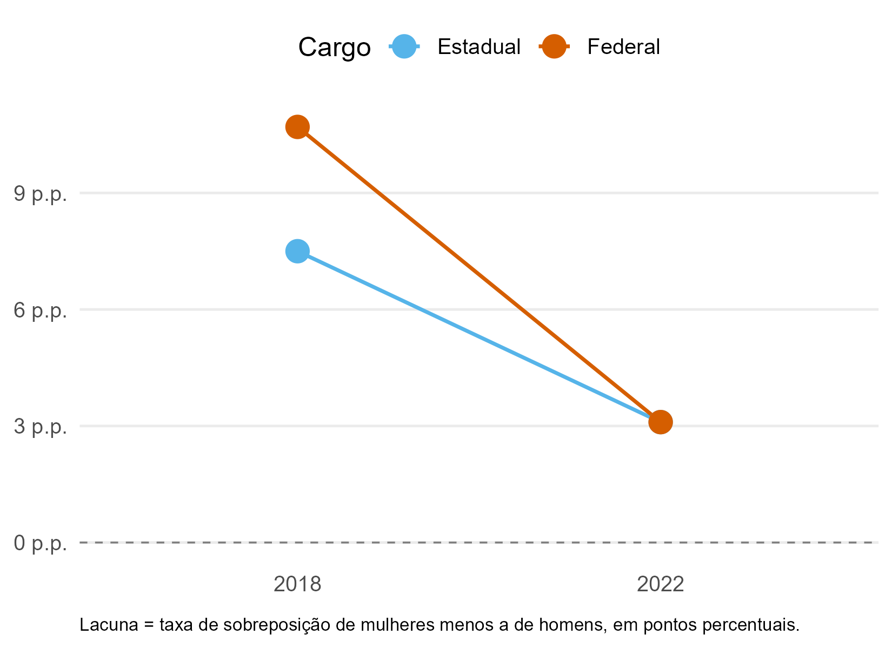
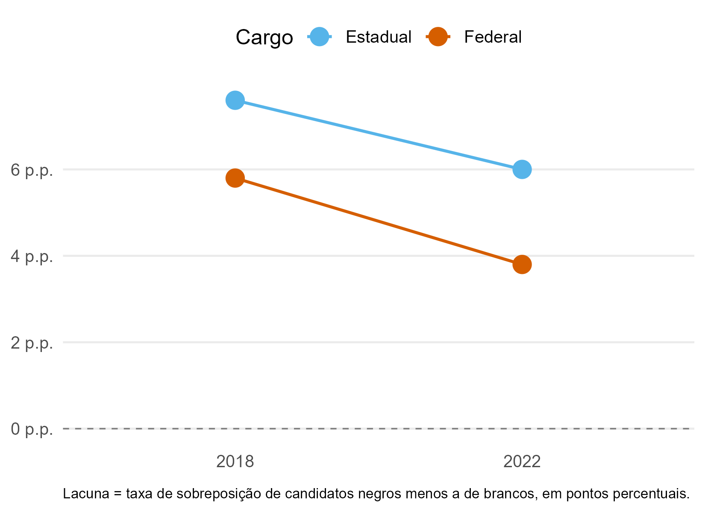
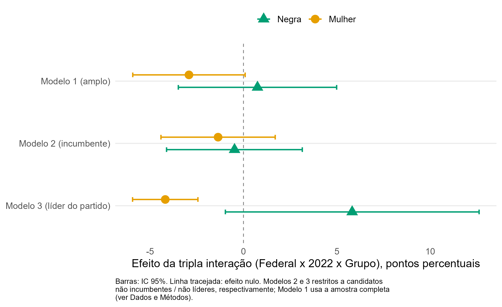

<!-- Este arquivo é derivado do capítulo do livro (Quarto/thesis/chapters/05-sobreposicao-territorial-partido.qmd). NÃO inclui a seção "Limitações" por design -- essa seção existe só nas versões dentro da tese. Ao propagar edições, o capítulo do livro é a fonte; este arquivo é atualizado a partir dele, exceto Limitações. -->

## Introdução

Esta tese investiga os limites das políticas de ação afirmativa para ampliar a representação de mulheres e negros na política brasileira. De forma específica, pretende-se contribuir para compreender melhor por que essas políticas aumentam a presença de candidaturas na disputa e até os recursos financeiros a que esses grupos têm acesso, mas não se traduzem, na mesma medida, em mais cadeiras conquistadas. Os capítulos anteriores abordam essa pergunta por um caminho específico, a geografia da campanha eleitoral. Isso inclui o quanto o gasto de um candidato se concentra territorialmente, o quanto esse gasto se alinha espacialmente com sua própria votação, e o quanto se sobrepõe à base histórica do partido construída na eleição anterior. Este capítulo desloca a unidade de análise mais uma vez, mantendo o mesmo objetivo de fundo. Em vez de perguntar como um candidato se relaciona com o território, o capítulo pergunta como candidatos do mesmo partido, cargo e ano se relacionam entre si dentro desse território, e o que essa relação revela sobre o papel da coordenação partidária na efetividade da ação afirmativa.

Partidos e lideranças partidárias têm poder efetivo de coordenar a distribuição territorial de suas próprias listas de candidatos. Com isso, podem proteger um grupo de candidatos. Por outro lado, sabe-se que esse mesmo tipo de poder já foi usado para cumprir a letra de políticas de ação afirmativa sem alterar, na mesma medida, a distribuição real de poder e de recursos dentro do partido. É a interseção dessas duas linhas, coordenação partidária seletiva e gatekeeping, que motiva a hipótese deste capítulo. Partidos coordenam suas candidaturas de forma estratégica para aproveitar os incentivos criados por ações afirmativas, conciliando dois interesses por vezes conflitantes. De um lado, aumentar o total de votos obtidos por mulheres e candidatos negros e, com isso, a fatia de recursos públicos de campanha a que o partido tem acesso. De outro, não afetar a posição de suas lideranças já estabelecidas. Mulheres e candidatos negros devem, nessa leitura, atrair votos novos para o partido, sem que essas candidaturas cheguem a ameaçar candidaturas já consolidadas.

Para mensurar a coordenação intrapartidária, analiso em que medida os partidos conseguem evitar que mais de um candidato da mesma legenda concentre esforço de campanha numa mesma localidade, disputando o mesmo eleitorado. A medida de esforço de campanha usada é a distribuição geográfica do gasto, não do voto. O gasto é decidido pelo candidato e pelo partido antes de o resultado da eleição ser conhecido. Por isso, capta diretamente a estratégia e a intenção de coordenar candidaturas. O voto, ao contrário, é um desfecho contaminado por fatores fora do controle da campanha. Havendo coordenação, espera-se que candidatos do mesmo partido não concentrem gasto no mesmo município. Havendo concentração territorial de gasto por mais de um correligionário na mesma localidade, entende-se essa sobreposição como reflexo da ausência de coordenação.

Essa modulação estratégica não é hipotética. A literatura sobre ação afirmativa na política brasileira documenta um padrão recorrente. Partidos e lideranças partidárias cumprem a letra dessas políticas sem alterar, na mesma medida, a distribuição real de poder e de recursos internos. Administram seus efeitos de modo a não ameaçar quadros já consolidados. Partidos recorrem a candidaturas femininas fictícias para cumprir cotas sem apoiar candidaturas competitivas [@GattoWylie2021_informal_institutions]. Doações entre candidatos favorecem sistematicamente o grupo já sobrerrepresentado, homens brancos [@Sacchet2025_nao_e_so_dinheiro]. A própria história legislativa da cota de recursos que antecede a EC 111 mostra lideranças partidárias negociando, em bastidores, para reduzir o alcance da política antes mesmo de sua aprovação [@Gatto2025_resistance_quotas]. Este capítulo testa se esse mesmo padrão de resistência modulada aparece também na distribuição territorial do gasto de campanha.

A Emenda Constitucional 111/2021, art. 2º, oferece uma oportunidade empírica para investigar essa coordenação estratégica. Entre 2022 e 2030, votos recebidos por mulheres ou candidatos afro-brasileiros à Câmara dos Deputados contam em dobro na distribuição do fundo partidário e do Fundo Especial de Financiamento de Campanha (FEFC) do ciclo seguinte [@FonsecaThomeGuedesNeto2026_money_talks]. É um incentivo financeiro direto para que os partidos ampliem o desempenho eleitoral desses grupos. Por valer apenas para as eleições federais, não para as estaduais, a regra cria um contrafactual válido. Candidatos a Deputado Estadual, sujeitos aos mesmos partidos e ao mesmo contexto político-eleitoral, mas não ao incentivo, servem de grupo de comparação para isolar o efeito específico da EC 111 sobre a coordenação partidária.

O capítulo testa essa hipótese em três camadas, cada uma mais precisa que a anterior sobre o que conta como um candidato protegido pelo partido da competição com os demais candidatos da própria legenda. A primeira, mais ampla, chamada de Modelo 1, mede a sobreposição territorial de um candidato com qualquer correligionário de mesmo cargo e ano. A segunda, chamada de Modelo 2, mede a sobreposição especificamente com correligionários incumbentes, candidatos eleitos no mesmo cargo na eleição anterior. A terceira, chamada de Modelo 3, mede a sobreposição especificamente com correligionários que ocupam cargo de liderança formal no partido: presidência, vice-presidência ou secretaria de finanças, no diretório nacional ou estadual. É uma medida direta de poder de decisão sobre a alocação de recursos do partido, construída a partir de dados de órgãos partidários do Tribunal Superior Eleitoral (TSE). As três exploram se a mudança de 2018 para 2022 é consistente com um efeito do incentivo financeiro da EC 111. A comparação é entre os resultados observados para mulheres e para candidatos negros no cargo de Deputado Federal, onde o incentivo vale, e no de Deputado Estadual, onde não vale.

Os achados deste capítulo confirmam que a sobreposição territorial é o padrão, não a exceção, entre correligionários, e que ela recai desproporcionalmente sobre mulheres e candidatos negros em todas as combinações de cargo e ano analisadas. Há, além disso, evidência causal de que o incentivo financeiro da EC 111 leva partidos a coordenar especificamente as candidaturas femininas a Deputado Federal, o cargo em que o incentivo vale: mulheres passam a explorar eleitorado novo, avançando a base territorial do partido, ao mesmo tempo em que evitam disputar o mesmo eleitorado de suas lideranças. Essa evidência sustenta a hipótese central deste capítulo de que partidos aproveitam incentivos de ação afirmativa de forma estratégica, sem ameaçar a posição de seus quadros já consolidados. O mesmo efeito não se observa para candidatos negros, em nenhuma das três especificações testadas. O capítulo sustenta, com isso, uma resposta parcial à hipótese central: partidos coordenam suas candidaturas de forma seletiva para proteger lideranças estabelecidas, mas esse mecanismo opera de forma desigual entre gênero e raça.

## Revisão de Literatura

### Geografia da coordenação intrapartidária

Em sistemas de representação proporcional (RP) de lista aberta, a expectativa padrão é de baixa coordenação partidária na alocação territorial dos candidatos, e de alta competição entre correligionários pelos mesmos eleitores. @Mainwaring1991_politicians_parties mostra que o desenho institucional brasileiro concede aos políticos uma autonomia excepcional em relação aos próprios partidos, o que reforça o comportamento individualista dos candidatos e mina esforços de construção de partidos mais coesos e disciplinados. Essa é também a leitura padrão da RP de lista aberta desde @Ames1995_electoral_rules — candidatos do mesmo partido concentrariam campanha em redutos eleitorais próprios e evitariam ativamente os redutos de correligionários, sem qualquer coordenação de cúpula. @NemotoShugart2013_localism e @Shugart2005_looking_locals explicam o mecanismo por trás dessa expectativa: como o total de votos de todos os candidatos da legenda soma para o mesmo resultado do partido, não importa, do ponto de vista do partido, qual candidato especificamente recebeu cada voto — de modo que, em tese, não haveria necessidade de conter a sobreposição territorial entre correligionários.

Essa leitura, porém, tem sido questionada por evidência mais recente sobre o caso brasileiro. @CheibubSin2020_preference_vote mostram que a competição intrapartidária nas eleições para a Câmara dos Deputados entre 1990 e 2014 é, na verdade, bem mais contida do que essa literatura supõe: partidos constroem suas listas deliberadamente para reduzir choques entre correligionários, e há uma descontinuidade abrupta na distribuição de votos pessoais exatamente entre o último candidato eleito e o primeiro não eleito da mesma legenda. Essa coordenação faz sentido do ponto de vista do próprio partido: se dois candidatos da mesma legenda concentram campanha exatamente no mesmo público, competem entre si pelos mesmos eleitores em vez de somar eleitores diferentes ao total da legenda; coordenar a distribuição territorial dos candidatos evita esse desperdício de esforço e amplia o alcance total do partido. A descontinuidade encontrada por Cheibub e Sin é o ponto de partida para o argumento deste capítulo — a coordenação partidária, quando existe, não é difusa, mas protege especificamente o limiar de eleição, isto é, os candidatos com maior chance real de se tornarem os quadros consolidados do partido. A coordenação também piora em distritos de magnitude grande: nos "mega-distritos", 40% das listas apresentam três ou mais candidatos fortes em excesso, contra apenas 7% nos distritos pequenos, um padrão que ecoa o que este capítulo encontra adiante ao comparar capitais e não capitais. Um resultado anterior, de @Ames2012_estrategia_eleitoral, já sugeria que a coordenação de cúpula não era totalmente ausente, ainda que restrita à disputa entre partidos aliados, não entre correligionários: líderes partidários desencorajavam a "caça furtiva" nos redutos de partidos da própria coligação, o que protegia a cota de cadeiras conquistada por ela. Cheibub e Sin estendem essa mesma lógica de proteção seletiva para dentro do próprio partido.

Essa coordenação seletiva tem, além disso, uma assinatura geográfica: se ela existe, precisa de algum mecanismo de alocação, e a evidência disponível aponta para um mecanismo territorial. Dois estudos sobre São Paulo, o distrito de maior magnitude do país, chegam a interpretações diferentes sobre a origem dessa alocação, mas concordam que ela não é aleatória. @Silotto2019_relevancia_regional argumenta que a regionalização é estratégia deliberada da cúpula partidária — candidaturas dificilmente se sobrepõem dentro de um partido ou região porque a alocação segue o potencial eleitoral de cada região do distrito —, a mesma leitura de coordenação deliberada de @CheibubSin2020_preference_vote, agora aplicada à dimensão territorial. @SilvaSilotto2018_preparing_terrain argumentam, em contraste, que a regionalização é consequência estrutural, não escolha estratégica, da magnitude do distrito combinada ao fluxo de informação entre cidades, medido pela hierarquia urbana do IBGE — uma leitura alternativa à ideia de @Ames1995_electoral_rules sobre redutos informais construídos intencionalmente. Este capítulo não precisa resolver essa disputa sobre se a alocação territorial é deliberada, como em Cheibub e Sin e em Silotto, ou estrutural, como em Silva e Silotto. As três leituras convergem no mesmo achado prático, que a sobreposição entre correligionários é sistematicamente menor do que a leitura padrão de lista aberta sugere, e que a alocação territorial não é aleatória — o pré-requisito lógico da hipótese central deste capítulo. Se a alocação territorial dentro do partido fosse aleatória, não haveria razão para esperar que ela protegesse especificamente os candidatos incumbentes.

### O papel dos partidos no efeito das ações afirmativas

A lógica coletiva de maximização de votos discutida acima explica por que partidos toleram sobreposição entre correligionários, já que qualquer voto soma ao total da legenda, mas não explica por si só por que continuariam protegendo especificamente os candidatos mais fortes. É aí que entra a literatura sobre ação afirmativa. @Gatto2025_resistance_quotas propõe uma teoria geral para esse padrão: políticos raramente bloqueiam abertamente uma cota de gênero ou raça, mas resistem durante o desenho e a implementação da política, de modo a preservar o espaço que já ocupam sem pagar o custo político de se opor publicamente à ampliação da representação. É esse padrão — consentimento formal à aprovação da política, resistência concentrada em sua aplicação prática — que a trajetória da legislação de cotas no Brasil ilustra de forma recorrente, em três momentos sucessivos: a cota de candidaturas na lista, sua efetiva exigência de preenchimento, e a cota de recursos financeiros de campanha.

O primeiro momento é o da própria cota de candidaturas. A Lei 9.100/1995 já previa, para as eleições municipais de 1996, uma reserva mínima de 20% das vagas de candidatura para mulheres; a Lei 9.504/1997 estendeu a regra às eleições estaduais e federais, elevando o mínimo para 30%. Mas a lei falava em "reservar" as vagas, não em "preenchê-las": partidos podiam simplesmente deixá-las vazias, sem qualquer sanção, e foi exatamente o que aconteceu por mais de uma década [@Sacchet2018_why_quotas_dont_work]. A exigência de preenchimento efetivo, e não apenas reserva nominal, só veio com uma reforma legal de 2009, com cumprimento generalizado apenas a partir das eleições municipais de 2012 e federais de 2014. @WylieSantos2016_law_paper_only mostram, porém, que nem a lei original de 1995 nem essa reforma de 2009 foram suficientes para mudar as estratégias reais dos partidos na nomeação e no apoio a candidaturas femininas: o poder explicativo maior está na estrutura descentralizada dos partidos brasileiros e na ausência de mulheres nas próprias lideranças partidárias estaduais e municipais — o mesmo nível de decisão que este capítulo testa diretamente pelo proxy de liderança formal.

Mesmo depois de cumprida a exigência de preenchimento, a cota de candidaturas continuou a ser esvaziada por dentro. @GattoWylie2021_informal_institutions mostram que partidos usam instituições informais, como a nomeação intencional de candidatas "laranja", para cumprir a letra da cota sem apoiar de fato candidaturas femininas competitivas — o preenchimento numérico da lista não equivale a candidatura real. No caso do financiamento, há um motivo adicional para os partidos reagirem estrategicamente a um incentivo como o de 2022: @SpeckMancuso2014_campaign_finance mostram que o retorno marginal do financiamento sobre o desempenho eleitoral é maior para candidatas desafiantes do que para candidatos homens desafiantes, de modo que investir nelas tem, em tese, mais a ganhar em votos por real gasto — o que torna plausível que um incentivo como a EC 111 mude o comportamento observável dos partidos, não apenas o cumprimento formal da regra. @Piscopo2022_follow_money, no caso comparado do Chile, mostram que mesmo um mecanismo de financiamento desenhado com viés de gênero pode ser insuficiente para equalizar recursos entre homens e mulheres. @Sacchet2025_nao_e_so_dinheiro, com dados brasileiros do mesmo ciclo eleitoral analisado neste capítulo, mostram que doações entre candidatos favorecem sistematicamente o grupo já sobrerrepresentado, homens brancos, tanto por gênero quanto por raça.

O terceiro momento é o da cota de recursos financeiros propriamente dita, e sua história legislativa, reconstruída em detalhe por @Gatto2025_resistance_quotas, repete o mesmo padrão de consentimento formal e resistência prática que marcou a cota de candidaturas. Em 2015, depois de o Congresso rejeitar uma proposta de cadeiras reservadas para mulheres, a bancada feminina negociou a reserva de parte dos recursos do fundo partidário para candidaturas femininas, mas líderes partidários enfraqueceram a proposta em negociações de bastidor até que a lei aprovada (Lei 13.165/2015) estabelecesse apenas um mínimo de 5% e um máximo de 15% dos recursos, com o Senado retirando ainda a exigência de que esses recursos fossem usados exclusivamente em eleições proporcionais — mudança que, segundo a autora, preservava a possibilidade de usar o mesmo dinheiro em campanhas majoritárias, nas quais os titulares, majoritariamente homens, já eram competitivos. A reserva só foi elevada a um mínimo de 30% em 2018, e por via judicial, não legislativa. O Procurador-Geral da República ajuizou a ADI 5.617 contra o teto de 15%, o STF acatou o pedido em março de 2018, e o TSE, em maio do mesmo ano, estendeu o piso de 30% ao Fundo Especial de Financiamento de Campanha e ao tempo de rádio e televisão.

A própria EC 111 nasceu dentro dessa dinâmica de proteção seletiva. @Gatto2025_resistance_quotas mostra que a dobra de votos de mulheres e negros na distribuição do fundo eleitoral foi negociada pela então relatora da reforma eleitoral de 2021, deputada Renata Abreu, do PODE, a mesma líder partidária que dois anos antes havia proposto suprimir a obrigatoriedade da cota de candidaturas, argumentando publicamente que cumprir o percentual mínimo "não é fácil" e prejudica os coeficientes eleitorais dos partidos (Zaremba 2019, apud @Gatto2025_resistance_quotas). Segundo a autora, especialistas consultados pela imprensa à época já previam que a medida beneficiaria sobretudo mulheres incumbentes e seus partidos, sem necessariamente ampliar a representação feminina de forma mais geral (Zaremba 2019, apud @Gatto2025_resistance_quotas).

O precedente mais direto para a hipótese deste capítulo é @FonsecaThomeGuedesNeto2026_money_talks, o único estudo, até onde alcança esta revisão, que analisa os efeitos da própria Emenda Constitucional 111/2021, art. 2º, com o mesmo desenho de identificação adotado aqui. Os autores mostram que o incentivo aumentou votos e recursos de campanha para candidatas mulheres e a proporção de candidaturas de candidatos negros lançadas pelos partidos. Esse efeito, contudo, é observado em candidaturas pouco competitivas, definidas pelos autores como aquelas menos votadas dentro de cada lista.

## Hipóteses

Da conciliação entre essas duas literaturas, é formulada a hipótese a ser investigada neste capítulo a respeito de como incentivos financeiros criados como ação afirmativa para representação de mulheres e negros afetaram a estratégia de lideranças partidárias na coordenação de candidaturas. Por um lado, há evidências de que partidos coordenam a competição intrapartidária mesmo em sistemas proporcionais de lista aberta — e como a geografia se relaciona a este mecanismo. Por outro, já foi identificado como líderes partidários conseguem limitar a efetividade de ações afirmativas de combate à sub-representação, modulando sua implementação. Especificamente sobre a EC 111/21, já há indícios de como seus resultados foram limitados em promover mudanças na representação descritiva. Dessa forma, espera-se que partidos atuem de forma estratégica para aproveitar os incentivos financeiros criados por novas ações afirmativas, desde que, simultaneamente, protejam suas lideranças.

Esse mecanismo, se confirmado, contribui para um entendimento mais amplo de como lideranças partidárias modulam os efeitos de ações afirmativas a seu próprio favor. A literatura revisada acima documenta, sobretudo, uma modulação por omissão: cotas de candidatura cumpridas só nominalmente, candidaturas femininas sem apoio real de campanha, cotas de recursos esvaziadas em negociação legislativa. O mecanismo testado aqui é distinto, e mais ativo: a liderança não nega o incentivo às candidaturas de mulheres e de candidatos negros, mas o aproveita seletivamente, deixando que essas candidaturas cresçam em território novo — somando votos e recursos ao total do partido sob a regra de dobra da EC 111 — desde que esse crescimento não avance sobre o próprio território eleitoral da liderança.

Essa proteção só faz sentido, porém, se a sobreposição de fato ameaça o candidato protegido. Como visto na seção anterior, o total de votos de todos os candidatos da legenda soma para o mesmo resultado do partido, o que torna a sobreposição indiferente para o total de cadeiras conquistadas. A ameaça não opera nesse nível agregado, mas no ranking individual de votos que decide, sob lista aberta, a posição de cada candidato dentro da própria legenda. É esse risco individual, não o risco ao desempenho agregado do partido, que dá à liderança partidária um motivo concreto para proteger especificamente seus quadros consolidados do avanço territorial de correligionários incentivados.

O capítulo testa essa hipótese geral em quatro proposições, da mais descritiva à mais diretamente causal:

1. H1. Candidatas mulheres apresentam taxa de sobreposição territorial maior do que candidatos homens — o padrão descritivo de base que os testes causais adiante (H3–H4) investigam.
2. H2. Pelo mesmo padrão, candidatos negros apresentam taxa de sobreposição territorial maior do que candidatos brancos.

Como primeira aproximação do mecanismo a ser estudado, há uma hipótese ampla de que o incentivo criado vai afetar a coordenação estratégica de distribuição geográfica das campanhas de forma distinta para os cargos de deputado federal, sobre a qual se aplica o incentivo, e deputado estadual.

3. H3. A queda na taxa de sobreposição territorial com qualquer correligionário de mulheres e de candidatos negros entre 2018 e 2022 é maior no cargo de Deputado Federal — onde vale o incentivo da EC 111 — do que no de Deputado Estadual, onde ele não se aplica.

Para testar o quanto a coordenação é feita para favorecer grupos específicos de candidatos, o mesmo movimento é testado comparando como a sobreposição territorial de campanhas foi afetada pelo incentivo com relação a estes grupos a serem protegidos.

4. H4. O quanto a queda de sobreposição territorial entre 2018 e 2022 se concentra no cargo em que vale o incentivo da EC 111 é maior — isto é, mais negativa — quando a sobreposição é medida especificamente com correligionários protegidos (incumbentes ou líderes formais do partido) do que quando é medida com qualquer correligionário.

## Dados e Métodos

### Variáveis e fontes

O objetivo desta seção é mensurar a coordenação partidária, verificando se mais de um candidato do mesmo partido concentra seus esforços de campanha no mesmo território. Há coordenação quando existe ausência de sobreposição geográfica de campanhas, já que isso refletiria o partido assegurando que seus candidatos não concorram pelo mesmo eleitorado.

Para identificar como se distribuem os esforços de campanha de cada candidatura, será analisada a concentração territorial do gasto realizado por cada candidato, seguindo @GuarnieriSilva2025_geodesp. A escolha de medir concentração via gasto de campanha, e não via votação obtida, é deliberada. O gasto é decidido pelo candidato e pelo partido antes de o resultado da eleição ser conhecido, e por isso reflete diretamente a estratégia e a intenção de onde investir esforço de campanha; a votação, por outro lado, é o resultado de fatores fora do controle direto da campanha, como o comportamento do eleitor, o desempenho de adversários e a conjuntura. Sobreposição territorial medida via gasto é, portanto, evidência mais direta da decisão de alocação que este capítulo quer explicar do que sobreposição medida via votos, que mistura essa decisão com seu resultado.

A concentração desse esforço é medida pelo Quociente Locacional (QL), uma adaptação, à geografia eleitoral, de uma ferramenta clássica de economia regional para medir concentração espacial de uma atividade em relação a uma base de referência. O índice já havia sido adaptado à ciência política antes deste capítulo, para medir a concentração territorial do voto recebido por um candidato [@AvelinoBidermanSilva2011_concentracao_eleitoral; @AvelinoBidermanSilva2016_concentracao_brasil]; a aplicação ao gasto de campanha, em vez do voto, é adaptação original deste capítulo.

Para um candidato $i$ e um município $m$, o QL do gasto é calculado como:

$$\text{QL}_{im} = \frac{\text{gasto}_{im} \,/\, \text{gasto}_{i}}{\text{eleitorado}_{m} \,/\, \text{eleitorado}_{\text{estado}}}$$

em que $\text{gasto}_{im}$ é o gasto do candidato $i$ no município $m$, $\text{gasto}_i$ é seu gasto total, e $\text{eleitorado}_m$ e $\text{eleitorado}_{\text{estado}}$ são, respectivamente, o eleitorado do município e do estado. O QL do gasto compara, assim, a participação de $m$ no gasto total de $i$ com a participação de $m$ no eleitorado do estado. Um candidato com QL > 1 em $m$ concentrou ali uma proporção do próprio gasto maior do que a proporção do eleitorado do estado que $m$ representa, ou seja, investiu ali desproporcionalmente.

O limiar QL > 1, e não um valor mais alto, segue a convenção do próprio índice na economia regional. QL = 1 é o ponto em que a participação do município no gasto do candidato iguala sua participação no eleitorado de referência, o corte mínimo e não arbitrário acima do qual já se pode falar de concentração territorial, e não apenas presença.

A sobreposição territorial é operacionalizada em dois níveis complementares — o do município, onde se conta quantos correligionários concentram gasto ali, e o do candidato, onde se mede a proporção do próprio território que é compartilhada.

No nível do município, para cada combinação de partido, cargo, ano, estado e município, é contado o número de candidatos distintos do partido com QL do gasto acima de 1 naquele município. Um município é classificado como sobreposto quando esse número é igual ou maior que 2.

No nível do candidato, para cada um, entre os municípios em que ele tem QL do gasto acima de 1, é calculada a proporção que é sobreposta, isto é, compartilhada com pelo menos um correligionário do mesmo partido, cargo e ano:

$$\text{taxa\_sobreposicao}_i = \frac{\#\{\text{municípios de } i \text{ com QL}>1 \text{ que são sobrepostos}\}}{\#\{\text{municípios de } i \text{ com QL}>1\}}$$

Essa é a métrica individual comparada entre grupos ao longo do capítulo. Ela só é definida para candidatos com pelo menos um município de concentração de gasto; dos 37.158 candidatos da amostra, todos têm ao menos um.

Essa sobreposição importa porque, em lista aberta, as cadeiras do partido são distribuídas aos candidatos pela ordem de votos pessoais dentro da própria legenda, uma vez atingido o quociente partidário. Dois correligionários que concentram gasto no mesmo município disputam, na prática, o mesmo eleitorado e, portanto, a mesma faixa de votos pessoais que determina essa posição relativa dentro da lista. Assim, a sobreposição territorial é uma ameaça ao lugar de um candidato específico na fila da própria legenda, não ao total de cadeiras conquistadas pelo partido, que continua sendo alimentado por qualquer voto recebido por qualquer correligionário.

Além do gasto e da sobreposição, o capítulo usa quatro variáveis de classificação do candidato. Gênero e raça são autodeclarados pelo candidato no registro de candidatura; a variável de raça está disponível desde o pleito de 2014, cobrindo os pleitos de 2018 e 2022 usados aqui. Candidatos negros são definidos, seguindo a convenção usual da literatura brasileira, como a soma das categorias "preta" e "parda" da autodeclaração; candidatos brancos são o grupo de referência.

Incumbente é o candidato eleito no mesmo cargo na eleição anterior — 2014 para candidatos de 2018, 2018 para candidatos de 2022 —, identificado por correspondência de CPF ao vencedor do pleito anterior, independentemente do partido atual do candidato. Líder partidário, usado apenas no Modelo 3, é o candidato que ocupa cargo de presidência, vice-presidência ou secretaria de finanças no diretório nacional ou estadual/distrital do partido no momento da eleição, vinculado ao registro de liderança pelo título eleitoral.

Todos os dados vêm de fontes públicas do TSE, coletadas diretamente no site de dados abertos (`dadosabertos.tse.jus.br`) ou pelo pacote `electionsBR`, a partir de quatro conjuntos. O conjunto de candidaturas fornece gênero, raça, cargo, partido e estado de cada candidato. O conjunto de resultados eleitorais fornece quem foi eleito em cada pleito, usado para construir a variável de incumbência — o pleito de 2014, Federal e Estadual, entra apenas para determinar a incumbência dos candidatos de 2018, sem entrar na análise de sobreposição em si. O conjunto de órgãos partidários fornece o histórico de quem ocupou cada cargo de liderança em cada partido, usado no Modelo 3: um registro completo, com datas de início e fim de mandato, que permite reconstruir a composição da liderança de qualquer partido em qualquer momento passado, não apenas a atual. O quarto conjunto, de prestação de contas eleitorais, fornece o gasto de campanha no nível candidato-município usado para calcular o QL. As bases usadas na análise foram construídas por mim a partir dessas quatro fontes originais.

### Amostra

A amostra selecionada para este estudo é composta pelas candidaturas para deputado federal e deputado estadual nos anos de 2018 e 2022 no Brasil, incluindo todos os partidos e unidades da federação. Ao todo, são 37.158 candidatos distintos, com pelo menos um registro de gasto, distribuídos por 34 legendas.

| Cargo | Ano | Candidaturas | Mulheres | Candidatos negros |
|---|---|---:|---:|---:|
| Deputado Estadual | 2018 | 10.794 | 3.276 (30,4%) | 4.708 (43,6%) |
| Deputado Estadual | 2022 | 12.689 | 4.410 (34,8%) | 6.350 (50,0%) |
| Deputado Federal | 2018 | 5.433 | 1.650 (30,4%) | 1.996 (36,7%) |
| Deputado Federal | 2022 | 8.242 | 2.989 (36,3%) | 3.848 (46,7%) |

: Candidaturas na amostra, por ano, cargo, gênero e raça {#tbl-amostra-descritiva}

Mulheres e candidatos negros são minoria nas quatro combinações de cargo e ano, mas a diferença se estreita de 2018 para 2022 nos dois cargos.

Os dados de gasto e de Quociente Locacional (QL), a base sobre a qual a sobreposição territorial é calculada, não aparecem diretamente na @tbl-amostra-descritiva porque estão num nível de observação diferente, de candidato-município. Cobrem, porém, os mesmos 37.158 candidatos, já que todos os candidatos da amostra têm pelo menos um registro de gasto de campanha e pelo menos um município com QL do gasto acima de 1, condição necessária para entrar na métrica de sobreposição usada ao longo do capítulo.

A amostra efetivamente usada em cada especificação da tripla diferença (@sec-estrategia-inferencia) varia — Modelo 2 e Modelo 3 restringem a amostra principal a não incumbentes e a não líderes, respectivamente — e é sempre menor que os 37.158 candidatos, porque os modelos de gênero e de raça são restritos às categorias válidas de cada variável (feminino/masculino; branca/negra), excluindo candidatos com outra categoria ou sem essa informação.

| Especificação | Amostra | N (gênero) | N (raça) |
|---|---|---:|---:|
| Modelo 1 (H3) | Completa | 36.610 | 36.182 |
| Modelo 2 (H4, incumbência) | Não incumbentes | 34.347 | 33.929 |
| Modelo 3 (H4, liderança) | Não líderes | 33.707 | 33.300 |

: N de candidatos por especificação e amostra {#tbl-amostra-especificacoes}

Dois partidos da amostra, porém — PMB e PMN —, não têm nenhum registro de órgão partidário no sistema do TSE sob nenhum nome, histórico ou atual; seus candidatos (3,3% da amostra) são tratados como dado ausente na variável de liderança formal, não como não-líderes, e excluídos do Modelo 3.

### Estratégia de inferência {#sec-estrategia-inferencia}

Para estimar o efeito da criação do incentivo financeiro ao voto em candidaturas de mulheres e pessoas negras sobre a estratégia adotada pelos partidos, é usado o método de diferenças em diferenças (DiD), seguindo a mesma lógica de identificação usada por @FonsecaThomeGuedesNeto2026_money_talks. A lógica de uma diferença em diferenças é comparar a mudança de um resultado ao longo do tempo, antes e depois de uma intervenção, entre um grupo afetado por ela e um grupo de comparação não afetado. A diferença entre essas duas mudanças isola o efeito da intervenção, sob o pressuposto de que, na ausência dela, os dois grupos teriam evoluído de forma parecida. Essa é a hipótese de tendências paralelas [@AngristPischke2009_mostly_harmless]. Aqui, a intervenção é o incentivo financeiro de 2022 criado pela EC 111/2021, art. 2º, que vale apenas para Deputado Federal. Deputado Estadual, sujeito aos mesmos partidos e ao mesmo contexto político-eleitoral, mas não ao incentivo, funciona como grupo de comparação e os anos de 2018 e 2022 servem como os períodos observados antes e o depois da intervenção.

Este capítulo estende essa lógica para uma terceira dimensão de comparação, entre grupos de candidatos (mulher e homem, negra e branca), testando se o efeito é específico ao grupo que o incentivo beneficia. Por isso, é chamado de tripla diferença (ou *difference-in-differences-in-differences*, DDD). O coeficiente de interesse é a interação tripla entre o cargo em disputa (Federal x Estadual), o ano do pleito eleitoral (2022 x 2018) e o grupo do candidato (de acordo com gênero ou raça autodeclarados). Esse coeficiente mede o quanto a variação de sobreposição territorial entre 2018 e 2022 é maior ou menor para o grupo incentivado especificamente na disputa para deputado federal, além do que cargo, ano e grupo explicam isoladamente ou em pares sobre esta variação. Formalmente, o modelo estimado é:

$$
\begin{aligned}
Y_i = \ & \beta_0 + \beta_1 \text{Federal}_i + \beta_2 \text{Ano2022}_i + \beta_3 G_i \\
& + \beta_4(\text{Federal}{\times}\text{Ano2022}) + \beta_5(\text{Federal}{\times}G_i) + \beta_6(\text{Ano2022}{\times}G_i) \\
& + \beta_7(\text{Federal}{\times}\text{Ano2022}{\times}G_i) + \varepsilon_i
\end{aligned}
$$

em que $G_i$ é Mulher ou Negra, em dois modelos separados. $Y_i$ é a variável de sobreposição relevante para cada especificação, apresentada a seguir, e $\beta_7$ é o coeficiente de interesse. A unidade é o candidato, não o par candidato-município. A especificação inclui efeitos fixos de partido e de estado, com erros-padrão clusterizados nas mesmas duas dimensões. Ambos são pré-determinados, escolhidos antes da campanha, e não consequência da estratégia de gasto. Essa mesma estrutura de efeitos fixos, clusterização e forma de regressão vale para as três especificações a seguir. O que muda entre elas é a variável dependente $Y_i$ e, em dois casos, a amostra.

Em cada especificação, $Y_i$ é a proporção dos municípios de $i$ com QL do gasto acima de 1 que são compartilhados com um correligionário de um tipo específico:

$$
\text{taxa\_sobreposicao\_X}_i = \frac{\#\{\text{municípios de } i \text{ com QL}>1 \text{ compartilhados com correligionário do tipo X}\}}{\#\{\text{municípios de } i \text{ com QL}>1\}}
$$

A primeira especificação (Modelo 1, H3) mede a sobreposição de forma geral, com qualquer correligionário do mesmo partido, cargo e ano (X = qualquer correligionário). É uma medida ampla que não distingue se o correligionário sobreposto é um candidato protegido pelo partido ou outro candidato também marginal. A segunda (Modelo 2, H4) restringe X a correligionários incumbentes, isto é, eleitos no mesmo cargo na eleição anterior (2014 para candidatos de 2018, 2018 para candidatos de 2022). É a mesma variável já usada como decomposição na análise de incumbência apresentada mais adiante, testando o mecanismo de proteção de lideranças com mais precisão. A terceira (Modelo 3, também H4), mais robusta e mais alinhada à hipótese de coordenação partidária deste capítulo, restringe X a correligionários que ocupam cargo de liderança formal do partido (presidência, vice-presidência ou secretaria de finanças, no diretório nacional ou estadual/distrital). É uma medida direta de poder de decisão sobre a alocação de recursos do partido que, ao contrário da incumbência, não depende de o candidato ter permanecido no mesmo partido entre uma eleição e outra.

## Resultados

A Análise Descritiva a seguir usa o Modelo 1, mais amplo, de sobreposição com qualquer correligionário. A seção seguinte, sobre os efeitos do incentivo da EC 111, também usa o Modelo 2 e o Modelo 3, referentes a H4, de sobreposição especificamente com incumbentes e com líderes formais do partido.

### Análise Descritiva

Entre 26% e 36% dos municípios em que ao menos um candidato de um partido concentrou gasto (QL > 1) têm dois ou mais candidatos do mesmo partido acima do QL simultaneamente. A coordenação territorial da lista partidária aparenta ser fraca de forma consistente nas quatro combinações de cargo e ano consideradas neste estudo.

O baixo nível de coordenação intrapartidário é explicado, em certa medida, pelo papel das capitais, municípios que concentram, por vezes, a maior parte do eleitorado do estado e que têm maior capacidade de influência sobre as demais localidades. Seria razoável supor que haveria nelas uma alocação de recursos desproporcional, concentrada. Capitais de fato têm taxa de sobreposição muito mais alta, de 71,3% a 95,3% dos municípios-capital com pelo menos um candidato acima do QL têm dois ou mais, contra 23,4% a 33,7% fora delas. Esse efeito, porém, é praticamente universal e não discrimina por grupo.

A respeito das Hipóteses 1 e 2, que previam uma taxa de sobreposição maior para candidaturas de mulheres e pessoas negras, @fig-lacuna-genero e @fig-lacuna-raca confirmam a relação esperada. A distância entre estes grupos diminui entre 2018 e 2022 nos dois cargos, mas em ritmos diferentes. A de gênero cai mais acentuadamente, de 7,5 para 3,1 pontos percentuais nas eleições estaduais e de 10,7 para 3,1 nas eleições para deputado federal. A de raça cai de forma mais moderada, de 7,6 para 6,0 nas estaduais e de 5,8 para 3,8 nas federais, permanecendo maior em magnitude ao final do período nos dois cargos. Um teste t de Welch, calculado separadamente para cada combinação de cargo, ano e grupo mas não representado nas figuras, confirma que essa diferença de médias é estatisticamente significativa em todas as oito combinações, com p < 0,001, e que nenhuma das duas lacunas desaparece em nenhuma delas.

{#fig-lacuna-genero width="70%"}

{#fig-lacuna-raca width="70%"}

Dentro das capitais, nem a lacuna de gênero (0,1 p.p., p = 0,262) nem a de raça (−0,1 p.p., p = 0,663) são estatisticamente significativas. As lacunas documentadas acima são, portanto, um fenômeno de município não-capital. Recalculando a taxa pessoal de sobreposição restrita aos municípios não-capital de cada candidato, tanto a lacuna de gênero (61,8% contra 56,8%, ou 5,0 p.p., p < 0,001) quanto a de raça (59,3% contra 57,7%, ou 1,6 p.p., p = 0,002) permanecem robustas. Os dois grupos enfrentam mais sobreposição fora das capitais, ainda que a lacuna de gênero seja consideravelmente maior em magnitude.

### Efeitos do incentivo da EC 111

As @tbl-modelo1, @tbl-modelo2 e @tbl-modelo3 apresentam os coeficientes completos da análise de diferenças em diferenças, com foco na tripla interação entre cargo, ano e grupo, cada uma delas referente a um dos modelos descritos na seção anterior. Cada tabela reporta as duas variáveis dependentes de interesse, candidaturas femininas e candidaturas negras, lado a lado. A @fig-modelo1-modelo2-modelo3, por sua vez, apresenta uma visualização única com as estimativas do coeficiente de interesse em cada modelo, com intervalo de confiança de 95%.

| | Mulher | Negra |
|---|---:|---:|
| Deputado Federal | −9,1\*\*\* (2,0) | −7,0\*\*\* (1,8) |
| Ano 2022 | 6,3\*\*\* (1,3) | 5,4\*\*\* (1,3) |
| Mulher/Negra | 7,5\*\*\* (1,0) | 7,4\*\*\* (0,8) |
| Deputado Federal × Ano 2022 | 4,1\*\* (1,8) | 2,8\* (1,6) |
| Deputado Federal × Mulher/Negra | 3,1\*\*\* (0,9) | −2,0 (1,4) |
| Ano 2022 × Mulher/Negra | −4,5\*\*\* (1,1) | −1,7\* (0,9) |
| Deputado Federal × Ano 2022 × Mulher/Negra | −2,9\* (1,5) | 0,7 (2,1) |
| N | 36.610 | 36.182 |

: Modelo 1 — sobreposição com qualquer correligionário, amostra completa. Coeficientes em pontos percentuais; erro-padrão clusterizado (partido, estado) entre parênteses. \* p < 0,1; \*\* p < 0,05; \*\*\* p < 0,01. {#tbl-modelo1}

Para raça, H3 não se sustenta. O sinal do Modelo 1 é positivo, o oposto do que a hipótese previa, e não é estatisticamente distinguível de zero (p = 0,719). Não há evidência de que o incentivo financeiro de 2022 tenha reduzido a sobreposição territorial de candidatos negros especificamente nas eleições para deputado federal, além do que cargo, ano e raça isoladamente já explicam.

Para gênero, H3 encontra apenas um sinal marginal no Modelo 1: negativo, como esperado, mas próximo, sem ficar abaixo, do limiar de significância convencional (p = 0,057) — um resultado sugestivo, mas não conclusivo, de queda na sobreposição de mulheres restrita às eleições para deputado federal.

O teste seguinte verifica se esse sinal marginal, presente para gênero e ausente para raça, é especificamente uma queda de sobreposição com candidatos protegidos pelo partido, ou se é difuso. O Modelo 1 mostrou um sinal marginal, restrito às eleições para deputado federal, para mulheres, e nenhum sinal para candidatos negros. O Modelo 2 pergunta se o sinal de gênero é, especificamente, uma queda na sobreposição com correligionários incumbentes, o teste direto do mecanismo de proteção de lideranças, H4.

Descritivamente, candidatos incumbentes, isto é, eleitos no mesmo cargo na eleição anterior, têm território sistematicamente mais exclusivo nas quatro combinações de cargo e ano: nas eleições estaduais de 2018, a taxa de sobreposição é de 46,3% contra 65,1%; nas estaduais de 2022, de 55,8% contra 72,4%; nas eleições para deputado federal de 2018, de 43,0% contra 56,1%; nas federais de 2022, de 51,9% contra 67,1%. É esse padrão que o Modelo 2 testa causalmente, perguntando se a queda de sobreposição especificamente com incumbentes se concentra nas eleições para deputado federal.

| | Mulher | Negra |
|---|---:|---:|
| Deputado Federal | −7,3\*\*\* (1,9) | −6,7\*\*\* (1,7) |
| Ano 2022 | 1,0 (2,2) | 1,2 (2,7) |
| Mulher/Negra | 4,6\*\*\* (1,1) | 3,8\*\* (1,5) |
| Deputado Federal × Ano 2022 | 2,4 (1,4) | 2,1 (2,1) |
| Deputado Federal × Mulher/Negra | −0,1 (1,6) | −1,0 (1,9) |
| Ano 2022 × Mulher/Negra | −2,8\*\* (1,3) | −2,4 (1,9) |
| Deputado Federal × Ano 2022 × Mulher/Negra | −1,4 (1,5) | −0,5 (1,8) |
| N | 34.347 | 33.929 |

: Modelo 2 — sobreposição com correligionário incumbente, amostra restrita a não incumbentes. Coeficientes em pontos percentuais; erro-padrão clusterizado (partido, estado) entre parênteses. \* p < 0,1; \*\* p < 0,05; \*\*\* p < 0,01. {#tbl-modelo2}

Para mulheres, o Modelo 2 dá um resultado menor em magnitude do que o Modelo 1 (−1,4 contra −2,9 p.p.) e mais distante da significância convencional (p = 0,368 contra 0,057). O sinal marginal do Modelo 1 se dilui, em vez de se concentrar, quando a atenção se volta especificamente para incumbentes: o oposto do que o mecanismo de proteção previa. Para candidatos negros, o resultado permanece nulo (p = 0,788, contra p = 0,719 no Modelo 1), sem mudança de padrão relevante.

O Modelo 2 diluiu o sinal em vez de concentrá-lo. Isso é compatível com dois cenários opostos. O mecanismo de proteção de lideranças simplesmente não existe, ou existe mas a incumbência é uma medida ruidosa demais de "candidato protegido" para captá-lo. O Modelo 3, que usa liderança formal do partido em vez de incumbência, ajuda a distinguir entre essas duas leituras.

Descritivamente, candidatos que ocupam cargo de liderança formal do partido também têm território mais exclusivo: nas eleições estaduais de 2018, a taxa de sobreposição é de 62,6% contra 76,5%; nas estaduais de 2022, de 69,2% contra 80,4%; nas eleições para deputado federal de 2018, de 39,2% contra 70,7%; nas federais de 2022, de 61,3% contra 75,6%. É esse padrão que o Modelo 3 testa causalmente, perguntando se a queda de sobreposição especificamente com líderes formais se concentra nas eleições para deputado federal.

| | Mulher | Negra |
|---|---:|---:|
| Deputado Federal | 4,4\*\* (2,1) | 7,4\*\*\* (1,9) |
| Ano 2022 | −1,7 (1,4) | −0,6 (1,5) |
| Mulher/Negra | 3,7\*\*\* (0,8) | 5,8\*\* (2,1) |
| Deputado Federal × Ano 2022 | 4,3 (2,7) | 0,5 (2,9) |
| Deputado Federal × Mulher/Negra | 2,7\*\* (1,2) | −5,1 (3,6) |
| Ano 2022 × Mulher/Negra | −0,9 (1,0) | −3,2 (2,3) |
| Deputado Federal × Ano 2022 × Mulher/Negra | −4,2\*\*\* (0,9) | 5,8\* (3,3) |
| N | 33.707 | 33.300 |

: Modelo 3 — sobreposição com correligionário líder do partido, amostra restrita a não líderes. Coeficientes em pontos percentuais; erro-padrão clusterizado (partido, estado) entre parênteses. \* p < 0,1; \*\* p < 0,05; \*\*\* p < 0,01. {#tbl-modelo3}

Para candidatos negros, o Modelo 3 confirma o padrão dos dois anteriores. Não há evidência do mecanismo, e aqui o coeficiente é ainda o de sinal oposto ao previsto, embora não estatisticamente distinguível de zero a 5% (p = 0,089). Três especificações diferentes de "candidato protegido" convergem em não encontrar o mecanismo para raça.

Para mulheres, o resultado é qualitativamente diferente dos dois anteriores. O Modelo 3 não dilui o sinal do Modelo 1, ele o fortalece de forma substancial, com a estimativa passando de marginal (p = 0,057) para muito além do limiar convencional (p < 0,001), e robusto à amostra completa, líderes mais não líderes (−4,25 p.p., p < 0,001). Decompor a tripla diferença em suas partes explica por que os Modelos 2 e 3 divergem tanto. No Modelo 2, a queda na taxa de sobreposição com incumbente para mulheres, entre 2018 e 2022, é parecida nos dois cargos: cai 5,6 pontos percentuais em relação a homens nas eleições para deputado federal e 4,0 nas estaduais. É exatamente por essa queda não ser restrita ao nível federal que a tripla diferença se anula, já que uma mudança que acontece onde o incentivo financeiro não vale não pode ser atribuída a ele. No Modelo 3, o padrão é o oposto. Nas eleições estaduais, a diferença de gênero na taxa de sobreposição com líder do partido muda muito pouco entre 2018 e 2022 (0,7 p.p.); nas federais, ela se abre 5,9 pontos percentuais, com mulheres se afastando de líderes do partido (31,5% para 28,9% de seus municípios QL>1) enquanto homens se aproximam (24,6% para 27,9%). É essa queda restrita ao nível federal, presente no Modelo 3 e ausente no Modelo 2, que torna o coeficiente da tripla interação grande e preciso.

{#fig-modelo1-modelo2-modelo3 width="90%"}

A leitura mais direta é que a incumbência, no Modelo 2, estava misturando um efeito real, específico do mecanismo de proteção de lideranças, com uma tendência geral e alheia à EC 111 de incumbentes de qualquer cargo ficarem mais "protegidos" ao longo do tempo. Esse ruído é suficiente para mascarar o sinal. Ao trocar para liderança formal, medida sobre o partido atual do candidato e não contaminada pela troca de partido entre ciclos, esse ruído desaparece e o padrão restrito ao nível federal, previsto pela hipótese, aparece com força, ao menos para mulheres.

## Discussão

Três testes compõem a evidência causal deste capítulo — a tripla diferença ampla (H3) e os dois testes diretos do mecanismo de proteção (H4, Modelos 2 e 3) —, e só o mais preciso deles distingue com clareza os dois grupos. A tripla diferença que testa se a queda de sobreposição entre 2018 e 2022 ocorre especificamente nas eleições para deputado federal (H3) encontra apenas um sinal marginal para mulheres e nenhum sinal para candidatos negros. O primeiro teste direto do mecanismo, que restringe a sobreposição a correligionários incumbentes (H4, Modelo 2), não confirma a hipótese para nenhum dos dois grupos; para mulheres, essa restrição chega a enfraquecer o sinal do Modelo 1. O segundo teste direto, que restringe a sobreposição a correligionários que ocupam cargo formal de liderança no partido (H4, Modelo 3), é o único que separa os dois grupos: para mulheres, o sinal deixa de ser marginal e se torna preciso; para candidatos negros, permanece nulo, com o coeficiente na direção oposta à prevista. Esse padrão confirma o mecanismo de proteção de lideranças para mulheres, mas não para candidatos negros. A diferença entre os dois grupos só fica visível quando a medida de "candidato protegido" é suficientemente precisa. O padrão descritivo, por trás desses três testes, é mais simples e sem exceção. Mulheres e candidatos negros apresentam sobreposição territorial mais alta do que seus grupos de referência em todas as combinações de cargo e ano (H1, H2).

A evidência causal deste capítulo para o mecanismo de proteção de lideranças é, portanto, assimétrica entre os dois grupos. Para mulheres, o Modelo 3 mostra que a queda de sobreposição territorial entre 2018 e 2022, com correligionários que formalmente decidem sobre o partido, é específica do cargo de deputado federal, onde vale o incentivo da EC 111, e não aparece na disputa estadual, onde ele não vale. Este é precisamente o mecanismo previsto pela hipótese de proteção a lideranças. Para candidatos negros, os três testes convergem em não encontrar esse padrão, e o Modelo 3, a especificação mais precisa, aponta inclusive na direção contrária. @CheibubSin2020_preference_vote já mostravam que a coordenação partidária brasileira é seletiva no sentido eleitoral, protegendo especificamente candidatos próximos do limiar de eleição, não qualquer correligionário. O achado do Modelo 3 estende essa seletividade para uma dimensão distinta, de poder formal dentro do partido, que os próprios autores não testam. Não é só quem está perto de se eleger que é protegido, mas também, e de forma mais nítida neste capítulo, quem já ocupa cargo de decisão no partido. Essa seletividade, porém, neste ciclo e nesta política, operou sobre a dimensão de gênero e não sobre a de raça.

Esse padrão de grupo dialoga com @FonsecaThomeGuedesNeto2026_money_talks, que usam o mesmo desenho de identificação, Federal versus Estadual, sobre a mesma política, e encontram aumento significativo de votos para mulheres, sem efeito significativo sobre cadeiras conquistadas por elas, e nenhum efeito significativo, nem de votos nem de cadeiras, para candidatos negros. A direção é a mesma nos dois estudos, sinal para mulheres e ausência de sinal para candidatos negros, e agora também a força. O Modelo 3 deste capítulo encontra, como os autores, um efeito de gênero estatisticamente sólido. Isso sugere que os dois estudos captam a mesma dinâmica por caminhos diferentes. Fonseca, Thomé e Guedes-Neto medem a alocação agregada de votos e recursos ao nível do partido; este capítulo mede a posição relativa de um candidato frente aos correligionários que decidem sobre esses recursos. A proteção de lideranças, quando medida com precisão suficiente, aparenta ser um mecanismo real.

Esse conjunto de achados dialoga com o restante da tese de um modo mais amplo. A desvantagem territorial de mulheres dentro do partido não é só real e mensurável. Agora tem uma explicação causal com apoio empírico razoavelmente forte. Lideranças partidárias protegem especificamente quem tem poder formal, e mulheres incentivadas pela EC 111 são mantidas fora do território desses líderes especificamente onde o incentivo vale. Para candidatos negros, o capítulo estabelece com a mesma solidez que a desvantagem territorial existe, mas não encontra, em nenhuma das três especificações testadas, evidência de que ela responda a esse mecanismo específico. A pergunta desta tese sobre os limites da ação afirmativa ganha, com isso, uma resposta parcial e assimétrica por grupo, não uniforme.

A assimetria racial encontrada aqui ganha um contorno legal adicional depois do período analisado por este capítulo. A Emenda Constitucional 133/2024, promulgada em dezembro de 2024, constitucionalizou a cota de recursos para candidaturas negras substituindo a proporcionalidade cruzada raça-gênero que o TSE havia firmado em 2020 por um piso único e estático de 30%, sem desdobramento por gênero, que os partidos podem aplicar nas circunscrições que melhor atendam aos seus próprios interesses estratégicos, sem qualquer vínculo geográfico obrigatório com o local em que as candidaturas negras foram de fato lançadas [@ONMP2026_30anoscotas]. A nova regra autoriza, portanto, exatamente o tipo de descolamento territorial entre recurso e candidatura protegida que este capítulo identifica empiricamente como mecanismo de coordenação partidária nas eleições de 2018 e 2022, antes mesmo de a regra existir. A coincidência entre o desenho empírico encontrado aqui e o desenho legal que passa a vigorar a partir de 2026 sugere que a permissividade geográfica documentada neste capítulo não é uma lacuna transitória do período analisado, mas um traço que o novo marco constitucional deixa de corrigir.

## Conclusão

Partidos brasileiros coordenam mal a distribuição territorial do gasto entre seus próprios candidatos. Entre 26% e 36% dos municípios onde há concentração de gasto por parte de algum candidato de um partido têm dois ou mais candidatos disputando o mesmo eleitorado. Essa falta de coordenação recai desproporcionalmente sobre mulheres e candidatos negros, de forma robusta e estatisticamente significativa em todas as combinações de cargo e ano — o achado mais sólido deste capítulo.

Quando o capítulo testa diretamente se a queda dessa sobreposição entre 2018 e 2022 reflete o incentivo financeiro da EC 111/2021 e, mais especificamente, lideranças partidárias protegendo seus quadros consolidados, a evidência causal é assimétrica entre os dois grupos, e essa assimetria só aparece quando o proxy de "candidato protegido" é preciso o suficiente. Para mulheres, dois dos três testes (H3, Modelo 1 amplo; H4, Modelo 2 com incumbência) dão apenas sinal marginal ou nulo, mas o terceiro (H4, Modelo 3, com liderança formal do partido) encontra um efeito grande e estatisticamente robusto, restrito às eleições para deputado federal, com p < 0,001 mesmo na amostra completa. Para candidatos negros, os três testes convergem em não encontrar o mecanismo, e o mais preciso deles (Modelo 3) aponta, ainda que sem significância convencional, na direção oposta à prevista.

A hipótese de proteção geográfica de lideranças, motivada pela literatura sobre coordenação partidária seletiva, sobre alocação territorial não aleatória e sobre gatekeeping em ações afirmativas anteriores, incluindo a história legislativa da própria Emenda Constitucional 111/2021, é bem fundamentada teoricamente e, para mulheres, encontra neste capítulo o suporte causal que a evidência qualitativa sobre o desenho da política já sugeria — uma vez que a proxy de candidato protegido passa de incumbência (uma medida indireta e sujeita a ruído da troca de partido) para liderança formal do partido (uma medida direta de poder de decisão sobre a alocação de recursos). Para candidatos negros, a mesma troca de proxy não muda a conclusão. A hipótese não encontra suporte causal em nenhuma das três especificações. Para a pergunta mais ampla desta tese, sobre por que ações afirmativas aumentam a presença e os recursos de mulheres e negros sem produzir equilíbrio equivalente de representação, este capítulo oferece uma resposta parcial e assimétrica. Para mulheres, há um mecanismo causal identificado com razoável confiança: lideranças partidárias protegem especificamente seus quadros com poder formal do avanço territorial das candidaturas incentivadas. Para candidatos negros, a desigualdade territorial é igualmente real e mensurável, mas este capítulo não consegue atribuí-la, com confiança causal, ao incentivo financeiro específico estudado aqui.



## Referências {#refs .unnumbered}
