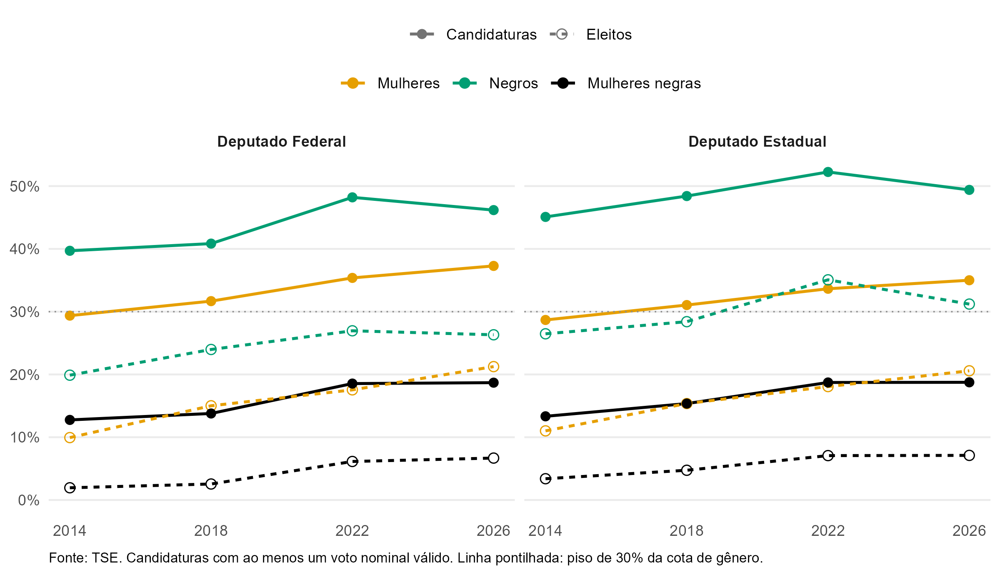
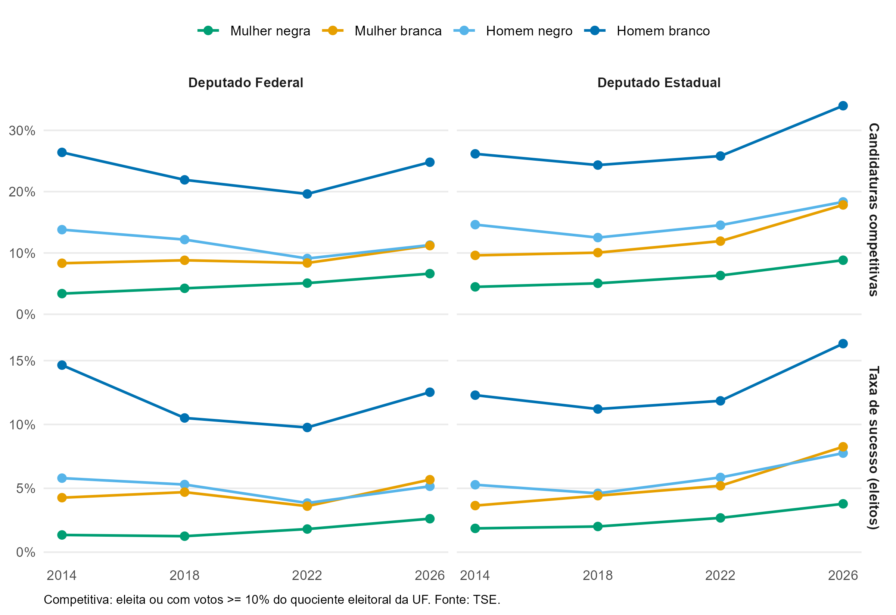
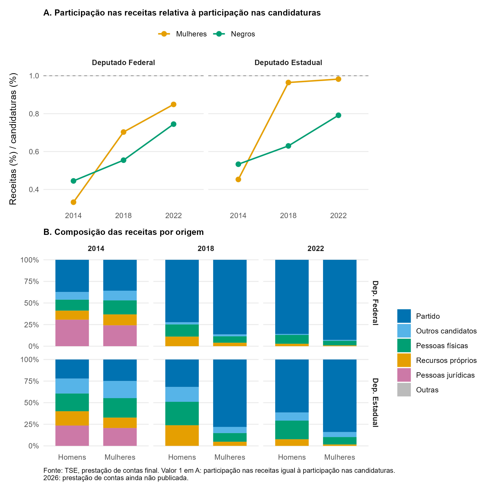
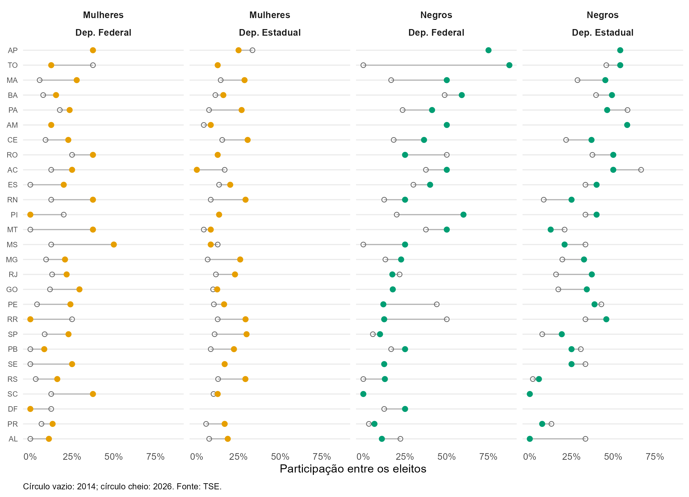
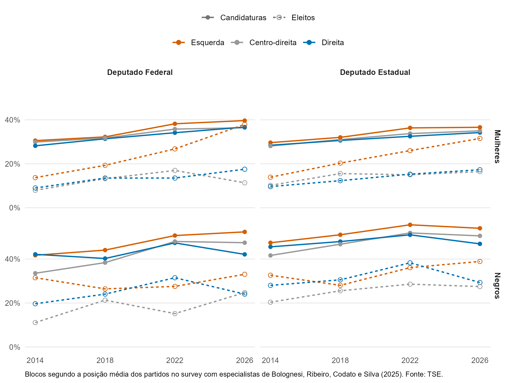

# Mulheres e Negros nas Eleições para Deputado, 2014–2026: um Panorama Descritivo {#sec-analise-descritiva}

## Introdução

Este capítulo descreve a presença de mulheres e de pessoas negras nas disputas para Deputado Federal e Deputado Estadual em quatro eleições gerais, de 2014 a 2026. O objetivo é apresentar, numa mesma base e com as mesmas definições, todas as dimensões que os capítulos seguintes analisam: quantas candidaturas esses grupos apresentam, quantas se elegem, quão competitivas são, quanto recebem e gastam, quantos votos obtêm e onde fazem campanha. O período cobre as principais mudanças nas regras de financiamento e de representação discutidas no Capítulo [-@sec-revisao-literatura]: a última eleição com doação empresarial (2014), a primeira com o Fundo Especial de Financiamento de Campanha (2018) e as duas eleições disputadas sob o incentivo da EC 111/2021 (2022 e 2026).

O capítulo não testa hipóteses. As comparações entre grupos, anos, regiões e partidos servem para situar os padrões que os capítulos seguintes explicam, e nenhuma delas deve ser lida como efeito causal das regras ou das características dos partidos.

## Dados e definições {#sec-dados-analise-descritiva}

Todos os dados vêm do Portal de Dados Abertos do Tribunal Superior Eleitoral (TSE). As candidaturas e seus atributos (gênero, cor ou raça, partido e unidade da federação) vêm do cadastro de candidaturas; os votos, da votação por candidato, município e zona eleitoral; as receitas e despesas, da prestação de contas final dos candidatos. Nos arquivos de prestação de contas, cada receita e cada despesa é um item de um documento (nota fiscal, contrato, recibo), e um mesmo documento reúne vários itens; todos os itens são somados, e só as linhas idênticas em todas as colunas, cópias do mesmo registro, são descartadas. Os votos de 2026 foram baixados em 13 de outubro de 2026, nove dias após o primeiro turno, e o cadastro de candidaturas de 2026, em 8 de novembro de 2026.

A unidade de análise é a candidatura que recebeu pelo menos um voto nominal válido no primeiro turno. Ficam de fora os registros indeferidos, as renúncias e as candidaturas cujos votos foram anulados. Por isso o número de candidaturas aqui é menor que o de registros no TSE e, em 2014, a proporção de mulheres fica pouco abaixo de 30%: a cota de gênero incide sobre os registros feitos por cada partido, não sobre as candidaturas que chegam à urna com voto válido. Para Deputado Estadual, o Distrito Federal, cuja câmara legislativa elege deputados distritais, não entra na análise. Em 2014, o arquivo de votação do TSE traz só os votos nominais, e foram considerados válidos os votos das candidaturas deferidas.

Pessoas negras são as que se declaram pretas ou pardas, seguindo a convenção da literatura brasileira; o grupo de referência são as pessoas brancas, e as que se declaram amarelas ou indígenas aparecem nos totais, mas não nas comparações por raça. Uma candidatura é eleita quando obtém cadeira por quociente partidário ou por média, e competitiva quando é eleita ou alcança pelo menos 10% do quociente eleitoral do estado, calculado com os votos válidos, nominais e de legenda, e o número de vagas. Calculadas com uma mesma regra para os quatro pleitos, essas classificações reproduzem as das bases usadas no Capítulo [-@sec-sobreposicao-territorial] para 99,8% a 100% das candidaturas, conforme o cargo e o ano, e o número de eleitos coincide com o de vagas em todos os pleitos.

Três recortes organizam a comparação territorial e partidária:

- **Região e UF**, segundo a divisão do IBGE.
- **Magnitude do distrito**, isto é, o número de vagas do estado: pequena (8 vagas para Deputado Federal, em 11 UFs; 24 para Deputado Estadual, em 10 UFs), média e grande, com os limites apresentados na @tbl-cap2-magnitude.
- **Bloco ideológico**, a partir da posição média de cada partido numa escala de 0 (esquerda) a 10 (direita) no survey com especialistas de @BolognesiRibeiroCodatoSilva2025_centro_ideologico, rodada de 2022, com os cortes dos próprios autores agregados em três blocos: esquerda (até 4,49), centro-direita (5,51 a 7,0) e direita (acima de 7,0). Nenhum partido ocupa a faixa de centro na rodada de 2022. Partidos extintos antes de 2022 (DEM, PSL, PHS, PPL e PRP) recebem a posição de 2018 [@BolognesiRibeiroCodato2023_classificacao_ideologica]; o PRD, criado em 2023, recebe a média do PTB e do Patriota, regra que os autores usam para fusões; Mobiliza e Democrata, antigos PMN e PMB, mantêm a posição do partido de origem. O Partido Missão, criado em 2025, fica sem classificação.

::: {.callout-important}
## O que falta para 2026

A prestação de contas final das eleições de 2026 foi publicada pelo TSE em novembro de 2026, depois da primeira versão deste capítulo, e ainda não foi incorporada a ele. As seções de financiamento e de geografia do gasto cobrem, por isso, 2014 a 2022. A geografia do gasto também não existe para 2014, porque as despesas daquele ano não identificam o município em que foram realizadas.
:::

## Candidaturas e eleitos

A participação de mulheres entre as candidaturas cresceu de forma contínua no período, de 29,4% para 37,3% na disputa para Deputado Federal e de 28,7% para 35,0% na disputa para Deputado Estadual (@tbl-cap2-visao-geral). A participação entre os eleitos cresceu mais depressa, mas a partir de um patamar muito mais baixo: as mulheres eram 9,9% dos deputados federais eleitos em 2014 e são 21,2% em 2026; entre os deputados estaduais, passaram de 11,0% para 20,6%. A distância entre candidaturas e eleitas caiu de 19,5 para 16,1 pontos percentuais no cargo federal e de 17,7 para 14,4 no estadual, mas continua grande nos dois.



As candidaturas negras seguem outra trajetória. Elas cresceram até 2022, quando chegaram a 48,2% das candidaturas federais e a 52,2% das estaduais, e recuaram em 2026, para 46,2% e 49,4%. O mesmo vale para os eleitos: os deputados estaduais negros passaram de 26,5% em 2014 para 35,1% em 2022 e caíram para 31,2% em 2026, enquanto entre os federais a participação ficou praticamente estável entre 2022 e 2026 (27,0% e 26,3%). A @fig-cap2-composicao mostra as três séries juntas.

{#fig-cap2-composicao width="95%"}

A sub-representação é mais acentuada para as mulheres negras. Elas eram 12,8% das candidaturas federais e 1,9% dos eleitos em 2014; em 2026, são 18,7% das candidaturas e 6,7% dos eleitos. Ou seja, a presença entre os eleitos mais que triplicou, mas ainda corresponde a pouco mais de um terço da presença entre as candidaturas. No cargo estadual, a proporção de mulheres negras eleitas dobrou entre 2014 e 2022 (de 3,4% para 7,1%) e ficou estável em 2026.

O número de candidaturas com voto válido caiu em 2026 nos dois cargos: de 9.376 para 7.051 na disputa federal e de 14.723 para 10.430 na estadual. A queda alcança todos os grupos e, com o mesmo número de vagas, eleva as taxas de sucesso de todos eles em 2026, o que precisa ser levado em conta ao comparar 2026 com os pleitos anteriores.

## Sucesso eleitoral e competitividade

A taxa de sucesso, a proporção de candidaturas de um grupo que se elegem, ordena os quatro grupos de gênero e raça da mesma forma em todos os pleitos e nos dois cargos (@tbl-cap2-sucesso; @fig-cap2-sucesso): homens brancos, seguidos por mulheres brancas e homens negros, com taxas próximas entre si, e por mulheres negras. Em 2026, 12,5% das candidaturas federais de homens brancos se elegeram, contra 2,6% das de mulheres negras; no cargo estadual, 16,3% contra 3,8%. A distância diminuiu em relação a 2014, quando a taxa dos homens brancos era cerca de onze vezes a das mulheres negras na disputa federal (14,6% contra 1,3%), mas em 2026 ainda é de quase cinco vezes.



A competitividade reproduz a mesma ordem. Um quarto das candidaturas federais de homens brancos alcança ao menos 10% do quociente eleitoral em 2026 (24,8%), contra 6,6% das de mulheres negras, e a votação mediana de um homem branco (3.082 votos) é quase cinco vezes a de uma mulher negra (638 votos). Mulheres brancas e homens negros ocupam a posição intermediária, e a distância entre eles diminuiu no período: em 2014, os homens negros tinham taxas de sucesso e de competitividade claramente superiores às das mulheres brancas nos dois cargos (13,8% contra 8,3% de candidaturas federais competitivas, por exemplo); em 2026, as taxas dos dois grupos são praticamente iguais. As mulheres negras ficam abaixo dos três outros grupos em todos os pleitos e nos dois cargos.

{#fig-cap2-sucesso width="95%"}

## Financiamento e gasto, 2014–2022

A participação das mulheres nos recursos de campanha mudou mais do que qualquer outro indicador do capítulo (@tbl-cap2-financiamento; @fig-cap2-financiamento). Em 2014, as candidatas a Deputada Federal eram 29,4% das candidaturas e receberam 9,8% das receitas; a receita média de uma candidata correspondia a 26% da de um candidato. Em 2018, primeiro pleito com o Fundo Especial de Financiamento de Campanha, essas proporções passaram a 22,3% das receitas e 62% da receita média, e em 2022 chegaram a 30,0% e 78%. No cargo estadual, a participação nas receitas já se aproxima da participação nas candidaturas desde 2018 (29,9% das receitas para 31,1% das candidaturas; em 2022, 33,1% para 33,6%).



Para as candidaturas negras, a aproximação é mais lenta. Na disputa federal, elas tinham 39,7% das candidaturas e 17,7% das receitas em 2014; em 2022, 48,2% das candidaturas e 35,9% das receitas, com receita média equivalente a 60% da de uma candidatura branca. No cargo estadual, a razão passou de 0,39 para 0,64 no mesmo período. Nos dois grupos, a participação nos recursos públicos (FEFC e Fundo Partidário) é maior que a participação no total das receitas em quase todos os pleitos e cargos (a exceção são as candidaturas negras estaduais em 2014), e a participação no gasto acompanha de perto a das receitas.

A composição das receitas mostra de onde vem essa mudança (painel B da @fig-cap2-financiamento). Em 2014, doações de pessoas jurídicas respondiam por 30,6% das receitas dos candidatos a Deputado Federal e por 24,1% das receitas das candidatas, e os recursos repassados pelos partidos, por pouco mais de um terço das receitas de ambos. A partir de 2018, sem doação empresarial, os recursos do partido passaram a predominar, e mais entre as mulheres: em 2022 representavam 92,8% das receitas das candidatas a Deputada Federal e 85,9% das dos candidatos; no cargo estadual, 84,0% contra 61,4%. Desde 2018, as candidatas contam menos que os candidatos com recursos próprios e doações de pessoas físicas, o que torna o seu financiamento mais dependente das decisões de alocação dos partidos. Em 2014 a situação era outra: as candidatas a Deputada Federal tinham proporção um pouco maior de recursos próprios e de doações de pessoas físicas do que os candidatos.

{#fig-cap2-financiamento width="95%"}

## Geografia das candidaturas

### Regiões e estados

A presença de mulheres e de negros entre os eleitos varia muito entre regiões, e a variação segue padrões diferentes para os dois grupos (@tbl-cap2-regiao). Para as mulheres, a mudança no tempo é mais marcante que a diferença entre regiões: entre 2014 e 2026, a proporção de deputadas federais eleitas cresceu em todas as regiões, exceto no Norte, que já tinha a maior proporção em 2014 (23,1%) e manteve patamar semelhante (21,5%). No cargo estadual, o Centro-Oeste é a exceção, com 10,1% de mulheres entre os eleitos em 2026, praticamente o mesmo de 2014. Para os negros, a diferença entre regiões é a maior de todo o capítulo e acompanha, em linhas gerais, a proporção de candidaturas negras em cada região: em 2026, os negros são 47,7% dos deputados federais eleitos no Norte e 37,1% no Nordeste, contra 17,3% no Sudeste e 7,8% no Sul.



No nível dos estados, as proporções oscilam bastante entre pleitos, em especial nas bancadas pequenas, em que a eleição de uma ou duas pessoas muda a proporção em mais de 10 pontos percentuais (@fig-cap2-uf-eleitos). Por essa razão, as comparações por estado devem ser lidas mais como indicação de heterogeneidade do que como tendência.

{#fig-cap2-uf-eleitos width="100%"}

### Magnitude do distrito

Na disputa para Deputado Federal, mulheres e negros têm maior participação entre os eleitos nos distritos de menor magnitude (@tbl-cap2-magnitude). Em 2026, as mulheres são 25,0% dos deputados federais eleitos nos estados com 8 vagas e 19,9% nos estados com 22 a 70 vagas; os negros, 39,8% e 21,2%. No cargo estadual, o padrão se mantém para os negros (39,6% dos eleitos nos estados com 24 vagas, contra 25,9% nos de 54 a 94 vagas), mas se inverte para as mulheres, que são 15,0% dos eleitos nos distritos pequenos e 24,0% nos grandes. Essas diferenças não podem ser atribuídas só à magnitude: dos onze estados com 8 vagas federais, seis estão no Norte e três no Centro-Oeste, de modo que magnitude e região se confundem nesta descrição.



### Geografia do voto e do gasto

A geografia do voto de cada candidatura é descrita pela sua base eleitoral, definida como os municípios em que o candidato tem quociente locacional do voto acima de 1 e que respondem por pelo menos 2,5% da sua votação. A construção dessa medida e a escolha do piso de 2,5% estão detalhadas no Capítulo [-@sec-sobreposicao-voto]. A geografia do gasto usa o quociente locacional do gasto do Capítulo [-@sec-sobreposicao-territorial], disponível para 2018 e 2022.



O tamanho da base de voto quase não varia entre grupos: a candidatura mediana tem três municípios-base em todos os grupos, cargos e anos (@tbl-cap2-geografia). O que varia é o peso dessa base e da capital na votação. As candidaturas de mulheres negras são as mais concentradas: na disputa federal de 2026, em média 69,5% dos seus votos vêm dos municípios-base e 39,3% da capital do estado, contra 61,7% e 23,5% para os homens brancos; no cargo estadual, 77,9% e 45,4% contra 70,0% e 26,2%. Mulheres brancas e homens negros ficam entre esses dois extremos. A ordem dos grupos é a mesma nos quatro pleitos, e a fatia da capital na votação caiu para todos entre 2014 e 2026, de 4 a 9 pontos percentuais conforme o grupo e o cargo.

O gasto é ainda mais concentrado na capital do que o voto, em todos os grupos, e de novo mais entre as mulheres e os negros. Em 2018, as candidatas negras a Deputada Federal fizeram, em média, 72,1% do seu gasto na capital, onde obtiveram 42,0% dos votos, enquanto os candidatos brancos fizeram ali 52,1% do gasto e obtiveram 26,4% dos votos; em 2022, a proporção do gasto na capital foi de 67,8% e 54,6%, respectivamente. No cargo estadual a ordem é a mesma. A base de gasto mediana tem de um a três municípios, conforme o grupo e o ano, e em 2018 é de um único município para as mulheres negras nos dois cargos.

## Partidos

A proporção de mulheres entre as candidaturas é muito parecida nos três blocos ideológicos e cresceu em todos eles, refletindo a obrigação comum da cota de gênero (@fig-cap2-blocos). A diferença entre blocos aparece entre os eleitos. Em 2026, as mulheres são 37,9% dos deputados federais eleitos por partidos de esquerda, contra 17,5% dos eleitos pela direita e 11,3% pela centro-direita; no cargo estadual, 31,5% contra 17,3% e 16,4%. Na disputa federal de 2026, a participação das mulheres entre os eleitos pelos partidos de esquerda (37,9%) quase alcança a participação entre as candidaturas desses partidos (39,6%), o que não ocorre em nenhum outro bloco nem no cargo estadual.

{#fig-cap2-blocos width="95%"}

Para os negros, as diferenças entre blocos são menores e menos estáveis. A esquerda tem a maior proporção de candidaturas negras em todos os pleitos desde 2018, mas entre os eleitos a ordem varia: em 2022, a direita elegeu a maior proporção de deputados negros nos dois cargos (31,5% no federal e 38,3% no estadual), e em 2026 a esquerda voltou à frente (33,1% e 38,9%).



Entre os doze partidos que mais elegeram deputados no período (@tbl-cap2-partidos), a proporção de mulheres entre as candidaturas é parecida, entre 34% e 39% em 2026, mas a proporção entre os eleitos vai de 5,6% no PRD a 33,7% no PT. A participação de negros entre os eleitos é maior no União (43,2%), no PDT (40,0%), no PRD (38,9%) e no Republicanos (37,9%), e menor no PL (18,9%) e no MDB (20,7%).

## Síntese

Três padrões atravessam o capítulo. O primeiro é a distância persistente entre candidaturas e eleitos: mulheres e negros aumentaram sua presença entre as candidaturas e entre os eleitos, mas continuam muito menos presentes entre os eleitos do que entre as candidaturas, e as mulheres negras acumulam as duas desvantagens. O segundo é a mudança no financiamento: a desigualdade de recursos entre homens e mulheres caiu muito com o fim da doação empresarial e a criação do FEFC, menos para os negros, e o financiamento dos grupos sub-representados passou a depender quase inteiramente dos partidos. O terceiro é a variação entre territórios e partidos: a presença de negros entre os eleitos depende fortemente da região e a de mulheres, do bloco ideológico do partido. Os capítulos seguintes analisam como os partidos organizam essas candidaturas no território.
