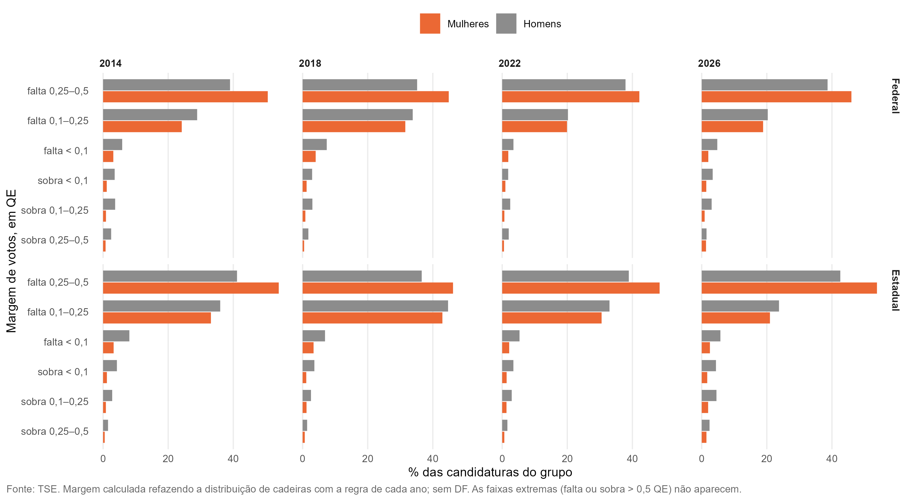

# Os Efeitos da EC 111/2021 sobre Candidaturas, Recursos, Votos e Sucesso Eleitoral de Mulheres e Pessoas Negras {#sec-ec111-competitividade}

```{=html}
<!-- Rascunho reestruturado (2026-11-08; plano quality_reports/plans/2026-11-08_cap3-reestruturacao-ec111.md)
e reorganizado em estrutura acadêmica padrão em 2026-11-10 (plano
quality_reports/plans/2026-11-10_cap3-estrutura-academica.md): Introdução, Revisão da Literatura,
Metodologia, Dados, Resultados (uma subseção por hipótese), Discussão, Conclusão.
Fontes: explorations/ec111-did-2026/ (funil: candidaturas, receita, transferências, gasto, votos, cadeiras;
origem da receita; persistência; tabela de amostra, script 05) e explorations/competitividade-eleitoral/
(margem de votos e margem de gasto, tripla diferença, HonestDiD). Números conferidos nos CSVs de output/
das duas explorações.
2026: votos do TSE de 09/11/2026 (distribuição de cadeiras validada em 100% dos eleitos), registro de
candidaturas de 08/11/2026, receitas e gasto do arquivo de prestação de contas de 08/11/2026, já com a
prestação final (>99% dos registros). Despesas e receitas de todos os anos: só cópias exatas removidas
(regra de 2026-11-09). Números atualizados e conferidos em 2026-11-09. -->
```

## Introdução {#sec-introducao-ec111}

A Emenda Constitucional 111/2021, art. 2º, criou um incentivo financeiro inédito no sistema eleitoral brasileiro em favor da maior representação de mulheres e pessoas negras. Nas eleições de 2022 a 2030, os votos dados a candidaturas desses grupos para a Câmara dos Deputados contam em dobro na distribuição entre os partidos de parcela dos fundos públicos de financiamento disponíveis. Diferentemente de outras modalidades de ações afirmativas, a regra não obriga o partido a nada. Ela altera, porém, o valor relativo de cada voto para o partido já que, no ciclo seguinte, um voto obtido por uma mulher ou por uma pessoa negra vale o dobro de um voto obtido por um homem branco em termos de arrecadação de fundos públicos. Este capítulo avalia como esse incentivo foi implementado pelos partidos e quais os resultados obtidos nos dois primeiros ciclos eleitorais de sua vigência. A recompensa financeira direcionada aumentou a representação de mulheres e pessoas negras na política brasileira?

A efetividade do incentivo financeiro é medida ao longo do ciclo de vida de uma candidatura, do recrutamento até a efetiva ocupação de uma cadeira: quantas mulheres e pessoas negras os partidos recrutaram como candidatas em suas listas, quanto dinheiro elas arrecadaram e quanto desses recursos foi investido diretamente pelo próprio partido, quanto gastaram em suas campanhas, quantos votos obtiveram, quão perto chegaram de se eleger e quantas, afinal, se elegeram. A distinção entre essas etapas é central para entender a efetividade, ou não, da medida. No bônus criado pela emenda, um voto conta o mesmo esteja ele numa candidatura que se elege ou numa candidatura que termina muito longe da cadeira. O desenho premia o volume de votos, e não a eleição. É possível, portanto, que a EC 111 tenha alavancado a votação dessas candidaturas sem afetar a sua representação entre os eleitos. O objetivo que orienta o capítulo é compreender até onde o efeito chega e onde ele, eventualmente, se perde.

Com relação à literatura que avalia o impacto das ações afirmativas sobre a representação de gênero e raça no Brasil, este capítulo apresenta três contribuições. A primeira, mais evidente, é a inclusão dos resultados eleitorais de 2026 na análise, de forma a entender se as mudanças observadas em 2022 persistem ou se alteram. A segunda é o refinamento metodológico, e seu significado substantivo, das medidas de competitividade eleitoral. Em vez de um corte fixo de votos ou da posição na lista, uso a margem de votos de cada candidatura, isto é, quantos votos faltariam (ou sobrariam) para que ela mudasse de resultado, calculada refazendo a distribuição de cadeiras com a regra de cada eleição [@AvelinoBidermanDesposato2022_incumbency; @LuechingerSchelkerSchmid2024_closeness]. Dessa forma, a medida avalia a competitividade da candidatura tanto dentro quanto fora do partido em termos das chances de alterar o resultado eleitoral, sem usar a quantidade de votos obtida como simples aproximação. Foi testada também uma medida de competitividade baseada no gasto eleitoral, seguindo lógica equivalente. A margem de gasto estima qual seria o volume de gasto adicional necessário para alterar o resultado eleitoral daquela candidatura, considerando a competição dentro e fora do partido.

Para identificar o efeito do voto em dobro, sigo a estratégia de @FonsecaThomeGuedesNeto2026_money_talks e comparo as candidaturas a deputado federal, sujeitas ao incentivo, com as candidaturas a deputado estadual nos mesmos distritos e eleições, que não estão sujeitas a ele. Como as cotas de recursos para mulheres e pessoas negras valem para os dois cargos, a comparação separa o efeito específico da EC 111 das demais mudanças do período que atingem ambos. A comparação tem um limite, examinado nos resultados. O cargo estadual não fica imune à emenda, porque o partido pode deslocar recursos de um cargo para o outro. Quando isso acontece, a diferença entre os cargos mede a realocação do dinheiro, e não um investimento adicional no grupo. A terceira contribuição é estimar todas as etapas, da candidatura à cadeira, com o mesmo estimador de diferenças em diferenças [@CallawaySantAnna2021_did] e a mesma comparação, o que permite ver em que etapa o efeito se perde.

A resposta, adiantada aqui, é que o efeito se perde entre o dinheiro e a cadeira. O incentivo mudou de forma relevante a alocação de recursos partidários em favor das mulheres no cargo federal. Em 2022 e em 2026, a proporção das transferências do partido destinada a elas subiu cerca de 12 pontos percentuais nas candidaturas federais em comparação com as estaduais. Esse dinheiro, porém, não era novo. Saiu das candidatas estaduais, e, somando os dois cargos, a proporção das mulheres nas transferências continuou a acompanhar a proporção de candidatas, o patamar que a reserva de recursos já exigia. Os partidos também lançaram mais mulheres e mais pessoas negras. Mas o dinheiro adicional ficou com candidaturas que terminaram longe do limiar da eleição. O investimento foi distribuído entre muitas candidatas, e a presença de mulheres entre as candidaturas com recursos suficientes para disputar uma cadeira não aumentou. Nos votos, o ganho das mulheres em 2022, de 4 pontos percentuais, é próximo do encontrado por @FonsecaThomeGuedesNeto2026_money_talks, mas não se distingue de zero quando os erros são agrupados por unidade da federação, e também ficou, em sua maior parte, com candidaturas não competitivas. Pelo voto, as mulheres parecem ter se aproximado da eleição em 3 a 4 pontos percentuais em relação aos homens. Essa aproximação, no entanto, não reflete o aumento da competitividade de mulheres, mas sim o aumento de candidaturas masculinas com poucas chances no cargo federal, reduzindo a taxa de competitividade dos homens. A presença de mulheres entre as candidaturas competitivas e entre os eleitos não mudou, e esse padrão se repete em 2026.

As mulheres negras são uma exceção parcial. O aumento das transferências a elas no cargo federal não saiu do estadual, os votos aumentaram, e a proporção delas entre as candidaturas competitivas pelo gasto subiu cerca de 4 pontos percentuais. É o único indício de que o dinheiro adicional levou candidaturas de algum grupo a uma posição de disputa. Em 2026, a proporção de mulheres negras entre os eleitos também subiu, mas o efeito aparece numa só eleição e precisa ser confirmado nas próximas. Para pessoas negras, as transferências do partido não mudaram de forma distinguível de zero, e as doações e os recursos próprios subiram no cargo federal em 2022, no limite da significância, sinal de que algo além do voto em dobro pode ter mudado a arrecadação dessas candidaturas. Para pessoas negras e mulheres negras, a taxa de eleição e parte das medidas de competitividade já vinham melhorando no cargo federal antes da emenda, entre 2014 e 2018, e os ganhos observados nessas etapas não podem ser atribuídos ao voto em dobro.

O capítulo está organizado em mais seis seções, além desta introdução. A @sec-literatura-ec111 situa a EC 111/2021 entre as ações afirmativas de financiamento eleitoral, revisa os estudos sobre a emenda, discute o que a regra efetivamente premia e formula hipóteses para cada etapa do percurso da candidatura. A @sec-desenho-ec111 apresenta a estratégia de identificação, baseada na comparação entre os cargos de deputado federal e estadual e define as variáveis, entre elas as margens de votos e de gasto. A @sec-medida-ec111 descreve as fontes de dados e a amostra. A @sec-resultados-ec111 reporta os resultados, em uma subseção para cada hipótese. A @sec-discussao-ec111 interpreta o conjunto dos resultados ao longo do percurso da candidatura e discute seus limites, e a @sec-conclusao-ec111 conclui.

## Revisão da Literatura {#sec-literatura-ec111}

Medidas para ampliar a presença de grupos sub-representados já são velhas conhecidas da política brasileira, mas não se resumem a cotas de candidaturas, de recursos ou de vagas. @Lovenduski2005_feminizing distingue três tipos de estratégia para a igualdade de gênero na representação política. A *retórica da igualdade* se limita a declarações de compromisso dos partidos. A *promoção da igualdade* oferece apoio e incentivos às candidatas, como formação e financiamento. As *garantias de igualdade* fixam resultados, como as cotas e as cadeiras reservadas. @KrookNorris2014_beyond_quotas ampliam esse quadro e mostram que, além das cotas, há estratégias que intervêm em cada etapa do recrutamento, da decisão de se candidatar à seleção pelos partidos e à eleição. Uma delas é a regulação do financiamento público, que vincula os recursos repassados pelo Estado aos partidos à presença de mulheres entre seus candidatos ou entre seus eleitos.

Esse tipo de mecanismo de ação afirmativa de financiamento eleitoral existe hoje em cerca de 30 países [@Ohman2018_gender_targeted] e assume formas diferentes. Em alguns casos, o partido perde parte dos recursos públicos se não atinge um patamar mínimo de candidatas, como na França e na Irlanda. Em outros, recebe recursos adicionais se atinge esse patamar ou se elege mulheres, como na Geórgia e na Colômbia. Há ainda os recursos carimbados, em que parte do financiamento público deve ser gasta em atividades voltadas às mulheres, como no México, a forma mais comum no mundo [@KrookNorris2014_beyond_quotas; @Ohman2018_gender_targeted]. As avaliações disponíveis indicam que o desenho do mecanismo importa para a efetividade dos seus resultados. No caso italiano, @FeoPiccio2020_party_funding mostram que regras mal desenhadas, sem sanções e recompensas capazes de mudar o comportamento dos partidos, se reduziram à política simbólica. Na comparação de 31 eleições em 17 países, @MuriaasMazurHoard2022_payments concluem que o equilíbrio de gênero melhora quando o incentivo financeiro se combina com outras condições. Nos casos bem-sucedidos, o mecanismo vinha acompanhado de cotas de gênero e de representação proporcional ou de um patamar mínimo de 15% de mulheres no parlamento.

Os modelos descritos recompensam ou penalizam os partidos pela composição das listas ou das bancadas eleitas. O Brasil adotou até aqui a outra categoria, a dos recursos carimbados. Ele já aparece nas sínteses comparativas pela obrigação de destinar ao menos 5% do Fundo Partidário à promoção da participação política das mulheres [@KrookNorris2014_beyond_quotas; @Ohman2018_gender_targeted]. Desde 2018, além disso, uma parcela mínima dos recursos públicos de campanha é reservada às candidatas e, desde 2020, distribuída às candidaturas negras na proporção delas. A EC 111 acrescentou um desenho próximo ao dos bônus, que difere dos modelos anteriores em dois pontos. O primeiro é o objeto de interesse. A emenda não recompensa nem a composição das listas nem a dos eleitos, e sim os votos, uma medida intermediária entre as duas, que o partido pode aumentar sem que a composição dos eleitos mude. O segundo é o alcance. A emenda vale também para pessoas negras. Até onde foi verificado, as sínteses comparativas disponíveis não registram mecanismo equivalente voltado à representação racial ou étnica, o que torna o caso brasileiro relevante também para essa literatura.

No caso brasileiro, a literatura sobre a emenda ainda é pequena e trata só de 2022. Dois trabalhos são descritivos. @EvangelistaEtAl2024_candidaturas_regras comparam as eleições para a Câmara de 2014, 2018 e 2022 e registram aumento das candidaturas e dos eleitos de mulheres, de pessoas negras e de pessoas LGBTQIA+ em 2022, além de maior participação de homens e mulheres negros nas receitas. @Trindade2025_subrepresentacao_camara avalia em conjunto a ADI 5.617 e as Emendas 111/2021 e 117/2022 e encontra, em 2022, aumento das candidaturas de mulheres negras e de homens negros, queda das de homens brancos e aumento da taxa de sucesso apenas entre mulheres negras. Nenhum dos dois separa o efeito do voto em dobro do efeito das cotas de recursos, adotadas no mesmo período. @FonsecaThomeGuedesNeto2026_money_talks são os primeiros a isolar a EC 111, com o mesmo contraste entre deputado federal e estadual usado aqui, para 2018 e 2022. Encontram aumento de votos e de recursos para mulheres e pessoas negras, mas concentrado em candidaturas pouco competitivas, definidas pela posição na lista.

Para entender esses resultados é preciso olhar o que, exatamente, a emenda incentiva. O voto conta em dobro no cálculo de parcela dos dois fundos públicos distribuídos aos partidos, mas com pesos diferentes. No Fundo Partidário, a quase totalidade dos recursos é dividida pela votação para a Câmara dos Deputados. No FEFC, a votação responde por 35% do total, e os demais 65% são divididos em partes iguais (2%) e pelo tamanho das bancadas na Câmara (48%) e no Senado (15%) (Lei 9.504/1997, art. 16-D). A dupla contagem vale só para a parcela que segue os votos, e o voto de uma mulher negra conta em dobro uma única vez, sem acúmulo pelas duas condições.

O incentivo tem, assim, três propriedades que importam para a análise. Primeiro, ele é dirigido ao partido, e não à candidatura, e quem decide quantas mulheres e pessoas negras lançar e quanto dinheiro destinar a cada uma é a direção partidária. Segundo, ele premia votos, e não eleitas. Para o bônus, um voto de uma candidata que termina com 2% do quociente eleitoral vale o mesmo que um voto de uma candidata eleita, enquanto a parte do FEFC que segue as cadeiras continua a premiar quem já as ocupa. Terceiro, o incentivo vale só para deputado federal, o que permite comparar as listas federais com as estaduais dos mesmos partidos, nos mesmos estados e eleições.

Dirigido ao partido e indexado aos votos, o incentivo pode ser capturado sem que a composição dos eleitos mude. Cada candidatura de uma mulher ou de uma pessoa negra funciona como uma máquina caça-níqueis a serviço dos partidos, coleta votos e, portanto, dinheiro público para o partido que a explora, ainda que quase nunca leve a cadeira. Basta ao partido espalhar recursos por muitas candidaturas desses grupos com chance baixa, sem deslocar os candidatos competitivos que já tem. Chamo essa categoria de *candidaturas caça-níqueis*.

A literatura sobre resistência às cotas permite tratar essa resposta como estratégia deliberada, e não como efeito colateral. Para @Gatto2025_resistance_quotas [p. 28], parlamentares resistem às cotas porque elas ameaçam suas carreiras e, quando a oposição aberta também se torna custosa, aprovam a política, mas usam o controle do processo legislativo para reduzir seu impacto. Os pontos que ficam mais fracos nos desenhos latino-americanos são justamente as sanções e as exigências de viabilidade das candidaturas [@Gatto2025_resistance_quotas, p. 195]. No Brasil, a ausência dessas exigências permitiu cumprir a cota apenas no papel [@Gatto2025_resistance_quotas, p. 110]. @GattoWylie2021_informal_institutions classificam a nomeação de candidatas laranja como uma instituição informal intencionalmente acomodatícia, que cumpre a letra da cota sem apoiar de fato as candidaturas de mulheres. Pelas contas das autoras, mais de 30% das candidaturas de mulheres à Câmara e às assembleias entre 1998 e 2018 eram provavelmente laranjas, quase metade em 2014, primeiro ano de exigência efetiva da cota, e os diretórios que mais recorriam a elas lançavam mais mulheres e elegiam menos. A candidatura caça-níqueis é essa mesma prática ajustada a um incentivo que remunera por voto. A laranja, que as autoras identificam por não alcançar 1% da votação do último eleito, cumpre a cota, mas nada rende sob a EC 111. Para capturar o bônus, o partido precisa de candidatas que obtenham votos, ainda que longe do limiar. A lógica continua a de atender à regra sem deslocar os candidatos que já disputam as cadeiras, mas o ponto ótimo passa da candidatura vazia para a candidatura financiada e não competitiva.

A história legislativa da emenda mostra que esse desenho, de recompensar o partido sem exigir viabilidade, foi defendido desde o início por quem resistia à cota. Já no debate da lei de 1997, um deputado que descrevia as listas de 1996 como um "festival de laranjas" propôs que, em vez de obrigados a lançar mulheres, os partidos fossem recompensados por fazê-lo, "sem que isso tenha o efeito de eliminar os aspirantes homens" [@Gatto2025_resistance_quotas, p. 104]. A ideia da dupla contagem dos votos surgiu em 2019 num projeto da deputada Renata Abreu, presidente do PODE, que retirava a obrigatoriedade da cota de candidaturas e oferecia, em troca, incentivos aos partidos. Segundo @Gatto2025_resistance_quotas [p. 119], a medida poderia beneficiar as mulheres, mas daria também vantagens claras aos partidos. Como relatora da reforma eleitoral de 2021, a mesma deputada incluiu o voto em dobro na EC 111, e especialistas já haviam avaliado, quando a proposta surgiu, que ela beneficiaria sobretudo as mulheres que já tinham mandato e seus partidos, sem ampliar de forma mais geral a representação feminina [Zaremba 2019, apud @Gatto2025_resistance_quotas, p. 120].

Este capítulo parte do desenho de @FonsecaThomeGuedesNeto2026_money_talks e o estende em três direções. Mede a competitividade pela distância até o limiar de eleição, em votos e em reais, e não pela posição na lista. Acompanha todas as etapas, da candidatura à cadeira, com o mesmo estimador. E acrescenta a eleição de 2026. O incentivo atua sobre a decisão partidária, e por isso o primeiro lugar onde ele deveria aparecer é naquilo que o partido controla diretamente, isto é, em quem lança e para quem envia dinheiro, avançando para gastos, competitividade e resultado eleitoral. As hipóteses seguem essa ordem. Em todas, o efeito é medido no cargo de deputado federal em relação ao de deputado estadual, e os grupos são mulheres, pessoas negras e mulheres negras.

- **H1 (candidaturas):** A EC 111 aumentou a proporção de candidaturas dos grupos nas listas partidárias.
- **H2 (transferências e gasto):** A EC 111 aumentou a proporção das transferências do partido e do gasto das listas destinada aos grupos. Como a reserva de recursos para mulheres é aferida no total do partido, sem separação por cargo, esse aumento pode vir de dinheiro deslocado de candidaturas estaduais, sem aumento do total destinado aos grupos.
- **H3 (votos):** A EC 111 aumentou a proporção dos votos nominais das listas obtida pelos grupos.
- **H4 (competitividade):** A EC 111 aumentou a presença dos grupos entre as candidaturas que terminam perto do limiar de eleição, medida pelo voto e pelo gasto, e o seu sucesso relativo, isto é, a taxa de candidaturas competitivas do grupo em comparação com a do restante das candidaturas.
- **H5 (eleição):** A EC 111 aumentou a proporção de cadeiras ocupadas pelos grupos e o seu sucesso relativo na eleição.
- **H6 (persistência):** Os efeitos observados em 2022 se mantêm em 2026, quando partidos e candidaturas já conheciam a regra.

Se a resposta dos partidos ao incentivo criado pela EC 111 for o lançamento de candidatos caça-níqueis, H1 a H3 devem ser confirmadas e H4 e H5 não, e os ganhos de recursos e de votos devem se concentrar em candidaturas que terminam longe do limiar. Se, além disso, o partido puder atender ao incentivo apenas mudando de cargo o dinheiro que já destinava às candidatas, o total destinado a elas nos dois cargos não deve mudar. Se o incentivo tiver levado os partidos a investir em candidaturas viáveis e contribuído para o desejado aumento da representação, o efeito deve se propagar até a competitividade e a cadeira, e H4 e H5 também devem ser confirmadas. As duas leituras não são excludentes em sentido estrito, porque o incentivo pode ter produzido algumas candidaturas competitivas e muitas não competitivas. O que as distingue é onde está a massa do efeito.

## Metodologia {#sec-desenho-ec111}

### Estratégia de identificação {#sec-estimacao-ec111}

Para estimar o efeito da medida em implementação, observam-se as variáveis de interesse referentes a cada etapa do ciclo eleitoral comparando a relação entre deputados federais, sujeitos ao tratamento, e deputados estaduais dentro do mesmo distrito eleitoral, que acabam por funcionar como grupo contrafactual para essa avaliação. Com quatro eleições (2014 e 2018 antes, 2022 e 2026 depois) e uma única data de adoção, o desenho é de diferenças em diferenças com dois grupos e vários períodos, como em @FonsecaThomeGuedesNeto2026_money_talks. A @tbl-esquema-ec111 resume o que cada comparação mede.

| Cargo | 2014 | 2018 | 2022 | 2026 |
|:--------------|:-------------:|:-------------:|:-------------:|:-------------:|
| Deputado federal (tratamento) | pré-teste | referência | efeito de 2022 | efeito de 2026 |
| Deputado estadual (controle) | pré-teste | referência | controle | controle |

: Esquema do desenho: cada efeito compara a mudança do cargo federal entre 2018 e o ano indicado com a mudança do cargo estadual no mesmo intervalo. Transferências do partido, gasto e competitividade pelo gasto começam em 2018 e não têm pré-teste. {#tbl-esquema-ec111}

A comparação entre mulheres e homens, e entre pessoas negras e as demais, está embutida em cada variável. Todas as variáveis principais medem a *proporção* do grupo num total, seja das candidaturas, das transferências do partido, do gasto, dos votos, das candidaturas competitivas ou das cadeiras. Como a proporção das mulheres e a dos homens somam 100%, um aumento de 3 pontos percentuais na proporção de mulheres entre as candidaturas é uma queda de 3 pontos na dos homens. O grupo de comparação é sempre o restante das candidaturas. Para as mulheres, são os homens. Para as pessoas negras, as que não se declaram pretas ou pardas. Para as mulheres negras, todas as demais candidaturas. A diferença em diferenças compara, portanto, a divisão entre o grupo e o restante entre deputados federais com a mesma divisão entre deputados estaduais, antes e depois da emenda.

Na competitividade e na eleição, o capítulo usa também uma segunda medida, o *sucesso relativo*, que compara a taxa de sucesso do grupo com a do grupo de comparação, como a proporção de candidatas que se elegem menos a proporção de candidatos que se elegem. As duas medidas respondem a perguntas diferentes. A proporção do grupo entre as competitivas ou entre os eleitos diz se a representação mudou. O sucesso relativo, por sua vez, informa se as chances de quem se candidata mudaram. A mudança na estratégia dos partidos pode afetar as duas por caminhos distintos, inclusive pelo número de candidaturas do grupo de comparação, e a leitura conjunta permite identificar esses caminhos.

Uma premissa do desenho inferencial de diferenças em diferenças é a de tendências paralelas prévias ao tratamento. Sem a intervenção, neste caso, a emenda, a diferença entre o desempenho de candidaturas federais ou estaduais teria evoluído da mesma forma depois de 2018 nas variáveis mensuradas. Ela não pode ser observada depois de 2022, mas pode ser examinada antes. O efeito "de 2014", calculado com a mesma conta entre 2014 e 2018, quando não havia o incentivo, funciona como um *pré-teste*. Um coeficiente próximo de zero indica que os dois cargos evoluíam de forma parecida antes da emenda. Ele não prova a hipótese, que precisa valer de 2018 até 2026. Para as variáveis relacionadas a recursos de campanha, o pré-teste não foi implementado, uma vez que a eleição de 2014 se deu em condições radicalmente distintas no que se refere às regras de financiamento eleitoral. Em 2014, ainda valiam as doações de empresas, proibidas a partir de 2015, e a mudança observada a partir de 2018 mostraria o fim desse regime de financiamento, não a tendência anterior dos dois cargos.

### Modelo e estimação {#sec-modelo-ec111}

Para uma variável $Y$ medida na unidade $u$ (lista ou disputa) no ano $t$, o modelo é a regressão de diferenças em diferenças com efeitos fixos de unidade e de ano [@Cunningham2021_mixtape, cap. 9]

$$
Y_{ut} = \mu_u + \lambda_t + \delta\,(\text{Federal}_u \times \text{Pós}_t) + \varepsilon_{ut}, \qquad t \in \{2018, 2022, 2026\},
$$ {#eq-reg-ec111}

em que Pós vale 1 para as eleições realizadas na vigência da regra, em 2022 e em 2026. O efeito fixo de unidade, $\mu_u$, elimina o que é permanente em cada lista ou disputa, como a magnitude do distrito eleitoral, o perfil do partido no estado e a diferença permanente entre os cargos. O efeito fixo de ano, $\lambda_t$, elimina o que muda no período para ambos os cargos, como as cotas de recursos e o ambiente político nacional. O coeficiente $\delta$ é a diferença em diferenças, ou seja, a mudança média observada no nível federal entre 2018 e o período posterior à emenda menos a mesma mudança no nível estadual. Com o painel balanceado e um único período anterior, ele é igual à média dos efeitos de 2022 e de 2026. O modelo não usa variáveis de controle. O que é fixo em cada unidade e o que muda no período para os dois cargos já é eliminado pelos efeitos fixos, e características que a própria emenda pode ter alterado, como o número de candidaturas, o gasto ou a incumbência depois de 2018, não podem entrar como controle sem mascarar parte do efeito.

Para separar as duas eleições e examinar o período anterior à emenda, o mesmo modelo é estimado na forma de estudo de evento,

$$
Y_{ut} = \mu_u + \lambda_t + \sum_{k \in \{2014,\,2022,\,2026\}} \delta_k\,(\text{Federal}_u \times \mathbb{1}[t = k]) + \varepsilon_{ut},
$$ {#eq-att-ec111}

com 2018, a última eleição antes da emenda, como referência. Os coeficientes $\delta_{2022}$ e $\delta_{2026}$ são os efeitos de cada eleição, e $\delta_{2014}$ é o pré-teste. A referência no último período anterior ao tratamento segue @Cunningham2021_mixtape, para quem a comparação deve partir de um período em que nenhuma unidade foi tratada. Pela mesma razão, 2014 não entra no período anterior da @eq-reg-ec111. Se entrasse, uma diferença de tendência entre os cargos de 2014 para 2018 seria somada ao efeito, justamente nas variáveis em que o pré-teste falha. Os coeficientes por ano são numericamente iguais aos do estimador de @CallawaySantAnna2021_did sem covariáveis, usado aqui para obter bandas de confiança uniformes para os vários anos, por bootstrap multiplicador com 25.000 repetições, e a função de influência da medida de persistência. Os efeitos são lidos em pontos percentuais.

A *persistência* (H6) é a diferença entre os efeitos de 2026 e de 2022, $\Delta = \delta_{2026} - \delta_{2022}$, calculada a partir das duas estimativas com base em 2018. Uma comparação que tomasse 2022 como referência mediria essa mesma diferença, mas a apresentaria como efeito de 2026, tratando 2022, ano já sob a regra, como se fosse anterior a ela [@Roth2024_interpreting_event_studies]. O erro-padrão de $\Delta$ vem da função de influência das duas estimativas, agrupada por estado. Uma diferença próxima de zero indica que o efeito de 2022 se repetiu em 2026.

Ao longo do capítulo, são usadas dois tipos de unidade para operacionalizar as medidas de interesse. As proporções de candidaturas, de transferências do partido, de gasto e de votos são medidas na *lista*, isto é, no conjunto de candidaturas de um partido a um cargo num distrito eleitoral, porque é nela que o partido decide quem lançar e para quem enviar dinheiro. As variáveis de competitividade e de eleição são medidas na *disputa*, isto é, em cada cargo de cada UF (26 UFs × 2 cargos), porque candidaturas competitivas e eleitas são raras dentro de uma lista, e a maior parte das listas não tem nenhuma. O sucesso relativo é o mesmo modelo aplicado à diferença entre as taxas do grupo e do grupo de comparação na disputa, $Y_{u,c,t} = \text{taxa}^{\,\text{grupo}}_{u,c,t} - \text{taxa}^{\,\text{comparação}}_{u,c,t}$ na UF $u$ e no cargo $c$, o que equivale a uma tripla diferença (grupo × cargo × período).

### Falsificação, inferência e limites {#sec-limites-ec111}

O pré-teste não esgota o exame do desenho. @Cunningham2021_mixtape recomenda complementá-lo com *testes de falsificação*, que verificam se o mesmo procedimento encontra efeito onde a emenda não deveria ter efeito algum. Além do pré-teste, que aplica o desenho a um intervalo sem voto em dobro, o capítulo usa a receita que as candidatas obtêm fora do partido, por doações de pessoas físicas, recursos próprios e financiamento coletivo. O voto em dobro altera o incentivo do partido, e não o dos doadores, de modo que um efeito sobre essa receita indicaria uma mudança mais ampla na capacidade de arrecadação das candidatas, sem relação com a regra. Os repasses de outras candidaturas ficam fora dessa receita. Em sua maior parte, eles são FEFC ou Fundo Partidário, recursos que só chegam às candidaturas pelos partidos e passam por outra candidatura antes de chegar à candidata, e por isso são tratados à parte (@sec-medida-ec111).

Em diferenças em diferenças, as observações de uma mesma unidade são correlacionadas ao longo do tempo, e erros-padrão convencionais subestimam a incerteza [@BertrandDufloMullainathan2004_did]. A correção usual é agrupar os erros num nível que reúna as observações sujeitas aos mesmos choques. Aqui, os erros são agrupados por UF em todas as variáveis. As listas de um mesmo cargo numa UF disputam o mesmo eleitorado e sofrem os mesmos choques locais, como uma candidatura forte ao governo ou ao Senado, e não podem ser tratadas como independentes. Com 26 UFs, essa correção ainda pode subestimar a incerteza [@CameronGelbachMiller2008_bootstrap; @ConleyTaber2011_few_policy_changes]. Por isso, os p-valores do termo Federal × Pós e de cada ano são conferidos por *wild cluster bootstrap* restrito, com pesos de @Webb2023_wild_bootstrap, por UF e 1.999 repetições, e os casos em que a conferência muda a conclusão são indicados no texto.

O caso impõe três limites ao desenho. O primeiro é a *ausência de variação no tratamento*. Não há UFs ou partidos que recebem a regra e outros que não, e qualquer mudança específica do cargo federal depois de 2018 se confunde com a emenda. Pela mesma razão, os intervalos de confiança medem a variação entre as 26 UFs em torno de um contraste nacional, e choques nacionais do cargo federal, comuns a todas as UFs, não entram no erro-padrão. O segundo é o *transbordamento* entre os cargos. Federal e estadual dividem o orçamento do partido e o mesmo conjunto de potenciais candidatas. Se o voto em dobro levou o partido a deslocar mulheres ou recursos do estadual para o federal, o cargo de controle é afetado pelo tratamento, e a diferença em diferenças soma o ganho do federal com a perda do estadual. Os níveis de cada cargo e a proporção nos dois cargos somados, apresentados junto com os resultados, permitem avaliar essa possibilidade. O terceiro são as *mudanças concorrentes* do período. As que valem para os dois cargos são eliminadas pela comparação, como a reserva de recursos e de tempo de propaganda para mulheres, de no mínimo 30%, em vigor desde 2018 e constitucionalizada pela EC 117/2022, e a distribuição proporcional de recursos a candidaturas negras, desde 2020. Três mudanças, porém, podem atingir só o cargo federal ou interagir com o incentivo. O fim das coligações proporcionais (EC 97/2017, aplicado a partir de 2020), somado ao limite de M + 1 candidaturas por partido (Lei 14.211/2021), altera o número de candidaturas por cadeira de forma que depende da magnitude do distrito, menor em média no federal. A cláusula de desempenho, medida só pelos votos para deputado federal (2% em 2022 e 2,5% em 2026), incentiva partidos ameaçados a maximizar votos no cargo tratado. A EC 133/2024 exige pelo menos 30% do FEFC e do Fundo Partidário para candidaturas negras nos dois cargos, um choque comum que pode interagir com o voto em dobro se os partidos cumprirem a cota alocando recursos no federal. As duas primeiras são examinadas nos resultados de H4 (@sec-h4-denominador-ec111). A terceira não pode ser separada do voto em dobro em 2026.

### Variáveis {#sec-variaveis-ec111}

As variáveis seguem as etapas da candidatura, do lançamento à eleição (@tbl-variaveis-ec111). Cada uma é medida para três grupos, mulheres, pessoas negras (pretas e pardas) e mulheres negras.

| Etapa | Variável | Definição | Unidade | Anos |
|:--------------|:--------------|:--------------|:--------------|:--------------|
| Lançamento | Proporção de candidaturas | \% das candidaturas aptas da lista que são do grupo | lista | 2014–2026 |
| Investimento do partido | Proporção das transferências do partido | \% dos recursos transferidos pela direção partidária às candidaturas da lista que foram para o grupo | lista | 2018–2026 |
| Gasto | Proporção do gasto | \% da despesa contratada pelas candidaturas da lista que foi feita pelo grupo, sem doações a outras candidaturas e partidos | lista | 2018–2026 |
| Votos | Proporção dos votos nominais | \% dos votos nominais da lista dados ao grupo | lista | 2014–2026 |
| Competitividade | Proporção entre as competitivas pelo voto | \% das candidaturas eleitas ou a menos de 0,1 QE do limiar pela margem de votos que são do grupo | disputa | 2014–2026 |
|  | Proporção entre as competitivas pelo gasto | \% das candidaturas que se elegeriam pelo gasto ou ficariam a menos de 0,1 QE de gasto do limiar que são do grupo | disputa | 2018–2026 |
|  | Sucesso relativo pelo voto e pelo gasto | \% das candidaturas do grupo que são competitivas menos a mesma taxa no grupo de comparação (pontos percentuais) | disputa | 2014 ou 2018–2026 |
| Eleição | Proporção das cadeiras | \% dos eleitos da disputa que são do grupo | disputa | 2014–2026 |
|  | Sucesso relativo na eleição | \% das candidaturas do grupo que se elegem menos a mesma taxa no grupo de comparação (pontos percentuais) | disputa | 2014–2026 |
| Tratamento | Federal × Pós | 1 para o cargo de deputado federal em 2022 e 2026; 0 nos demais casos | lista ou disputa | 2014–2026 |

: Variáveis por etapa da candidatura. Grupos: mulheres, pessoas negras e mulheres negras. Grupo de comparação: o restante das candidaturas (homens; pessoas que não se declaram pretas ou pardas; todas as demais candidaturas). No sucesso relativo, há também comparações adicionais com pessoas brancas e com homens brancos. {#tbl-variaveis-ec111}

A proporção de candidaturas mede quem o partido decide lançar. A proporção das transferências do partido mede para quem ele decide enviar dinheiro, e é a medida mais direta do investimento partidário, porque exclui as doações de pessoas físicas, os recursos próprios e os repasses de outras candidaturas. Como o partido também distribui FEFC e Fundo Partidário por meio de outras candidaturas, uma versão ampla das transferências, que soma esses repasses, serve de conferência. A proporção do gasto mede quanto do dinheiro efetivamente empregado nas campanhas da lista coube ao grupo, qualquer que seja a origem. A proporção dos votos mede o que o partido recebe em troca no cálculo do bônus. As variáveis de competitividade e de eleição medem se esse investimento chegou a candidaturas em condição de disputar uma cadeira. Para examinar para onde foi o dinheiro, os resultados usam ainda duas divisões dessas proporções, entre candidaturas competitivas e não competitivas e, na receita, entre as suas origens, o partido, os repasses de outras candidaturas e as doações e os recursos próprios. As partes somam o total, e nenhuma candidatura é excluída.

As duas medidas de competitividade exigem descrição mais longa, porque são construídas. As análises anteriores desta tese classificam como competitiva a candidatura eleita ou com pelo menos 10% do quociente eleitoral (QE), e @FonsecaThomeGuedesNeto2026_money_talks usam a posição da candidatura na ordem de votação da lista. As duas soluções são simples e comparáveis entre UFs, mas não dizem o quão perto da cadeira a candidatura chegou. Em lista aberta, a distância até a eleição depende dos votos da própria candidatura, dos votos dos colegas de lista e da distribuição de cadeiras entre as listas. Uma candidata com 15% do QE numa lista que elege três pessoas pode estar mais perto da vaga do que outra com 40% do QE numa lista que não elege ninguém.

A *margem de votos* resolve esse problema. Ela responde a uma pergunta contrafactual. Mantidos os votos de todas as demais candidaturas, quantos votos a mais (para quem não se elegeu) ou a menos (para quem se elegeu) mudariam o resultado desta candidatura? A medida foi formalizada para a lista aberta brasileira por @AvelinoBidermanDesposato2022_incumbency, no contexto de desenhos de regressão descontínua sobre incumbência, e generalizada para sistemas proporcionais por @LuechingerSchelkerSchmid2024_closeness, que consideram todos os números possíveis de cadeiras da lista e não apenas a mudança de uma cadeira. As duas propostas trazem fórmulas fechadas para regras genéricas (D'Hondt, maiores restos), mas a regra brasileira tem pisos que dependem do próprio QE: a exigência individual de 10% do QE desde 2018, a restrição das sobras a listas com 80% do QE e candidaturas com 20% do QE a partir de 2022, além das federações. Somar votos a uma candidatura muda o QE e pode ligar ou desligar essas cláusulas. Por isso a margem foi calculada por busca. Para cada candidatura, procura-se o menor número inteiro de votos que, somado ou retirado, muda o resultado, refazendo a cada passo a distribuição completa de cadeiras com a regra do ano. Como o resultado é monótono nos votos da própria candidatura, a busca binária é válida.[^03-ec111-competitividade-eleitoral-1]

[^03-ec111-competitividade-eleitoral-1]: A rotina de distribuição de cadeiras reproduz 100% dos eleitos registrados pelo TSE nos 216 distritos (UF × cargo × ano) de 2014 a 2026. Em 2022, a base do TSE já traz os eleitos recalculados após as ADIs 7228, 7263 e 7325, que abriram a terceira fase das sobras a todas as listas. Para deputado federal em 2014, 5.796 das 6.165 candidaturas da base de replicação de @AvelinoBidermanDesposato2022_incumbency foram pareadas, e o resultado eleito ou não eleito coincide em 99,98% dos casos. Entre os eleitos, a diferença mediana na medida é de 0,009, e, perto do limiar (margem menor que 0,1 QE em valor absoluto), 66% das candidaturas coincidem até a segunda casa decimal.

A margem é dividida pelo QE do distrito, o que dá uma escala comum entre os dois cargos da mesma UF. *Competitiva* é a candidatura eleita ou a menos de 0,1 QE do limiar de eleição. Bandas mais largas não servem como medida principal porque, numa lista grande, a distância de uma candidatura fraca até o limiar passa a ser determinada mais pelos colegas de lista do que pelos votos dela (@sec-distribuicao-competitividade-ec111).

A margem de votos tem uma limitação. É uma medida *ex post*, que depende do resultado, e por isso mede a proximidade do limiar depois da eleição, sem dizer em que posição o partido colocou a candidatura antes dela. Para medir essa posição uso o dinheiro. A *margem de gasto* faz a mesma pergunta da margem de votos num mundo contrafactual em que o gasto faz o papel do voto. Nesse mundo, as listas recebem cadeiras pelo gasto total das suas candidaturas, com a regra do ano aplicada ao "QE de gasto" (gasto do distrito dividido pelas cadeiras), e dentro de cada lista as candidaturas são ordenadas pelo gasto. A margem é quantos reais faltariam ou sobrariam para a candidatura mudar de resultado nesse mundo, dividida pelo QE de gasto. Competitiva pelo gasto é a candidatura que se elegeria pelo gasto ou ficaria a menos de 0,1 QE de gasto do limiar. A medida usa a mesma rotina de distribuição da margem de votos, validada reproduzindo a margem de votos quando os votos substituem o gasto.

Usar o gasto para classificar candidaturas como viáveis seria circular aqui, porque o gasto é uma das variáveis que a EC 111 altera. A margem de gasto, porém, entra como variável dependente. A pergunta é se a emenda colocou mais mulheres e pessoas negras em posição de disputar uma cadeira em dinheiro, algo que a proporção do gasto não mede. A proporção do gasto mede *volume*, isto é, quanto do dinheiro da lista foi para o grupo. A margem mede *concentração*, isto é, se esse dinheiro chegou, em alguma candidatura, a ponto de fazê-la disputar a vaga, ou se foi pulverizado entre muitas.

Como são muitas variáveis para três grupos e duas eleições, um coeficiente isolado não sustenta conclusão. A leitura se apoia no padrão ao longo das etapas, na repetição em 2022 e em 2026 e na conferência pelo *wild cluster bootstrap*.

## Dados {#sec-medida-ec111}

Os dados são do TSE e cobrem as candidaturas aptas a deputado federal e estadual em 2014, 2018, 2022 e 2026, nas 26 UFs que elegem os dois cargos (o Distrito Federal não elege deputados estaduais). Gênero e cor/raça são os autodeclarados no registro. Pessoas negras são as que se declaram pretas ou pardas, e mulheres negras, a interseção dos dois grupos. Para 2026, os votos vêm do arquivo de votação republicado pelo TSE em 09/11/2026, o registro de candidaturas do arquivo de 08/11/2026 e as receitas e despesas do arquivo de prestação de contas de 08/11/2026, que já traz a prestação final de mais de 99% das candidaturas. As siglas foram harmonizadas para as vigentes em 2026.

Os recursos vêm da prestação de contas das candidaturas. A receita total se divide em partes que somam o todo, segundo a origem declarada: a que veio do partido, os repasses de outras candidaturas e a *receita privada*, isto é, doações de pessoas físicas, financiamento coletivo e recursos próprios. Uma parte residual, de rendimentos de aplicações e de origem não identificada, fica abaixo de 0,1% da receita. Os repasses de outras candidaturas preservam a fonte do recurso, e de 80% a 86% do seu valor, conforme o ano, é FEFC ou Fundo Partidário, dinheiro público que só chega às candidaturas pelos partidos. Eles vão sobretudo para candidaturas estaduais, de R$ 96 milhões a R$ 128 milhões em FEFC e Fundo Partidário por eleição, contra R$ 18 milhões a R$ 26 milhões para as federais. Nos arquivos do TSE, cada despesa e cada receita é um item de um documento (nota fiscal, contrato, recibo), e um mesmo documento reúne vários itens. Por isso, todos os itens são somados, e só as linhas idênticas em todas as colunas, cópias do mesmo registro, são descartadas. Receita e gasto não coincidem. Parte do que a candidatura recebe pode ser repassada a outras candidaturas ou ao partido, os recursos não utilizados são devolvidos (as sobras do FEFC, ao Tesouro Nacional) e despesas acima da receita podem ser assumidas pelo partido como dívida de campanha. Por isso uso as duas medidas. As transferências do partido registram o que a direção partidária destinou a cada candidatura, e o gasto, o que de fato foi empregado na campanha, base da margem de gasto. Recursos e gasto entram de 2018 em diante, porque em 2014 vigorava a doação empresarial, outro regime de financiamento.

@tbl-amostra-ec111 resume a amostra. Em cada ano há 26 disputas por cargo. O painel de listas usado nas proporções de candidaturas e de votos é balanceado e reúne as 799 listas (413 federais e 386 estaduais) presentes nas quatro eleições. Nas transferências e no gasto, que começam em 2018, o painel balanceado reúne as listas presentes de 2018 a 2026 em que a variável existe nos três anos, isto é, em que a lista teve aquele tipo de recurso, o que dá 770 listas nas transferências do partido e 834 no gasto.



Duas características da amostra importam para a leitura dos resultados. O número de candidaturas caiu em 2026 cerca de 24% no federal e 30% no estadual, depois do pico de 2022 no federal. A proporção de mulheres e de pessoas negras entre as candidaturas cresce nos dois cargos ao longo do período, o que mostra que parte do aumento observado no federal ocorreu também onde não havia voto em dobro.

A cobertura dos dados financeiros (@tbl-cobertura-ec111) é alta, mas não completa. De 90% a 94% das candidaturas têm receita registrada, e a proporção com gasto subiu de 72% a 77% em 2018 para 85% a 90% em 2022 e 2026, com cobertura algo menor entre pessoas negras. Em 2026, cerca de 400 candidaturas ainda constavam só com prestação parcial ou relatórios financeiros no arquivo de 08/11/2026.



### Distribuição das medidas de competitividade {#sec-distribuicao-competitividade-ec111}

@fig-faixas-margem-genero e @fig-faixas-margem-raca mostram a distribuição das candidaturas por faixa de margem de votos. A maior parte das candidaturas termina muito longe do limiar, e as de mulheres e de pessoas negras, mais longe que as demais. Em 2018, último ano antes da emenda, 7,1% das candidatas a deputada federal e 15,9% dos candidatos se elegeram ou ficaram a menos de 0,1 QE do limiar. Entre pessoas negras e brancas, a distância era parecida com a de gênero, de 8,2% contra 16,6%.

{#fig-faixas-margem-genero width="100%"}

{#fig-faixas-margem-raca width="100%"}

A distribuição explica a escolha da banda de 0,1 QE. Com bandas mais largas, de 0,25 ou 0,5 QE, candidaturas quase sem votos passam a ser classificadas como próximas do limiar quando a lista tem colegas fortes. Entre as candidaturas com menos de 0,5% do QE, 27,6% ficam a menos de 0,25 QE do limiar, mas só 0,8% a menos de 0,1 QE.

As duas margens medem coisas relacionadas, mas distintas. Sozinho, o gasto elege de 50% a 66% dos eleitos reais, conforme o cargo e o ano, e a margem de gasto tem correlação de 0,51 a 0,75 com a margem de votos.

## Resultados {#sec-resultados-ec111}

Antes das estimativas, @fig-niveis-ec111 mostra os dados brutos, com a proporção média de cada grupo nas listas federais e estaduais em cada eleição, como recomenda @Cunningham2021_mixtape. Para as mulheres, as linhas dos dois cargos correm juntas até 2018, nas candidaturas e nos votos, e se afastam depois. Para pessoas negras, já se afastavam nas candidaturas de 2014 para 2018, porque a proporção crescia no estadual e não no federal. Nas transferências do partido, a distância que se abre entre as linhas das mulheres em 2022 vem tanto da alta no federal quanto da queda no estadual, ponto examinado em H2.

{#fig-niveis-ec111 width="100%"}

@fig-efeitos-etapas-ec111 resume os efeitos de 2022 e de 2026 sobre a proporção de cada grupo em todas as etapas, e @tbl-principal-ec111 traz as estimativas. As colunas por ano são os coeficientes da @eq-att-ec111, e a coluna Federal × Pós traz o termo único da @eq-reg-ec111. O sucesso relativo, na competitividade e na eleição, está em @tbl-sucesso-ec111, nos resultados de H4. Os resultados são apresentados na ordem das hipóteses.

{#fig-efeitos-etapas-ec111 width="100%"}



### H1 · Candidaturas {#sec-candidaturas-ec111}

H1 é confirmada para os três grupos (@tbl-principal-ec111). A proporção de mulheres nas listas federais sobe cerca de 3 pontos em relação às estaduais, em 2022 e em 2026, com pré-teste próximo de zero. Partindo de 31,7% em 2018, é um aumento modesto. A proporção de pessoas negras sobe cerca de 5 pontos, e a de mulheres negras, cerca de 4 pontos, sobre uma base de 14,0% em 2018. No termo único, os efeitos são de 2,9, 5,3 e 3,9 pontos para mulheres, pessoas negras e mulheres negras.

### H2 · Transferências e gasto {#sec-recursos-ec111}

Na comparação entre os cargos, H2 é confirmada para mulheres e mulheres negras e não é confirmada para pessoas negras (@tbl-principal-ec111). No federal, em relação ao estadual, a proporção das transferências partidárias destinada a mulheres sobe 12,4 pontos percentuais em 2022 e 12,2 em 2026, sobre uma base de 30,2% nas listas federais em 2018. Para mulheres negras, a alta é de 8,1 e 8,4 pontos. Para pessoas negras, os efeitos (3,4 e 4,1 pontos) não se distinguem de zero.

Para as mulheres, porém, essa alta não corresponde a dinheiro novo. @tbl-transferencias-cargo-ec111 e @fig-transferencias-cargo-ec111 mostram as transferências de cada cargo e dos dois somados, em totais nacionais. Em 2018, as candidatas estaduais recebiam 51,2% das transferências do partido no seu cargo, e as federais, 25,1%. Em 2022, a proporção das federais subiu para 31,6% e a das estaduais caiu para 40,3%. Somando os dois cargos, a proporção das mulheres nas transferências quase não mudou (33,4%, 34,3% e 36,2% em 2018, 2022 e 2026) e acompanhou, em cada eleição, a proporção de candidatas (31,3%, 34,2% e 35,7%). O valor médio transferido a cada candidata federal passou de 0,72 para 0,85 do transferido a cada candidato, enquanto no estadual caiu de 2,32 para 1,34. O voto em dobro mudou o lugar do dinheiro das mulheres, do cargo estadual para o federal, sem aumentar o total destinado a elas.



{#fig-transferencias-cargo-ec111 width="100%"}

A regra da reserva de recursos para mulheres explica por que o deslocamento era possível. A reserva é aferida sobre o total do FEFC do partido, em âmbito nacional, sem separação por cargo. Desde 2022, o mínimo é a proporção de candidatas do partido, nunca inferior a 30% (Resolução TSE 23.605/2019, art. 6º, na redação da Resolução TSE 23.664/2021). Em 2018, os partidos cumpriam boa parte da reserva com as candidatas estaduais. Com o voto em dobro, o mesmo dinheiro passou a render mais no federal, onde o voto delas conta em dobro, e foi para lá. A proporção das mulheres nas transferências dos dois cargos somados ficou, em 2022 e em 2026, praticamente igual à proporção de candidatas, isto é, no patamar compatível com o mínimo da reserva.

O deslocamento tem uma consequência para o desenho. O cargo de controle foi afetado pela emenda, e a diferença em diferenças das transferências às mulheres soma o ganho do federal com a perda do estadual. Ela mede a realocação entre os cargos, e não o investimento adicional nas mulheres. A diferença entre os números da tabela e os da estimação vem da forma de agregar. A estimação usa a média das listas, em que cada lista pesa o mesmo, e nela a queda no estadual é menor (de 50,1% para 45,2% em 2022). Os totais nacionais pesam cada lista pelo dinheiro que recebeu e mostram onde o dinheiro de fato estava.

Parte do dinheiro que o partido distribui chega às candidaturas por meio de outras candidaturas, como o FEFC repassado de um candidato a outro, e não entra nas transferências do partido. Esses repasses vão sobretudo para candidaturas estaduais e, em 2018, pouco para mulheres (15,8% dos repasses de FEFC e Fundo Partidário ao cargo estadual). Somando-os às transferências, o efeito sobre a proporção destinada às mulheres é menor, de 8,7 pontos em 2022 e 7,3 em 2026, ambos com intervalo que exclui o zero, e de 6,7 e 5,9 pontos para as mulheres negras. Em totais nacionais, a proporção das candidatas estaduais cai de 44,1% para 38,8% em 2022, cerca de metade da queda medida só com as transferências diretas, e a proporção nos dois cargos somados continua a acompanhar a proporção de candidatas (31,9%, 33,9% e 36,0%). O deslocamento entre os cargos se mantém, mas é menor do que as transferências diretas sugerem.

As mulheres negras são a exceção. No estadual, a proporção delas nas transferências ficou estável (18,3%, 19,0% e 19,4%), e no federal mais que dobrou, de 6,7% para 14,2% e 14,0%. Nos dois cargos somados, ela subiu de 10,4% para 15,7%, acima do crescimento da proporção de candidatas (de 14,8% para 18,2%). Para elas, o aumento no federal não saiu do estadual, embora o valor médio por candidata federal continue abaixo do dos demais (0,75 em 2022). Para pessoas negras, as transferências subiram nos dois cargos, o que é compatível com a distribuição proporcional de recursos a candidaturas negras, obrigatória desde 2020 e comum aos dois cargos.

No gasto, o padrão é o mesmo, com magnitude menor. A proporção do gasto das mulheres sobe 7,1 pontos em 2022 e 5,0 em 2026, este último com intervalo que inclui o zero (p = 0,09 pelo *wild cluster bootstrap*). Para mulheres negras, a alta é de 5,3 e 5,2 pontos. Para pessoas negras, não há efeito distinguível de zero.

O teste de falsificação não encontra efeito onde a emenda não deveria agir (@tbl-falsificacao-ec111). A receita privada, a parte da receita total da lista que chega às candidatas por doações de pessoas físicas, financiamento coletivo e recursos próprios, não muda de forma distinguível de zero nas duas eleições (+1,7 e −0,4 pontos; p = 0,06 em 2022 pelo *wild cluster bootstrap*), e o mesmo vale para mulheres negras (+0,5 e +0,1). Os repasses de outras candidaturas a elas também não mudam. A parte que vem do partido sobe 4,5 pontos em 2022 e 5,8 em 2026 para as mulheres, só a segunda com intervalo que exclui o zero, e 4,0 e 5,3 pontos para as mulheres negras. Para mulheres e mulheres negras, nada indica uma mudança mais ampla na capacidade de arrecadação das candidatas federais. Para pessoas negras, o teste fica no limite em 2022. A receita privada sobe 1,7 ponto, com intervalo que exclui o zero quando os erros são agrupados por UF, mas p = 0,05 pelo *wild cluster bootstrap*, e não sobe em 2026 (−1,1). Os repasses de FEFC e Fundo Partidário de outras candidaturas a pessoas negras sobem 1,0 ponto em 2022, sem significância, e 2,4 em 2026, com intervalo que exclui o zero, o que pode refletir a reserva de recursos a candidaturas negras da EC 133/2024 cumprida também por meio de repasses entre candidaturas. Como as transferências do partido a pessoas negras não mudam de forma distinguível de zero, o resultado não altera as conclusões sobre recursos, mas indica que algo além do voto em dobro pode ter mudado a arrecadação das candidaturas negras federais em 2022.



### H3 · Votos {#sec-votos-ec111}

H3 é confirmada para mulheres negras e não é confirmada para mulheres e pessoas negras (@tbl-principal-ec111). Para mulheres negras, o ganho de votos é de 3,8 pontos em 2022 e 3,9 em 2026, sobre uma base de 6,6%, com pré-teste próximo de zero. Para as mulheres, o efeito de 2022, de 4,0 pontos, é próximo do encontrado por @FonsecaThomeGuedesNeto2026_money_talks (4,4), mas o intervalo de confiança inclui o zero quando os erros são agrupados por UF (p = 0,12 pelo *wild cluster bootstrap*).[^votos-fonseca] Em 2026, o efeito cai para 2,1 pontos. A queda vem sobretudo do cargo de controle. De 2022 para 2026, a proporção dos votos nominais das mulheres passou de 20,3% para 25,5% no estadual e de 20,9% para 24,1% no federal. Para pessoas negras, nenhum dos dois efeitos é distinguível de zero.

[^votos-fonseca]: A diferença em relação a @FonsecaThomeGuedesNeto2026_money_talks está na inferência, não na estimativa. Com as listas presentes em 2018 e 2022, como no estudo deles, e os erros agrupados por lista, padrão do estimador, o efeito sobre a proporção dos votos das mulheres em 2022 é de 4,7 pontos (erro-padrão 1,8). Com as mesmas listas e os erros agrupados por UF, o erro-padrão sobe para 2,4, e o efeito fica no limite da significância de 5%. No painel deste capítulo, que exige a presença da lista nas quatro eleições, o efeito é de 4,0 pontos, com erro-padrão de 1,9 por lista e de 2,5 por UF.

### H4 · Competitividade {#sec-competitividade-ec111}

H4 não é confirmada para mulheres e pessoas negras. A presença de mulheres e de pessoas negras entre as candidaturas competitivas não muda, nem pelo voto nem pelo gasto. O sucesso relativo das mulheres pelo voto melhora, mas pelo lado dos homens. Para mulheres negras, há indícios de ganho pelo gasto.

#### Presença entre as competitivas {#sec-h4-resultado-ec111}

A proporção de mulheres entre as candidaturas competitivas pelo voto sobe nos dois cargos quase no mesmo ritmo, de 17,1% em 2018 para 19,3% em 2022 e 21,1% em 2026 no federal, e de 16,7% para 17,7% e 20,1% no estadual. A diferença entre os cargos é de 2,1 e 1,5 ponto, sem significância (@tbl-principal-ec111). Para pessoas negras e mulheres negras, os efeitos também não se distinguem de zero em nenhuma das duas eleições. Se a EC 111 tivesse trazido mais mulheres e pessoas negras para perto do limiar, elas apareceriam no conjunto das competitivas, o que não acontece.

Pelo gasto, o resultado é parecido para mulheres e pessoas negras. A proporção de mulheres entre as competitivas pelo gasto sobe 4,9 pontos em 2022 e 4,1 em 2026, com intervalos que incluem o zero. Para pessoas negras, só o efeito de 2026 se distingue de zero, no limite (5,2 pontos, p = 0,05 pelo *wild cluster bootstrap*), e a diferença em relação a 2022 segue a direção dos ganhos de pessoas negras que já vinham antes da emenda (H5). As mulheres negras são a exceção. A proporção delas entre as competitivas pelo gasto sobe 4,3 pontos em 2022 e 4,2 em 2026, sobre uma base de 5,7% em 2018, e o termo único, de 4,2 pontos, se distingue de zero (p = 0,01 pelo *wild cluster bootstrap*). É o único indício de que o dinheiro adicional levou candidaturas de algum grupo a uma posição de disputa. Ele não se repete pelo voto, em que a proporção de mulheres negras entre as competitivas não muda.

#### Sucesso relativo {#sec-h4-sucesso-ec111}

@tbl-sucesso-ec111 traz o sucesso relativo, a diferença entre a taxa de candidaturas competitivas ou eleitas do grupo e a do grupo de comparação. Para as mulheres, a competitividade pelo voto aumenta em relação à dos homens nas duas eleições, em 3,4 pontos em 2022 e 3,9 em 2026, ou 3,6 no termo único, com pré-teste próximo de zero. Como em 2018 a diferença entre homens e mulheres no federal era de cerca de 9 pontos (15,9% contra 7,1%), o efeito equivaleria a fechar perto de 40% dessa distância. Como a presença das mulheres entre as competitivas não muda, a aproximação tem de vir do grupo de comparação, ponto examinado adiante (@sec-h4-denominador-ec111). Pelo gasto, o sucesso relativo das mulheres não muda (+2,2 em 2022, +0,4 em 2026).



Para pessoas negras, o pré-teste falha. Em 2014, a diferença entre pessoas negras e as demais na taxa de competitivas pelo voto era 5,7 pontos menor no federal que no estadual, em relação a 2018, com intervalo que exclui o zero. A posição relativa das candidaturas negras no cargo federal já vinha melhorando antes da emenda, e os ganhos de 2026 não podem ser atribuídos ao voto em dobro. Para mulheres negras, o sucesso relativo pelo voto sobe 3,6 pontos em 2022 e 6,6 em 2026 em relação às demais candidaturas, e pelo gasto, 3,4 e 2,8 pontos. O pré-teste pelo voto (−1,8 pontos, com IC de 95% de −5,7 a 2,1) não rejeita tendências paralelas, mas, na comparação com os homens brancos, ele é de −4,2 pontos, da mesma ordem do efeito de 2022.

Pelo gasto, a falta de efeito sobre as mulheres não quer dizer que elas não tenham ganhado posição em dinheiro. A proporção das candidatas federais competitivas pelo gasto passou de 5,2% em 2018 para 8,8% em 2022 e 10,4% em 2026, mas nas estaduais ela também subiu, de 9,4% para 12,4% e 16,4%. A aproximação pelo dinheiro ocorreu nos dois cargos, o que é compatível com a reserva de recursos para mulheres, que vale para ambos. A melhora das candidatas estaduais indica também que o deslocamento de transferências do estadual para o federal (@sec-recursos-ec111) não chegou a afastá-las da disputa. No cargo federal, a EC 111 acrescentou volume de dinheiro sem acrescentar candidatas em posição de disputa. É o padrão dos candidatos caça-níqueis, agora medido em reais.

#### Onde ficaram os ganhos {#sec-h4-ganhos-ec111}

Para saber em que candidaturas ficaram os ganhos de transferências, gasto e votos, a proporção do grupo na lista pode ser dividida em duas partes, a das candidaturas do grupo que terminaram competitivas e a das que terminaram não competitivas. As duas partes somam o efeito total, e nenhuma candidatura é excluída. @tbl-decomposicao-ec111 mostra a divisão.



Para as mulheres, praticamente todo o ganho está nas candidaturas não competitivas. Dos 12,4 pontos a mais de transferências partidárias em 2022, 11,5 foram para candidatas que terminaram a mais de 0,1 QE do limiar, e todo o aumento de 7,1 pontos no gasto ficou com elas. O mesmo vale para os votos. O efeito de 4,0 pontos em 2022 divide-se em −1,1 de competitivas e +5,2 de não competitivas. O padrão se repete em 2026 e, com magnitudes menores, para mulheres negras. Para pessoas negras, há uma realocação, em que as transferências, o gasto e os votos de candidaturas negras competitivas caem e os das não competitivas sobem. Nos votos, porém, o pré-teste de 2014 já aponta na mesma direção (−3,9 nas competitivas e +3,4 nas não competitivas), o que sugere a continuação de uma tendência anterior.

#### Por que a taxa das mulheres subiu {#sec-h4-denominador-ec111}

Se os recursos e os votos ficaram com candidaturas não competitivas e a presença das mulheres entre as competitivas não mudou, a melhora do sucesso relativo das mulheres pelo voto tem de vir do grupo de comparação, como mostram os números de candidaturas não competitivas por cadeira. Esses números também permitem examinar as duas mudanças concorrentes que atingem só o cargo federal.

No cargo federal, as candidaturas femininas não competitivas passaram, de 2018 para 2022, de 2.201 para 3.090 (de 4,4 para 6,1 por cadeira), enquanto no estadual ficaram estáveis, em 4.666 (4,5 por cadeira). O efeito sobre as mulheres não competitivas por cadeira é de +1,7 a +2,2, em 2022 e em 2026. As candidaturas masculinas não competitivas, porém, cresceram ainda mais no federal, e a diferença entre mulheres e homens em não competitivas por cadeira é de −1,1 a −1,2. Houve uma expansão geral de candidaturas fracas no cargo federal, maior entre homens. Como os homens ganharam mais candidaturas sem chance, a taxa de competitivos entre eles caiu (no federal, de 15,9% em 2018 para 10,5% em 2022), e é essa queda que produz a maior parte da "aproximação" das mulheres.

A cláusula de desempenho não explica essa expansão. Uma explicação possível seria que partidos ameaçados pela cláusula de desempenho, medida só pelos votos para deputado federal, lançaram mais candidaturas para somar votos. Classificando partidos e federações pela votação para a Câmara em 2018 (pressionados abaixo de 4%), a expansão de candidaturas não competitivas em 2022 é geral e apenas um pouco maior nos pressionados, de +1,5 por cadeira nos partidos com folga e +1,9 nos pressionados entre os homens, e de +0,9 e +1,2 entre as mulheres. A aproximação das mulheres na taxa de competitivas aparece nos partidos com folga (+4,5 a +5,8 pontos) e não nos pressionados (+0,9 a +1,8). A presença das mulheres entre as competitivas não muda em nenhum dos dois grupos.

A segunda explicação possível é o fim das coligações com limite de M + 1 candidaturas por partido, que pesa mais em distritos de magnitude pequena, mais comuns no federal. Regressões por distrito da variação de candidaturas aptas por cadeira mostram que o federal cresceu 5,6 candidaturas por cadeira a mais que o estadual de 2018 para 2022; controlando pelo log da magnitude, 4,5; restringindo à faixa de magnitude comum aos dois cargos (24 a 70 cadeiras), 3,6 a 3,7, todos significativos. A magnitude explica a maior parte do aumento do número de listas por cadeira, mas só 20% a 35% do aumento do número de candidaturas. @fig-magnitude-ec111 mostra a variação das candidaturas por cadeira segundo a magnitude.

{#fig-magnitude-ec111 width="100%"}

A expansão de candidaturas, por outro lado, já existia antes da emenda. De 2014 para 2018, quando havia coligações nos dois anos e não havia voto em dobro, o federal já crescia mais em candidaturas por cadeira, com excesso de 1,7 a 3,1 sobre o estadual. A média por distrito foi de 10,3 para 13,3 e depois 17,8 candidaturas por cadeira no federal, contra 13,4, 14,8 e 13,7 no estadual. É uma federalização da estratégia partidária que começa antes da EC 111, plausivelmente ligada à distribuição de fundos e à cláusula de desempenho atreladas à Câmara desde 2018. A aproximação das mulheres na taxa de competitivas decorre, em sua maior parte, dessa expansão e da queda da taxa dos homens que ela produz, e não de um avanço das candidatas em direção ao limiar, como confirma a presença das mulheres entre as competitivas, que não mudou.

### H5 · Eleição {#sec-resultado-ec111}

H5 não é confirmada para as mulheres e não é identificada para pessoas negras. Para mulheres negras, há um indício em 2026. A proporção de cadeiras ocupadas por mulheres e por pessoas negras não muda de forma distinguível de zero em nenhuma das duas eleições (@tbl-principal-ec111). Com 52 disputas, os intervalos são largos, e as estimativas pontuais mudam de sinal entre 2022 e 2026 (de −5,0 para +1,9 no caso das pessoas negras), o que impede uma leitura firme em qualquer direção. O sucesso relativo das mulheres na eleição não muda em 2022 (+0,9) e sobe 2,9 pontos em 2026 (@tbl-sucesso-ec111), sem que a proporção de cadeiras acompanhe. É o único resultado de eleição das mulheres com efeito distinguível de zero e aparece numa só eleição. Por isso, deve ser lido com cautela, à luz das comparações múltiplas.

Para pessoas negras e para mulheres negras, o sucesso relativo na eleição sobe em 2026 em relação a 2018 (3,8 e 5,4 pontos), mas o pré-teste falha. Em 2014, a diferença na taxa de eleitas entre pessoas negras e as demais era 4,4 pontos menor no federal que no estadual, em relação a 2018, e entre mulheres negras e as demais, 2,6 pontos menor, ambas com intervalos que excluem o zero. A posição relativa das candidaturas negras no cargo federal já vinha melhorando antes da emenda, e o desenho não permite atribuir esses ganhos ao voto em dobro.

A proporção de mulheres negras entre os eleitos é um caso diferente. Ela sobe 3,5 pontos em 2026, com intervalo que exclui o zero (p = 0,04 pelo *wild cluster bootstrap*), e o pré-teste é de +0,1, sem sinal de tendência anterior. O efeito, porém, aparece numa só eleição (em 2022 é de +0,5), o termo único (+2,0) não se distingue de zero, e a diferença entre as duas eleições também não (+3,0, com IC de 95% de −1,5 a 7,6). Com 52 disputas e muitas variáveis testadas, ele deve ser lido como indício a confirmar nas próximas eleições. Em 2026, além disso, a cota de 30% dos recursos para candidaturas negras da EC 133/2024 dificulta separar o efeito do voto em dobro do efeito da nova reserva.

### H6 · Persistência {#sec-persistencia-ec111}

H6 é confirmada para candidaturas e transferências. A coluna "Diferença 2026 − 2022" de @tbl-principal-ec111 e de @tbl-sucesso-ec111 mostra a diferença entre os efeitos de 2026 e de 2022. Nas candidaturas, nas transferências, no gasto e nos votos, nenhuma diferença se distingue de zero. Em 2026, partidos que já conheciam a regra lançaram mais mulheres e pessoas negras e mantiveram as transferências às mulheres no cargo federal em medida parecida com a de 2022 (+12,4 e +12,2 pontos), de novo sem aumento no total dos dois cargos. Diferenças não significativas não provam que os efeitos sejam iguais. Os intervalos das diferenças têm meia largura de 2 a 3 pontos nas candidaturas e de 3 a 5 pontos nas transferências, no gasto e nos votos, e mudanças dessa ordem passariam despercebidas. O que os dados mostram é que os efeitos de 2026 têm a mesma direção e magnitude parecida com os de 2022.

Persistiram também as ausências. A presença das mulheres entre as competitivas não mudou em 2026, e o sucesso relativo delas pelo voto ficou no mesmo patamar (diferença de +0,5 ponto). O sucesso relativo das mulheres na eleição é o único que aumenta de uma eleição para a outra (+2,1 pontos), sem que a proporção de cadeiras acompanhe. Para pessoas negras e mulheres negras, os aumentos de 2022 para 2026 na competitividade e na eleição seguem a mesma direção da tendência anterior à emenda e não podem ser lidos como aprendizado dos partidos.

O que mudou entre as duas eleições ajuda a qualificar essa leitura. Em 2026 houve cerca de 24% menos candidaturas no federal e 30% menos no estadual (@tbl-amostra-ec111), a cláusula de desempenho subiu de 2% para 2,5% dos votos para a Câmara e a EC 133/2024 passou a reservar recursos a candidaturas negras nos dois cargos. Nenhuma dessas mudanças alterou a resposta dos partidos ao incentivo no caso das mulheres. Eles continuaram a lançar mais candidatas no federal e a concentrar ali o dinheiro destinado a elas, sobretudo nas que não disputam a cadeira.

## Discussão {#sec-discussao-ec111}

Entre a candidatura e a efetiva ocupação das cadeiras, o efeito do voto em dobro aparece nas etapas que dependem de decisões do partido, como quem lançar e para quem enviar recursos, e desaparece nas que dependem do eleitor e da concorrência, como a competitividade e a eleição. Os partidos lançaram mais mulheres e mais pessoas negras no cargo federal (H1) e passaram a destinar às candidatas federais uma parte maior das transferências (H2). Para as mulheres, esse dinheiro saiu das candidatas estaduais, e o total destinado a elas nos dois cargos seguiu a proporção de candidatas, como já exigia a reserva de recursos. Os votos das mulheres subiram em 2022 com magnitude parecida com a encontrada em outros estudos, mas sem precisão suficiente para afastar o acaso, e os das mulheres negras subiram nas duas eleições (H3). A presença de mulheres e de pessoas negras entre as competitivas e entre os eleitos não mudou de forma detectável (H4 e H5). Esse padrão se manteve em 2026 (H6).

O padrão é o que o desenho da regra faz esperar. Como o bônus da emenda remunera votos e não cadeiras, o partido pode capturar o benefício lançando e financiando mais candidaturas de mulheres e de pessoas negras sem chance, sem mexer nas candidaturas competitivas que já tem, majoritariamente de homens brancos e de incumbentes. Lançar candidatos caça-níqueis é a resposta de menor custo para a direção partidária, porque gera votos e recursos sem ameaçar os candidatos tradicionais. A realocação entre os cargos mostra que o custo foi ainda menor do que essa leitura sugere. Para alimentar as máquinas caça-níqueis do cargo federal, os partidos não precisaram de dinheiro novo. Usaram o que a reserva já os obrigava a destinar às mulheres e o mudaram de cargo, para onde o voto delas passou a valer em dobro. A decomposição mostra o resto, com o dinheiro dirigido às candidaturas que não disputam a vaga, e a margem de gasto mostra o resultado, com mais dinheiro para as candidatas federais distribuído de modo que nenhuma delas fosse levada ao limiar. É o que @FonsecaThomeGuedesNeto2026_money_talks encontram para 2022 com outra definição de competitividade, e o que @Gatto2025_resistance_quotas registra como avaliação de especialistas quando a proposta surgiu, em 2019. Na linguagem de @GattoWylie2021_informal_institutions, os partidos cumpriram a letra das duas regras, a reserva e o bônus, sem que nenhuma delas mudasse quem disputa as cadeiras.

As mulheres negras são a exceção parcial. Para elas, o aumento das transferências no federal não saiu do estadual, os votos subiram nas duas eleições, a presença entre as competitivas pelo gasto aumentou e a proporção de cadeiras subiu em 2026. São indícios de que o incentivo chegou mais longe nesse grupo, mas eles não se repetem na presença entre as competitivas pelo voto, e o de cadeiras aparece numa só eleição.

Os resultados também ajudam a ler a literatura anterior. O aumento das candidaturas e da presença de mulheres negras entre os eleitos em 2022, registrado por @EvangelistaEtAl2024_candidaturas_regras e @Trindade2025_subrepresentacao_camara, é compatível com o que se observa aqui quando se compara o cargo federal consigo mesmo ao longo do tempo. A comparação com o cargo estadual mostra que boa parte dessas mudanças ocorreu também onde não havia voto em dobro, e que a parte específica do voto em dobro está nas candidaturas e na distribuição do dinheiro entre os cargos, não nas cadeiras. O efeito sobre os votos das mulheres em 2022 é próximo do estimado por @FonsecaThomeGuedesNeto2026_money_talks, e a diferença está na inferência. Quando se admite que as listas de uma mesma UF sofrem os mesmos choques, a evidência de que esse efeito difere de zero fica no limite. O contraste com a literatura comparada é instrutivo. Incentivos financeiros tendem a produzir mais equilíbrio de gênero quando combinados com cotas e com representação proporcional [@MuriaasMazurHoard2022_payments], e o Brasil tem as duas coisas. Ainda assim, o efeito da emenda para nas candidaturas e no dinheiro, o que sugere que o objeto premiado, o voto e não a cadeira, pesa tanto quanto o contexto em que o incentivo opera. O caso brasileiro mostra também que incentivos e reservas sobrepostos interagem. O bônus por voto não somou recursos à reserva de gênero, apenas redirecionou o que ela já garantia.

A melhora do sucesso relativo das mulheres pelo voto, de 3 a 4 pontos na taxa de candidaturas competitivas, não deve ser lida como avanço das candidatas. Ela vem da queda da taxa de competitivos entre os homens, causada pela expansão de candidaturas masculinas não competitivas no cargo federal. Essa expansão é parte da estratégia partidária, mas começou antes da emenda e não tem correspondente pelo gasto nem na presença das mulheres entre as competitivas.

Esses resultados têm limites que decorrem do caso.

**Ausência de variação no tratamento.** O tratamento é atribuído ao cargo inteiro, ao mesmo tempo em todas as UFs, e qualquer choque específico do cargo federal entre 2018 e 2026 entra no efeito. A federalização da estratégia partidária documentada em H4 (@sec-h4-denominador-ec111) é um choque desse tipo, e ela começa antes da emenda. Pela mesma razão, os intervalos de confiança não incorporam choques nacionais do cargo federal, e a evidência sobre a tendência anterior pesa mais na leitura do que a significância de cada coeficiente.

**Transbordamento entre os cargos.** O transbordamento previsto na Metodologia aparece nas transferências às mulheres, em que o cargo de controle perdeu o que o federal ganhou. Por isso, o efeito estimado sobre elas mede a realocação entre os cargos, e não um aumento do investimento. Nas candidaturas, não há sinal disso, porque a proporção de mulheres entre as candidaturas estaduais cresce em todo o período (@tbl-amostra-ec111). Nas transferências às mulheres negras, a proporção no estadual fica estável.

**Poucos agrupamentos.** Com 26 UFs e um só cargo tratado, os erros agrupados por UF podem subestimar a incerteza, e os resultados no limite da significância, como os votos das mulheres em 2022 e o gasto delas em 2026, devem ser lidos com essa ressalva. Os resultados que sustentam as conclusões resistem à conferência pelo *wild cluster bootstrap*.

**Pré-teste.** Nas taxas de competitividade e de eleição de pessoas negras e de mulheres negras, o pré-teste falha ou é impreciso, e os ganhos não são identificados. Com 2014 como único período anterior, a hipótese de tendências paralelas por oito anos não pode ser examinada em detalhe. Para transferências e gasto não há pré-teste, porque 2014 ocorreu sob outro regime de financiamento.

**Medidas de competitividade.** A margem de votos mede proximidade do limiar no resultado, não viabilidade antes da eleição. A decomposição entre competitivas e não competitivas é válida, mas comparações dentro de cada categoria são descritivas. A margem de gasto não depende do resultado, mas supõe um mundo em que o dinheiro distribui as cadeiras, uma simplificação, já que o gasto, sozinho, elege de metade a dois terços dos eleitos reais.

**Dados de 2026.** As receitas e o gasto de 2026 vêm da prestação de contas final, mas cerca de 400 candidaturas ainda constavam só com prestação parcial ou relatórios financeiros no arquivo de 08/11/2026. Os votos são os do arquivo republicado pelo TSE em 09/11/2026, com a distribuição de cadeiras validada em todos os distritos. O TSE ainda republica esses arquivos. Em relação à versão de 13/10/2026, os eleitos não mudaram, três candidaturas mudaram de votação e 88 deixaram de constar como aptas, o que alterou estimativas em no máximo alguns décimos.

**Comparações múltiplas.** O capítulo estima muitas variáveis para três grupos e duas eleições. Os resultados que sustentam a conclusão, o aumento das candidaturas, a realocação das transferências e a concentração dos ganhos em candidaturas não competitivas, são os de maior magnitude e se repetem nas duas eleições. Os efeitos isolados e marginais, como o sucesso relativo das mulheres na eleição em 2026, devem ser lidos com cautela.

Em síntese, a evidência se divide em três grupos. Os resultados mais estáveis são o aumento de candidaturas de mulheres e de pessoas negras no cargo federal, a realocação das transferências às mulheres do cargo estadual para o federal, sem aumento do total, e a concentração dos ganhos em candidaturas não competitivas. Todos se repetem nas duas eleições. Para as mulheres negras, o aumento das transferências e dos votos no federal não depende de perda no estadual e também se repete. São frágeis o efeito sobre os votos das mulheres em 2022, a melhora do sucesso relativo das mulheres pelo voto, que vem do lado dos homens, e os indícios isolados de 2026, como a proporção de mulheres negras entre os eleitos. Não são identificados pelo desenho os ganhos nas taxas de competitividade e de eleição de pessoas negras e de mulheres negras, que seguem uma tendência anterior à emenda ou têm pré-teste impreciso.

## Conclusão {#sec-conclusao-ec111}

A EC 111/2021 mudou o comportamento dos partidos no que ela remunera, e essa mudança persistiu. Em 2022 e em 2026, os partidos lançaram mais mulheres e mais pessoas negras na disputa para a Câmara dos Deputados e passaram a destinar às candidatas federais uma parte maior das suas transferências. Mas, no caso das mulheres, esse dinheiro não era novo. Saiu das candidatas estaduais, e o total destinado a elas nos dois cargos continuou a seguir a proporção de candidatas, o patamar que a reserva de recursos já exigia. O incentivo também não tornou as candidatas mais competitivas. Os recursos e os votos adicionais ficaram com candidaturas que terminaram longe do limiar de eleição, e a presença de mulheres e de pessoas negras entre as candidaturas competitivas e entre os eleitos não mudou de forma detectável. A melhora do sucesso relativo das mulheres pelo voto é explicada pela expansão de candidaturas masculinas sem chance no cargo federal, um movimento que já existia antes da emenda. As mulheres negras são a exceção parcial, com ganhos de transferências e de votos que não saíram do estadual e um aumento da proporção de eleitas em 2026 que precisa ser confirmado nas próximas eleições.

O resultado reforça um argumento central desta tese, o de que políticas que incentivam os partidos sem condicionar o benefício à eleição tendem a ser absorvidas pela estratégia partidária de menor custo, que preserva as candidaturas competitivas existentes. Um incentivo baseado em votos produz votos e o dinheiro necessário para obtê-los, e, quando se soma a uma reserva de recursos, pode ser atendido apenas redistribuindo o dinheiro que a reserva já garantia. Para produzir representação, o desenho teria de premiar cadeiras ou proximidade da cadeira, exigir que o dinheiro reservado às candidatas crescesse no total e não só no cargo premiado, ou restringir a pulverização de recursos entre candidaturas sem viabilidade.

```{=html}
<!-- Resolvido em 2026-11-09:
- Votação de 2026 refeita com o arquivo republicado pelo TSE (09/11); eleitos idênticos, validação 100%.
- Deduplicação: só cópias exatas saem (decisão da autora); gasto 2018/2022/2026 e receitas refeitos.
  Ver explorations/ec111-did-2026/README.md, seção "Regra de contagem da prestação de contas".
Resolvido em 2026-11-10:
- Estrutura acadêmica padrão (plano 2026-11-10_cap3-estrutura-academica.md); hipóteses H1–H6;
  tabela de amostra (script 05_tabela_amostra.R); regra do FEFC (Lei 9.504/1997, art. 16-D: 2% iguais,
  35% votos, 48% bancada na Câmara, 15% bancada no Senado; o voto em dobro entra só nos 35%).
Pendências (2026-11-10):
- [Resolvido em 17/11] Regressão linear de DiD tradicional (termo único Federal × Pós e estudo de evento,
  explorations/ec111-did-2026/R/08_regressao_did.R).
- [18/11] Testes de robustez, sensibilidade (HonestDiD) e inferência por randomização retirados do corpo por
  decisão da autora; texto guardado em chapters/_apendice-cap3/robustez.md (fora do livro).
- Robustez com efeitos fixos de lista e de UF × ano (decidido em 10/11: fica para a etapa seguinte).
- Revisão de 10/11 (quality_reports/paper_review_03-ec111-competitividade-eleitoral_round1.md):
  [17/11: MC5 explicado na legenda da tbl-honestdid, sem reestimar; MC6 reescrito sem "conservadora"]
  harmonizar de fato os pesos entre tbl-ddd e tbl-honestdid (MC5, reestimar), inferência com poucos clusters (MC3), cláusula com corte de
  4% sem justificativa e sem IC (mc1). [mc2 resolvido em 17/11: placebo da faixa comum na tbl-ddd e
  argumento rebaixado; ver plano 2026-11-17_cap4-ec111-revisao-estilo-consistencia.md, A6.]
- CoVe da regra do Fundo Partidário (Lei 9.096/1995, art. 41-A) no texto da lei.
- [CoVe 17/11] Reserva do FEFC para mulheres aferida no total nacional do partido, sem separação por cargo;
  desde 2022, proporção de candidatas com piso de 30% (Res. TSE 23.605/2019, art. 6º, com a redação da Res.
  23.664/2021; páginas do TSE com 403 no acesso automático, conferido por compilações e notas técnicas).
  PENDENTE: ler o texto oficial da Res. TSE 23.749/2026, que revogou o inciso III do art. 6º e, segundo
  resoluções partidárias de 2026, manteve o cálculo sobre o total nacional (inciso III-A).
- [Resolvido em 17/11] Níveis por cargo de H2: data/processed/ do main atualizado com os dados de 09/11
  do worktree agent-af2207c6f1188d435 (antigos em data/processed/_anterior_2026-10-14/); níveis gerados
  por explorations/ec111-did-2026/R/06_niveis_por_cargo.R (output/niveis_por_cargo.csv), que reproduz o
  ATT do did em 42 combinações (|dif| < 1e-13).
- HonestDiD formal para o funil e para mulheres negras (o funil só tem o conjunto identificado ± 1,96 EP) e
  restrição de suavidade (ΔSD/FLCI) num R ≥ 4.3. A restrição de magnitudes relativas já roda no R 4.2.3.
- Levar a regra de cópias exatas às bases de gasto dos Caps. 2 e 5 (usam despesas_categorizadas_dep_*).
- Scripts 02, 03, 06 e 07 de competitividade-gasto não foram rodados de novo com a regra nova (fora do capítulo).
- Refazer 2022 com a regra original da totalização (antes das ADIs) como robustez.
- Robustez da margem de gasto com D'Hondt puro (MARGEM_GASTO_REGRA=dhondt).
- CoVe das caracterizações de Gatto (2025), Fonseca et al. (2026), Evangelista et al. (2024) e Trindade (2025)
  pelo texto integral; Fonseca et al.: atualizar volume e DOI quando publicado.
- Cap. 1: incorporar Lucciola (2023), Evangelista et al. (2024), Trindade (2025), Fonseca et al. (2026) e
  Squires (2024) à revisão de literatura.
- Graduar os scripts das duas explorações para scripts/R/ quando o capítulo sair de rascunho.
- Figuras de estudo de evento do funil (03_did_event_study.R): tirar dos títulos de painel a numeração interna
  ("3c.", "3.", "4a."...) na próxima rodada do script.
-->
```
