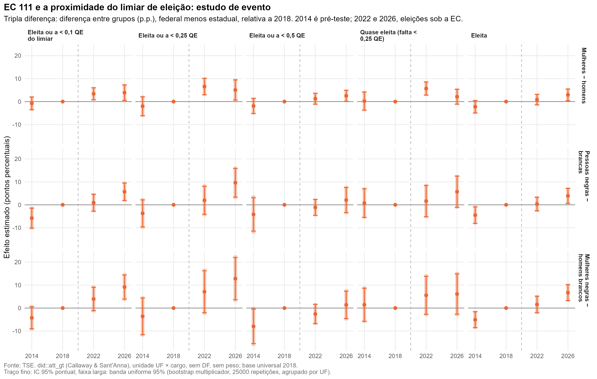
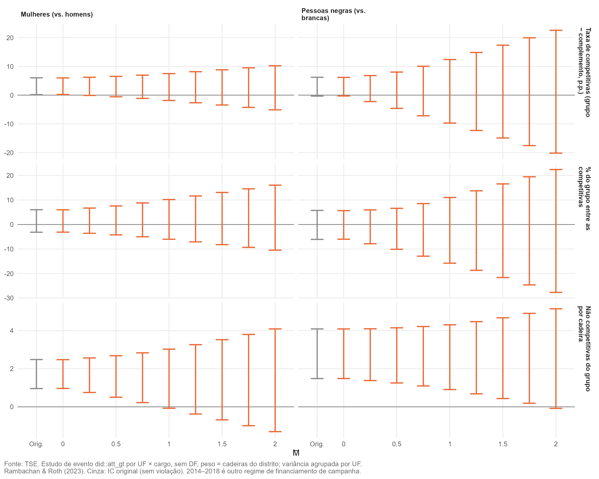

# Os Efeitos da EC 111/2021 sobre Candidaturas, Recursos, Votos e Sucesso Eleitoral de Mulheres e Pessoas Negras {#sec-ec111-competitividade}

```{=html}
<!-- Rascunho reestruturado (2026-11-08; plano quality_reports/plans/2026-11-08_cap3-reestruturacao-ec111.md)
e reorganizado em estrutura acadêmica padrão em 2026-11-10 (plano
quality_reports/plans/2026-11-10_cap3-estrutura-academica.md): Introdução, Revisão da Literatura,
Metodologia, Dados, Resultados (uma subseção por hipótese), Discussão, Conclusão.
Fontes: explorations/ec111-did-2026/ (funil: candidaturas, receita, transferências, gasto, votos, cadeiras;
origem da receita; persistência; tabela de amostra, script 05) e explorations/competitividade-eleitoral/
(margem de votos e margem de gasto, tripla diferença, HonestDiD). Números conferidos nos CSVs de output/
das duas explorações.
2026: votos do TSE de 09/11/2026 (distribuição de cadeiras validada em 100% dos eleitos), registro de
candidaturas de 08/11/2026, receitas e gasto do arquivo de prestação de contas de 08/11/2026, já com a
prestação final (>99% dos registros). Despesas e receitas de todos os anos: só cópias exatas removidas
(regra de 2026-11-09). Números atualizados e conferidos em 2026-11-09. -->
```

## Introdução {#sec-introducao-ec111}

A Emenda Constitucional 111/2021, art. 2º, criou um incentivo financeiro inédito no sistema eleitoral brasileiro em favor da maior representação de mulheres e pessoas negras. Nas eleições de 2022 a 2030, os votos dados a candidaturas desses grupos para a Câmara dos Deputados contam em dobro na distribuição entre os partidos dos fundos públicos de financiamento disponíveis. Diferentemente de outras modalidades de ações afirmativas já discutidas no @sec-revisao-literatura, a regra não obriga o partido a nada. Ela altera, no entanto, o valor relativo de cada voto: um voto obtido por uma mulher ou por uma pessoa negra vale, para o partido no ciclo seguinte, o dobro de um voto obtido por um homem branco. Este capítulo avalia como esse incentivo inovador foi implementado pelos partidos e quais os resultados obtidos nos dois primeiros ciclos eleitorais de sua vigência. A recompensa financeira direcionada aumentou a representação de mulheres e pessoas negras na política brasileira?

A efetividade do incentivo financeiro é medida ao longo do ciclo de vida de uma candidatura, do recrutamento até o resultado eleitoral. Para isso, acompanho a candidatura ao longo de todo o caminho até a efetiva ocupação de uma cadeira: quantas mulheres e pessoas negras os partidos recrutaram como candidatas em suas listas, quanto dinheiro elas arrecadaram e quanto desses recursos foi investido diretamente pelo próprio partido, quanto gastaram, quantos votos obtiveram, quão perto chegaram de se eleger e quantas se elegeram. A distinção entre esses estágios é o centro do argumento. No bônus criado pela emenda, um voto conta o mesmo esteja ele numa candidatura que se elege ou numa candidatura que termina muito longe da cadeira. O desenho da emenda premia o volume de votos, não a eleição. É possível, portanto, que a EC 111 tenha alavancado a votação obtida por essas candidaturas sem, no entanto, afetar a sua representação entre os eleitos. O objetivo que orienta o capítulo é compreender até onde o efeito chega e onde ele, eventualmente, se perde.

Com relação à literatura que avalia o impacto das ações afirmativas sobre a representação de gênero e raça no Brasil, este capítulo apresenta duas principais contribuições. A primeira, mais evidente, é a inclusão dos resultados eleitorais de 2026 na análise, de forma a entender se as mudanças observadas em 2022 persistem ou se alteram. A segunda é o refinamento metodológico, e seu significado substantivo, das medidas de competitividade eleitoral. Em vez de um corte fixo de votos ou da posição na lista, uso a margem de votos de cada candidatura, isto é, quantos votos faltariam (ou sobrariam) para que ela mudasse de resultado, calculada refazendo a distribuição de cadeiras com a regra de cada eleição [@AvelinoBidermanDesposato2022_incumbency; @LuechingerSchelkerSchmid2024_closeness]. Dessa forma, a medida avalia a competitividade da candidatura tanto dentro quanto fora do partido em termos das chances de alterar o resultado eleitoral, sem usar a quantidade de votos obtida como simples aproximação. Foi testada também uma medida de competitividade baseada no gasto eleitoral, seguindo lógica equivalente. A margem de gasto estima qual seria o volume de gasto adicional necessário para alterar o resultado eleitoral daquela candidatura, considerando a competição dentro e fora do partido.

Para identificar o efeito do voto em dobro, sigo a estratégia de @FonsecaThomeGuedesNeto2026_money_talks e comparo as candidaturas a deputado federal, sujeitas ao incentivo, com as candidaturas a deputado estadual nas mesmas UFs e eleições, que não estão sujeitas a ele. Como as cotas de recursos para mulheres e pessoas negras valem para os dois cargos, a comparação separa o efeito específico da EC 111 das demais mudanças do período que atingem ambos. Todos os estágios, da candidatura à cadeira, são estimados com o mesmo estimador de diferenças em diferenças [@CallawaySantAnna2021_did] e a mesma comparação, o que permite ver em que estágio o efeito se perde.

A resposta, adiantada aqui, é que o efeito se perde entre o dinheiro e a cadeira. O incentivo mudou de forma grande e estável a alocação de recursos partidários em favor das mulheres: em 2022 e em 2026, a parcela das transferências do partido destinada a elas subiu cerca de 12 pontos percentuais entre candidaturas federais em comparação com as estaduais, e foi por essa via, e não por outras fontes de receita, que a arrecadação total das candidatas aumentou. Os partidos também lançaram mais mulheres e mais pessoas negras. Mas o dinheiro e os votos adicionais ficaram com candidaturas que terminaram longe do limiar da eleição. O dinheiro adicional, porém, foi distribuído entre muitas candidatas, e a proporção de mulheres com recursos suficientes para disputar uma cadeira não aumentou. Pelo voto, as mulheres parecem ter se aproximado da eleição em 3 a 4 pontos percentuais. Essa aproximação, no entanto, é aparente: decorre sobretudo do aumento de candidaturas masculinas com poucas chances no cargo federal, que reduziu a taxa de competitividade dos homens, e desaparece quando se admite que os dois cargos poderiam ter evoluído de forma um pouco diferente mesmo sem a emenda. A presença de mulheres entre as candidaturas competitivas e entre os eleitos não mudou de forma detectável. Esse padrão se repete em 2026. Para pessoas negras e mulheres negras, a taxa de eleição e parte das medidas de competitividade já vinham melhorando no cargo federal antes da emenda, entre 2014 e 2018. Por isso, os ganhos observados nesses estágios não podem ser atribuídos ao voto em dobro.

## Revisão da Literatura {#sec-literatura-ec111}

A literatura sobre a emenda ainda é pequena e trata só de 2022. Dois trabalhos são descritivos. @EvangelistaEtAl2024_candidaturas_regras comparam as eleições para a Câmara de 2014, 2018 e 2022 e registram aumento das candidaturas e dos eleitos de mulheres, de pessoas negras e de pessoas LGBTQIA+ em 2022, além de maior participação de homens e mulheres negros nas receitas. @Trindade2025_subrepresentacao_camara avalia em conjunto a ADI 5.617 e as Emendas 111/2021 e 117/2022 e encontra, em 2022, aumento das candidaturas de mulheres negras e de homens negros, queda das de homens brancos e aumento da taxa de sucesso apenas entre mulheres negras. Nenhum dos dois separa o efeito do voto em dobro do efeito das cotas de recursos, adotadas no mesmo período.

Dois trabalhos estimam efeitos. Em versão anterior desta pesquisa [@Lucciola2023_financiamento_preprint], estimei por diferenças em diferenças, entre candidaturas a deputado federal de 2014 a 2022, o efeito das regras de distribuição proporcional de recursos (por gênero a partir de 2018, por raça em 2022) sobre a probabilidade de eleição, e encontrei aumento para as mulheres e nenhum efeito para pessoas negras. Como aquela comparação era entre grupos dentro do mesmo cargo, ela mede o efeito conjunto das mudanças de financiamento, não o do voto em dobro. @FonsecaThomeGuedesNeto2026_money_talks são os primeiros a isolar a EC 111, com o mesmo contraste entre deputado federal e estadual usado aqui, para 2018 e 2022: encontram aumento de votos e de recursos para mulheres e pessoas negras, mas concentrado em candidaturas pouco competitivas, definidas pela posição na lista.

Para entender o que esses resultados significam é preciso olhar o que, exatamente, a emenda premia. O voto em dobro entra no cálculo dos dois fundos públicos distribuídos aos partidos, mas com pesos diferentes. No Fundo Partidário, a quase totalidade dos recursos é dividida pela votação para a Câmara dos Deputados. No FEFC, a votação responde por 35% do total; os demais 65% são divididos em partes iguais (2%) e pelo tamanho das bancadas na Câmara (48%) e no Senado (15%) (Lei 9.504/1997, art. 16-D). A dobra vale só para a parcela que segue os votos, e o voto de uma mulher negra conta em dobro uma única vez, sem acúmulo pelas duas condições. O incentivo tem, assim, três propriedades que importam para a análise. Ele é dirigido ao partido, não à candidatura: quem decide quantas mulheres e pessoas negras lançar e quanto dinheiro destinar a cada uma é a direção partidária, a mesma que, como argumentado no @sec-sobreposicao-territorial, tende a proteger candidatos tradicionais na distribuição de recursos e de territórios. Ele premia votos, não cadeiras: para o bônus, um voto de uma candidata que termina com 2% do quociente eleitoral vale o mesmo que um voto de uma candidata eleita, enquanto a parte do FEFC que segue as cadeiras continua a premiar quem já as ocupa. O partido pode, portanto, capturar o benefício espalhando recursos por muitas candidaturas de mulheres e de pessoas negras com chance baixa, sem deslocar os candidatos competitivos que já tem. Chamo essa estratégia de **colheita de votos**: candidaturas que agregam votos à legenda e ao cálculo dos fundos sem disputar de fato uma vaga. Por fim, ele vale só para deputado federal, o que permite comparar as listas federais com as estaduais dos mesmos partidos, nas mesmas UFs e eleições.

A história legislativa da emenda torna a colheita de votos mais do que uma possibilidade teórica. @Gatto2025_resistance_quotas mostra que o voto em dobro foi negociado pela relatora da reforma eleitoral de 2021, a mesma liderança partidária que havia proposto suprimir a obrigatoriedade da cota de candidaturas, e que especialistas já previam à época um benefício concentrado em incumbentes e em seus partidos.

Este capítulo parte do desenho de @FonsecaThomeGuedesNeto2026_money_talks e o estende em três direções: mede a competitividade pela distância até o limiar de eleição, em votos e em reais, em vez da posição na lista; acompanha todos os estágios, da candidatura à cadeira, com o mesmo estimador; e acrescenta 2026. O incentivo atua sobre a decisão partidária, e por isso o primeiro lugar onde ele deveria aparecer é naquilo que o partido controla diretamente: quem lança e para quem envia dinheiro. Daí em diante, cada estágio depende cada vez menos do partido e cada vez mais do eleitor e da concorrência. As hipóteses seguem essa ordem. Em todas, o efeito é medido no cargo de deputado federal em relação ao de deputado estadual, e os grupos são mulheres, pessoas negras e mulheres negras.

-   **H1 (candidaturas).** A EC 111 aumentou a parcela de candidaturas dos grupos nas listas partidárias.
-   **H2 (recursos e gasto).** A EC 111 aumentou a parcela da receita, das transferências do partido e do gasto das listas destinada aos grupos, e esse aumento veio das transferências do partido, não de outras fontes de receita.
-   **H3 (votos).** A EC 111 aumentou a parcela dos votos nominais das listas obtida pelos grupos.
-   **H4 (competitividade).** A EC 111 aumentou, em relação ao grupo de comparação (homens, pessoas brancas, homens brancos), a proporção de candidaturas dos grupos que terminam perto do limiar de eleição, medida pelo voto e pelo gasto.
-   **H5 (eleição).** A EC 111 aumentou a taxa de eleição dos grupos e a sua parcela das cadeiras.
-   **H6 (persistência).** Os efeitos observados em 2022 se mantêm em 2026, quando partidos e candidaturas já conheciam a regra.

Se a resposta dos partidos for a colheita de votos, H1 a H3 devem ser confirmadas e H4 e H5 não, e os ganhos de recursos e de votos devem se concentrar em candidaturas que terminam longe do limiar. Se o incentivo tiver levado os partidos a investir em candidaturas viáveis, o efeito deve se propagar até a competitividade e a cadeira, e H4 e H5 também devem ser confirmadas. As duas leituras não são excludentes em sentido estrito: o incentivo pode ter produzido algumas candidaturas competitivas e muitas não competitivas. O que as distingue é onde está a massa do efeito.

## Metodologia {#sec-desenho-ec111}

### Estimação {#sec-estimacao-ec111}

O tratado é o cargo de deputado federal a partir de 2022; o controle, o de deputado estadual na mesma UF, nunca tratado. Com quatro eleições (2014 e 2018 antes, 2022 e 2026 depois) e uma única data de adoção, o desenho é de diferenças em diferenças com dois grupos e vários períodos, como em @FonsecaThomeGuedesNeto2026_money_talks. @tbl-esquema-ec111 resume o que cada comparação mede.

| Cargo | 2014 | 2018 | 2022 | 2026 |
|:---|:---:|:---:|:---:|:---:|
| Deputado federal (tratado a partir de 2022) | pré-teste | referência | efeito de 2022 | efeito de 2026 |
| Deputado estadual (nunca tratado) | pré-teste | referência | controle | controle |

: Esquema do desenho: cada efeito compara a mudança do cargo federal entre 2018 e o ano indicado com a mudança do cargo estadual no mesmo intervalo. Recursos e gasto começam em 2018 e não têm pré-teste. {#tbl-esquema-ec111}

Para um desfecho $Y$ medido na unidade $i$ (lista ou disputa, conforme o desfecho), o efeito do voto em dobro no ano $t$ é

$$
\text{ATT}(t) = \Big[\,\mathbb{E}\big(Y_{i,t} - Y_{i,2018} \mid \text{federal}\big)\Big] - \Big[\,\mathbb{E}\big(Y_{i,t} - Y_{i,2018} \mid \text{estadual}\big)\Big], \qquad t \in \{2014, 2022, 2026\},
$$ {#eq-att-ec111}

isto é, a mudança média do cargo federal de 2018 para $t$ menos a mesma mudança no cargo estadual. Comparar cada unidade consigo mesma ao longo do tempo elimina o que é fixo nela (o tamanho da UF, o perfil do partido no estado), como faria um efeito fixo de unidade; subtrair a mudança do estadual elimina o que mudou no mesmo período para os dois cargos, como as cotas de recursos e o ambiente político nacional, como faria um efeito fixo de ano. O coeficiente é numericamente igual ao da interação na regressão linear

$$
Y_{i,s} = \alpha + \beta\,\text{Federal}_i + \gamma\,\text{Pós}_s + \delta\,(\text{Federal}_i \times \text{Pós}_s) + \varepsilon_{i,s}, \qquad s \in \{2018, t\},
$$ {#eq-reg-ec111}

com $\delta = \text{ATT}(t)$, e ao da regressão com efeitos fixos de unidade e de ano no painel completo, porque todas as unidades tratadas recebem o tratamento ao mesmo tempo. A estimação usa o estimador de @CallawaySantAnna2021_did, sem covariáveis, que dá o mesmo efeito, separa 2022 e 2026 com a mesma referência e fornece bandas de confiança uniformes; com adoção escalonada ou efeitos que variam no tempo, as regressões com efeitos fixos duplos fazem comparações indevidas, o que o estimador evita [@RothEtAl2023_trending_did]. Os desfechos são parcelas e taxas em %, e os efeitos são lidos em pontos percentuais.

A hipótese de identificação é a de **tendências paralelas**: sem a emenda, a diferença entre federal e estadual teria evoluído da mesma forma depois de 2018. Ela não pode ser observada depois de 2022, mas pode ser examinada antes. O efeito "de 2014", calculado com a mesma conta entre 2014 e 2018, quando não havia voto em dobro, é um **pré-teste**: um coeficiente próximo de zero indica que os dois cargos evoluíam de forma parecida antes da emenda. Ele não prova a hipótese, que agora precisa valer por oito anos [@Roth2022_pretest]. Para receita, transferências e gasto não há pré-teste. Em 2014 ainda valiam as doações de empresas, proibidas a partir de 2015, e a mudança de 2014 para 2018 mostraria o fim desse regime de financiamento, não a tendência anterior dos dois cargos. Nesses desfechos, que incluem o resultado mais forte do capítulo, a hipótese de tendências paralelas é suposta sem checagem direta.

A **persistência** (H6) é medida pela diferença entre os efeitos de 2026 e de 2022, $\Delta = \text{ATT}(2026) - \text{ATT}(2022)$. Uma comparação direta de 2022 com 2026 mediria só essa diferença, não o efeito [@Roth2024_interpreting_event_studies]; aqui ela é calculada a partir das duas estimativas com base em 2018, com erro-padrão obtido da função de influência das duas, somada no mesmo nível de agrupamento dos erros. Uma diferença próxima de zero indica que o efeito de 2022 se repetiu em 2026.

O capítulo combina duas análises com o mesmo desenho e unidades diferentes. Nos **desfechos de parcela** (candidaturas, receita, transferências, gasto e votos), a unidade é a lista partido × UF × cargo, e cada desfecho é a parcela do grupo na lista, em %. Os erros são agrupados por lista. Nos **desfechos de taxa** (competitividade pelo voto e pelo gasto, eleição), a unidade é a disputa UF × cargo (26 UFs × 2 cargos), e o desfecho é a diferença, em pontos percentuais, entre a taxa do grupo e a do grupo de comparação na disputa: mulheres e homens, pessoas negras e brancas, mulheres negras e homens brancos. O estimador aplicado a essa diferença é, portanto, uma **tripla diferença**: grupo × cargo × período, $\text{ATT}(t)$ da @eq-att-ec111 com $Y_{u,c,t} = \text{taxa}^{\,\text{grupo}}_{u,c,t} - \text{taxa}^{\,\text{comparação}}_{u,c,t}$ na UF $u$ e no cargo $c$. As bandas de confiança são uniformes, por bootstrap multiplicador com 25.000 repetições e agrupamento por UF. A taxa de competitivas é estimada na disputa, e não na lista, porque as listas federais perderam competitividade em geral em relação às estaduais entre 2018 e 2022: a parcela de candidaturas competitivas de qualquer grupo numa lista federal cai mecanicamente. A diferença entre grupos dentro da mesma disputa elimina esse componente comum.

O caso impõe limites ao desenho. O primeiro é o **tratamento simultâneo de um só cargo**: não há UFs ou partidos que recebem a regra e outros que não, e qualquer mudança específica do cargo federal depois de 2018 se confunde com a emenda. Pela mesma razão, os intervalos de confiança medem a variação entre as 26 UFs em torno de um contraste nacional; choques nacionais do cargo federal, comuns a todas as UFs, não entram no erro-padrão. O segundo é o **transbordamento** entre os cargos: federal e estadual dividem o orçamento do partido e o mesmo conjunto de potenciais candidatas. Se o voto em dobro levou o partido a deslocar mulheres e recursos do estadual para o federal, o controle é afetado pelo tratamento e o efeito é superestimado, porque o tratado sobe e o controle cai. Os níveis de cada cargo, apresentados junto com os resultados, permitem avaliar essa possibilidade. O terceiro são as **mudanças concorrentes** do período. As que valem para os dois cargos são eliminadas pela comparação: a cota de 30% dos recursos e do tempo de propaganda para mulheres, em vigor desde 2018 e constitucionalizada pela EC 117/2022, e a distribuição proporcional de recursos a candidaturas negras, desde 2020. As que podem atingir só o cargo federal, ou interagir com o incentivo, são as ameaças:

-   **Fim das coligações proporcionais** (EC 97/2017, aplicado a partir de 2020) com limite de candidaturas por partido de M + 1 (Lei 14.211/2021). O efeito sobre o número de candidaturas por cadeira depende da magnitude do distrito, menor em média no federal.
-   **Cláusula de desempenho**, medida só pelos votos para deputado federal: 2% em 2022 e 2,5% em 2026. Incentiva partidos ameaçados a maximizar votos no cargo tratado.
-   **EC 133/2024**, que exige pelo menos 30% do FEFC e do Fundo Partidário para candidaturas negras nos dois cargos. É um choque comum, mas pode interagir com o voto em dobro se os partidos cumprirem a cota alocando recursos no federal.

As duas primeiras são testadas diretamente nos resultados de H4 (@sec-competitividade-ec111). Por fim, como são muitos desfechos para três grupos e duas eleições, defino um desfecho principal por estágio (@tbl-hierarquia-ec111), para evitar que um coeficiente isolado conduza a conclusão. Os demais são lidos como mecanismo ou robustez.

| Estágio | Desfecho principal | Mecanismo e robustez |
|:---|:---|:---|
| Candidaturas | % do grupo nas candidaturas da lista | % na disputa; ponderado pelos votos da lista em 2018; painel desbalanceado |
| Recursos | % da receita total da lista **e** % das transferências do partido | receita vinda do partido × de outras fontes; recursos públicos |
| Gasto | % do gasto da lista | — |
| Votos | % dos votos nominais da lista | % na disputa; sensibilidade a tendências |
| Competitividade | eleita ou a menos de 0,1 QE do limiar, pelo voto e pelo gasto | normalizações de ABD e LSS; gasto relativo ao último eleito; composição das competitivas |
| Eleição | taxa de eleitas | % das cadeiras da disputa |

: Desfechos principais e secundários por estágio. {#tbl-hierarquia-ec111}

### Variáveis {#sec-variaveis-ec111}

@tbl-variaveis-ec111 descreve as variáveis. As dependentes são medidas para cada grupo; a independente é a única variável de tratamento do desenho.

| Variável | Definição | Unidade | Anos |
|:---|:---|:---|:---|
| *Dependentes: parcelas* |  |  |  |
| Candidaturas | % das candidaturas aptas da lista que são do grupo | lista | 2014–2026 |
| Receita total | % da receita de todas as fontes da lista recebida pelo grupo | lista | 2018–2026 |
| Transferências do partido | % dos recursos recebidos da direção partidária pela lista que foram para o grupo | lista | 2018–2026 |
| Recursos públicos | % do FEFC e do Fundo Partidário da lista recebidos pelo grupo, qualquer que seja o intermediário | lista | 2018–2026 |
| Gasto | % da despesa contratada da lista feita pelo grupo, sem doações a outras candidaturas e partidos | lista | 2018–2026 |
| Votos nominais | % dos votos nominais da lista obtidos pelo grupo | lista | 2014–2026 |
| Cadeiras | % dos eleitos da disputa que são do grupo | disputa | 2014–2026 |
| *Dependentes: taxas (diferença entre o grupo e o de comparação)* |  |  |  |
| Competitiva pelo voto | % das candidaturas eleitas ou a menos de 0,1 QE do limiar pela margem de votos | disputa | 2014–2026 |
| Competitiva pelo gasto | % das candidaturas que se elegeriam pelo gasto ou ficariam a menos de 0,1 QE de gasto do limiar | disputa | 2018–2026 |
| Eleita | % das candidaturas eleitas | disputa | 2014–2026 |
| *Independente* |  |  |  |
| Tratamento | 1 para o cargo de deputado federal em 2022 e 2026; 0 nos demais casos | lista ou disputa | 2014–2026 |

: Variáveis dependentes e independente. Grupos: mulheres, pessoas negras (pretas e pardas) e mulheres negras; grupos de comparação nas taxas: homens, pessoas brancas e homens brancos. {#tbl-variaveis-ec111}

A variável de tratamento é a interação entre o cargo federal e o período posterior à emenda (Federal × Pós na @eq-reg-ec111); os termos Federal e Pós, sozinhos, absorvem as diferenças permanentes entre os cargos e as mudanças comuns aos dois. O desenho não usa variáveis de controle. O que é fixo em cada lista ou disputa e o que muda no período para os dois cargos já é eliminado pelas diferenças. Características que a própria emenda pode ter alterado, como o número de candidaturas, o gasto ou a incumbência depois de 2018, não podem entrar como controle sem mascarar parte do efeito. As ponderações (pelos votos da lista em 2018, pelo número de candidaturas da disputa) entram como robustez, para verificar se os efeitos se concentram em listas ou UFs pequenas.

As duas medidas de competitividade exigem descrição mais longa, porque são construídas. As análises anteriores desta tese classificam como competitiva a candidatura eleita ou com pelo menos 10% do quociente eleitoral (QE); @FonsecaThomeGuedesNeto2026_money_talks usam a posição da candidatura na ordem de votação da lista. O corte é simples e comparável entre UFs, mas não diz o quão perto da cadeira a candidatura chegou. Em lista aberta, a distância até a eleição depende dos votos da própria candidatura, dos votos dos colegas de lista e da distribuição de cadeiras entre as listas. Uma candidata com 15% do QE numa lista que elege três pessoas pode estar mais perto da vaga do que outra com 40% do QE numa lista que não elege ninguém.

A **margem de votos** resolve isso. Ela responde a uma pergunta contrafactual: mantidos os votos de todas as demais candidaturas, quantos votos a mais (para quem não se elegeu) ou a menos (para quem se elegeu) mudariam o resultado desta candidatura? A medida foi formalizada para a lista aberta brasileira por @AvelinoBidermanDesposato2022_incumbency, no contexto de desenhos de regressão descontínua sobre incumbência, e generalizada para sistemas proporcionais por @LuechingerSchelkerSchmid2024_closeness, que consideram todos os números possíveis de cadeiras da lista e não apenas a mudança de uma cadeira. As duas propostas trazem fórmulas fechadas para regras genéricas (D'Hondt, maiores restos), mas a regra brasileira tem pisos que dependem do próprio QE: a exigência individual de 10% do QE desde 2018, a restrição das sobras a listas com 80% do QE e candidaturas com 20% do QE a partir de 2022, além das federações. Somar votos a uma candidatura muda o QE e pode ligar ou desligar essas cláusulas. Por isso a margem foi calculada **por busca**: para cada candidatura procura-se o menor número inteiro de votos que, somado ou retirado, muda o resultado, refazendo a cada passo a distribuição completa de cadeiras com a regra do ano. Como o resultado é monótono nos votos da própria candidatura, a busca binária é válida.

::: callout-note
## Validação da medida

-   A distribuição de cadeiras reproduz **100% dos eleitos** do TSE nos 216 distritos (UF × cargo × ano, 2014–2026). Em 2022 a base do TSE já traz os eleitos recalculados após as ADIs 7228, 7263 e 7325, que abriram a terceira fase das sobras a todas as listas.
-   Para deputado federal em 2014, 5.796 das 6.165 candidaturas da base de replicação de @AvelinoBidermanDesposato2022_incumbency foram pareadas. O resultado eleito/não eleito coincide em 99,98% dos casos; entre os eleitos, a diferença mediana na medida é de 0,009; perto do limiar (\|margem\| \< 0,1), 66% coincidem ao centésimo.
:::

A margem é dividida pelo QE do distrito, o que dá uma escala comum entre os dois cargos da mesma UF. **Competitiva** é a candidatura eleita ou a menos de 0,1 QE do limiar de eleição. Bandas mais largas (0,25 e 0,5 QE) foram descartadas como desfecho principal porque saturam: numa lista grande, a distância de uma candidatura fraca até o limiar é determinada pelos colegas de lista, não pelos votos dela. Entre as candidaturas com menos de 0,5% do QE, 27,6% ficam "a menos de 0,25 QE" do limiar, mas só 0,8% a menos de 0,1 QE. As normalizações originais de @AvelinoBidermanDesposato2022_incumbency (pelos votos da candidatura e do primeiro não eleito da lista) e de @LuechingerSchelkerSchmid2024_closeness (pelo eleitorado) entram como robustez. @fig-faixas-margem mostra a distribuição das candidaturas por faixa de margem. Em 2018, último ano antes da emenda, 7,1% das candidatas a deputada federal e 15,9% dos candidatos se elegeram ou ficaram a menos de 0,1 QE do limiar.

{#fig-faixas-margem width="100%"}

A margem de votos tem uma limitação: é uma medida *ex post*, que depende do resultado. Ela mede proximidade do limiar, não a posição em que o partido colocou a candidatura antes da eleição. Para medir essa posição uso o dinheiro. A **margem de gasto** faz a mesma pergunta da margem de votos num mundo contrafactual em que o gasto faz o papel do voto: as listas recebem cadeiras pelo gasto total das suas candidaturas, com a regra do ano aplicada ao "QE de gasto" (gasto do distrito dividido pelas cadeiras), e dentro de cada lista as candidaturas são ordenadas pelo gasto. A margem é quantos reais faltariam ou sobrariam para a candidatura mudar de resultado nesse mundo, dividida pelo QE de gasto. Competitiva pelo gasto é a candidatura que se elegeria pelo gasto ou ficaria a menos de 0,1 QE de gasto do limiar. Como robustez, uso uma medida mais simples, o gasto da candidatura em relação ao do último eleito da sua lista (competitiva quando chega a metade dele). A medida usa a mesma rotina de distribuição da margem de votos, validada reproduzindo a margem de votos quando os votos substituem o gasto. Sozinho, o gasto elege de 50% a 66% dos eleitos reais, e a margem de gasto tem correlação de 0,51 a 0,75 com a margem de votos, o que indica que as duas medem coisas relacionadas, mas distintas.

Usar o gasto para classificar candidaturas como viáveis seria circular aqui, porque o gasto é um dos desfechos que a EC 111 altera. A margem de gasto, porém, não entra como classificação, e sim como **desfecho**: a pergunta é se a emenda colocou mais mulheres e pessoas negras em posição de disputar uma cadeira **em dinheiro**. Ela responde a algo que a parcela do gasto não responde. A parcela mede **volume**, quanto do dinheiro da lista foi para o grupo; a margem mede **concentração**, se esse dinheiro chegou, em alguma candidatura, a ponto de fazê-la disputar a vaga, ou se foi pulverizado entre muitas.

## Dados {#sec-medida-ec111}

Os dados são do TSE e cobrem as candidaturas aptas a deputado federal e estadual em 2014, 2018, 2022 e 2026, nas 26 UFs que elegem os dois cargos (o Distrito Federal não elege deputados estaduais). Gênero e cor/raça são os autodeclarados no registro; pessoas negras são as que se declaram pretas ou pardas, e mulheres negras, a interseção dos dois grupos. Para 2026, os votos vêm do arquivo de votação republicado pelo TSE em 09/11/2026, o registro de candidaturas do arquivo de 08/11/2026 e as receitas e despesas do arquivo de prestação de contas de 08/11/2026, que já traz a prestação final de mais de 99% das candidaturas. As siglas foram harmonizadas para as vigentes em 2026.

Os recursos vêm da prestação de contas das candidaturas. A receita total se divide em duas partes que somam o todo: a que veio do partido e a de **outras fontes** (doações de pessoas físicas, recursos próprios, financiamento coletivo e repasses de outras candidaturas). Nos arquivos do TSE, cada despesa e cada receita é um item de um documento (nota fiscal, contrato, recibo), e um mesmo documento reúne vários itens; por isso todos os itens são somados, e só as linhas idênticas em todas as colunas, cópias do mesmo registro, são descartadas. Receita e gasto não coincidem: parte do que a candidatura recebe pode ser repassada a outras candidaturas ou ao partido, os recursos não utilizados são devolvidos (as sobras do FEFC, ao Tesouro Nacional) e despesas acima da receita podem ser assumidas pelo partido como dívida de campanha. Por isso uso as duas medidas: a receita registra o que o partido e os demais financiadores destinaram a cada candidatura, e o gasto, o que de fato foi empregado na campanha, base da margem de gasto. Recursos e gasto entram de 2018 em diante, porque em 2014 vigorava a doação empresarial, outro regime de financiamento.

@tbl-amostra-ec111 resume a amostra. Em cada ano há 26 disputas por cargo. O painel de listas usado nos desfechos de candidaturas, votos e competitividade é balanceado: são as 799 listas (413 federais e 386 estaduais) presentes nas quatro eleições, com o painel desbalanceado como robustez, já que fusões e federações fazem listas surgirem e desaparecerem [@SantAnnaXu2023_compositional]. Nos desfechos de recursos e gasto, que começam em 2018, o painel balanceado reúne as listas presentes de 2018 a 2026 em que o desfecho existe nos três anos, isto é, em que a lista teve aquele tipo de recurso: são de 770 listas (transferências do partido) a 850 (receita total).



Três características da amostra importam para a leitura dos resultados. O número de candidaturas caiu cerca de 25% em 2026 nos dois cargos, depois do pico de 2022 no federal. A parcela de mulheres e de pessoas negras entre as candidaturas cresce nos dois cargos ao longo do período, o que mostra que parte do aumento observado no federal ocorreu também onde não havia voto em dobro. E a cobertura dos dados financeiros é alta, mas não completa: de 90% a 94% das candidaturas têm receita registrada, e a proporção com gasto subiu de 72% a 77% em 2018 para 85% a 90% em 2022 e 2026, com cobertura algo menor entre pessoas negras. Em 2026, cerca de 400 candidaturas ainda constavam só com prestação parcial ou relatórios financeiros no arquivo de 08/11/2026.

## Resultados {#sec-resultados-ec111}

@tbl-funil-ec111 e @fig-funil-sintese-ec111 resumem os efeitos sobre os desfechos de parcela, do lançamento das candidaturas aos votos, e sobre as cadeiras. Os desfechos de competitividade e de eleição estão em @tbl-ddd-ec111. Os resultados são apresentados na ordem das hipóteses.

| Desfecho (% da lista) | Grupo | Pré-teste 2014 | 2022 | 2026 | Diferença 2026 − 2022 |
|:---|:---|---:|---:|---:|---:|
| Candidaturas | Mulheres | −1,0 | +3,2\* | +2,6\* | −0,6 |
|  | Pessoas negras | +2,6 | +5,0\* | +5,5\* | +0,5 |
|  | Mulheres negras | +0,3 | +3,8\* | +4,1\* | +0,3 |
| Receita total | Mulheres | — | +6,1\* | +5,6\* | −0,5 |
|  | Pessoas negras | — | +3,2 | +3,7 | +0,5 |
|  | Mulheres negras | — | +4,5\* | +5,6\* | +1,0 |
| Transferências do partido | Mulheres | — | +12,4\* | +12,2\* | −0,2 |
|  | Pessoas negras | — | +3,4 | +4,1 | +0,7 |
|  | Mulheres negras | — | +8,1\* | +8,4\* | +0,3 |
| Recursos públicos (FEFC + FP) | Mulheres | — | +8,4\* | +7,4\* | −1,0 |
|  | Pessoas negras | — | +5,1\* | +4,3 | −0,8 |
|  | Mulheres negras | — | +6,4\* | +5,4\* | −0,9 |
| Gasto | Mulheres | — | +7,1\* | +5,0\* | −2,2 |
|  | Pessoas negras | — | +3,6 | +3,0 | −0,6 |
|  | Mulheres negras | — | +5,3\* | +5,2\* | −0,1 |
| Votos nominais | Mulheres | −0,4 | +4,0\* | +2,1 | −1,9 |
|  | Pessoas negras | −0,5 | +3,5 | +2,8 | −0,7 |
|  | Mulheres negras | +1,0 | +3,8\* | +3,9\* | 0,0 |
| Cadeiras (% dos eleitos da UF) | Mulheres | −1,9 | −2,1 | +1,8 | +3,9 |
|  | Pessoas negras | −3,6 | −5,0 | +1,9 | +6,9 |
|  | Mulheres negras | +0,1 | +0,5 | +3,5\* | +3,0 |

: Efeito do voto em dobro ao longo do funil eleitoral, federal × estadual, base 2018 (pontos percentuais). Listas partido × UF, painel balanceado, sem ponderação; cadeiras no nível UF × cargo. \* IC de 95% exclui zero. Receita, transferências, recursos públicos e gasto sem pré-teste (doação empresarial em 2014). {#tbl-funil-ec111}

{#fig-funil-sintese-ec111 width="100%"}

### H1 · Candidaturas {#sec-candidaturas-ec111}

**H1 é confirmada para os três grupos, com magnitude modesta e concentrada em listas pequenas.** A parcela de mulheres nas listas federais sobe cerca de 3 pontos em relação às estaduais, em 2022 e em 2026, com pré-teste próximo de zero. Partindo de 31,7% em 2018, é um aumento modesto, e ele se reduz à metade e perde significância quando as listas são ponderadas pelos votos que tiveram em 2018 (+1,6 nas duas eleições). A parcela de pessoas negras sobe cerca de 5 pontos, mas o efeito desaparece com a ponderação (+0,4 em 2022; +0,1 em 2026): o aumento se concentra em listas pequenas. Para mulheres negras, o efeito é de cerca de 4 pontos, sobre uma base de 14,0% em 2018, também concentrado em listas pequenas. No nível da disputa, que soma as listas, os aumentos se mantêm, de 2 a 4 pontos, com exceção do de pessoas negras em 2022 (+2,6, sem significância).

### H2 · Recursos e gasto {#sec-recursos-ec111}

**H2 é confirmada para mulheres e mulheres negras e não confirmada para pessoas negras.** O efeito pretendido pela emenda, a mudança na alocação de recursos, aparece com clareza para as mulheres e se mantém em 2026. No federal, em relação ao estadual, a parcela das transferências partidárias destinada a mulheres sobe 12,4 pontos percentuais em 2022 e 12,2 em 2026, sobre uma base de 30,2% em 2018; ponderado pelos votos das listas, o efeito é ainda maior (+16,8 e +14,5). A parcela dos recursos públicos sobe 8,4 e 7,4 pontos; a da receita total, 6,1 e 5,6; a do gasto, 7,1 e 5,0. O efeito é maior quanto mais a fonte é controlada pelo partido. Para mulheres negras, o padrão é o mesmo, com cerca de dois terços da magnitude. Para pessoas negras, só os recursos públicos de 2022 sobem de forma distinguível de zero.

A receita total do grupo se divide em duas partes que somam o efeito: a que veio do partido e a de outras fontes. @tbl-receita-ec111 mostra a divisão. Para as mulheres, o aumento da receita total vem do partido: das receitas das listas federais, a parte que chega às candidatas como transferência partidária sobe 4,5 pontos em 2022 e 5,8 em 2026, enquanto a parte que chega de outras fontes não muda (+1,5 e −0,2, sem significância). O mesmo vale para mulheres negras (+4,0 e +5,3 vindos do partido; +0,6 e +0,3 de outras fontes). A emenda não mudou a capacidade das candidatas de arrecadar fora do partido; mudou quanto o partido lhes repassa (@fig-receita-ec111).

| Parte da receita total da lista recebida pelo grupo (pp) | Mulheres 2022 | Mulheres 2026 | Pessoas negras 2022 | Pessoas negras 2026 | Mulheres negras 2022 | Mulheres negras 2026 |
|:---|---:|---:|---:|---:|---:|---:|
| Receita total | +6,1\* | +5,6\* | +3,2 | +3,7 | +4,5\* | +5,6\* |
| Vinda do partido | +4,5\* | +5,8\* | +0,2 | +2,1 | +4,0\* | +5,3\* |
| De outras fontes | +1,5 | −0,2 | +3,0 | +1,5 | +0,6 | +0,3 |
| Do partido, a competitivas | −1,2 | −0,5 | −6,5\* | −4,8\* | 0,0 | +0,6 |
| Do partido, a não competitivas | +5,7\* | +6,3\* | +6,7\* | +7,0\* | +3,9\* | +4,7\* |
| De outras fontes, a competitivas | +0,7 | +0,4 | +1,7\* | +1,3 | 0,0 | +0,4 |
| De outras fontes, a não competitivas | +0,8 | −0,6 | +1,3 | +0,3 | +0,6 | −0,1 |

: De onde vem a receita total do grupo: efeito do voto em dobro sobre a parcela da receita total da lista recebida pelo grupo, dividida entre a que veio do partido e a de outras fontes, e entre candidaturas competitivas e não competitivas (eleitas ou a menos de 0,1 QE do limiar de eleição). As partes somam o efeito sobre a receita total. Listas partido × UF, painel balanceado, sem ponderação, base 2018. \* IC de 95% exclui zero. {#tbl-receita-ec111}

{#fig-receita-ec111 width="100%"}

A divisão entre competitivas e não competitivas mostra para onde foi o dinheiro do partido. Para as mulheres, praticamente todo o aumento da receita vinda do partido ficou com candidatas que terminaram longe do limiar (+5,7 e +6,3 pontos da receita total da lista), e nada com as competitivas. Para pessoas negras, a receita total não muda, mas há uma realocação dentro dela: a parte da receita total que o partido transfere a candidaturas negras competitivas **cai** 6,5 pontos em 2022 e 4,8 em 2026, e a que transfere às não competitivas sobe na mesma medida. A mesma divisão, aplicada às transferências do partido, ao gasto e aos votos, está em @tbl-decomposicao-ec111, nos resultados de H4.

### H3 · Votos {#sec-votos-ec111}

**H3 é confirmada em 2022 para mulheres e mulheres negras, e em 2026 só para mulheres negras; não é confirmada para pessoas negras.** O ganho de votos das mulheres, de 4,0 pontos em 2022, cai para 2,1 em 2026 e perde significância. A queda vem sobretudo do cargo de controle: de 2022 para 2026 a parcela dos votos nominais das mulheres passou de 20,3% para 25,5% no estadual e de 20,9% para 24,1% no federal. Uma aproximação da sensibilidade a violações de tendências paralelas (o conjunto identificado sob magnitudes relativas, somado a ±1,96 erro-padrão, sem a inferência completa de @RambachanRoth2023_parallel_trends) aponta na mesma direção: o efeito de 2022 resiste a violações de até cerca de 0,6 vez a pré-tendência observada; o de 2026, a nenhuma. Para mulheres negras, o ganho de votos é de 3,8 pontos em 2022 e 3,9 em 2026, sobre uma base de 6,6%. Para pessoas negras, nenhum dos dois efeitos é distinguível de zero.

### H4 · Competitividade {#sec-competitividade-ec111}

**H4 não é confirmada.** Pelo gasto, a posição das mulheres não muda; pelo voto, há uma aproximação que não resiste ao exame das explicações alternativas; para pessoas negras e mulheres negras, o pré-teste falha e o efeito não é identificado.

@tbl-ddd-ec111 traz a tripla diferença para a taxa de candidaturas competitivas e para a taxa de eleitas. Para as mulheres, a competitividade **pelo voto** aumenta em relação à dos homens nas duas eleições: 3,4 pontos em 2022 e 3,9 em 2026, ou 3,6 em média, com pré-teste próximo de zero. Como em 2018 a diferença entre homens e mulheres no federal era de cerca de 9 pontos (15,9% contra 7,1%), o efeito equivaleria a fechar perto de 40% dessa distância.

| Desfecho / especificação | 2014 (pré) | 2022 | 2026 | Média | Dif. 2026 − 2022 |
|:---|---:|---:|---:|---:|---:|
| *Mulheres − homens* |  |  |  |  |  |
| Competitiva pelo voto, principal | −0,8 \[−3,9; 2,4\] | **3,4** \[0,4; 6,4\] | **3,9** \[0,0; 7,7\] | **3,6** \[0,9; 6,3\] | +0,5 \[−2,1; 3,1\] |
| Idem, ponderado pelo número de candidaturas | 0,6 | 2,4 | 2,3 | 2,3 | −0,1 |
| Idem, sem UFs com 8 cadeiras | 0,9 | **3,9** | **4,9** | **4,4** |  |
| Idem, sem incumbentes (2018–2026) | — | **3,0** | 2,3 | 2,7 |  |
| Idem, normalização de ABD | −2,4 | 1,9 | 3,1 | **2,5** | +1,2 |
| Idem, normalização de LSS | −2,0 | 0,5 | 1,8 | 1,2 | +1,2 |
| Competitiva pelo gasto (margem de gasto) | 0,1 | 2,2 \[−0,5; 5,0\] | 0,4 \[−4,5; 5,4\] | 1,3 \[−1,6; 4,3\] | −1,8 |
| Eleita pelo gasto | −0,5 | 0,8 | 0,0 | 0,4 | −0,8 |
| Gasto ≥ metade do último eleito da lista | 3,5 | 3,2 | 3,4 | 3,3 | +0,2 |
| Eleita | −2,3 | 0,9 | **2,9** \[0,1; 5,8\] | 1,9 | **+2,1** \[0,2; 3,9\] |
| *Pessoas negras − brancas* |  |  |  |  |  |
| Competitiva pelo voto | **−5,8** \[−10,7; −0,8\] | 0,9 | **5,7** | **3,3** | **+4,8** |
| Competitiva pelo gasto | **−4,9** | −1,3 | 0,8 | −0,2 | +2,1 |
| Eleita | **−4,5** \[−8,6; −0,4\] | 0,3 | **3,9** | 2,1 | **+3,6** |
| *Mulheres negras − homens brancos* |  |  |  |  |  |
| Competitiva pelo voto | −4,2 | 3,9 | **9,1** | **6,5** | +5,2 |
| Competitiva pelo gasto | −1,9 | 2,0 | 1,9 | 1,9 | −0,1 |
| Eleita | **−5,1** | 1,5 | **6,7** | **4,1** | **+5,2** |

: Tripla diferença (grupo × cargo × período) na taxa de candidaturas competitivas (eleitas ou a menos de 0,1 QE do limiar, em votos ou em gasto) e na taxa de eleitas, base 2018 (pontos percentuais). Unidade UF × cargo, sem DF, sem ponderação salvo indicação. Colunas de ano: bandas uniformes de 95% (bootstrap multiplicador com 25.000 repetições, agrupado por UF); média e diferença: IC de 95% pontual. Em negrito, intervalo que exclui zero. No gasto, 2014 não é lido como pré-teste (doação empresarial). ABD = @AvelinoBidermanDesposato2022_incumbency; LSS = @LuechingerSchelkerSchmid2024_closeness. {#tbl-ddd-ec111}

{#fig-ddd-ec111 width="100%"}

O resultado pelo voto é sensível à especificação. Ponderado pelo número de candidaturas, o que dá mais peso às UFs grandes, o efeito médio cai para 2,3 pontos e deixa de ser significativo. Com a normalização de @LuechingerSchelkerSchmid2024_closeness, fica em 1,2 e também não é significativo. Ele se mantém quando se excluem as UFs com 8 cadeiras federais, onde a distância até o limiar é mais grosseira, e diminui um pouco quando se excluem os incumbentes.

**Pelo gasto, a posição das mulheres não muda.** A margem de gasto dá efeitos pequenos e sem significância nas duas eleições (+2,2 em 2022, +0,4 em 2026), assim como a eleição pelo gasto (+0,8 e 0,0) e o gasto em relação ao do último eleito da lista (+3,2 e +3,4). Isso não quer dizer que as mulheres não tenham ganhado posição em dinheiro. A parcela das candidatas federais competitivas pelo gasto passou de 5,2% em 2018 para 8,8% em 2022 e 10,4% em 2026; mas nas estaduais ela também subiu, de 9,4% para 12,4% e 16,4%. A aproximação pelo dinheiro ocorreu nos dois cargos, o que é compatível com a cota de 30% dos recursos para mulheres, que vale para ambos e que a tripla diferença elimina. A melhora da posição das candidatas estaduais sugere, além disso, que o cargo de controle não perdeu recursos para o federal, embora não exclua um deslocamento menor (o transbordamento discutido na Metodologia). O que a EC 111 acrescentou no cargo federal foi volume de dinheiro, não candidatas em posição de disputa.

Há, portanto, uma assimetria: o voto em dobro aumentou a parcela do gasto das mulheres no federal (@sec-recursos-ec111) sem aumentar a proporção de mulheres com dinheiro suficiente para disputar uma cadeira. O dinheiro adicional foi distribuído por muitas candidaturas, nenhuma delas levada ao limiar. É a versão monetária da colheita de votos. Para pessoas negras e mulheres negras, os efeitos pelo gasto também não se distinguem de zero, em nenhuma das duas eleições nem na média delas.

Além disso, a taxa de competitivas é uma razão, e a aproximação das mulheres pelo voto pode vir tanto do numerador quanto do denominador. Duas medidas olham diretamente para o conjunto das competitivas e não mostram mudança:

-   **Composição.** A parcela de mulheres entre as candidaturas competitivas pelo voto sobe nos dois cargos quase no mesmo ritmo: no federal, 17,1% em 2018, 19,3% em 2022 e 21,1% em 2026; no estadual, 16,7%, 17,7% e 20,1%. A diferença entre os cargos é de 1,4 a 1,7 ponto, sem significância.
-   **Cadeiras.** A parcela de mulheres entre os eleitos não muda de forma distinguível de zero (@sec-resultado-ec111).

Se a EC 111 tivesse trazido mais mulheres para perto do limiar, elas apareceriam no conjunto das competitivas. Não aparecem. Para saber em que candidaturas ficaram os ganhos de votos, gasto e recursos, a parcela do grupo na lista pode ser dividida em duas partes, a das candidaturas do grupo que terminaram competitivas e a das que terminaram não competitivas. As duas partes **somam o efeito total**, e nenhuma candidatura é excluída. @tbl-decomposicao-ec111 e @fig-decomposicao-ec111 mostram a divisão.

| Desfecho (% da lista) | 2022: competitivas | 2022: não competitivas | 2026: competitivas | 2026: não competitivas |
|:---|---:|---:|---:|---:|
| *Mulheres* |  |  |  |  |
| Votos | −1,1 | +5,2\* | −0,3 | +2,5 |
| Gasto | −0,1 | +7,3\* | 0,0 | +4,9\* |
| Transferências do partido | +0,9 | +11,5\* | +2,0 | +10,2\* |
| *Pessoas negras* |  |  |  |  |
| Votos | −4,8\* | +8,2\* | −3,0 | +5,8\* |
| Gasto | −4,3\* | +7,9\* | −3,3 | +6,3\* |
| Transferências do partido | −8,0\* | +11,4\* | −5,0\* | +9,0\* |
| *Mulheres negras* |  |  |  |  |
| Votos | −0,5 | +4,4\* | +1,0 | +2,9\* |
| Gasto | +0,1 | +5,2\* | +1,0 | +4,2\* |
| Transferências do partido | +0,6 | +7,5\* | +1,5 | +6,9\* |

: Decomposição do efeito do voto em dobro entre candidaturas competitivas e não competitivas do grupo (pontos percentuais; competitiva = eleita ou a menos de 0,1 QE do limiar pelo voto). Listas partido × UF, painel balanceado, sem ponderação, base 2018. \* IC de 95% exclui zero. {#tbl-decomposicao-ec111}

{#fig-decomposicao-ec111 width="100%"}

Para as mulheres, praticamente todo o ganho está nas candidaturas não competitivas. Dos 12,4 pontos a mais de transferências partidárias em 2022, 11,5 foram para candidatas que terminaram a mais de 0,1 QE do limiar; dos 7,1 pontos a mais de gasto, todos. O mesmo vale para os votos: o efeito de 4,0 pontos em 2022 divide-se em −1,1 de competitivas e +5,2 de não competitivas, com pré-teste próximo de zero nas duas partes. O padrão se repete em 2026 e, com magnitudes menores, para mulheres negras. Para pessoas negras, há uma realocação: as transferências, o gasto e os votos de candidaturas negras competitivas **caem**, e os das não competitivas sobem. Nos votos, porém, o pré-teste de 2014 já aponta na mesma direção (−3,9 nas competitivas e +3,4 nas não competitivas), o que sugere a continuação de uma tendência anterior.

::: callout-important
## Como ler uma classificação feita depois da eleição

Competitiva ou não competitiva é definida pelo resultado, que a própria EC 111 pode alterar. A divisão do efeito total em duas partes continua válida como decomposição contábil, porque as partes somam o total e ninguém é excluído. O que ela não permite é tratar as competitivas como um grupo fixo e comparar o que aconteceu dentro dele. Ainda assim, a direção do viés favorece a leitura adotada: se o dinheiro extra tivesse tornado competitivas candidaturas que não o seriam, essas candidaturas e o dinheiro que receberam apareceriam do lado das competitivas. O fato de o dinheiro aparecer do lado das não competitivas indica que, mesmo com mais recursos, essas candidaturas não chegaram perto do limiar. A margem de gasto, que não depende do resultado, aponta na mesma direção.
:::

Se os recursos e os votos ficaram com candidaturas não competitivas e a composição das competitivas não mudou, a aproximação das mulheres na taxa de competitivas pelo voto tem de vir do denominador. É o que mostram os números de candidaturas não competitivas por cadeira, que também permitem testar as duas mudanças concorrentes que atingem só o cargo federal.

**A expansão das candidaturas fracas no federal.** De 2018 para 2022, as candidaturas femininas não competitivas ao cargo federal passaram de 2.201 para 3.090 (de 4,4 para 6,1 por cadeira); no estadual ficaram estáveis, em 4.666 (4,5 por cadeira). O efeito sobre as mulheres não competitivas por cadeira é de +1,7 a +2,2, em 2022 e em 2026. Mas as candidaturas masculinas não competitivas cresceram ainda mais no federal: a diferença entre mulheres e homens em não competitivas por cadeira é de −1,1 a −1,2. Houve uma expansão geral de candidaturas fracas no cargo federal, maior entre homens. Como os homens ganharam mais candidaturas sem chance, a taxa de competitivos entre eles caiu (no federal, de 15,9% em 2018 para 10,5% em 2022), e é essa queda que produz a maior parte da "aproximação" das mulheres.

**A cláusula de desempenho não explica a expansão.** Uma explicação candidata é que partidos ameaçados pela cláusula de desempenho, medida só pelos votos para deputado federal, lançaram mais candidaturas para somar votos. Classificando partidos e federações pela votação para a Câmara em 2018 (pressionados abaixo de 4%), a expansão de candidaturas não competitivas em 2022 é geral e apenas um pouco maior nos pressionados: entre os homens, +1,5 por cadeira nos partidos com folga e +1,9 nos pressionados; entre as mulheres, +0,9 e +1,2. A aproximação das mulheres na taxa de competitivas aparece nos partidos **com folga** (+4,5 a +5,8 pontos) e não nos pressionados (+0,9 a +1,8). A composição das competitivas não muda em nenhum dos dois grupos.

**O fim das coligações e a magnitude do distrito.** Uma segunda explicação é o fim das coligações com limite de M + 1 candidaturas por partido, que pesa mais em distritos de magnitude pequena, mais comuns no federal. Regressões por distrito da variação de candidaturas aptas por cadeira mostram que o federal cresceu 5,6 candidaturas por cadeira a mais que o estadual de 2018 para 2022; controlando pelo log da magnitude, 4,5; restringindo à faixa de magnitude comum aos dois cargos (24 a 70 cadeiras), 3,6 a 3,7, todos significativos. A magnitude explica a maior parte do aumento do número de **listas** por cadeira, mas só 20% a 35% do aumento de **candidaturas** (@fig-magnitude-ec111).

{#fig-magnitude-ec111 width="100%"}

**A tendência já existia antes da emenda.** De 2014 para 2018, quando havia coligações nos dois anos e não havia voto em dobro, o federal já crescia mais em candidaturas por cadeira, com excesso de 1,7 a 3,1 sobre o estadual. A média por distrito foi de 10,3 para 13,3 e depois 17,8 candidaturas por cadeira no federal, contra 13,4, 14,8 e 13,7 no estadual. É uma federalização da estratégia partidária que começa antes da EC 111, plausivelmente ligada à distribuição de fundos e à cláusula de desempenho atreladas à Câmara desde 2018. Na faixa de magnitude comum, a diferença na taxa de competitivas entre mulheres e homens aumenta 3,0 a 3,2 pontos de 2018 para 2022, contra 3,5 pontos de 2014 para 2018, um período sem o incentivo que serve de placebo. Entre distritos comparáveis, o "efeito" tem o mesmo tamanho da tendência anterior.

**Sensibilidade formal.** A análise de @RambachanRoth2023_parallel_trends formaliza essa preocupação. Sob a restrição de magnitudes relativas, a violação de tendências paralelas depois de 2018 pode ser até M̄ vezes a observada de 2014 para 2018. O **valor de quebra** é o maior M̄ com que o intervalo robusto de 95% ainda exclui zero (@tbl-honestdid-ec111, @fig-honestdid-ec111).

| Desfecho (efeito médio 2022–2026) | Estimativa | IC original | Quebra M̄ |
|:---|---:|:---:|---:|
| *Mulheres* |  |  |  |
| Taxa de competitivas (mulheres − homens) | 3,1 / 3,6 | \[0,2; 6,0\] / \[0,7; 6,5\] | 0 / 0,25 |
| Taxa de eleitas (mulheres − homens) | 2,2 / 1,9 | \[0,0; 4,3\] / n.s. | 0 / — |
| \% de mulheres entre as competitivas | 1,4 / 1,7 | n.s. | — |
| Mulheres não competitivas por cadeira | 1,7 / 2,2 | \[1,0; 2,5\] / \[1,7; 2,7\] | **0,75 / 1,5** |
| Não competitivas por cadeira (mulheres − homens) | −1,1 / −1,2 | \[−1,9; −0,3\] / \[−1,9; −0,5\] | 0,25 / 0,25 |
| *Pessoas negras* |  |  |  |
| Taxa de competitivas e % entre as competitivas | — | n.s. | — |
| Pessoas negras não competitivas por cadeira | 2,8 / 3,5 | \[1,5; 4,1\] / \[2,3; 4,7\] | **1,75 / ∞** |

: Sensibilidade a violações de tendências paralelas (HonestDiD, magnitudes relativas). Valores com peso pela magnitude do distrito / sem peso. "Quebra M̄" é o maior múltiplo da violação de 2014–2018 com que o IC robusto de 95% ainda exclui zero; "—" indica que o IC original já inclui zero. {#tbl-honestdid-ec111}

{#fig-honestdid-ec111 width="100%"}

A aproximação das mulheres ao limiar pelo voto só se sustenta se a violação de tendências depois de 2018 for praticamente nula (M̄ \< 0,25). O que resiste é o aumento de candidaturas **não competitivas** no cargo federal: de mulheres, até violações de 0,75 a 1,5 vez a de 2014–2018; de pessoas negras, até 1,75 vez ou mais. Como há um único período anterior, estimado com imprecisão, a restrição de magnitudes relativas é conservadora, porque incorpora a incerteza do coeficiente de 2014. A restrição alternativa de suavidade não pôde ser calculada: com um só período anterior ela é degenerada, e o procedimento recomendado nesse caso não roda na versão de R disponível.

### H5 · Eleição {#sec-resultado-ec111}

**H5 não é confirmada para as mulheres e não é identificada para pessoas negras e mulheres negras.** No fim do funil, a parcela de cadeiras ocupadas por mulheres e por pessoas negras não muda de forma distinguível de zero em nenhuma das duas eleições (@tbl-funil-ec111). Com 52 disputas os intervalos são largos, mas as estimativas pontuais também são pequenas e mudam de sinal entre 2022 e 2026. A taxa de eleitas das mulheres em relação à dos homens não muda em 2022 (+0,9) e sobe 2,9 pontos em 2026 (@tbl-ddd-ec111). É o único desfecho de eleição das mulheres com efeito distinguível de zero, aparece numa só eleição e não resiste a nenhuma violação de tendências paralelas (@tbl-honestdid-ec111); deve ser lido com cautela, à luz das comparações múltiplas.

Para pessoas negras e para mulheres negras, a taxa de eleitas e a de competitivas sobem em 2026 em relação a 2018: para mulheres negras, 6,7 e 9,1 pontos em relação aos homens brancos, e a parcela de mulheres negras entre os eleitos sobe 3,5 pontos. Mas o pré-teste falha nesses desfechos. Em 2014, a diferença entre pessoas negras e brancas na taxa de competitivas era 5,8 pontos menor no federal que no estadual, em relação a 2018, e na taxa de eleitas, 4,5 pontos menor; entre mulheres negras e homens brancos, a taxa de eleitas era 5,1 pontos menor. Esses coeficientes são da mesma ordem dos efeitos de 2026, o que indica que a posição relativa das candidaturas negras no cargo federal já vinha melhorando antes da emenda, e a tendência de 2014 para 2018 continuaria até 2026 mesmo sem ela. O desenho não permite atribuir esses ganhos ao voto em dobro. Em 2026, além disso, a cota de 30% dos recursos para candidaturas negras da EC 133/2024 dificulta separar o efeito do voto em dobro do efeito da nova reserva.

### H6 · Persistência {#sec-persistencia-ec111}

**H6 é confirmada: o padrão de 2022 se repete em 2026, nos ganhos e nas ausências.** A última coluna de @tbl-funil-ec111 e de @tbl-ddd-ec111 mostra a diferença entre os efeitos de 2026 e de 2022. Nenhuma das diferenças nos desfechos de parcela da @tbl-funil-ec111 é distinguível de zero: em 2026, partidos que já conheciam a regra lançaram mais mulheres e pessoas negras e transferiram mais recursos às mulheres no cargo federal na mesma medida em que o fizeram em 2022. O efeito sobre as transferências às mulheres é praticamente idêntico nas duas eleições (+12,4 e +12,2 pontos). A exceção está na decomposição (@tbl-decomposicao-ec111): a queda das transferências do partido a candidaturas negras competitivas é menor em 2026 (−5,0 pontos) que em 2022 (−8,0), uma recuperação parcial distinguível de zero, possivelmente ligada à cota da EC 133/2024.

Persistiram também as ausências. A competitividade das mulheres pelo gasto não melhorou em 2026, e a pelo voto ficou no mesmo patamar (diferença de +0,5 ponto). O efeito sobre os votos das mulheres enfraqueceu, de 4,0 para 2,1 pontos, mas a diferença não é significativa e vem sobretudo do avanço das mulheres no cargo de controle. A taxa de eleitas das mulheres é o único desfecho que aumenta de uma eleição para a outra (+2,1 pontos), sem que a parcela de cadeiras acompanhe. Para pessoas negras e mulheres negras, os aumentos de 2022 para 2026 na competitividade e na eleição seguem a mesma direção da tendência anterior à emenda e não podem ser lidos como aprendizado dos partidos.

O que mudou entre as duas eleições ajuda a qualificar essa leitura. Em 2026 houve cerca de 25% menos candidaturas nos dois cargos (@tbl-amostra-ec111), a cláusula de desempenho subiu de 2% para 2,5% dos votos para a Câmara e a EC 133/2024 passou a reservar recursos a candidaturas negras nos dois cargos. Nenhuma dessas mudanças alterou a forma como os partidos responderam ao incentivo no caso das mulheres: mais candidaturas, mais dinheiro, concentrado nas que não disputam a cadeira.

## Discussão {#sec-discussao-ec111}

Ao longo do funil, o efeito do voto em dobro é grande onde a decisão é do partido e desaparece onde ela depende da disputa. Os partidos lançaram mais mulheres e mais pessoas negras no cargo federal (H1) e transferiram mais recursos às mulheres, cerca de 12 pontos percentuais a mais, em 2022 e em 2026 (H2). O aumento da receita das candidatas veio do partido, não de outras fontes. Os votos das mulheres acompanharam em 2022 e enfraqueceram em 2026 (H3). Mas a competitividade pelo gasto não mudou, a pelo voto mudou pouco e por um caminho que não é o da emenda, e a presença de mulheres entre as competitivas e entre os eleitos não mudou de forma detectável (H4 e H5). Esse padrão se manteve em 2026 (H6).

O padrão é o que o desenho da regra faz esperar. Como o bônus da emenda remunera votos e não cadeiras, o partido pode capturar o benefício lançando e financiando mais candidaturas de mulheres e de pessoas negras sem chance, sem mexer nas candidaturas competitivas que já tem, majoritariamente de homens brancos e de incumbentes. A colheita de votos é a resposta de menor custo para a direção partidária e é compatível com o mecanismo de proteção dos candidatos tradicionais desenvolvido no @sec-sobreposicao-territorial. A divisão da receita mostra o instrumento: o partido é a fonte do dinheiro adicional e é ele quem o dirige às candidaturas que não disputam a vaga. A margem de gasto mostra o resultado: mais dinheiro para as mulheres, distribuído de modo que nenhuma delas fosse levada ao limiar pelo dinheiro. É o que @FonsecaThomeGuedesNeto2026_money_talks encontram para 2022 com outra definição de competitividade, e o que @Gatto2025_resistance_quotas registra como previsão de especialistas no momento da aprovação da emenda.

Os resultados também ajudam a ler a literatura anterior. O aumento das candidaturas e da presença de mulheres negras entre os eleitos em 2022, registrado por @EvangelistaEtAl2024_candidaturas_regras e @Trindade2025_subrepresentacao_camara, e o aumento das chances eleitorais das mulheres estimado em @Lucciola2023_financiamento_preprint são compatíveis com o que se observa aqui quando se compara o cargo federal consigo mesmo ao longo do tempo. A comparação com o cargo estadual mostra que boa parte dessas mudanças ocorreu também onde não havia voto em dobro, como efeito das cotas de recursos, e que a parte específica do voto em dobro está nas candidaturas e no dinheiro, não nas cadeiras.

A aproximação das mulheres ao limiar de eleição pelo voto, de 3 a 4 pontos na taxa de candidaturas competitivas, não deve ser lida como efeito da emenda sobre a competitividade. Ela vem da queda da taxa de competitivos entre os homens, causada pela expansão de candidaturas masculinas não competitivas no cargo federal; tem, em distritos de magnitude comparável, o mesmo tamanho da tendência observada de 2014 para 2018; não aparece nos partidos pressionados pela cláusula de desempenho; não tem correspondente pelo gasto; e não resiste a violações de tendências paralelas maiores que um quarto da observada antes da emenda.

Esses resultados têm limites que decorrem do caso. **Tratamento simultâneo de um só cargo.** O tratamento é atribuído ao cargo inteiro, ao mesmo tempo em todas as UFs, e qualquer choque específico do cargo federal entre 2018 e 2026 entra no efeito. A federalização da estratégia partidária documentada nos resultados de H4 é precisamente um choque desse tipo, e ela começa antes da emenda. Pela mesma razão, os intervalos de confiança não incorporam choques nacionais do cargo federal, e a evidência sobre a tendência anterior pesa mais na leitura do que a significância de cada coeficiente.

**Transbordamento entre os cargos.** Federal e estadual dividem o orçamento e as candidatas dos mesmos partidos. Se recursos e mulheres tivessem sido deslocados do estadual para o federal, os efeitos de H1 e H2 estariam superestimados. A melhora da posição das candidatas estaduais pelo gasto e o aumento da parcela de mulheres entre as candidaturas estaduais (@tbl-amostra-ec111) indicam que o cargo de controle não perdeu terreno, mas o desenho não exclui um deslocamento menor, que teria reduzido esse crescimento.

**Um único período anterior.** Com 2014 como único pré-teste, a hipótese de tendências paralelas por oito anos não pode ser examinada em detalhe, e a restrição de suavidade da análise de sensibilidade é degenerada. Para recursos e gasto não há pré-teste, porque 2014 ocorreu sob outro regime de financiamento.

**Medidas de competitividade.** A margem de votos mede proximidade do limiar no resultado, não viabilidade antes da eleição; a decomposição entre competitivas e não competitivas é válida, mas comparações dentro de cada categoria são descritivas. A margem de gasto não depende do resultado, mas supõe um mundo em que o dinheiro distribui as cadeiras, o que é uma simplificação: o gasto, sozinho, elege de metade a dois terços dos eleitos reais.

**Dados de 2026.** As receitas e o gasto de 2026 vêm da prestação de contas final, mas cerca de 400 candidaturas ainda constavam só com prestação parcial ou relatórios financeiros no arquivo de 08/11/2026. Os votos são os do arquivo republicado pelo TSE em 09/11/2026, com a distribuição de cadeiras validada em todos os distritos. O TSE ainda republica esses arquivos; em relação à versão de 13/10/2026, os eleitos não mudaram, três candidaturas mudaram de votação e 88 deixaram de constar como aptas, o que alterou estimativas em no máximo alguns décimos.

**Comparações múltiplas.** O capítulo estima muitos desfechos para três grupos e duas eleições. Os resultados que sustentam a conclusão, a alocação de recursos às mulheres pelo partido e o aumento de candidaturas não competitivas, são os de maior magnitude e mais estáveis entre especificações e entre as duas eleições; os efeitos isolados e marginais, como a taxa de eleitas das mulheres em 2026, devem ser lidos com cautela.

Em síntese, a evidência se divide em três grupos. São efeitos causais robustos do voto em dobro a alocação de recursos do partido às mulheres e às mulheres negras e o aumento de candidaturas não competitivas no cargo federal. É frágil a aproximação das mulheres ao limiar de eleição pelo voto, e a taxa de eleitas das mulheres em 2026. Não são identificados pelo desenho os ganhos de competitividade e de eleição de pessoas negras e de mulheres negras, que seguem uma tendência anterior à emenda.

## Conclusão {#sec-conclusao-ec111}

A EC 111/2021 mudou o comportamento dos partidos no que ela remunera, e essa mudança persistiu. Em 2022 e em 2026, os partidos lançaram mais mulheres e mais pessoas negras na disputa para a Câmara dos Deputados e transferiram mais recursos às candidatas, e é por essa via, a do partido, que a receita das mulheres aumentou. Mas o incentivo não as tornou mais competitivas. Os recursos e os votos adicionais ficaram com candidaturas que terminaram longe do limiar de eleição; medida em dinheiro, a posição das mulheres na disputa por cadeiras não mudou; a presença de mulheres e de pessoas negras entre as candidaturas competitivas e entre os eleitos não mudou de forma detectável; e a pequena aproximação das mulheres ao limiar pelo voto é explicada pela expansão de candidaturas masculinas sem chance e pela tendência que já existia antes da emenda. O aumento da parcela de mulheres negras entre os eleitos em 2026 segue a mesma tendência anterior e não pode ser atribuído ao voto em dobro.

O resultado reforça um argumento central desta tese: políticas que incentivam os partidos sem condicionar o benefício à eleição tendem a ser absorvidas pela estratégia partidária de menor custo, que preserva as candidaturas competitivas existentes. Um incentivo baseado em votos produz votos e o dinheiro necessário para colhê-los. Para produzir representação, o desenho teria de premiar cadeiras ou proximidade da cadeira, ou restringir a pulverização de recursos entre candidaturas sem viabilidade.

```{=html}
<!-- Resolvido em 2026-11-09:
- Votação de 2026 refeita com o arquivo republicado pelo TSE (09/11); eleitos idênticos, validação 100%.
- Deduplicação: só cópias exatas saem (decisão da autora); gasto 2018/2022/2026 e receitas refeitos.
  Ver explorations/ec111-did-2026/README.md, seção "Regra de contagem da prestação de contas".
Resolvido em 2026-11-10:
- Estrutura acadêmica padrão (plano 2026-11-10_cap3-estrutura-academica.md); hipóteses H1–H6;
  tabela de amostra (script 05_tabela_amostra.R); regra do FEFC (Lei 9.504/1997, art. 16-D: 2% iguais,
  35% votos, 48% bancada na Câmara, 15% bancada no Senado; o voto em dobro entra só nos 35%).
Pendências (2026-11-10):
- Preferência da autora (10/11): estimar também por regressão linear de DiD tradicional.
- Robustez com efeitos fixos de lista e de UF × ano (decidido em 10/11: fica para a etapa seguinte).
- Revisão de 10/11 (quality_reports/paper_review_03-ec111-competitividade-eleitoral_round1.md):
  harmonizar pesos e IC entre tbl-ddd e tbl-honestdid (MC5), rever a justificativa de que a restrição de
  magnitudes relativas é "conservadora" (MC6), inferência com poucos clusters (MC3), cláusula com corte de
  4% sem justificativa e sem IC (mc1), placebo da faixa de magnitude comum sem tabela (mc2).
- CoVe da regra do Fundo Partidário (Lei 9.096/1995, art. 41-A) no texto da lei.
- HonestDiD formal para o funil e para mulheres negras (o funil só tem o conjunto identificado ± 1,96 EP) e
  restrição de suavidade (ΔSD/FLCI) num R ≥ 4.3. A restrição de magnitudes relativas já roda no R 4.2.3.
- Levar a regra de cópias exatas às bases de gasto dos Caps. 2 e 5 (usam despesas_categorizadas_dep_*).
- Scripts 02, 03, 06 e 07 de competitividade-gasto não foram rodados de novo com a regra nova (fora do capítulo).
- Refazer 2022 com a regra original da totalização (antes das ADIs) como robustez.
- Robustez da margem de gasto com D'Hondt puro (MARGEM_GASTO_REGRA=dhondt).
- CoVe das caracterizações de Gatto (2025), Fonseca et al. (2026), Evangelista et al. (2024) e Trindade (2025)
  pelo texto integral; Fonseca et al.: atualizar volume e DOI quando publicado.
- Cap. 1: incorporar Lucciola (2023), Evangelista et al. (2024), Trindade (2025), Fonseca et al. (2026) e
  Squires (2024) à revisão de literatura.
- Graduar os scripts das duas explorações para scripts/R/ quando o capítulo sair de rascunho.
- Figuras de estudo de evento do funil (03_did_event_study.R): tirar dos títulos de painel a numeração interna
  ("3c.", "3.", "4a."...) na próxima rodada do script.
-->
```
