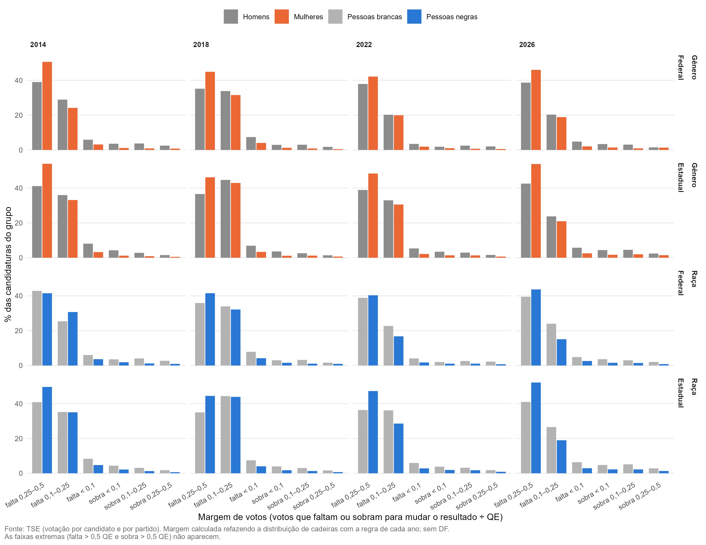
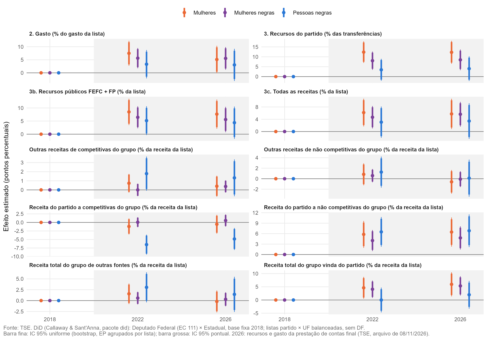
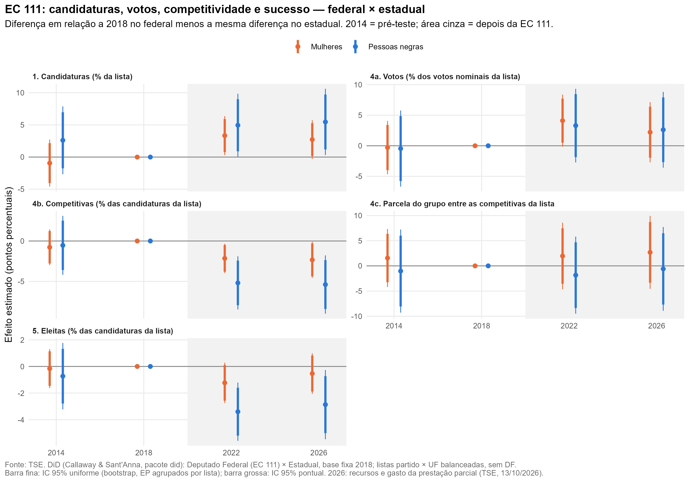
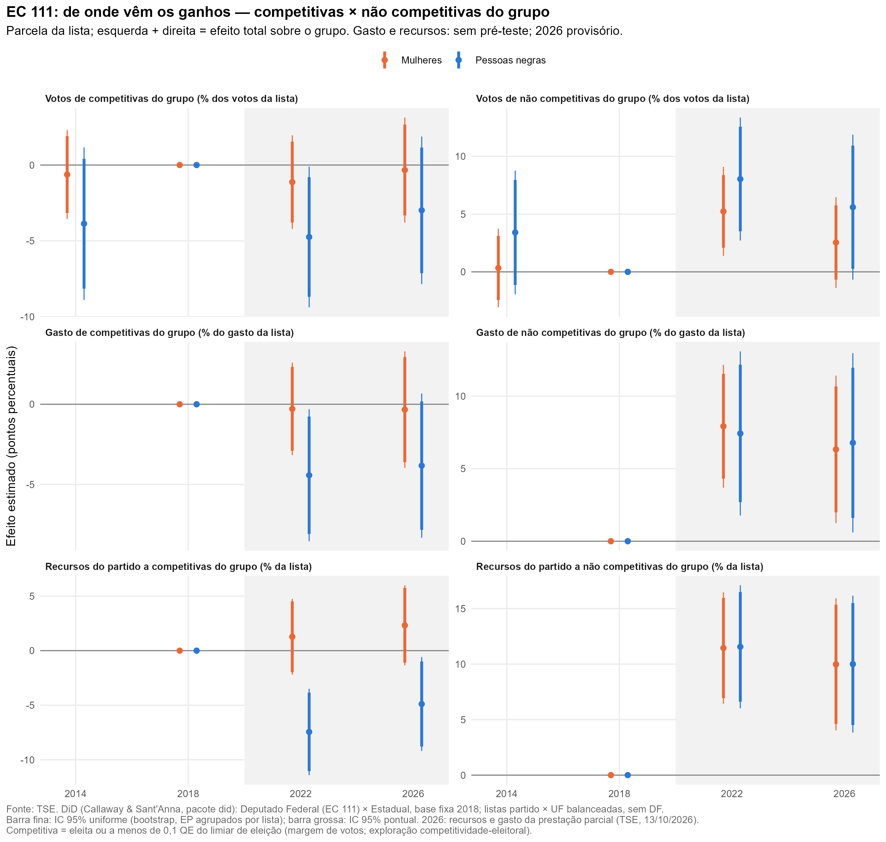
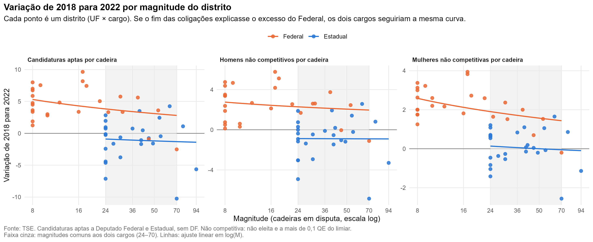

# A EC 111/2021 e a Competitividade Eleitoral de Mulheres e Pessoas Negras {#sec-ec111-competitividade}

```{=html}
<!-- Rascunho (2026-11-07). Fontes: explorations/competitividade-eleitoral/ (margem de votos,
tripla diferença, HonestDiD) e explorations/ec111-did-2026/ (DiD federal × estadual de
candidaturas, recursos, votos e cadeiras, 2014–2026). Números conferidos nos CSVs de output/
das duas explorações. Recursos e gasto de 2026: prestação de contas PARCIAL (TSE, 13/10/2026). -->
```

## Introdução {#sec-introducao-ec111}

A Emenda Constitucional 111/2021, art. 2º, criou um incentivo financeiro inédito no sistema eleitoral brasileiro em favor da maior representação de mulheres e pessoas negras. Nas eleições de 2022 a 2030, os votos dados a candidatas mulheres e a candidaturas negras para a Câmara dos Deputados contam em dobro na distribuição entre os partidos dos fundos públicos de financiamento disponíveis. Diferentemente das cotas de candidaturas e de recursos discutidas no @sec-revisao-literatura, a regra não obriga o partido a nada. Ela altera, no entanto, o valor relativo de cada voto: um voto obtido por uma mulher ou por uma pessoa negra vale, para o caixa do partido no ciclo seguinte, o dobro de um voto obtido por um homem branco.

Este capítulo pergunta se esse incentivo aumentou as chances de sucesso eleitoral de mulheres e de pessoas negras nas duas eleições já realizadas sob a vigência da regra, 2022 e 2026. A pergunta não é a mesma que perguntar se a EC 111 aumentou votos ou recursos desses grupos. Um partido maximiza o que recebe do fundo somando votos, e um voto conta o mesmo para o fundo esteja ele numa candidatura que se elege ou numa candidatura que termina muito longe da cadeira. O desenho da emenda premia o volume de votos, não a eleição. Por isso é possível que a EC 111 tenha mudado a alocação de recursos e a votação de mulheres e pessoas negras sem aproximá-las do limiar de eleição, e é essa distinção que o capítulo procura medir.

Três escolhas orientam a análise. A primeira é a medida de competitividade: em vez de um corte fixo de votos, uso a **margem de votos** de cada candidatura, isto é, quantos votos faltariam (ou sobrariam) para que ela mudasse de resultado, calculada refazendo a distribuição de cadeiras com a regra de cada eleição [@AvelinoBidermanDesposato2022_incumbency; @LuechingerSchelkerSchmid2024_closeness]. A segunda é o desenho de identificação: como o voto em dobro vale só para deputado federal, as candidaturas a deputado estadual da mesma UF servem de comparação, como em @FonsecaThomeGuedesNeto2026_money_talks. A terceira é o horizonte: a eleição de 2026 permite verificar se o que se observou em 2022 persistiu, com 2014 como pré-teste.

A resposta, adiantada aqui, é negativa no essencial. O incentivo mudou a alocação de recursos partidários em favor das mulheres, de forma grande e estável entre 2022 e 2026. Mas esses recursos e o ganho de votos que os acompanhou ficaram com candidaturas que terminaram longe do limiar. A composição do conjunto de candidaturas competitivas e das cadeiras não mudou de forma detectável. Há uma pequena aproximação das mulheres ao limiar, de 3 a 4 pontos percentuais na taxa de candidaturas competitivas, mas ela decorre sobretudo da expansão de candidaturas masculinas não competitivas no cargo federal, tem o tamanho da tendência que já existia antes da emenda em distritos comparáveis e não resiste a violações modestas de tendências paralelas. Para pessoas negras o pré-teste falha, e o desenho não sustenta conclusão sobre competitividade.

## O incentivo e as hipóteses {#sec-hipoteses-ec111}

### O que a EC 111 premia

A distribuição do FEFC entre partidos segue, em grande parte, a votação obtida para a Câmara dos Deputados. A EC 111 dobrou o peso dos votos de mulheres e de pessoas negras nessa conta. O incentivo tem três propriedades que importam para a análise.

Primeiro, ele é **dirigido ao partido**, não à candidatura. Quem decide quantas mulheres e pessoas negras lançar e quanto dinheiro destinar a cada uma é a direção partidária, a mesma que, como argumentado no @sec-sobreposicao-territorial, tende a proteger candidatos tradicionais na distribuição de recursos e de territórios.

Segundo, ele premia **votos, não cadeiras**. Para o fundo, um voto de uma candidata que termina com 2% do quociente eleitoral vale o mesmo que um voto de uma candidata eleita. O partido pode, portanto, capturar o benefício espalhando recursos por muitas candidaturas de mulheres e de pessoas negras com chance baixa, sem deslocar os candidatos competitivos que já tem. Chamo essa estratégia de **colheita de votos**: candidaturas que agregam votos à legenda e ao cálculo do fundo sem disputar de fato uma vaga.

Terceiro, ele vale **só para deputado federal**. Como as listas estaduais dos mesmos partidos, nas mesmas UFs e eleições, não estão sujeitas à regra, a comparação entre os dois cargos isola o efeito do incentivo das mudanças comuns a ambos, como a cota de 30% dos recursos para mulheres em vigor desde 2018.

A história legislativa da emenda torna a segunda propriedade mais do que uma possibilidade teórica. @Gatto2025_resistance_quotas mostra que o voto em dobro foi negociado pela relatora da reforma eleitoral de 2021, a mesma liderança partidária que havia proposto suprimir a obrigatoriedade da cota de candidaturas, e que especialistas já previam à época um benefício concentrado em incumbentes e em seus partidos. @FonsecaThomeGuedesNeto2026_money_talks, com o mesmo desenho federal × estadual para 2018–2022, encontram aumento de votos e de recursos para mulheres, mas em candidaturas pouco competitivas, definidas pela posição na lista.

### Hipóteses

O capítulo contrasta duas leituras do efeito da emenda:

-   **H1 (competitividade).** A EC 111 aumentou, no cargo federal em relação ao estadual, a proporção de mulheres (e de pessoas negras) que se elegem ou terminam perto do limiar de eleição, em comparação com homens (e com pessoas brancas).
-   **H2 (colheita de votos).** Os ganhos de votos e de recursos de mulheres (e de pessoas negras) produzidos pela EC 111 concentraram-se em candidaturas que terminaram longe do limiar, sem alterar a composição do conjunto de candidaturas competitivas nem das cadeiras.

As duas hipóteses não são excludentes em sentido estrito: o incentivo pode ter produzido algumas candidaturas competitivas e muitas não competitivas. O que as distingue é onde está a massa do efeito. A eleição de 2026 acrescenta uma terceira pergunta:

-   **H3 (persistência).** Os efeitos observados em 2022 se mantêm em 2026, quando partidos e candidaturas já conheciam a regra.

## Medir competitividade pela margem de votos {#sec-medida-ec111}

### Por que uma margem e não um corte

As análises anteriores desta tese classificam como competitiva a candidatura eleita ou com pelo menos 10% do quociente eleitoral (QE); @FonsecaThomeGuedesNeto2026_money_talks usam a posição da candidatura na ordem de votação da lista. O corte é simples e comparável entre UFs, mas não diz o quão perto da cadeira a candidatura chegou. Em lista aberta, a distância até a eleição depende dos votos da própria candidatura, dos votos dos colegas de lista e da distribuição de cadeiras entre as listas. Uma candidata com 15% do QE numa lista que elege três pessoas pode estar mais perto da vaga do que outra com 40% do QE numa lista que não elege ninguém.

A margem de votos resolve isso. Ela responde a uma pergunta contrafactual: mantidos os votos de todas as demais candidaturas, quantos votos a mais (para quem não se elegeu) ou a menos (para quem se elegeu) mudariam o resultado desta candidatura? A medida foi formalizada para a lista aberta brasileira por @AvelinoBidermanDesposato2022_incumbency, no contexto de desenhos de regressão descontínua sobre incumbência, e generalizada para sistemas proporcionais por @LuechingerSchelkerSchmid2024_closeness, que consideram todos os números possíveis de cadeiras da lista e não apenas a mudança de uma cadeira.

### Implementação

As duas propostas trazem fórmulas fechadas para regras genéricas (D'Hondt, maiores restos), mas a regra brasileira tem pisos que dependem do próprio QE: a exigência individual de 10% do QE desde 2018, a restrição das sobras a listas com 80% do QE e candidaturas com 20% do QE em 2022, além das federações. Somar votos a uma candidatura muda o QE e pode ligar ou desligar essas cláusulas. Por isso a margem foi calculada **por busca**: para cada candidatura procura-se o menor número inteiro de votos que, somado ou retirado, muda o resultado, refazendo a cada passo a distribuição completa de cadeiras com a regra do ano. Como o resultado é monótono nos votos da própria candidatura, a busca binária é válida.

::: callout-note
## Validação da medida

-   A distribuição de cadeiras reproduz **100% dos eleitos** do TSE nos 216 distritos (UF × cargo × ano, 2014–2026). Em 2022 a base do TSE já traz os eleitos recalculados após as ADIs 7228, 7263 e 7325, que abriram a terceira fase das sobras a todas as listas.
-   Para deputado federal em 2014, 5.796 das 6.165 candidaturas da base de replicação de @AvelinoBidermanDesposato2022_incumbency foram pareadas. O resultado eleito/não eleito coincide em 99,98% dos casos; entre os eleitos, a diferença mediana na medida é de 0,009; perto do limiar (\|margem\| \< 0,1), 66% coincidem ao centésimo.
:::

A margem é dividida pelo QE do distrito, o que dá uma escala comum entre os dois cargos da mesma UF. **Competitiva** é a candidatura eleita ou a menos de 0,1 QE do limiar de eleição. Bandas mais largas (0,25 e 0,5 QE) foram descartadas como desfecho principal porque saturam: numa lista grande, a distância de uma candidatura fraca até o limiar é determinada pelos colegas de lista, não pelos votos dela. Entre as candidaturas com menos de 0,5% do QE, 27,6% ficam "a menos de 0,25 QE" do limiar, mas só 0,8% a menos de 0,1 QE. As normalizações originais de @AvelinoBidermanDesposato2022_incumbency (pelos votos da candidatura e do primeiro não eleito da lista) e de @LuechingerSchelkerSchmid2024_closeness (pelo eleitorado) entram como robustez.

A margem é uma medida *ex post*: depende do resultado e mede proximidade do limiar, não viabilidade anterior à eleição. Uma alternativa *ex ante* seria classificar candidaturas pelo gasto. Ela, porém, é inadequada aqui, porque o gasto é um dos desfechos que a EC 111 altera: uma candidata que recebe mais dinheiro do partido passaria a ser "viável" por definição, mesmo terminando sem votos. A @sec-onde-ganhos-ec111 trata da consequência do caráter *ex post* da margem para a interpretação.

@fig-faixas-margem mostra a distribuição das candidaturas por faixa de margem. Em 2018, último ano antes da emenda, 7,1% das candidatas a deputada federal e 15,9% dos candidatos se elegeram ou ficaram a menos de 0,1 QE do limiar.

{#fig-faixas-margem width="100%"}

## Desenho de identificação {#sec-desenho-ec111}

### Federal × estadual com dois períodos pós-tratamento

O tratado é o cargo de deputado federal a partir de 2022; o controle, o de deputado estadual na mesma UF, nunca tratado. Com quatro eleições (2014 e 2018 antes, 2022 e 2026 depois) e uma única data de adoção, o desenho é de dois grupos e vários períodos. Uso o estimador de @CallawaySantAnna2021_did, em que cada efeito é uma comparação 2×2 limpa entre federal e estadual, o que evita as comparações indevidas das regressões com efeitos fixos duplos quando o efeito varia no tempo [@RothEtAl2023_trending_did].

O período de referência é fixo em 2018, o último antes do tratamento. O efeito de 2026 é a mudança de 2018 para 2026 no federal menos a mesma mudança no estadual. Uma comparação de 2022 com 2026 mediria só quanto o efeito mudou entre as duas eleições, não o efeito [@Roth2024_interpreting_event_studies]. A eleição de 2014 serve de pré-teste: um coeficiente próximo de zero é evidência de que os dois cargos evoluíam de forma parecida antes da emenda, mas não prova a hipótese de tendências paralelas, que agora precisa valer por oito anos [@Roth2022_pretest].

### Duas unidades de análise

O capítulo combina duas análises com o mesmo desenho e unidades diferentes.

1.  **O funil do incentivo** (candidaturas, gasto, recursos, votos e cadeiras). A unidade é a **lista partido × UF × cargo**, e cada desfecho é a parcela do grupo na lista, em %. O painel principal é balanceado (801 listas presentes nas quatro eleições), com o desbalanceado como robustez, já que fusões e federações fazem listas surgirem e desaparecerem [@SantAnnaXu2023_compositional]. Os erros são agrupados por lista. As siglas foram harmonizadas para as vigentes em 2026.
2.  **A competitividade.** A unidade é a **disputa UF × cargo** (26 UFs × 2 cargos; o Distrito Federal fica de fora porque não elege deputados estaduais). O desfecho é a diferença, em pontos percentuais, entre a taxa de candidaturas competitivas de mulheres e a de homens (ou de pessoas negras e brancas) na disputa. O estimador aplicado a essa diferença é, portanto, uma **tripla diferença**: grupo × cargo × período. As bandas de confiança são uniformes, por bootstrap multiplicador com 25.000 repetições e agrupamento por UF.

Recursos e gasto não têm pré-teste, porque em 2014 vigorava a doação empresarial, outro regime de financiamento. Os dados de recursos de 2026 vêm da prestação de contas parcial do TSE (13/10/2026) e são provisórios.

### O que mais mudou entre 2018 e 2026

A comparação entre os cargos elimina o que afeta os dois da mesma forma. As ameaças são as mudanças específicas do cargo federal, ou que interagem com o incentivo:

-   **Fim das coligações proporcionais** (EC 97/2017, aplicado a partir de 2020) com limite de candidaturas por partido de M + 1 (Lei 14.211/2021). O efeito sobre o número de candidaturas por cadeira depende da magnitude do distrito, menor em média no federal.
-   **Cláusula de desempenho**, medida só pelos votos para deputado federal: 2% em 2022 e 2,5% em 2026. Incentiva partidos ameaçados a maximizar votos no cargo tratado.
-   **EC 133/2024**, que exige pelo menos 30% do FEFC e do Fundo Partidário para candidaturas negras nos dois cargos. É um choque comum, mas pode interagir com o voto em dobro se os partidos cumprirem a cota alocando recursos no federal.

As duas primeiras são testadas diretamente na @sec-fragilidade-ec111.

## Resultados {#sec-resultados-ec111}

### O funil: recursos, candidaturas, votos e cadeiras {#sec-funil-ec111}

@tbl-funil-ec111 resume os efeitos ao longo do funil, da candidatura à cadeira. O efeito pretendido pela emenda, a mudança na alocação de recursos, aparece com clareza para as mulheres e se mantém em 2026. No federal, em relação ao estadual, a parcela das transferências partidárias destinada a mulheres sobe 12,7 pontos percentuais em 2022 e 12,3 em 2026; a de recursos públicos (FEFC e Fundo Partidário), 9,0 e 7,5; a do gasto, 7,6 e 6,0. O efeito é maior quanto mais a fonte é controlada pelo partido.

| Desfecho (% da lista) | Grupo | Pré-teste 2014 | 2022 | 2026 |
|:---|:---|---:|---:|---:|
| Candidaturas | Mulheres | −0,9 | +3,3\* | +2,7\* |
|  | Pessoas negras | +2,6 | +4,9\* | +5,5\* |
| Recursos do partido | Mulheres | — | +12,7\* | +12,3\*ᵖ |
|  | Pessoas negras | — | +4,1 | +5,1ᵖ |
| Recursos públicos (FEFC + FP) | Mulheres | — | +9,0\* | +7,5\*ᵖ |
|  | Pessoas negras | — | +5,6\* | +5,3ᵖ |
| Gasto | Mulheres | — | +7,6\* | +6,0\*ᵖ |
|  | Pessoas negras | — | +3,0 | +3,0ᵖ |
| Votos nominais | Mulheres | −0,3 | +4,1\* | +2,2 |
|  | Pessoas negras | −0,5 | +3,3 | +2,6 |
| Cadeiras (% dos eleitos da UF) | Mulheres | −1,9 | −2,1 | +1,8 |
|  | Pessoas negras | −3,6 | −5,0 | +1,9 |

: Efeito do voto em dobro ao longo do funil eleitoral, federal × estadual, base 2018 (pontos percentuais). Listas partido × UF, painel balanceado, sem ponderação; cadeiras no nível UF × cargo. \* IC de 95% exclui zero. ᵖ Provisório (prestação de contas parcial de 2026). Recursos e gasto sem pré-teste (doação empresarial em 2014). {#tbl-funil-ec111}

{#fig-recursos-ec111 width="100%"}

A parcela de mulheres nas listas federais sobe cerca de 3 pontos em relação às estaduais, com pré-teste próximo de zero. A de pessoas negras sobe cerca de 5 pontos, mas o efeito desaparece quando as listas são ponderadas pelos votos que tiveram em 2018 (+0,4 em 2022; +0,2 em 2026): o aumento se concentra em listas pequenas.

O ganho de votos das mulheres, de 4,1 pontos em 2022, cai para 2,2 em 2026 e perde significância. A queda vem sobretudo do cargo de controle: de 2022 para 2026 a parcela dos votos nominais das mulheres passou de 20,3% para 25,5% no estadual e de 20,9% para 24,1% no federal. Uma aproximação da sensibilidade a violações de tendências paralelas (o conjunto identificado sob magnitudes relativas, somado a ±1,96 erro-padrão, sem a inferência completa de @RambachanRoth2023_parallel_trends) aponta na mesma direção: o efeito de 2022 resiste a violações de até cerca de 1,7 vez a pré-tendência observada; o de 2026, a nenhuma.

No fim do funil, a parcela de cadeiras ocupadas por mulheres e por pessoas negras não muda de forma distinguível de zero em nenhuma das duas eleições. Com 52 disputas os intervalos são largos, mas as estimativas pontuais também são pequenas e mudam de sinal entre 2022 e 2026 (@fig-funil-ec111).

{#fig-funil-ec111 width="100%"}

Entre recursos e cadeiras há, portanto, uma perda. Mais dinheiro e mais candidaturas de mulheres não produziram mais eleitas no cargo federal em relação ao estadual. A pergunta das próximas seções é onde essa perda acontece: se o dinheiro aproximou mulheres do limiar sem chegar a convertê-lo em cadeiras (H1) ou se foi para candidaturas que nunca chegaram perto dele (H2).

### A competitividade: taxa, composição e eleição {#sec-competitividade-ec111}

@tbl-ddd-ec111 traz a tripla diferença para a taxa de candidaturas competitivas, isto é, eleitas ou a menos de 0,1 QE do limiar. Para as mulheres, o pré-teste de 2014 é próximo de zero e o efeito é positivo nas duas eleições: 3,4 pontos em 2022 e 3,9 em 2026, ou 3,6 em média. Como em 2018 a diferença entre homens e mulheres no federal era de cerca de 9 pontos (15,9% contra 7,1%), o efeito equivaleria a fechar perto de 40% dessa distância. Para a taxa de eleitas o efeito só aparece em 2026 (2,9 pontos).

| Desfecho / especificação | 2014 (pré) | 2022 | 2026 | Média |
|:--------------|--------------:|--------------:|--------------:|--------------:|
| *Mulheres − homens* |  |  |  |  |
| Competitiva (eleita ou \< 0,1 QE), principal | −0,8 \[−3,9; 2,4\] | **3,4** \[0,4; 6,4\] | **3,9** \[0,0; 7,7\] | **3,6** \[1,0; 6,3\] |
| Idem, ponderado pelo nº de candidaturas | 0,6 | 2,4 | 2,3 | 2,3 \[−0,4; 5,1\] |
| Idem, sem UFs com 8 cadeiras | 0,9 | **3,9** | **4,9** | **4,4** \[1,3; 7,4\] |
| Idem, sem incumbentes (2018–2026) | — | **3,0** \[0,2; 5,7\] | 2,3 | 2,7 \[−0,1; 5,4\] |
| Idem, normalização de ABD | −2,4 | 1,9 | 3,1 | **2,5** \[0,1; 4,8\] |
| Idem, normalização de LSS | −2,0 | 0,5 | 1,8 | 1,2 \[−1,0; 3,3\] |
| Eleita | −2,3 | 0,9 | **2,9** \[0,1; 5,8\] | 1,9 \[−0,3; 4,1\] |
| *Pessoas negras − brancas* |  |  |  |  |
| Competitiva (eleita ou \< 0,1 QE), principal | **−5,8** \[−10,7; −0,8\] | 0,9 | **5,7** | **3,3** \[0,1; 6,5\] |
| Eleita | **−4,5** \[−8,6; −0,4\] | 0,3 | **3,9** | 2,1 \[−0,6; 4,8\] |

: Tripla diferença (grupo × cargo × período) na taxa de candidaturas competitivas, base 2018 (pontos percentuais). Unidade UF × cargo, sem DF; bandas uniformes de 95% entre colchetes (bootstrap multiplicador, agrupado por UF). Em negrito, banda que exclui zero. ABD = @AvelinoBidermanDesposato2022_incumbency; LSS = @LuechingerSchelkerSchmid2024_closeness. {#tbl-ddd-ec111}

{#fig-ddd-ec111 width="100%"}

O resultado é sensível à especificação. Ponderado pelo número de candidaturas, o que dá mais peso às UFs grandes, o efeito médio cai para 2,3 pontos e deixa de ser significativo. Com a normalização de @LuechingerSchelkerSchmid2024_closeness, fica em 1,2 e também não é significativo. Ele se mantém quando se excluem as UFs com 8 cadeiras federais, onde a distância até o limiar é mais grosseira, e diminui um pouco quando se excluem os incumbentes.

Mais importante, a taxa de competitivas é uma razão, e a aproximação das mulheres pode vir tanto do numerador quanto do denominador. Duas outras medidas olham diretamente para o conjunto das competitivas e não mostram mudança:

-   **Composição.** A parcela de mulheres entre as candidaturas competitivas sobe nos dois cargos quase no mesmo ritmo: no federal, 17,1% em 2018, 19,3% em 2022 e 21,1% em 2026; no estadual, 16,7%, 17,7% e 20,1%. A diferença entre os cargos é de 1,4 a 1,7 ponto, sem significância.
-   **Cadeiras.** Como visto na @sec-funil-ec111, a parcela de mulheres entre os eleitos não muda de forma distinguível de zero.

Se a EC 111 tivesse trazido mais mulheres para perto do limiar, elas apareceriam no conjunto das competitivas. Não aparecem. A aproximação medida pela taxa vem, então, de outro lugar, e as duas seções seguintes mostram de onde.

### De onde vêm os ganhos: competitivas e não competitivas {#sec-onde-ganhos-ec111}

Para saber em que candidaturas ficaram os ganhos de votos, gasto e recursos das mulheres, a parcela do grupo na lista pode ser dividida em duas partes, a das candidaturas do grupo que terminaram competitivas e a das que terminaram não competitivas. As duas partes **somam o efeito total**, e nenhuma candidatura é excluída. @tbl-decomposicao-ec111 e @fig-decomposicao-ec111 mostram a divisão.

| Desfecho (% da lista) | 2022: competitivas | 2022: não competitivas | 2026: competitivas | 2026: não competitivas |
|:--------------|--------------:|--------------:|--------------:|--------------:|
| *Mulheres* |  |  |  |  |
| Votos | −1,1 | **+5,2** | −0,3 | +2,5 |
| Gasto | −0,3 | **+7,9** | −0,3 | **+6,3**ᵖ |
| Recursos do partido | +1,3 | **+11,4** | +2,3 | **+10,0**ᵖ |
| *Pessoas negras* |  |  |  |  |
| Votos | **−4,7** | **+8,0** | −3,0 | **+5,6** |
| Recursos do partido | **−7,4** | **+11,6** | **−4,9**ᵖ | **+10,0**ᵖ |

: Decomposição do efeito do voto em dobro entre candidaturas competitivas e não competitivas do grupo (pontos percentuais; competitiva = eleita ou a menos de 0,1 QE do limiar). Listas partido × UF, painel balanceado, sem ponderação. Em negrito, IC de 95% que exclui zero. ᵖ Provisório (prestação de contas parcial de 2026). {#tbl-decomposicao-ec111}

{#fig-decomposicao-ec111 width="100%"}

Para as mulheres, praticamente todo o ganho está nas candidaturas não competitivas. Dos 12,7 pontos a mais de recursos partidários em 2022, 11,4 foram para candidatas que terminaram a mais de 0,1 QE do limiar; dos 7,6 pontos a mais de gasto, 7,9 (a parte das competitivas é ligeiramente negativa). O mesmo vale para os votos: o efeito de 4,1 pontos em 2022 divide-se em −1,1 de competitivas e +5,2 de não competitivas, com pré-teste próximo de zero nas duas partes. O padrão se repete em 2026.

Para pessoas negras, há uma realocação: os recursos partidários a candidaturas negras competitivas **caem** 7,4 pontos em 2022 e 4,9 em 2026, enquanto os destinados às não competitivas sobem 11,6 e 10,0. Nos votos, porém, o pré-teste de 2014 já aponta na mesma direção (−3,9 nas competitivas e +3,4 nas não competitivas), o que sugere a continuação de uma tendência anterior.

::: callout-important
## Como ler uma classificação feita depois da eleição

Competitiva ou não competitiva é definida pelo resultado, que a própria EC 111 pode alterar. A divisão do efeito total em duas partes continua válida como decomposição contábil, porque as partes somam o total e ninguém é excluído. O que ela não permite é tratar as competitivas como um grupo fixo e comparar o que aconteceu dentro dele. Ainda assim, a direção do viés favorece a leitura adotada: se o dinheiro extra tivesse tornado competitivas candidaturas que não o seriam, essas candidaturas e o dinheiro que receberam apareceriam do lado das competitivas. O fato de o dinheiro aparecer do lado das não competitivas indica que, mesmo com mais recursos, essas candidaturas não chegaram perto do limiar.
:::

### Por que a aproximação ao limiar é frágil {#sec-fragilidade-ec111}

Se os recursos e os votos ficaram com candidaturas não competitivas e a composição das competitivas não mudou, a aproximação das mulheres na taxa de competitivas tem de vir do denominador. É o que mostram os números de candidaturas não competitivas por cadeira.

**A expansão das candidaturas fracas no federal.** De 2018 para 2022, as candidaturas femininas não competitivas ao cargo federal passaram de 2.201 para 3.090 (de 4,4 para 6,1 por cadeira); no estadual ficaram estáveis, em 4.666 (4,5 por cadeira). O efeito sobre as mulheres não competitivas por cadeira é de +1,7 a +2,2, em 2022 e em 2026. Mas as candidaturas masculinas não competitivas cresceram ainda mais no federal: a diferença entre mulheres e homens em não competitivas por cadeira é de −1,1 a −1,2. Houve uma expansão geral de candidaturas fracas no cargo federal, maior entre homens. Como os homens ganharam mais candidaturas sem chance, a taxa de competitivos entre eles caiu (no federal, de 15,9% em 2018 para 10,5% em 2022), e é essa queda que produz a maior parte da "aproximação" das mulheres.

**A cláusula de desempenho não explica a expansão.** Uma explicação candidata é que partidos ameaçados pela cláusula de desempenho, medida só pelos votos para deputado federal, lançaram mais candidaturas para somar votos. Classificando partidos e federações pela votação para a Câmara em 2018 (pressionados abaixo de 4%), a expansão de candidaturas não competitivas em 2022 é geral e apenas um pouco maior nos pressionados: entre os homens, +1,5 por cadeira nos partidos com folga e +1,9 nos pressionados; entre as mulheres, +0,9 e +1,2. A aproximação das mulheres na taxa de competitivas aparece nos partidos **com folga** (+4,5 a +5,8 pontos) e não nos pressionados (+0,9 a +1,8). A composição das competitivas não muda em nenhum dos dois grupos.

**O fim das coligações e a magnitude do distrito.** Uma segunda explicação é o fim das coligações com limite de M + 1 candidaturas por partido, que pesa mais em distritos de magnitude pequena, mais comuns no federal. Regressões por distrito da variação de candidaturas aptas por cadeira mostram que o federal cresceu 5,6 candidaturas por cadeira a mais que o estadual de 2018 para 2022; controlando pelo log da magnitude, 4,5; restringindo à faixa de magnitude comum aos dois cargos (24 a 70 cadeiras), 3,6 a 3,7, todos significativos. A magnitude explica a maior parte do aumento do número de **listas** por cadeira, mas só 20% a 35% do aumento de **candidaturas** (@fig-magnitude-ec111).

{#fig-magnitude-ec111 width="100%"}

**A tendência já existia antes da emenda.** De 2014 para 2018, quando havia coligações nos dois anos e não havia voto em dobro, o federal já crescia mais em candidaturas por cadeira, com excesso de 1,7 a 3,1 sobre o estadual. A média por distrito foi de 10,3 para 13,3 e depois 17,8 candidaturas por cadeira no federal, contra 13,4, 14,8 e 13,7 no estadual. É uma federalização da estratégia partidária que começa antes da EC 111, plausivelmente ligada à distribuição de fundos e à cláusula de desempenho atreladas à Câmara desde 2018. Na faixa de magnitude comum, a diferença na taxa de competitivas entre mulheres e homens aumenta 3,0 a 3,2 pontos de 2018 para 2022, contra 3,5 pontos de 2014 para 2018, um período sem o incentivo que serve de placebo. Entre distritos comparáveis, o "efeito" tem o mesmo tamanho da tendência anterior.

**Sensibilidade formal.** A análise de @RambachanRoth2023_parallel_trends formaliza essa preocupação. Sob a restrição de magnitudes relativas, a violação de tendências paralelas depois de 2018 pode ser até M̄ vezes a observada de 2014 para 2018. O **valor de quebra** é o maior M̄ com que o intervalo robusto de 95% ainda exclui zero (@tbl-honestdid-ec111, @fig-honestdid-ec111).

| Desfecho (efeito médio 2022–2026) | Estimativa | IC original | Quebra M̄ |
|:----------------|----------------:|:-------------------:|----------------:|
| *Mulheres* |  |  |  |
| Taxa de competitivas (mulheres − homens) | 3,1 / 3,6 | \[0,2; 6,0\] / \[0,7; 6,5\] | 0 / 0,25 |
| Taxa de eleitas (mulheres − homens) | 2,2 / 1,9 | \[0,0; 4,3\] / n.s. | 0 / — |
| \% de mulheres entre as competitivas | 1,4 / 1,7 | n.s. | — |
| Mulheres não competitivas por cadeira | 1,7 / 2,2 | \[1,0; 2,5\] / \[1,7; 2,7\] | **0,75 / 1,5** |
| Não competitivas por cadeira (mulheres − homens) | −1,1 / −1,2 | \[−1,9; −0,3\] / \[−1,9; −0,5\] | 0,25 / 0,25 |
| *Pessoas negras* |  |  |  |
| Taxa de competitivas e % entre as competitivas | — | n.s. | — |
| Pessoas negras não competitivas por cadeira | 2,8 / 3,5 | \[1,5; 4,1\] / \[2,3; 4,7\] | **1,75 / ∞** |

: Sensibilidade a violações de tendências paralelas (HonestDiD, magnitudes relativas). Valores com peso pela magnitude do distrito / sem peso. "Quebra M̄" é o maior múltiplo da violação de 2014–2018 com que o IC robusto de 95% ainda exclui zero; "—" indica que o IC original já inclui zero. {#tbl-honestdid-ec111}

{#fig-honestdid-ec111 width="100%"}

A aproximação das mulheres ao limiar só se sustenta se a violação de tendências depois de 2018 for praticamente nula (M̄ \< 0,25). O que resiste é o aumento de candidaturas **não competitivas** no cargo federal: de mulheres, até violações de 0,75 a 1,5 vez a de 2014–2018; de pessoas negras, até 1,75 vez ou mais. Como há um único período anterior, estimado com imprecisão, a restrição de magnitudes relativas é conservadora, porque incorpora a incerteza do coeficiente de 2014. A restrição alternativa de suavidade não pôde ser calculada: com um só período anterior ela é degenerada, e o procedimento recomendado nesse caso não roda na versão de R disponível.

### Pessoas negras {#sec-negras-ec111}

Para pessoas negras, o desenho não permite afirmar efeito sobre a competitividade. O pré-teste falha: em 2014 a diferença entre pessoas negras e brancas na taxa de competitivas era 5,8 pontos menor no federal que no estadual, em relação a 2018, e na taxa de eleitas, 4,5 pontos menor (@tbl-ddd-ec111). Esses coeficientes são da mesma ordem dos efeitos positivos de 2026 (5,7 e 3,9 pontos), o que indica que a posição relativa das candidaturas negras no federal já vinha mudando antes da emenda. A parcela de pessoas negras entre as competitivas não muda de forma distinguível de zero, e a sensibilidade formal não sustenta nenhum efeito sobre a taxa de competitivas.

O que se sustenta é o mesmo padrão observado para as mulheres, em versão mais forte: mais candidaturas negras não competitivas no federal (2,8 a 3,5 por cadeira, robusto a violações grandes de tendências) e recursos partidários que migram das candidaturas negras competitivas para as não competitivas. Em 2026, a cota de 30% dos recursos para candidaturas negras da EC 133/2024 dificulta separar o efeito do voto em dobro do efeito da nova reserva.

## Discussão {#sec-discussao-ec111}

### O que a EC 111 fez e o que não fez

Os resultados favorecem H2 sobre H1. O incentivo funcionou no plano em que atua diretamente, a decisão partidária de alocar recursos: as transferências a mulheres no cargo federal subiram cerca de 12 pontos percentuais em relação ao estadual, em 2022 e em 2026, o que responde também a H3 quanto aos recursos. Mas esses recursos foram para candidaturas que terminaram longe do limiar, e o ganho de votos das mulheres, real em 2022 e enfraquecido em 2026, também ficou com elas. A composição do conjunto de candidaturas competitivas e a das cadeiras não mudaram de forma detectável.

O padrão é o que o desenho da regra faz esperar. Como o fundo remunera votos e não cadeiras, o partido pode capturar o benefício lançando e financiando mais candidaturas de mulheres e de pessoas negras sem chance, sem mexer nas candidaturas competitivas que já tem, majoritariamente de homens brancos e de incumbentes. A colheita de votos é a resposta de menor custo para a direção partidária, e é compatível com o mecanismo de proteção dos candidatos tradicionais desenvolvido no @sec-sobreposicao-territorial. É também o que @FonsecaThomeGuedesNeto2026_money_talks encontram para 2022 com outra definição de competitividade, e o que @Gatto2025_resistance_quotas registra como previsão de especialistas no momento da aprovação da emenda.

A aproximação das mulheres ao limiar de eleição, de 3 a 4 pontos na taxa de candidaturas competitivas, não deve ser lida como evidência de H1. Ela vem da queda da taxa de competitivos entre os homens, causada pela expansão de candidaturas masculinas não competitivas no cargo federal; tem, em distritos de magnitude comparável, o mesmo tamanho da tendência observada de 2014 para 2018; não aparece nos partidos pressionados pela cláusula de desempenho; e não resiste a violações de tendências paralelas maiores que um quarto da observada antes da emenda.

### Limitações

**Um único tratado.** O tratamento é atribuído ao cargo inteiro. Na prática há um só "grupo" tratado, e qualquer choque específico do cargo federal entre 2018 e 2026 entra no efeito. A federalização da estratégia partidária documentada na @sec-fragilidade-ec111 é precisamente um choque desse tipo, e ela começa antes da emenda.

**Um único período anterior.** Com 2014 como único pré-teste, a hipótese de tendências paralelas por oito anos não pode ser examinada em detalhe, e a restrição de suavidade da análise de sensibilidade é degenerada. A eleição de 2014 ocorreu, além disso, sob outro regime de financiamento.

**Medida *ex post*.** A margem de votos mede proximidade do limiar no resultado, não viabilidade antes da eleição. A decomposição entre competitivas e não competitivas é válida, mas comparações dentro de cada categoria são descritivas.

**Dados provisórios de 2026.** Recursos e gasto de 2026 vêm da prestação de contas parcial. Os efeitos de 2026 sobre esses desfechos devem ser refeitos com a prestação final.

**Comparações múltiplas.** O capítulo estima muitos desfechos para dois grupos e duas eleições. Os resultados que sustentam a conclusão, a alocação de recursos às mulheres e o aumento de candidaturas não competitivas, são os de maior magnitude e mais estáveis entre especificações; os efeitos isolados e marginais devem ser lidos com cautela.

## Conclusão {#sec-conclusao-ec111}

A EC 111/2021 mudou o comportamento dos partidos no que ela remunera. Os partidos destinaram mais recursos a mulheres e lançaram mais mulheres e mais pessoas negras na disputa para a Câmara dos Deputados, em 2022 e em 2026. Mas o incentivo não tornou essas candidaturas mais competitivas. Os recursos e os votos adicionais ficaram com candidaturas que terminaram longe do limiar de eleição, a presença de mulheres e de pessoas negras entre as candidaturas competitivas e entre os eleitos não mudou de forma detectável, e a pequena aproximação das mulheres ao limiar é explicada pela expansão de candidaturas masculinas sem chance e pela tendência que já existia antes da emenda.

O resultado reforça um argumento central desta tese: políticas que incentivam os partidos sem condicionar o benefício à eleição tendem a ser absorvidas pela estratégia partidária de menor custo, que preserva as candidaturas competitivas existentes. Um incentivo baseado em votos produz votos. Para produzir representação, o desenho teria de premiar cadeiras ou proximidade da cadeira, ou restringir a pulverização de recursos entre candidaturas sem viabilidade.

```{=html}
<!-- Pendências (2026-11-07):
- Refazer recursos e gasto de 2026 com a prestação de contas final (prazo em nov/2026): trocar o zip em data/raw/ e rodar explorations/ec111-did-2026/R/01 → 03.
- ec111-did-2026 rodou com biters = 1000; usar 25.000 na versão final (competitividade-eleitoral já usa 25.000).
- HonestDiD formal para o funil (ec111-did-2026 só tem o conjunto identificado ± 1,96 EP) e restrição de suavidade (ΔSD/FLCI) num R ≥ 4.3.
- Decidir a deduplicação de despesas por SQ_DESPESA (afeta 2018/2022 também).
- Refazer 2022 com a regra original da totalização (antes das ADIs) como robustez.
- CoVe das entradas bibliográficas novas (sobretudo Avelino, Biderman & Desposato 2022) e da caracterização de Gatto (2025) e Fonseca et al. (2026) aqui.
- Fonseca, Thomé & Guedes-Neto: o .bib registra working paper (Cepesp/FGV); as explorações citam Electoral Studies — conferir o veículo.
- Figuras: os PNGs trazem título e subtítulo embutidos (padrão de exploração); para a versão final, regerar sem título, já que a legenda do Quarto cumpre esse papel.
- Graduar os scripts das duas explorações para scripts/R/ quando o capítulo sair de rascunho.
-->
```
