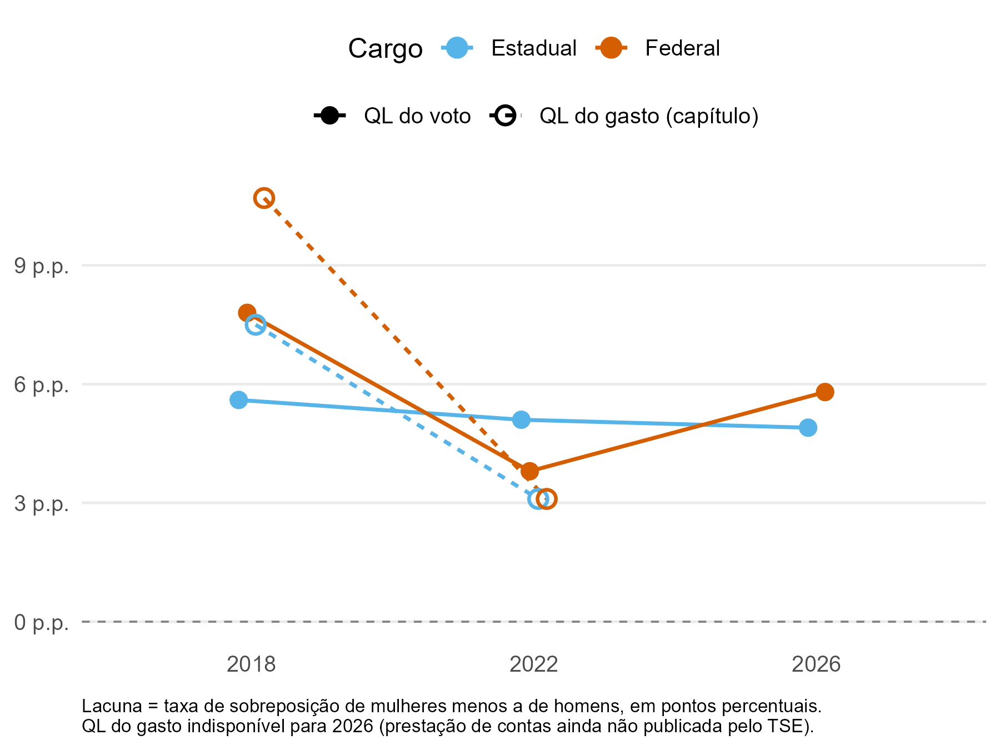
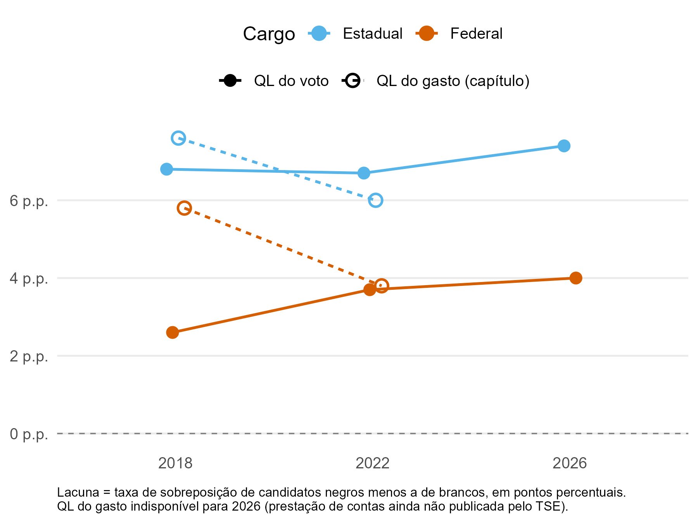
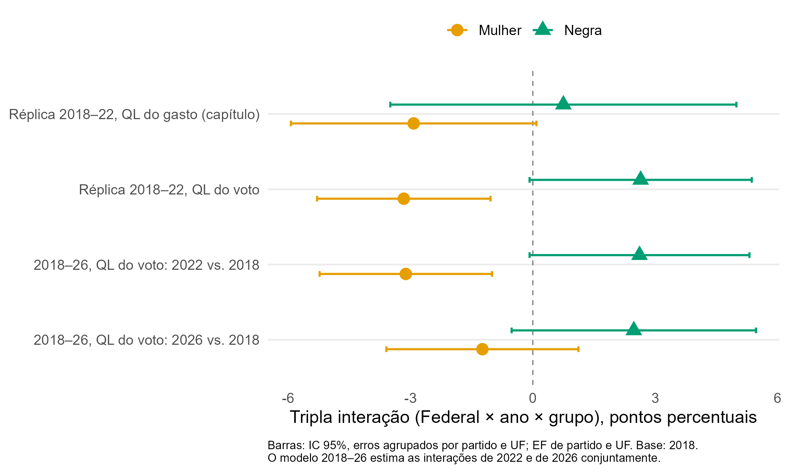

# Sobreposição Territorial do Voto entre Candidatos do Mesmo Partido, 2018–2026 {#sec-sobreposicao-voto}

<!-- TODO: título e posição provisórios. Capítulo derivado de explorations/ql-voto-2026/;
     o Capítulo 6 (gasto) permanece inalterado e receberá 2026 quando a prestação de
     contas for publicada pelo TSE. -->

## Introdução

<!-- TODO: introdução — motivação para olhar a sobreposição pelo voto e para incluir 2026,
     o segundo pleito sob o incentivo da EC 111/2021. -->

## Dados e Métodos {#sec-metodos-sobreposicao-voto}

### Por que o voto, e não o gasto

O Capítulo [-@sec-sobreposicao-territorial] mede a coordenação territorial das listas partidárias pela concentração do gasto de campanha, e justifica essa escolha: o gasto é decidido antes da eleição e por isso registra onde a campanha decidiu investir, enquanto a votação mistura essa decisão com o comportamento do eleitor e o desempenho dos adversários. Este capítulo usa a outra medida, a concentração territorial do voto, por duas razões. A primeira é prática: a prestação de contas das eleições de 2026 ainda não havia sido publicada pelo TSE quando esta análise foi feita, de modo que só o voto permite incluir o segundo pleito realizado sob o incentivo da EC 111/2021. A segunda é substantiva: o voto mostra onde cada candidato efetivamente construiu sua base eleitoral, e a sobreposição medida assim indica se correligionários terminaram a eleição disputando o mesmo eleitorado, qualquer que tenha sido a intenção inicial da campanha. As duas medidas são complementares, e a medida de voto não substitui a de gasto. Os resultados deste capítulo devem ser lidos com essa ressalva, que a validação descrita adiante torna explícita.

### Quociente locacional do voto

A concentração territorial do voto é medida pelo mesmo Quociente Locacional (QL) do Capítulo [-@sec-sobreposicao-territorial], agora aplicado ao uso que lhe deu origem na ciência política, a votação recebida por um candidato [@AvelinoBidermanSilva2011_concentracao_eleitoral; @AvelinoBidermanSilva2016_concentracao_brasil]. Para um candidato $i$ e um município $m$:

$$\text{QL}^{\text{voto}}_{im} = \frac{\text{votos}_{im} \,/\, \text{votos}_{i}}{\text{votos}_{m} \,/\, \text{votos}_{\text{estado}}}$$

em que $\text{votos}_{im}$ são os votos nominais válidos do candidato $i$ no município $m$, $\text{votos}_i$ é a sua votação total, e $\text{votos}_m$ e $\text{votos}_{\text{estado}}$ são os votos nominais válidos para o mesmo cargo no município e no estado. O denominador usa os votos do cargo, e não o eleitorado como no QL do gasto, para comparar a votação do candidato com a de todos os concorrentes ao mesmo cargo, já descontadas a abstenção e as diferenças de comparecimento entre municípios. Um QL acima de 1 indica que o município pesa mais na votação do candidato do que na votação do cargo no estado.

### Base territorial do candidato

Aplicado ao voto, o limiar QL > 1 usado para o gasto não basta para delimitar a base territorial de um candidato. Quase todo candidato recebe alguns votos em muitos municípios, e um punhado de votos num município pequeno já basta para produzir QL acima de 1. Um candidato com 20 mil votos que obtém 30 votos num município responsável por 0,05% da votação do estado tem ali QL de 3, embora esse município represente 0,15% da sua votação. Por isso, a base territorial do candidato $i$ é definida aqui por duas condições:

$$B_i = \left\{ m : \text{QL}^{\text{voto}}_{im} > 1 \ \text{ e } \ \frac{\text{votos}_{im}}{\text{votos}_i} \geq 0{,}025 \right\}$$

Um município entra na base quando o candidato é ali proporcionalmente mais forte do que o conjunto da disputa e quando o município responde por pelo menos 2,5% da votação do candidato. A distribuição dessa base por gênero e raça entre 2014 e 2026 está descrita no Capítulo [-@sec-analise-descritiva]. A sobreposição territorial e as taxas de sobreposição por candidato seguem exatamente as definições do Capítulo [-@sec-sobreposicao-territorial], com $B_i$ no lugar do conjunto de municípios com QL do gasto acima de 1.

::: {.callout-note}
## Escolha e validação do piso de 2,5%

O piso foi escolhido nos pleitos de 2018 e 2022, os únicos em que as duas medidas existem, antes de qualquer resultado de 2026 ser examinado. Foram comparados quatro pisos (0%, 2,5%, 5% e 10%) segundo o quanto reproduzem as oito lacunas de sobreposição por gênero e por raça do Capítulo [-@sec-sobreposicao-territorial] (dois grupos, dois cargos, dois anos). Sem piso, isto é, só com QL > 1, a base mediana de um candidato tem de 15 a 26 municípios, contra 2 na medida de gasto. A sobreposição no nível do município sobe de 26–36% para 54–70%, a correlação entre as taxas de sobreposição de um mesmo candidato nas duas medidas fica entre 0,25 e 0,38, e as lacunas se afastam das do gasto em 6,4 pontos percentuais em média, com a de raça mudando de sinal. Com o piso de 2,5%, a base mediana cai para 3 municípios, a sobreposição no nível do município fica entre 28% e 34%, a correlação sobe para 0,38–0,45 e o erro médio das lacunas cai para 1,5 ponto percentual, o menor entre os quatro pisos (1,9 com 5% e 2,6 com 10%). A medida de voto calibrada reproduz, portanto, os padrões agregados do Capítulo [-@sec-sobreposicao-territorial], mas continua sendo outra medida no nível do candidato. O piso de 5% é reportado como teste de robustez.
:::

### Dados

Todos os dados vêm do Portal de Dados Abertos do TSE. A votação por candidato, município e zona eleitoral (`votacao_candidato_munzona`) fornece os votos nominais válidos usados no QL, para Deputado Federal e Deputado Estadual em 2018, 2022 e 2026; o arquivo de 2026 usado aqui foi gerado pelo TSE em 13 de outubro de 2026, nove dias após o primeiro turno. Gênero, raça, partido e CPF vêm do conjunto de candidaturas, e a incumbência é definida como no Capítulo [-@sec-sobreposicao-territorial], por correspondência de CPF com os eleitos no mesmo cargo na eleição anterior (2022 para os candidatos de 2026).

Para 2018 e 2022, o resultado eleitoral (eleito, competitivo, não competitivo) é o mesmo do Capítulo [-@sec-sobreposicao-territorial]. Para 2026 ele foi construído com a mesma regra: eleito é o candidato eleito por quociente partidário ou por média, e competitivo é o candidato que obteve pelo menos 10% do quociente eleitoral do estado, calculado com os votos válidos, nominais e de legenda, e com o número de vagas do pleito. A regra, aplicada a 2022, reproduz a classificação usada no Capítulo [-@sec-sobreposicao-territorial] para 99,8% a 99,9% dos candidatos, conforme o cargo. Em 2026 ela identifica 513 eleitos para Deputado Federal e 1.035 para Deputado Estadual, exatamente o número de vagas em disputa.

A amostra inclui os candidatos com pelo menos um voto nominal válido, de todos os partidos, e exclui o Distrito Federal no cargo estadual, como no Capítulo [-@sec-sobreposicao-territorial]. Em 2018 e 2022, os partidos seguem a harmonização de siglas daquele capítulo. Em 2026 é usada a sigla vigente no pleito, para não tratar como uma só legenda partidos que disputaram separados.

### Estratégia de inferência

A tripla diferença segue a especificação da Seção [-@sec-estrategia-inferencia], com efeitos fixos de partido e de estado e erros-padrão clusterizados nas mesmas duas dimensões. Como o incentivo da EC 111/2021 vale para as eleições de 2022 a 2030, 2026 é um segundo período tratado. O modelo com as três eleições estima separadamente as interações Federal × Ano × Grupo para 2022 e para 2026, ambas em relação a 2018, e a estimação restrita a 2018 e 2022 é reportada como réplica direta do Capítulo [-@sec-sobreposicao-territorial].

## Resultados {#sec-resultados-sobreposicao-voto}

<!-- RASCUNHO (2026-11-07). Fonte de todos os números: explorations/ql-voto-2026/output/
     fatia_025/ (principal) e fatia_050/ (robustez). Gerados em 2026-10-13 por run_all.R.
     Pendente antes de fechar a seção: (1) investigar o erro-padrão do Modelo 2 para raça
     em 2026; (2) refazer o Modelo 3 (liderança); (3) refazer tudo com o QL do gasto
     quando a prestação de contas de 2026 estiver disponível. -->

### Lacunas de sobreposição por gênero e raça

A @tbl-lacunas-voto apresenta as taxas médias de sobreposição por grupo, cargo e ano. Em todas as doze células, mulheres têm sobreposição maior que homens e candidatos negros têm sobreposição maior que candidatos brancos, e todas as diferenças são estatisticamente significativas (p < 0,001, exceto negros no cargo federal em 2018, com p = 0,003). Em 2026, a base territorial de uma candidata a Deputada Federal coincide, em média, com a de um correligionário em 70,1% dos seus municípios, contra 64,3% entre os homens. A lacuna de raça em 2026 é de 4,0 pontos percentuais no cargo federal e de 7,4 no estadual, a maior da série.

| Grupo | Cargo | 2018 | 2022 | 2026 |
|:------|:------|-----:|-----:|-----:|
| Mulheres − homens | Federal | 7,8 | 3,8 | 5,8 |
| Mulheres − homens | Estadual | 5,6 | 5,1 | 4,9 |
| Negros − brancos | Federal | 2,6 | 3,7 | 4,0 |
| Negros − brancos | Estadual | 6,8 | 6,7 | 7,4 |

: Lacuna de sobreposição territorial do voto (taxa do grupo menos taxa de referência, em pontos percentuais), base com QL do voto > 1 e piso de 2,5%. Todas as diferenças são significativas a 1%. {#tbl-lacunas-voto}

As @fig-lacuna-genero-voto e [-@fig-lacuna-raca-voto] comparam essas lacunas com as obtidas pelo QL do gasto no Capítulo [-@sec-sobreposicao-territorial], nos dois anos em que ambas existem. Para gênero, as duas medidas registram queda da lacuna entre 2018 e 2022 no cargo federal (de 7,8 para 3,8 pontos pelo voto), mais acentuada pelo gasto, que parte de um patamar mais alto. No cargo estadual elas se separam: pelo gasto a lacuna também cai, enquanto pelo voto ela quase não muda (de 5,6 para 5,1). Em 2026, a lacuna de gênero no cargo federal volta a subir pela medida de voto, de 3,8 para 5,8 pontos. Para raça, as medidas discordam na direção: pelo gasto, a lacuna cai nos dois cargos entre 2018 e 2022; pelo voto, ela fica estável no cargo estadual e cresce no federal.

{#fig-lacuna-genero-voto width="70%"}

{#fig-lacuna-raca-voto width="70%"}

### Incumbência e resultado eleitoral

Os padrões descritivos de incumbência e de resultado eleitoral do Capítulo [-@sec-sobreposicao-territorial] se repetem com a medida de voto e se mantêm em 2026. A @tbl-incumbencia-resultado-voto mostra a parcela dos municípios da base de cada candidato em que há ao menos um correligionário com base no mesmo município, calculada sobre os pares candidato × município. Os incumbentes dividem sua base com correligionários com bem menos frequência que os demais: em 2026, 44,7% contra 63,4% no cargo federal e 50,4% contra 69,5% no estadual. A sobreposição também cresce na ordem eleitos, competitivos não eleitos e não competitivos, em todos os anos e nos dois cargos.

| Cargo | Ano | Incumbente | Não incumbente | Eleito | Competitivo | Não competitivo |
|:------|:---:|-----:|-----:|-----:|-----:|-----:|
| Federal | 2018 | 33,6 | 62,1 | 39,1 | 41,7 | 64,5 |
| Federal | 2022 | 47,8 | 64,5 | 51,4 | 56,9 | 65,0 |
| Federal | 2026 | 44,7 | 63,4 | 49,0 | 57,2 | 63,9 |
| Estadual | 2018 | 41,0 | 69,3 | 46,0 | 52,6 | 71,7 |
| Estadual | 2022 | 50,2 | 69,7 | 52,4 | 60,4 | 71,2 |
| Estadual | 2026 | 50,4 | 69,5 | 52,3 | 61,5 | 71,2 |

: Parcela (%) dos pares candidato × município da base em que há sobreposição com correligionário, por incumbência e resultado eleitoral. "Competitivo" = competitivo não eleito. {#tbl-incumbencia-resultado-voto}

### Tripla diferença

A @tbl-ddd-voto e a @fig-ddd-voto reportam a tripla interação Federal × Ano × Grupo. O coeficiente mede quanto a lacuna de sobreposição do grupo variou no cargo federal, em relação ao estadual, entre 2018 e o ano indicado. Um valor negativo indica que a sobreposição do grupo caiu mais (ou subiu menos) no cargo federal, o cargo em que o incentivo da EC 111/2021 pesa na distribuição do FEFC.

| Especificação | Mulher × 2022 | Mulher × 2026 | Negra × 2022 | Negra × 2026 |
|:--------------|:------------:|:------------:|:------------:|:------------:|
| Réplica 2018–2022, QL do gasto (Cap. 6) | −2,92 (1,46)\* | — | 0,75 (2,06) | — |
| Réplica 2018–2022, QL do voto | −3,16 (1,03)\*\*\* | — | 2,64 (1,32)\* | — |
| Três eleições | −3,11 (1,03)\*\*\* | −1,24 (1,14) | 2,62 (1,31)\* | 2,48 (1,45) |
| Três eleições + incumbência | −2,99 (1,04)\*\*\* | −0,90 (1,12) | 2,61 (1,30)\* | 2,51 (1,51) |
| Três eleições + resultado | −2,73 (0,98)\*\* | −0,74 (1,09) | 2,62 (1,27)\*\* | 2,64 (1,54)\* |
| Pós agrupado (2022 e 2026) | −2,32 (0,93)\*\* | | 2,57 (1,32)\* | |

: Tripla diferença sobre a taxa de sobreposição (QL do voto, piso de 2,5%). Coeficientes em pontos percentuais; erro-padrão clusterizado (partido, estado) entre parênteses. Efeitos fixos de partido e de estado; base: 2018. Na linha "Pós agrupado", o coeficiente único aparece na coluna de 2022. \* p < 0,1; \*\* p < 0,05; \*\*\* p < 0,01. {#tbl-ddd-voto}

{#fig-ddd-voto width="90%"}

Para gênero, a medida de voto reproduz o resultado do Capítulo [-@sec-sobreposicao-territorial] com mais precisão: a sobreposição das mulheres no cargo federal cai cerca de 3 pontos percentuais em 2022, em relação ao estadual, agora com p = 0,005, contra p = 0,057 na medida de gasto. A queda, porém, não se repete em 2026. O coeficiente de 2026 é de −1,2 ponto e não se distingue de zero (p = 0,29), e os controles por incumbência e por resultado eleitoral não alteram esse quadro. O efeito agrupado dos dois pleitos pós-reforma (−2,3 pontos, p = 0,02) mistura um 2022 forte com um 2026 nulo e não deve ser lido como efeito persistente.

Para raça, a medida de voto **diverge** do Capítulo [-@sec-sobreposicao-territorial]. Pelo gasto, a tripla interação de 2022 é praticamente nula (0,75 ponto, p = 0,72); pelo voto, é de +2,6 pontos, no limite da significância (p = 0,057), e o coeficiente de 2026 tem magnitude semelhante (+2,5, p = 0,10). O sinal positivo indicaria que a sobreposição de candidatos negros *aumentou* no cargo federal depois da reforma, ao contrário do que o mecanismo de proteção prevê. Como as duas medidas discordam já em 2018–2022, esse resultado é tratado como específico da medida de voto até que a análise com o gasto de 2026 permita compará-las no mesmo período.

### Sobreposição com incumbentes e alcance territorial

O Modelo 2 do Capítulo [-@sec-sobreposicao-territorial] restringe a sobreposição àquela com um correligionário incumbente, na amostra de não incumbentes. Com a medida de voto, ele não mostra efeito para gênero em nenhum dos anos (−0,46 ponto em 2022, p = 0,56; −0,50 em 2026, p = 0,54). O alcance territorial total, isto é, o número de municípios na base do candidato, também não varia para gênero.

Para raça, o Modelo 2 dá coeficientes negativos nos dois anos, de magnitude parecida: −1,73 ponto em 2022 (EP 1,42; p = 0,23) e −1,42 em 2026 (EP 0,53; p = 0,013). Na amostra completa, o padrão se repete: −1,82 (EP 1,38) em 2022 e −1,70 (EP 0,42; p < 0,001) em 2026.

::: {.callout-important}
## Erro-padrão do Modelo 2 para raça em 2026: não investigado

A significância do coeficiente de 2026 vem quase toda do erro-padrão, e não da estimativa. A estimativa de 2026 é próxima à de 2022, mas seu erro-padrão é cerca de **três vezes menor** (0,53 contra 1,42 na amostra de não incumbentes; 0,42 contra 1,38 na amostra completa). O mesmo encolhimento aparece, em menor grau, no alcance territorial (EP 0,059 em 2026 contra 0,094 em 2022). Não há razão substantiva para que a precisão da estimativa triplique de um pleito para o outro, com amostras de tamanho semelhante.

**Essa discrepância não foi investigada.** Uma hipótese é a estrutura dos clusters: em 2026 o partido é identificado pela sigla vigente, e não pela harmonização de 2018–2022, o que altera o número e a composição dos clusters de partido justamente no ano tratado. Com erros clusterizados em duas dimensões e poucos clusters, o erro-padrão pode ser subestimado. A hipótese não foi testada. Por isso, **o coeficiente de 2026 do Modelo 2 para raça não é interpretado neste capítulo**, e a significância reportada acima não deve ser tomada como evidência até que a verificação seja feita (por exemplo, com cluster só por estado, com *wild cluster bootstrap* ou com a harmonização de siglas estendida a 2026).
:::

### Robustez: piso de 5% {#sec-robustez-piso-voto}

O piso de 2,5% foi escolhido por calibração, e o de 5% foi definido de antemão como teste de robustez. As lacunas descritivas sobrevivem a ele sem dificuldade: com o piso de 5%, todas continuam positivas e significativas, e ficam até maiores (por exemplo, 8,2 pontos para gênero e 5,7 para raça no cargo federal em 2026).

::: {.callout-important}
## Os resultados da tripla diferença não sobrevivem ao piso de 5%

Com o piso de 5%, **nenhum coeficiente da tripla diferença é estatisticamente significativo**, nem para gênero nem para raça (@tbl-ddd-voto-robustez). O resultado mais forte do capítulo, a queda da sobreposição das mulheres no cargo federal em 2022, cai de −3,1 pontos (p = 0,006) para −1,9 (p = 0,27). A queda se mantém no sinal, mas a estimativa perde cerca de 40% da magnitude e o erro-padrão aumenta cerca de 60%. O efeito agrupado pós-reforma cai para −0,9 ponto (p = 0,58). Para raça, a estimativa de 2022 se mantém em +2,6, mas com p = 0,12.

A evidência causal deste capítulo depende, portanto, de uma escolha de parâmetro que é razoável, calibrada e anterior a 2026, mas não é a única defensável. Os resultados da tripla diferença devem ser lidos como **frágeis**. Os achados descritivos, ao contrário, são robustos.
:::

| Especificação | Mulher × 2022 | Mulher × 2026 | Negra × 2022 | Negra × 2026 |
|:--------------|:------------:|:------------:|:------------:|:------------:|
| Três eleições, piso 2,5% (principal) | −3,11 (1,03)\*\*\* | −1,24 (1,14) | 2,62 (1,31)\* | 2,48 (1,45) |
| Três eleições, piso 5% | −1,86 (1,65) | 0,35 (1,70) | 2,64 (1,66) | 1,25 (1,48) |
| Pós agrupado, piso 2,5% | −2,32 (0,93)\*\* | | 2,57 (1,32)\* | |
| Pós agrupado, piso 5% | −0,90 (1,59) | | 2,06 (1,47) | |

: Tripla diferença com piso de 2,5% e de 5%. Coeficientes em pontos percentuais; erro-padrão clusterizado (partido, estado) entre parênteses. \* p < 0,1; \*\* p < 0,05; \*\*\* p < 0,01. {#tbl-ddd-voto-robustez}

No Modelo 2 para raça, o piso de 5% também dá um coeficiente de 2026 negativo e significativo (−3,40 ponto, EP 1,33, p = 0,017, na amostra de não incumbentes), agora com erro-padrão próximo ao de 2022 (1,53). Isso não resolve a ressalva do quadro anterior, porque a estimativa muda bastante de um piso para o outro (−1,42 para −3,40), e o resultado continua sem interpretação até que a estrutura dos clusters seja verificada.

<!-- TODO: Modelo 3 (sobreposição com líder do partido) não foi refeito com o QL do voto. -->

## Discussão

<!-- TODO -->

## Conclusão

<!-- TODO -->
