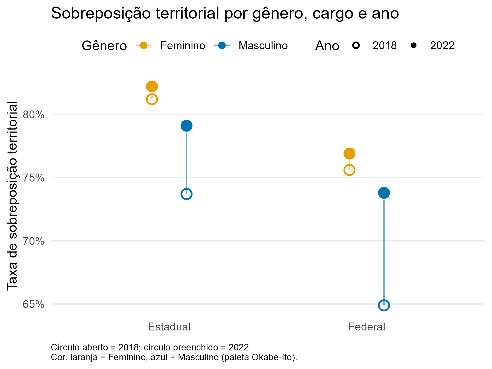
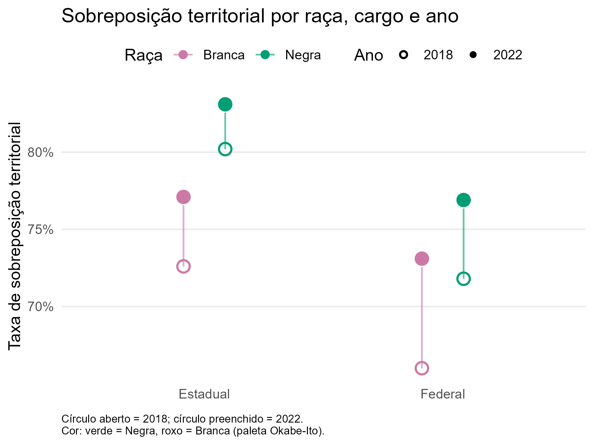
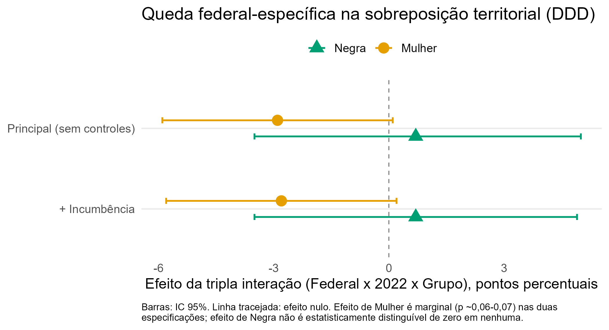
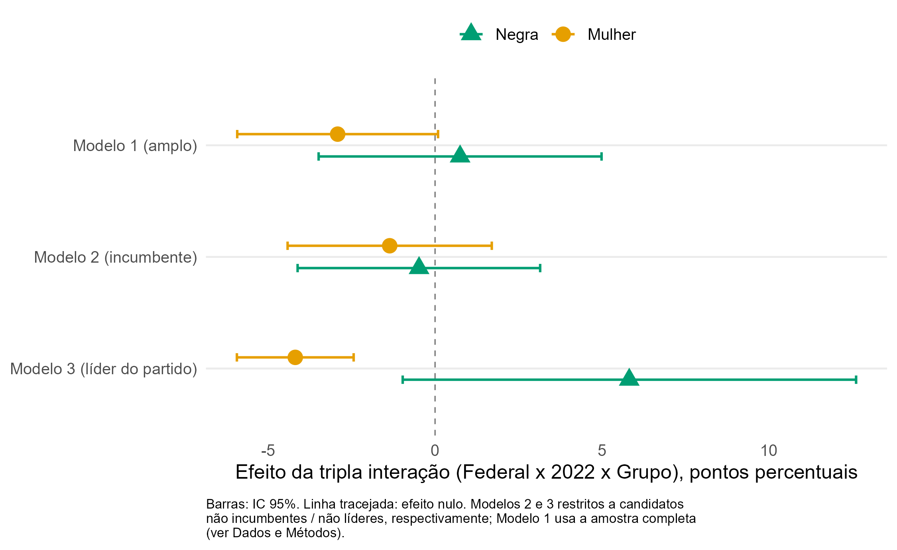
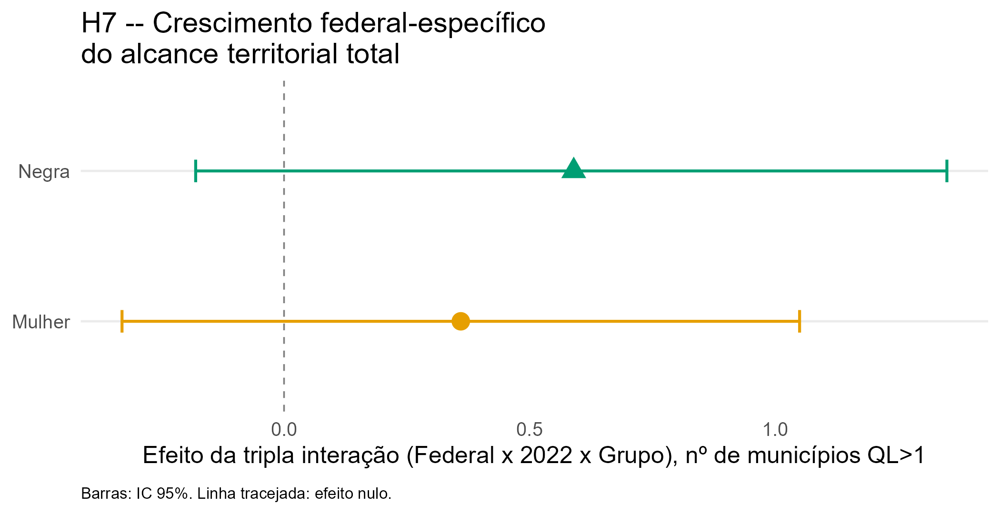

# Coordenação Territorial de Listas Partidárias: Sobreposição de Gasto entre Candidatos do Mesmo Partido {#sec-sobreposicao-territorial}

## Introdução

Esta tese investiga os limites das políticas de ação afirmativa para ampliar a representação de mulheres e negros na política brasileira. De forma específica, pretende-se contribuir para compreender melhor por que essas políticas aumentam a presença de candidaturas na disputa e até os recursos financeiros a que esses grupos têm acesso, mas não se traduzem, na mesma medida, em mais cadeiras conquistadas. Os capítulos anteriores abordam essa pergunta por um caminho específico, a geografia da campanha eleitoral: o quanto o gasto de um candidato se concentra territorialmente (Índice G, Quociente Locacional), o quanto esse gasto se alinha espacialmente com sua própria votação, e o quanto se sobrepõe à base histórica do partido construída na eleição anterior. Este capítulo desloca a unidade de análise mais uma vez, mantendo o mesmo objetivo de fundo: em vez de perguntar como um candidato se relaciona com o território, pergunta como candidatos do mesmo partido, cargo e ano se relacionam entre si dentro desse território, e o que essa relação revela sobre o papel da coordenação partidária na efetividade da ação afirmativa.

A pergunta é simples de enunciar: quando dois ou mais candidatos da mesma legenda concentram gasto de campanha no mesmo município, ambos acima do Quociente Locacional (QL) do gasto, o partido conseguiu coordenar a alocação territorial de seus candidatos, ou eles disputam, na prática, o mesmo eleitorado? Chamamos essa disputa não coordenada de *sobreposição territorial*.

A revisão de literatura deste capítulo segue dois eixos que convergem para um mesmo ponto. O primeiro mostra que partidos e lideranças partidárias têm poder efetivo de coordenar a distribuição territorial de suas próprias listas de candidatos, e que esse poder, quando exercido, protege especificamente os candidatos mais próximos do limiar de eleição ou já consolidados na estrutura da legenda, não a lista como um todo. O segundo mostra que esse mesmo tipo de poder já foi usado, em ações afirmativas anteriores de representação de gênero e raça, para cumprir a letra da política sem alterar, na mesma medida, a distribuição real de poder e de recursos dentro do partido. É a interseção dessas duas linhas — coordenação partidária seletiva e gatekeeping em ações afirmativas — que motiva a hipótese central deste capítulo.

Este capítulo pretende contribuir para entender se partidos coordenam suas candidaturas de forma estratégica, de modo a aproveitar os incentivos criados por ações afirmativas conciliando a maximização de dois interesses por vezes conflitantes: aumentar o total de votos obtidos por mulheres e candidatos negros e, com isso, a fatia de recursos públicos de campanha a que o partido tem acesso, sem afetar a posição de suas lideranças já estabelecidas — ou seja, mantendo essas lideranças elegíveis, sem ameaçá-las. Mulheres e candidatos negros devem, nessa leitura, atrair votos novos para o partido, sem que essas candidaturas cheguem a ameaçar candidaturas já consolidadas.

A Emenda Constitucional 111/2021, art. 2º, oferece uma oportunidade empírica para investigar essa coordenação estratégica. Entre 2022 e 2030, votos recebidos por mulheres ou candidatos afro-brasileiros à Câmara dos Deputados contam em dobro na distribuição do fundo partidário e do Fundo Especial de Financiamento de Campanha (FEFC) do ciclo seguinte [@FonsecaThomeGuedesNeto2026_money_talks] — um incentivo financeiro direto para que os partidos ampliem o desempenho eleitoral desses grupos. Por valer apenas para as eleições federais, não para as estaduais, a regra cria um contrafactual válido: candidatos de Deputado Estadual, sujeitos aos mesmos partidos e ao mesmo contexto político-eleitoral, mas não ao incentivo, servem de grupo de comparação para isolar o efeito específico da EC 111 sobre a coordenação partidária.

Para mensurar a coordenação intrapartidária, analiso em que medida os partidos conseguem evitar que mais de um candidato compita numa mesma localidade pelos votos do mesmo eleitor.

O capítulo testa essa hipótese em três camadas, cada uma mais precisa que a anterior sobre o que conta como "candidato tradicional protegido". A primeira, mais ampla, chamada de Modelo 1, mede a sobreposição territorial de um candidato com qualquer correligionário de mesmo cargo e ano. A segunda, chamada de Modelo 2, mede a sobreposição especificamente com correligionários incumbentes — candidatos eleitos no mesmo cargo na eleição anterior. A terceira, chamada de Modelo 3, mede a sobreposição especificamente com correligionários que ocupam cargo de liderança formal no partido — presidência, vice-presidência ou secretaria de finanças, no diretório nacional ou estadual —, uma medida direta de poder de decisão sobre a alocação de recursos do partido, construída a partir de dados de órgãos partidários do Tribunal Superior Eleitoral (TSE). As três exploram se a mudança de 2018 para 2022 é consistente com um efeito do incentivo financeiro da EC 111.

Os achados deste capítulo confirmam que a sobreposição territorial é o padrão, não a exceção, entre correligionários, e que ela recai desproporcionalmente sobre mulheres e candidatos negros em todas as combinações de cargo e ano analisadas. A evidência causal de que essa queda de sobreposição é específica de onde o incentivo da EC 111 vale, e específica em relação a correligionários com poder de decisão no partido, no entanto, é assimétrica entre os dois grupos: consistente para mulheres a partir do proxy mais preciso, de liderança formal, mas ausente para candidatos negros em todas as especificações testadas. O capítulo sustenta, com isso, uma resposta parcial à hipótese central: partidos parecem, sim, coordenar suas candidaturas de forma estratégica para proteger lideranças estabelecidas, mas esse mecanismo de proteção seletiva opera de forma desigual entre gênero e raça.

## Revisão de Literatura

### Eixo 1 — Há mais coordenação partidária em RP de lista aberta do que se supõe, e ela é seletiva

A leitura padrão da representação proporcional (RP) de lista aberta, desde @Ames1995_electoral_rules, é que candidatos do mesmo partido concentram campanha em redutos eleitorais e evitam ativamente os redutos de correligionários. Mas o resultado empírico mais citado desse programa, @Ames2012_estrategia_eleitoral, já continha uma assimetria importante: líderes partidários desencorajam a "caça furtiva" nos redutos de partidos aliados, o que protege a cota de cadeiras conquistada pela coligação no sistema D'Hondt. @NemotoShugart2013_localism e @Shugart2005_looking_locals ajudam a explicar por que essa mesma preocupação não se estende aos próprios candidatos do partido: sob lista aberta, o vote pooling faz convergir os objetivos coletivos do partido com as estratégias individuais dos candidatos para maximizar votos locais — qualquer voto pessoal, mesmo de quem não se elege, soma ao total da legenda —, de modo que não há necessidade de conter a sobreposição territorial entre correligionários. Um estudo brasileiro recente testa essa hipótese em nível municipal: @Terron2012_padroes_espaciais encontram sobreposição territorial em apenas 3 dos 7 partidos analisados no Rio de Janeiro em 2008, e mesmo aí limitada a pares específicos de candidatos.

Essa leitura, porém, não é o quadro completo. @CheibubSin2020_preference_vote mostram que a competição intrapartidária nas eleições para a Câmara dos Deputados entre 1990 e 2014 é, na verdade, bem mais contida do que essa literatura supõe: partidos constroem suas listas deliberadamente para reduzir choques entre correligionários, e há uma descontinuidade abrupta na distribuição de votos pessoais exatamente entre o último candidato eleito e o primeiro não eleito da mesma legenda. Essa descontinuidade é o ponto de partida para o argumento deste capítulo: a coordenação partidária, quando existe, não é difusa, mas protege especificamente o limiar de eleição, isto é, os candidatos com maior chance real de se tornarem os quadros consolidados do partido. A leitura de Ames e de Nemoto e Shugart e o achado de Cheibub e Sin não se contradizem; coexistem, porque a coordenação partidária brasileira é seletiva, concentrada em proteger quem já está perto de se eleger, não em organizar a lista como um todo. Os próprios autores mostram, além disso, que essa coordenação piora em distritos de magnitude grande: nos "mega-distritos", 40% das listas apresentam três ou mais candidatos fortes em excesso, contra apenas 7% nos distritos pequenos, um padrão que ecoa o que este capítulo encontra adiante ao comparar capitais e não capitais.

### Eixo 2 — Essa coordenação seletiva tem assinatura geográfica

Se a coordenação partidária existe, mas é seletiva, ela precisa de algum mecanismo de alocação, e a evidência disponível aponta para um mecanismo geográfico. Dois estudos sobre São Paulo, o distrito de maior magnitude do país, chegam a interpretações opostas sobre a origem dessa alocação territorial, mas concordam que ela não é aleatória. @Silotto2019_relevancia_regional argumenta que a regionalização é estratégia deliberada da cúpula partidária: candidaturas dificilmente se sobrepõem dentro de um partido ou região porque a alocação segue o potencial eleitoral de cada região do distrito. @SilvaSilotto2018_preparing_terrain argumentam, em contraste, que a regionalização é consequência estrutural, não escolha estratégica, da magnitude do distrito combinada ao fluxo de informação entre cidades, medido pela hierarquia urbana do IBGE — uma leitura alternativa à ideia de @Ames1995_electoral_rules sobre redutos informais construídos intencionalmente. Este capítulo não precisa resolver essa disputa sobre a origem da regionalização para se apoiar nela: seja a alocação territorial deliberada ou estrutural, as duas leituras implicam que ela não é aleatória, o que é o pré-requisito lógico da hipótese central deste capítulo. Se a alocação territorial dentro do partido fosse aleatória, não haveria razão para esperar que ela protegesse especificamente os candidatos incumbentes.

### Eixo 3 — Partidos como gatekeepers de ações afirmativas, inclusive da própria política estudada aqui

A lógica coletiva de maximização de votos discutida no Eixo 1 explica por que partidos toleram sobreposição entre correligionários, já que qualquer voto soma ao total da legenda, mas não explica por si só por que continuariam protegendo especificamente os candidatos mais fortes. É aí que entra a literatura sobre ação afirmativa, que documenta um padrão recorrente de cumprimento formal de regras de representação sem mudança substantiva na distribuição real de poder dentro do partido. No caso do financiamento, há um motivo adicional para os partidos reagirem estrategicamente a um incentivo como o de 2022: @SpeckMancuso2014_campaign_finance mostram, com dados de Deputado Federal e Estadual de 2010, que o retorno marginal do financiamento sobre o desempenho eleitoral é maior para candidatas desafiantes do que para candidatos homens desafiantes, de modo que investir nelas tem, em tese, mais a ganhar em votos por real gasto — o que torna plausível que um incentivo como a EC 111 mude o comportamento observável dos partidos, não apenas o cumprimento formal da regra.

@GattoWylie2021_informal_institutions mostram que partidos usam instituições informais, como a nomeação intencional de candidatas "laranja", para cumprir a letra da cota de candidaturas sem apoiar de fato candidaturas femininas competitivas: o precedente mais direto de gatekeeping partidário sobre uma ação afirmativa anterior à estudada aqui. @Piscopo2022_follow_money, no caso comparado do Chile, mostram que mesmo um mecanismo de financiamento desenhado com viés de gênero pode ser insuficiente para equalizar recursos entre homens e mulheres. @Sacchet2025_nao_e_so_dinheiro, com dados brasileiros do mesmo ciclo eleitoral analisado neste capítulo, mostram que doações entre candidatos favorecem sistematicamente o grupo já sobrerrepresentado, homens brancos, tanto por gênero quanto por raça.

O precedente mais direto para a hipótese deste capítulo, porém, é @FonsecaThomeGuedesNeto2026_money_talks, o único estudo, até onde alcança esta revisão, que analisa a própria Emenda Constitucional 111/2021, art. 2º, com o mesmo desenho de identificação usado aqui — Federal versus Estadual, já que a regra só vale para o cargo federal. Os autores mostram que o incentivo aumentou votos e recursos de campanha para candidatas mulheres, e a proporção de candidaturas de candidatos negros lançadas pelos partidos, mas que em ambos os grupos os partidos tenderam a nomear candidatos não competitivos, evitando ameaçar a posição de candidatos já estabelecidos. Essa é a assinatura empírica do mecanismo de aproveitar o incentivo sem ameaçar as lideranças que este capítulo testa de forma mais direta, substituindo competitividade agregada por uma medida geográfica centrada em incumbência.

A história legislativa da cota de recursos financeiros, reconstruída em detalhe por @Gatto2025_resistance_quotas, mostra esse padrão de proteção seletiva se repetindo antes da própria EC 111. Em 2015, depois de o Congresso rejeitar uma proposta de cadeiras reservadas para mulheres, a bancada feminina negociou a reserva de parte dos recursos do fundo partidário para candidaturas femininas, mas líderes partidários enfraqueceram a proposta em negociações de bastidor até que a lei aprovada (Lei 13.165/2015) estabelecesse apenas um mínimo de 5% e um máximo de 15% dos recursos, com o Senado retirando ainda a exigência de que esses recursos fossem usados exclusivamente em eleições proporcionais — mudança que, segundo a autora, preservava a possibilidade de usar o mesmo dinheiro em campanhas majoritárias, nas quais os titulares, majoritariamente homens, já eram competitivos. A reserva só foi elevada a um mínimo de 30% em 2018, e por via judicial, não legislativa: o Procurador-Geral da República ajuizou a ADI 5.617 contra o teto de 15%, o STF acatou o pedido em março de 2018, e o TSE, em maio do mesmo ano, estendeu o piso de 30% ao Fundo Especial de Financiamento de Campanha e ao tempo de rádio e televisão.

A própria EC 111 nasceu dentro dessa dinâmica de proteção seletiva. @Gatto2025_resistance_quotas mostra que a dobra de votos de mulheres e negros na distribuição do fundo eleitoral foi negociada pela então relatora da reforma eleitoral de 2021, deputada Renata Abreu, do PODE, a mesma líder partidária que dois anos antes havia proposto suprimir a obrigatoriedade da cota de candidaturas, argumentando publicamente que cumprir o percentual mínimo "não é fácil" e que isso prejudica os coeficientes eleitorais dos partidos, sua possibilidade de conquistar mais cadeiras e até sua sobrevivência (Zaremba 2019, apud @Gatto2025_resistance_quotas). Segundo a autora, especialistas consultados pela imprensa à época já previam que a medida beneficiaria sobretudo mulheres incumbentes e seus partidos, sem necessariamente encorajar uma ampliação mais geral da representação feminina (Zaremba 2019, apud @Gatto2025_resistance_quotas): a mesma assimetria entre aproveitar o grupo incentivado e não ameaçar quem já está eleito que a hipótese deste capítulo testa diretamente, agora com uma base documental, não apenas inferida do desenho da política.

## Hipóteses

A conciliação entre essas duas literaturas — a evidência de que partidos coordenam de forma seletiva a distribuição territorial de suas listas, protegendo especificamente candidatos já consolidados, e a evidência de que partidos usam esse mesmo tipo de poder para proteger essas lideranças diante de ações afirmativas anteriores — embasa a hipótese geral deste capítulo: partidos atuam de forma estratégica para aproveitar o incentivo financeiro criado pela Emenda Constitucional 111/2021, art. 2º, desde que protejam seus candidatos estabelecidos. Isso se dá por meio de dois mecanismos, testados com proxies operacionais distintos de candidato tradicional/protegido: incumbência, isto é, ter sido eleito no mesmo cargo na eleição anterior; e liderança formal do partido, isto é, ocupar cargo de presidência, vice-presidência ou secretaria de finanças no diretório nacional ou estadual do partido no momento da eleição. O segundo é uma medida mais direta de poder de decisão sobre o partido — inclusive sobre a alocação de recursos, no caso da secretaria de finanças — e não depende de o candidato ter permanecido no mesmo partido entre uma eleição e outra, ao contrário da incumbência.

1. H1. Candidatas mulheres apresentam taxa de sobreposição territorial maior do que candidatos homens.
2. H2. Candidatos negros apresentam taxa de sobreposição territorial maior do que candidatos brancos.
3. H3. A queda na taxa de sobreposição territorial com qualquer correligionário de mulheres e de candidatos negros entre 2018 e 2022 é maior no cargo de Deputado Federal — onde vale o incentivo da EC 111 — do que no de Deputado Estadual, onde ele não se aplica. Essa é a primeira aproximação ao mecanismo, mais ampla e, por isso, menos capaz de distinguir afastamento de qualquer correligionário de afastamento especificamente de candidatos tradicionais.
4. H4. O quanto a queda de sobreposição territorial entre 2018 e 2022 se concentra no cargo em que vale o incentivo da EC 111 é maior — isto é, mais negativa — quando a sobreposição é medida especificamente com correligionários tradicionais/protegidos (incumbentes ou líderes formais do partido) do que quando é medida com qualquer correligionário (Modelo 1): evidência de que o afastamento observado é direcionado aos candidatos tradicionais do partido, e não difuso.
5. H5. O alcance territorial total de mulheres e candidatos negros, medido pelo número de municípios com concentração de gasto (QL > 1), cresce no cargo em que vale o incentivo da EC 111, em 2022. H5 testa a contrapartida positiva de H4: se lideranças protegem seu território de correligionários incentivados, o alcance territorial total desses candidatos ainda assim deve crescer — só que fora da área dos correligionários protegidos.

## Dados e Métodos

### Variáveis

A estratégia de coordenação partidária será operacionalizada por meio da análise da distribuição geográfica dos gastos de campanha realizados por candidatos. Havendo coordenação, espera-se que candidatos de um mesmo partido não concentrem suas campanhas, em termos de despesas realizadas, num mesmo município.

A concentração do gasto é medida pelo Quociente Locacional (QL), uma adaptação, à geografia eleitoral, de uma ferramenta clássica de economia regional para medir concentração espacial de uma atividade em relação a uma base de referência. O índice já havia sido adaptado à ciência política antes deste capítulo, para medir a concentração territorial do voto recebido por um candidato [@AvelinoBidermanSilva2011_concentracao_eleitoral; @AvelinoBidermanSilva2016_concentracao_brasil]; a aplicação ao gasto de campanha, em vez do voto, é adaptação original deste capítulo. Para um candidato $i$ e um município $m$, o QL do gasto compara a participação de $m$ no gasto total de $i$ com a participação de $m$ no eleitorado da UF: um candidato com QL > 1 em $m$ concentrou ali uma fração do próprio gasto maior do que a fração do eleitorado da UF que $m$ representa, ou seja, investiu ali desproporcionalmente. A escolha de medir concentração via gasto de campanha, e não via votação obtida, é deliberada. O gasto é decidido pelo candidato e pelo partido antes de o resultado da eleição ser conhecido, e por isso reflete diretamente a estratégia e a intenção de onde investir esforço de campanha; a votação, por contraste, é o resultado de fatores fora do controle direto da campanha, como o comportamento do eleitor, o desempenho de adversários e a conjuntura. Sobreposição territorial medida via gasto é, portanto, evidência mais direta da decisão de alocação que este capítulo quer explicar do que sobreposição medida via votos, que mistura essa decisão com seu resultado. O limiar QL > 1, e não um valor mais alto, segue a convenção do próprio índice na economia regional. QL = 1 é o ponto em que a participação do município no gasto do candidato iguala sua participação no eleitorado de referência, o corte mínimo e não arbitrário acima do qual já se pode falar de concentração territorial, e não apenas presença.

No nível do município, para cada combinação de partido, cargo, ano, UF e município, contamos o número de candidatos distintos do partido com QL do gasto acima de 1 naquele município. Um município é classificado como sobreposto (`overlap = 1`) quando esse número é igual ou maior que 2.

No nível do candidato, para cada um, entre os municípios em que ele tem QL do gasto acima de 1, calculamos a fração que é sobreposta, isto é, compartilhada com pelo menos um correligionário do mesmo partido, cargo e ano:

$$\text{taxa\_sobreposicao}_i = \frac{\#\{\text{municípios de } i \text{ com QL}>1 \text{ que são sobrepostos}\}}{\#\{\text{municípios de } i \text{ com QL}>1\}}$$

Essa é a métrica individual comparada entre grupos ao longo do capítulo. Ela só é definida para candidatos com pelo menos um município de concentração de gasto; dos 37.158 candidatos da amostra, todos têm ao menos um.

Essa sobreposição importa porque, em lista aberta, as cadeiras do partido são distribuídas aos candidatos pela ordem de votos pessoais dentro da própria legenda, uma vez atingido o quociente partidário: dois correligionários que concentram gasto no mesmo município disputam, na prática, o mesmo eleitorado e, portanto, a mesma faixa de votos pessoais que determina essa posição relativa dentro da lista. A ameaça da sobreposição territorial é, assim, ao lugar de um candidato específico na fila da própria legenda, não ao total de cadeiras conquistadas pelo partido, que continua sendo alimentado por qualquer voto recebido por qualquer correligionário.

### Amostra

A amostra cobre Deputado Federal e Deputado Estadual, em 2018 e 2022, todos os partidos presentes nos dados e todas as Unidades da Federação: 37.158 candidatos distintos, com pelo menos um registro de gasto, distribuídos por 34 legendas.

| Cargo | Ano | Candidaturas | Mulheres | Candidatos negros |
|---|---|---:|---:|---:|
| Deputado Estadual | 2018 | 10.794 | 3.276 (30,4%) | 4.708 (43,6%) |
| Deputado Estadual | 2022 | 12.689 | 4.410 (34,8%) | 6.350 (50,0%) |
| Deputado Federal | 2018 | 5.433 | 1.650 (30,4%) | 1.996 (36,7%) |
| Deputado Federal | 2022 | 8.242 | 2.989 (36,3%) | 3.848 (46,7%) |

: Candidaturas na amostra, por ano, cargo, gênero e raça {#tbl-amostra-descritiva}

Os dados vêm de fontes públicas do Tribunal Superior Eleitoral (TSE). O Quociente Locacional do gasto eleitoral, no nível candidato-município, é derivado de dados de prestação de contas eleitorais do TSE. Variáveis de candidatura — gênero, raça autodeclarada, partido, situação eleitoral — vêm dos registros de candidatura do TSE dos mesmos pleitos, obtidos via `electionsBR::elections_tse()`, incluindo Deputado Federal 2014, usada apenas para a análise de incumbência. Os dados de liderança formal do partido, usados no Modelo 3, vêm do sistema de Gerenciamento de Informações Partidárias (SGIP) do TSE, disponibilizado como dado aberto (`dadosabertos.tse.jus.br`, conjunto "Delegados Partidários — Órgãos Partidários", arquivo `orgao_partidario.zip`, baixado em agosto de 2026): um registro histórico completo de quem ocupou cada cargo em cada órgão partidário do país, com datas de início e fim de mandato, permitindo reconstruir a composição da liderança de cada partido em qualquer momento passado, não apenas a atual. As bases usadas na análise foram construídas por mim a partir dessas três fontes originais.

Dois partidos da amostra, PMB e PMN, não têm nenhum registro de órgão partidário no sistema do TSE sob nenhum nome, histórico ou atual; seus candidatos (3,3% da amostra) são tratados como dado ausente na variável de liderança formal, não como não-líderes, e excluídos do Modelo 3.

### Estratégia de inferência

#### Modelo 1: especificação da tripla diferença

O desenho é uma diferença-em-diferenças estendida para uma terceira dimensão de comparação, por isso chamada de tripla diferença, ou diferença em diferenças. A lógica de uma diferença-em-diferenças simples é comparar a mudança ao longo do tempo, antes e depois de uma intervenção, entre um grupo afetado por ela e um grupo de comparação não afetado: a diferença entre essas duas mudanças isola o efeito da intervenção, sob o pressuposto de que, na ausência dela, os dois grupos teriam evoluído de forma parecida. Aqui, a intervenção é o incentivo financeiro de 2022 criado pela EC 111/2021, art. 2º, que vale apenas para Deputado Federal; Deputado Estadual funciona como grupo de comparação, e 2018 e 2022 como o antes e o depois. A tripla diferença adiciona uma terceira comparação, entre grupos de candidatos — mulher e homem, negra e branca —, para testar se o efeito é específico ao grupo que o incentivo beneficia. O coeficiente de interesse é a interação tripla entre Federal, Ano 2022 e Grupo: mede o quanto a queda de sobreposição territorial entre 2018 e 2022 é maior, ou menor, para o grupo incentivado especificamente no cargo Federal, além do que cargo, ano e grupo explicam isoladamente ou em pares.

Formalmente, para H3, estimamos:

$$
\begin{aligned}
\text{taxa\_sobreposicao}_i = \ & \beta_0 + \beta_1 \text{Federal}_i + \beta_2 \text{Ano2022}_i + \beta_3 G_i \\
& + \beta_4(\text{Federal}{\times}\text{Ano2022}) + \beta_5(\text{Federal}{\times}G_i) + \beta_6(\text{Ano2022}{\times}G_i) \\
& + \beta_7(\text{Federal}{\times}\text{Ano2022}{\times}G_i) + \varepsilon_i
\end{aligned}
$$

em que $G_i$ é Mulher ou Negra, em dois modelos separados, e $\beta_7$ é o coeficiente de interesse. A unidade é o candidato, não o par candidato-município (ver nota metodológica abaixo). A especificação inclui efeitos fixos de partido e de UF, com erros-padrão clusterizados nas mesmas duas dimensões; ambos são pré-determinados, escolhidos antes da campanha, e não consequência da estratégia de gasto. Uma especificação adicional (Seção @sec-resultados-incumbencia) inclui incumbência, também pré-determinada, como controle de decomposição. Essa mesma estrutura de efeitos fixos e clusterização vale para as especificações do Modelo 2 e de H5 apresentadas a seguir.

#### Modelo 2: sobreposição especificamente com correligionários incumbentes

O Modelo 1 mede a sobreposição de um candidato com qualquer correligionário do mesmo partido, cargo e ano, uma medida ampla que não distingue se o correligionário sobreposto é um candidato tradicional do partido ou outro candidato também marginal. Para testar o mecanismo de proteção de lideranças com mais precisão, o Modelo 2 restringe a definição de sobreposição aos casos em que o correligionário sobreposto é especificamente um candidato incumbente, eleito no mesmo cargo na eleição anterior (2014 para candidatos de 2018, 2018 para candidatos de 2022), a mesma variável já usada como decomposição na análise de incumbência apresentada mais adiante.

Formalmente, para cada candidato $i$, entre os municípios em que ele tem QL do gasto acima de 1, calculamos a fração que é compartilhada com pelo menos um correligionário incumbente, que não o próprio $i$, caso ele mesmo seja incumbente:

$$
\text{taxa\_sobreposicao\_incumbente}_i = \frac{\#\{\text{municípios de } i \text{ com QL}>1 \text{ sobrepostos a incumbente}\}}{\#\{\text{municípios de } i \text{ com QL}>1\}}
$$

A amostra principal do Modelo 2 é restrita a candidatos não incumbentes, pois o mecanismo testado é sobre desafiantes evitando o território de líderes já estabelecidos, uma pergunta distinta de saber se um incumbente se sobrepõe a outro incumbente. A amostra completa, incumbentes mais não incumbentes, entra como robustez. A especificação da tripla diferença é idêntica à do Modelo 1, com os mesmos efeitos fixos de partido e UF e a mesma clusterização, trocando apenas a variável dependente.

Incumbência, porém, é uma medida indireta de "candidato tradicional": ela identifica quem já ocupou o cargo, não quem tem poder de decisão dentro do partido, e é definida por correspondência de CPF ao vencedor do pleito anterior, sem checar se o candidato permanece no mesmo partido — um problema relevante dado que a troca de partido entre eleições, a chamada janela partidária, é comum na política brasileira (Limitação 8). O Modelo 3, a seguir, testa o mesmo mecanismo com uma medida mais direta.

#### Modelo 3: sobreposição com correligionários líderes formais do partido

Uma liderança partidária não precisa ter sido eleita para ter poder de decisão sobre a campanha e os recursos do partido: presidentes, vice-presidentes e secretários de finanças de diretórios partidários ocupam essas posições por processo interno do partido, não por eleição popular, e a secretaria de finanças, em particular, tem no próprio nome do cargo a ligação com a alocação de recursos que a hipótese deste capítulo testa. O Modelo 3 mede a sobreposição territorial especificamente com correligionários que ocupam um desses três cargos — presidente, vice-presidente ou secretário de finanças — no diretório nacional ou no diretório estadual/distrital do partido, uma proxy mais direta de "candidato tradicional protegido" do que a incumbência do Modelo 2, e que, por ser definida sobre o partido atual do candidato em cada ciclo eleitoral, não herda o problema de troca de partido do Modelo 2. Um candidato é considerado líder do partido em determinado ciclo eleitoral se seu mandato em um dos três cargos se sobrepõe ao ano civil da eleição (2018 ou 2022). A liderança nacional conta para o candidato em qualquer UF em que concorra — um presidente nacional tem poder de decisão sobre a alocação de recursos do partido onde quer que ele lance candidatos, não apenas na UF de sua própria residência —, enquanto a liderança estadual ou distrital conta apenas na UF correspondente. O vínculo entre o registro de liderança e o candidato é feito pelo título eleitoral, com cobertura completa (100%) na amostra deste capítulo.

Formalmente, a variável dependente do Modelo 3, $\text{taxa\_sobreposicao\_lideranca}_i$, segue a mesma definição do Modelo 2, trocando "correligionário incumbente" por "correligionário líder do partido", e a amostra principal é, pelo mesmo racional do Modelo 2, restrita a candidatos que não são eles mesmos líderes do partido, com a amostra completa como robustez. A especificação da tripla diferença é idêntica às anteriores.

#### Alcance territorial total

Como contrapartida de H4, medimos também o alcance territorial total de cada candidato, o número de municípios em que ele tem QL do gasto acima de 1 ($n\_mun\_ql1$, já calculado como insumo do Modelo 1). Se o mecanismo de proteção de lideranças estiver correto, esse alcance deveria crescer de forma federal-específica em 2022 para mulheres e negros, evidência de que as candidaturas incentivadas de fato se expandem territorialmente, mesmo sem confrontar diretamente os candidatos tradicionais. A especificação da tripla diferença é a mesma, com a amostra completa, já que o sujeito de interesse aqui é o crescimento do próprio candidato incentivado, incumbente ou não.

## Resultados

A Análise preliminar a seguir, assim como as subseções de incumbência e de tripla diferença, usa o Modelo 1, mais amplo, de sobreposição com qualquer correligionário; as três subseções finais apresentam o Modelo 2 e o Modelo 3, referentes a H4, de sobreposição especificamente com incumbentes e com líderes formais do partido, e o teste complementar de alcance territorial total, referente a H5.

### Análise preliminar

#### Sobreposição é o padrão, não a exceção

Entre 26% e 36% dos municípios em que ao menos um candidato de um partido concentrou gasto (QL > 1) têm dois ou mais candidatos do mesmo partido acima do QL simultaneamente, ou seja, a coordenação territorial da lista partidária é fraca de forma consistente nas quatro combinações de cargo e ano.

@tbl-sobreposicao-genero-raca mostra a taxa de sobreposição média por candidato (`taxa_sobreposicao`), por gênero e raça, cargo e ano, com teste t de Welch para a diferença de médias.

| Grupo | Cargo | Ano | Taxa (grupo) | Taxa (referência) | Lacuna (p.p.) | p-valor | Sig. |
|---|---|---|---:|---:|---:|---:|:---:|
| Gênero (Fem. vs. Masc.) | Estadual | 2018 | 81,2% | 73,7% | 7,5 | <0,001 | *** |
| Gênero (Fem. vs. Masc.) | Estadual | 2022 | 82,2% | 79,1% | 3,1 | <0,001 | *** |
| Gênero (Fem. vs. Masc.) | Federal | 2018 | 75,6% | 64,9% | 10,7 | <0,001 | *** |
| Gênero (Fem. vs. Masc.) | Federal | 2022 | 76,9% | 73,8% | 3,1 | <0,001 | *** |
| Raça (Negra vs. Branca) | Estadual | 2018 | 80,2% | 72,6% | 7,6 | <0,001 | *** |
| Raça (Negra vs. Branca) | Estadual | 2022 | 83,1% | 77,1% | 6,0 | <0,001 | *** |
| Raça (Negra vs. Branca) | Federal | 2018 | 71,8% | 66,0% | 5,8 | <0,001 | *** |
| Raça (Negra vs. Branca) | Federal | 2022 | 76,9% | 73,1% | 3,8 | <0,001 | *** |

: Taxa de sobreposição territorial (média por candidato) por gênero, raça, cargo e ano {#tbl-sobreposicao-genero-raca}

Duas leituras se destacam. As lacunas de gênero e de raça são estatisticamente significativas nas oito células, com p < 0,001 em todas, e nenhuma das duas desaparece em nenhuma combinação de cargo e ano. As duas lacunas caem entre 2018 e 2022 nos dois cargos, mas em ritmos diferentes: a de gênero cai mais acentuadamente, de 7,5 para 3,1 pontos percentuais no Estadual e de 10,7 para 3,1 no Federal, enquanto a de raça cai de forma mais moderada, de 7,6 para 6,0 no Estadual e de 5,8 para 3,8 no Federal, permanecendo maior em magnitude ao final do período nos dois cargos.

{#fig-sobreposicao-genero width="85%"}

{#fig-sobreposicao-raca width="85%"}

#### Onde a lacuna realmente vive: capital vs. não-capital

Uma pergunta natural é se esse padrão está concentrado nas capitais estaduais, municípios de eleitorado muito maior, onde intuitivamente seria mais fácil qualquer candidato ultrapassar o QL. A resposta é que sim: capitais têm taxa de sobreposição muito mais alta, de 71,3% a 95,3% dos municípios-capital com pelo menos um candidato acima do QL têm dois ou mais, contra 23,4% a 33,7% fora delas. Esse efeito, porém, é praticamente universal e não discrimina por grupo: dentro das capitais, nem a lacuna de gênero (0,1 p.p., p = 0,262) nem a de raça (−0,1 p.p., p = 0,663) são estatisticamente significativas.

As lacunas documentadas na @tbl-sobreposicao-genero-raca são, portanto, um fenômeno de município não-capital. Recalculando a taxa pessoal de sobreposição restrita aos municípios não-capital de cada candidato, tanto a lacuna de gênero (61,8% contra 56,8%, ou 5,0 p.p., p < 0,001) quanto a de raça (59,3% contra 57,7%, ou 1,6 p.p., p = 0,002) permanecem robustas: os dois grupos enfrentam mais sobreposição fora das capitais, ainda que a lacuna de gênero seja consideravelmente maior em magnitude.

#### Resultado eleitoral do ano corrente

A sobreposição cresce com o desempenho eleitoral pior na maioria das células cargo por ano: eleito menor que competitivo não eleito, menor que não competitivo (como em Federal 2022, com 54,5%, 55,4% e 69,2%), com a única exceção de Federal 2018, em que competitivo não eleito (41,0%) fica ligeiramente abaixo de eleito (43,7%). Candidatos com desempenho eleitoral pior têm, de modo geral, gasto territorialmente menos exclusivo, o que é coerente com uma estrutura de campanha própria menor.

### Incumbência

Candidatos incumbentes, isto é, eleitos no mesmo cargo na eleição anterior, têm território sistematicamente mais exclusivo nas quatro combinações de cargo e ano: Estadual 2018, com 46,3% contra 65,1%; Estadual 2022, com 55,8% contra 72,4%; Federal 2018, com 43,0% contra 56,1%; e Federal 2022, com 51,9% contra 67,1%. No modelo de tripla diferença com controle de incumbência, o coeficiente de `incumbente` é grande e altamente significativo nas duas especificações, de aproximadamente −16,5 p.p., com p < 0,0001: incumbentes se sobrepõem muito menos a correligionários do que não incumbentes, controlando por gênero ou raça, partido e UF.

### A tripla diferença: o incentivo financeiro de 2022 {#sec-ddd}

@tbl-ddd apresenta os coeficientes da tripla interação entre Federal, 2022 e Grupo, nas duas especificações descritas anteriormente: principal e com controle de incumbência.

| Grupo | Especificação | Estimativa (p.p.) | IC 95% | p-valor |
|---|---|---:|---|---:|
| Mulher | Principal (sem controles) | −2,9 | [−5,9; 0,1] | 0,057 |
| Mulher | + Incumbência | −2,8 | [−5,8; 0,2] | 0,068 |
| Negra | Principal (sem controles) | 0,7 | [−3,5; 5,0] | 0,719 |
| Negra | + Incumbência | 0,7 | [−3,5; 4,9] | 0,730 |

: Tripla diferença (Federal × 2022 × Grupo) — efeito federal-específico na queda de sobreposição territorial {#tbl-ddd}

{#fig-ddd width="90%" fig-pos="H"}

Para raça, H3 não se sustenta: o sinal é positivo, o oposto do que a hipótese previa, e não é estatisticamente distinguível de zero em nenhuma especificação, com p entre 0,719 e 0,730. Não há evidência de que o incentivo financeiro de 2022 tenha reduzido especificamente a sobreposição territorial de candidatos negros no Federal, além do que cargo, ano e raça isoladamente já explicam.

Para gênero, H3 encontra apenas um sinal marginal: o sinal é o esperado, negativo, e próximo, mas não abaixo, do limiar de significância convencional nas duas especificações, com p entre 0,057 e 0,068 — um resultado sugestivo, mas não conclusivo, de queda federal-específica na sobreposição de mulheres.

O teste seguinte verifica se esse sinal marginal, presente para gênero e ausente para raça, é especificamente uma queda de sobreposição com candidatos tradicionais do partido, ou se é difuso.

### Modelo 2: o teste direto do mecanismo de proteção {#sec-resultados-modelo2}

O Modelo 1 mostrou um sinal marginal e federal-específico para mulheres, e nenhum sinal para candidatos negros. O Modelo 2 pergunta se o sinal de gênero é, especificamente, uma queda na sobreposição com correligionários incumbentes: o teste direto do mecanismo de proteção de lideranças, H4.

Para mulheres, o Modelo 2 dá um resultado menor em magnitude do que o Modelo 1 (−1,4 contra −2,9 p.p.) e mais distante da significância convencional (p = 0,368 contra 0,057): o sinal marginal do Modelo 1 se dilui, em vez de se concentrar, quando a atenção se volta especificamente para incumbentes — o oposto do que o mecanismo de proteção previa. Para candidatos negros, o resultado permanece nulo (p = 0,788, contra p = 0,719 no Modelo 1), sem mudança de padrão relevante. A comparação completa, incluindo o Modelo 3 a seguir, está na @tbl-modelo1-modelo2-modelo3.

### Modelo 3: liderança formal, o teste mais direto do mecanismo {#sec-resultados-modelo3}

O Modelo 2 diluiu o sinal em vez de concentrá-lo. Isso é compatível com dois cenários opostos: o mecanismo de proteção de lideranças simplesmente não existe, ou existe mas a incumbência é uma medida ruidosa demais de "candidato protegido" para captá-lo (Limitação 8). O Modelo 3, que usa liderança formal do partido em vez de incumbência, ajuda a distinguir entre essas duas leituras.

@tbl-modelo1-modelo2-modelo3 e @fig-modelo1-modelo2-modelo3 comparam os coeficientes da tripla interação nos três modelos.

| Grupo | Modelo | Amostra | Estimativa (p.p.) | IC 95% | p-valor |
|---|---|---|---:|---|---:|
| Mulher | Modelo 1 (amplo) | Completa | −2,9 | [−5,9; 0,1] | 0,057 |
| Mulher | Modelo 2 (incumbente) | Não incumbentes | −1,4 | [−4,4; 1,7] | 0,368 |
| Mulher | Modelo 3 (líder do partido) | Não líderes | −4,2 | [−6,1; −2,4] | <0,001 |
| Negra | Modelo 1 (amplo) | Completa | 0,7 | [−3,5; 5,0] | 0,719 |
| Negra | Modelo 2 (incumbente) | Não incumbentes | −0,5 | [−4,1; 3,1] | 0,788 |
| Negra | Modelo 3 (líder do partido) | Não líderes | 5,9 | [−1,0; 12,7] | 0,089 |

: Tripla diferença — Modelo 1 (qualquer correligionário) vs. Modelo 2 (correligionário incumbente) vs. Modelo 3 (correligionário líder formal do partido) {#tbl-modelo1-modelo2-modelo3}

{#fig-modelo1-modelo2-modelo3 width="90%"}

Para candidatos negros, o Modelo 3 confirma o padrão dos dois anteriores: nenhuma evidência do mecanismo, e aqui o coeficiente é ainda o de sinal oposto ao previsto, embora não estatisticamente distinguível de zero a 5% (p = 0,089). Três especificações diferentes de "candidato tradicional/protegido" convergem em não encontrar o mecanismo para raça.

Para mulheres, o resultado é qualitativamente diferente dos dois anteriores: o Modelo 3 não dilui o sinal do Modelo 1, ele o fortalece de forma substancial, com a estimativa passando de marginal (p = 0,057) para muito além do limiar convencional (p < 0,001), e robusto à amostra completa, líderes mais não líderes (−4,25 p.p., p < 0,001). Decompor a tripla diferença em suas partes explica por que os Modelos 2 e 3 divergem tanto. No Modelo 2, a queda na taxa de sobreposição com incumbente para mulheres, entre 2018 e 2022, é parecida nos dois cargos: cai 5,6 pontos percentuais em relação a homens no Federal e 4,0 no Estadual. É exatamente essa falta de especificidade federal que anula a tripla diferença, já que uma mudança que acontece onde o incentivo financeiro não vale não pode ser atribuída a ele. No Modelo 3, o padrão é o oposto. No Estadual, a diferença de gênero na taxa de sobreposição com líder do partido muda muito pouco entre 2018 e 2022 (0,7 p.p.); no Federal, ela se abre 5,9 pontos percentuais, com mulheres se afastando de líderes do partido (31,5% para 28,9% de seus municípios QL>1) enquanto homens se aproximam (24,6% para 27,9%). Essa especificidade federal, presente no Modelo 3 e ausente no Modelo 2, é o que torna o coeficiente da tripla interação grande e preciso.

A leitura mais direta é que a incumbência, no Modelo 2, estava misturando um efeito real, específico do mecanismo de proteção de lideranças, com uma tendência geral e alheia à EC 111 de incumbentes de qualquer cargo ficarem mais "protegidos" ao longo do tempo — ruído suficiente para mascarar o sinal. Ao trocar para liderança formal, medida sobre o partido atual do candidato e não contaminada pela troca de partido entre ciclos, esse ruído desaparece e o padrão federal-específico previsto pela hipótese aparece com força, ao menos para mulheres.

### Alcance territorial total

@tbl-h7 e @fig-h7 mostram a tripla diferença sobre o alcance territorial total (número de municípios com QL>1 por candidato).

| Grupo | Estimativa (nº municípios) | IC 95% | p-valor |
|---|---:|---|---:|
| Mulher | 0,36 | [−0,33; 1,05] | 0,293 |
| Negra | 0,59 | [−0,18; 1,35] | 0,127 |

: Tripla diferença (Federal × 2022 × Grupo) sobre alcance territorial total (H5) {#tbl-h7}

{#fig-h7 width="80%"}

Os dois coeficientes têm o sinal esperado, positivo, indicando mais municípios de concentração de gasto no Federal em 2022, mas nenhum é estatisticamente distinguível de zero. Isso significa que H5 não encontra evidência de que o alcance territorial de mulheres ou candidatos negros tenha crescido de forma federal-específica mensurável nesta amostra.

## Discussão

Quatro testes compõem a evidência causal deste capítulo, e só o último os distingue com clareza por grupo. A tripla diferença que testa se a queda de sobreposição entre 2018 e 2022 é especificamente federal (H3) encontra apenas um sinal marginal para mulheres e nenhum sinal para candidatos negros. O primeiro teste direto do mecanismo, que restringe a sobreposição a correligionários incumbentes (H4, Modelo 2), não confirma a hipótese para nenhum dos dois grupos; para mulheres, essa restrição chega a enfraquecer o sinal do Modelo 1. O teste de alcance territorial total (H5) não encontra evidência de crescimento federal-específico para nenhum dos dois grupos. É o segundo teste direto, que restringe a sobreposição a correligionários que ocupam cargo formal de liderança no partido (H4, Modelo 3), que separa os dois grupos: para mulheres, o sinal deixa de ser marginal e se torna preciso; para candidatos negros, permanece nulo, com o coeficiente na direção oposta à prevista. Esse padrão confirma o mecanismo de proteção de lideranças para mulheres, mas não para candidatos negros — e a diferença entre os dois grupos só fica visível quando a medida de "candidato tradicional protegido" é suficientemente precisa. O padrão descritivo, por trás desses quatro testes, é mais simples e sem exceção: mulheres e candidatos negros apresentam sobreposição territorial mais alta do que seus grupos de referência em todas as combinações de cargo e ano (H1, H2).

A evidência causal deste capítulo para o mecanismo de proteção de lideranças é, portanto, assimétrica entre os dois grupos. Para mulheres, o Modelo 3 mostra que a queda de sobreposição territorial entre 2018 e 2022, com correligionários que formalmente decidem sobre o partido, é específica do cargo Federal, onde vale o incentivo da EC 111, e não aparece no Estadual, onde ele não vale: exatamente a assinatura que a hipótese de proteção de lideranças previa. Para candidatos negros, os três testes convergem em não encontrar esse padrão, e o Modelo 3, a especificação mais precisa, aponta inclusive na direção contrária. @CheibubSin2020_preference_vote (Eixo 1) já mostravam que a coordenação partidária brasileira é seletiva no sentido eleitoral, protegendo especificamente candidatos próximos do limiar de eleição, não qualquer correligionário. O achado do Modelo 3 estende essa seletividade para uma dimensão distinta, de poder formal dentro do partido, que os próprios autores não testam: não é só quem está perto de se eleger que é protegido, mas também, e de forma mais nítida neste capítulo, quem já ocupa cargo de decisão no partido. Essa seletividade, porém, neste ciclo e nesta política, operou sobre a dimensão de gênero e não sobre a de raça.

Esse padrão de grupo dialoga com @FonsecaThomeGuedesNeto2026_money_talks, que usam o mesmo desenho de identificação, Federal versus Estadual, sobre a mesma política, e encontram aumento significativo de votos para mulheres, sem efeito significativo sobre cadeiras conquistadas por elas, e nenhum efeito significativo, nem de votos nem de cadeiras, para candidatos negros. A direção é a mesma nos dois estudos, sinal para mulheres e ausência de sinal para candidatos negros, e agora também a força: o Modelo 3 deste capítulo encontra, como os autores, um efeito de gênero estatisticamente sólido. Isso sugere que os dois estudos captam a mesma dinâmica por caminhos diferentes. Fonseca, Thomé e Guedes-Neto medem a alocação agregada de votos e recursos ao nível do partido; este capítulo mede a posição relativa de um candidato frente aos correligionários que decidem sobre esses recursos. A proteção de lideranças, quando medida com precisão suficiente, aparenta ser um mecanismo real.

Esse conjunto de achados dialoga com o restante da tese de um modo mais amplo: a desvantagem territorial de mulheres dentro do partido não é só real e mensurável, como agora tem uma explicação causal com apoio empírico razoavelmente forte — lideranças partidárias protegem especificamente quem tem poder formal, e mulheres incentivadas pela EC 111 são mantidas fora do território desses líderes especificamente onde o incentivo vale. Para candidatos negros, o capítulo estabelece com a mesma solidez que a desvantagem territorial existe, mas não encontra, em nenhuma das três especificações testadas, evidência de que ela responda a esse mecanismo específico. A pergunta desta tese sobre os limites da ação afirmativa ganha, com isso, uma resposta parcial e assimétrica por grupo, não uniforme.

### Limitações

1. **Dois períodos.** A tripla diferença usa apenas 2018 e 2022, o que não permite testar a hipótese de tendências paralelas pré-incentivo com um período anterior.
2. **Threshold único.** A definição de sobreposição usa QL do gasto maior que 1, o corte mínimo e não arbitrário do índice, mas a sensibilidade a thresholds mais altos, como 1,5 ou 2, que capturariam apenas concentração mais extrema, não foi testada.
3. **Mecanismo não isolado.** O capítulo não encontra evidência causal robusta do mecanismo de proteção de lideranças, já que nenhum dos três testes atinge significância convencional, e também não testa diretamente o desenho do incentivo em si, o que exigiria dados sobre a distribuição do fundo eleitoral por candidato, fora do escopo aqui. <!-- TODO: avaliar se dados do fundo eleitoral por candidato/partido/ano estão disponíveis para uma extensão futura. -->
4. **Amostra do Modelo 2.** A restrição a candidatos não incumbentes reduz o N em cerca de 6% em relação ao Modelo 1, o que amplia os intervalos de confiança; a ausência de significância não deve ser lida como evidência definitiva de efeito nulo, especialmente para o coeficiente de raça, cujo intervalo de confiança é o mais largo de todo o capítulo.
5. **Cobertura parcial da literatura sobre gatekeeping em cotas de financiamento.** A história legislativa da cota de recursos por gênero, entre 2015 e 2018, e da própria EC 111, documentada por @Gatto2025_resistance_quotas, cobre bem a dimensão de gênero. Não foi localizada, porém, uma reconstrução histórica equivalente para a dimensão racial da EC 111: o argumento de gatekeeping racial se apoia apenas no precedente de @GattoWylie2021_informal_institutions, sobre cota de candidaturas, não de recursos, e no achado ex-post de @FonsecaThomeGuedesNeto2026_money_talks. Uma busca dedicada à história legislativa da inclusão de candidatos negros na EC 111 fica como extensão futura.
6. **Possível violação de SUTVA por transbordamento entre cargos.** O desenho trata Deputado Estadual como grupo de controle não afetado pelo incentivo de 2022, mas Federal e Estadual do mesmo partido, na mesma UF, podem compartilhar estrutura de campanha, operadores locais ou caixa de recursos. Se parte do incentivo federal vazar para a campanha estadual dos mesmos correligionários, o grupo de controle deixa de ser puro, o que tende a atenuar o efeito estimado na tripla diferença; essa possibilidade não foi testada.
7. **Número efetivo de clusters abaixo do patamar de conforto.** Os erros-padrão são clusterizados em duas dimensões, partido_harm e SG_UF. Nos seis modelos deste capítulo (Modelo 1, Modelo 2 e H5, gênero e raça), o número efetivo de clusters usado no ajuste dos graus de liberdade é G = 26 em todos — a dimensão UF, não a de 34 partidos, é a que limita —, abaixo do patamar convencional de conforto de 40–50 clusters para inferência assintótica robusta a heterocedasticidade e correlação intra-cluster. Sem um bootstrap de cluster tipo wild, não é possível descartar que os p-valores marginais de H3 para gênero (0,057–0,068) reflitam viés de poucos clusters, e não um resultado genuinamente próximo do limiar de significância.
8. **Incumbência ignora troca de partido — testado, e a suspeita se confirma para gênero.** A variável incumbente é definida por correspondência de CPF ao vencedor do pleito anterior, independentemente do partido atual do candidato, um problema dado que a troca de partido entre eleições (janela partidária) é comum na política brasileira. Esta limitação, registrada em revisão anterior deste capítulo, motivou a construção do Modelo 3, que mede liderança formal sobre o partido atual do candidato em vez de incumbência. O resultado confirma que a medição importava: para mulheres, o sinal marginal do Modelo 1 se dilui no Modelo 2 (incumbência) mas se fortalece substancialmente no Modelo 3 (liderança formal), consistente com a leitura de que a incumbência misturava o efeito real do mecanismo com ruído alheio à EC 111. Para candidatos negros, a troca de proxy não muda a conclusão — permanece nula nos três modelos.
9. **Testes múltiplos não corrigidos.** O capítulo reporta mais de 20 testes de significância ao longo das especificações de H1 a H5, incluindo agora o Modelo 3, e suas variantes de robustez, sem correção para comparações múltiplas. Os p-valores marginais de H3 para gênero (0,057–0,068) devem ser lidos com essa ressalva — sob qualquer correção para uma família de testes desse tamanho, mesmo moderada, eles deixariam de estar próximos do limiar convencional de significância. O resultado do Modelo 3 para gênero (p < 0,001), por outro lado, sobrevive a praticamente qualquer correção razoável para essa família de testes.
10. **Liderança formal depende do registro administrativo do TSE.** O Modelo 3 usa apenas os três cargos com nome padronizado nos dados do TSE (presidente, vice-presidente, secretário de finanças) e não captura poder informal não-registrado (por exemplo, um fundador ou financiador histórico do partido sem cargo formal). Dois partidos da amostra, PMB e PMN, não têm nenhum registro de órgão partidário no sistema do TSE sob nenhum nome — seus candidatos (3,3% da amostra) são excluídos do Modelo 3 por ausência de dado, não por serem classificados como não-líderes. O Modelo 3 usa a mesma clusterização em duas dimensões dos demais modelos deste capítulo, com o mesmo número efetivo de clusters (G=26, Limitação 7).

## Conclusão

Partidos brasileiros coordenam mal a distribuição territorial do gasto entre seus próprios candidatos: entre 26% e 36% dos municípios onde há concentração de gasto por parte de algum candidato de um partido têm dois ou mais candidatos disputando o mesmo eleitorado. Essa falta de coordenação recai desproporcionalmente sobre mulheres e candidatos negros, de forma robusta e estatisticamente significativa em todas as combinações de cargo e ano — o achado mais sólido deste capítulo.

Quando o capítulo testa diretamente se a queda dessa sobreposição entre 2018 e 2022 reflete o incentivo financeiro da EC 111/2021 e, mais especificamente, lideranças partidárias protegendo seus quadros consolidados, a evidência causal é assimétrica entre os dois grupos, e essa assimetria só aparece quando o proxy de "candidato tradicional protegido" é preciso o suficiente. Para mulheres, três dos quatro testes (H3, Modelo 1 amplo; H4, Modelo 2 com incumbência; e H5, alcance territorial total) dão apenas sinal marginal ou nulo, mas o quarto (H4, Modelo 3, com liderança formal do partido) encontra um efeito federal-específico grande e estatisticamente robusto, com p < 0,001 mesmo na amostra completa. Para candidatos negros, os quatro testes convergem em não encontrar o mecanismo, e o mais preciso deles (Modelo 3) aponta, ainda que sem significância convencional, na direção oposta à prevista.

A hipótese de proteção geográfica de lideranças, motivada pela literatura sobre coordenação partidária seletiva, sobre alocação territorial não aleatória e sobre gatekeeping em ações afirmativas anteriores, incluindo a história legislativa da própria Emenda Constitucional 111/2021, é bem fundamentada teoricamente e, para mulheres, encontra neste capítulo o suporte causal que a evidência qualitativa sobre o desenho da política já sugeria — uma vez que a proxy de candidato protegido passa de incumbência (uma medida indireta e sujeita a ruído da troca de partido) para liderança formal do partido (uma medida direta de poder de decisão sobre a alocação de recursos). Para candidatos negros, a mesma troca de proxy não muda a conclusão: a hipótese não encontra suporte causal em nenhuma das três especificações. Para a pergunta mais ampla desta tese, sobre por que ações afirmativas aumentam a presença e os recursos de mulheres e negros sem produzir equilíbrio equivalente de representação, este capítulo oferece uma resposta parcial e assimétrica: para mulheres, um mecanismo causal identificado com razoável confiança — lideranças partidárias protegem especificamente seus quadros com poder formal do avanço territorial das candidaturas incentivadas; para candidatos negros, a desigualdade territorial é igualmente real e mensurável, mas este capítulo não consegue atribuí-la, com confiança causal, ao incentivo financeiro específico estudado aqui. Capítulos futuros, com dados diretos sobre a distribuição do fundo eleitoral por candidato, poderiam testar esse mecanismo de forma ainda mais direta, e investigar por que ele parece operar sobre gênero e não sobre raça.
