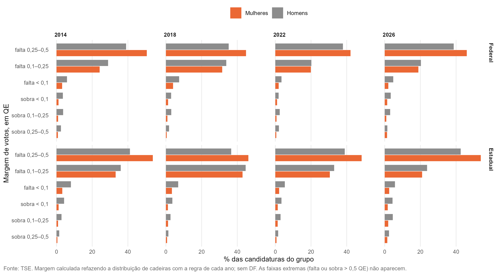
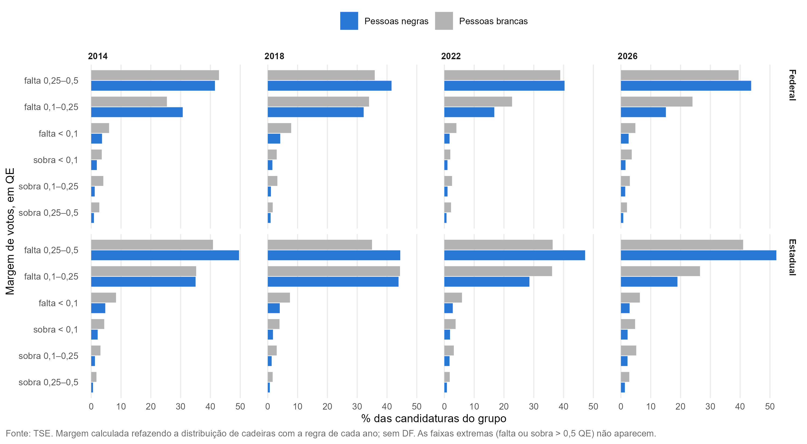

# Apêndice metodológico: os efeitos da EC 111/2021 {#sec-apendice-ec111}

```{=html}
<!-- Criado em 2026-11-25 (plano quality_reports/plans/2026-11-25_cap4-ec111-dados-resultados.md,
item 3): a distribuição das candidaturas pela margem de votos e a calibração da banda de 0,1 QE
saíram da seção de Dados do capítulo sobre a EC 111. Texto inteiro novo, marcado com .revisao. -->
```

::: revisao
Este apêndice complementa a Metodologia do Capítulo [-@sec-ec111-competitividade] com a distribuição das candidaturas pela margem de votos e com a justificativa da banda de 0,1 quociente eleitoral (QE) usada para classificar uma candidatura como competitiva.
:::

## Distribuição das candidaturas pela margem de votos {#sec-distribuicao-competitividade-ec111}

::: revisao
A @fig-faixas-margem-genero e a @fig-faixas-margem-raca mostram a distribuição das candidaturas por faixa de margem de votos, em QE, por cargo e eleição. A maior parte das candidaturas termina muito longe do limiar, e as de mulheres e de pessoas negras ficam, em geral, mais longe do que as demais. Em 2018, último ano antes da emenda, 7,1% das candidatas a deputada federal e 15,9% dos candidatos se elegeram ou ficaram a menos de 0,1 QE do limiar, e a distância entre pessoas negras e brancas era parecida com a de gênero, de 8,2% contra 16,6%.
:::

{#fig-faixas-margem-genero width="100%"}

{#fig-faixas-margem-raca width="100%"}

## A escolha da banda de 0,1 QE

::: revisao
A margem de votos de uma candidatura depende dos votos dela, dos votos dos colegas de lista e da distribuição de cadeiras entre as listas. Numa lista grande, a distância de uma candidatura fraca até o limiar passa a ser determinada mais pelos colegas de lista do que pelos seus próprios votos, e o peso dessa situação cresce à medida que a banda se alarga. Com bandas de 0,25 ou 0,5 QE, candidaturas quase sem votos passam a ser classificadas como próximas do limiar sempre que a lista tem colegas fortes. Entre as candidaturas com menos de 0,5% do QE, 27,6% ficam a menos de 0,25 QE do limiar, mas apenas 0,8% ficam a menos de 0,1 QE, de modo que, com a banda adotada, a classificação de uma candidatura quase sem votos como competitiva se torna rara.
:::
