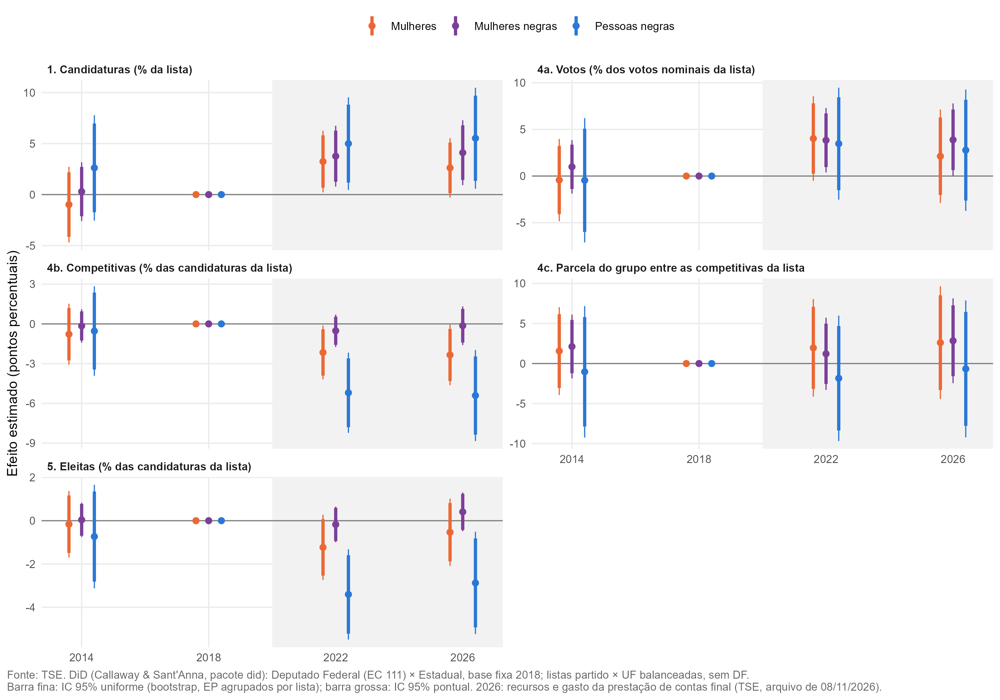
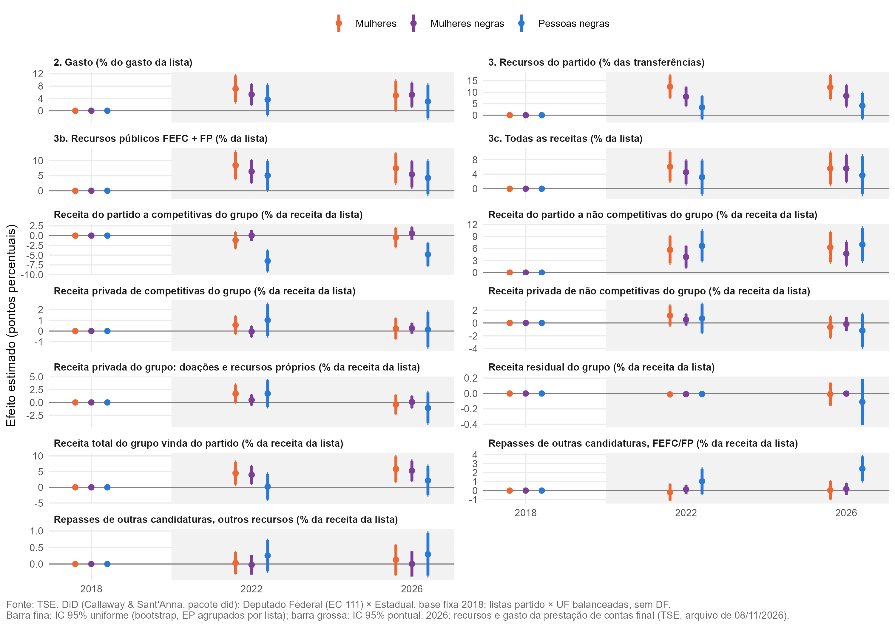
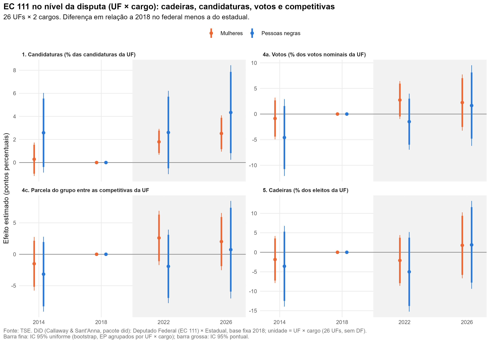

```{r}
#| label: setup
library(tidyverse)
library(knitr)
out <- "output"
res  <- read_csv2(file.path(out, "did_2026_resultados.csv"), show_col_types = FALSE)
rm_s <- read_csv2(file.path(out, "did_2026_sensibilidade_rm.csv"), show_col_types = FALSE)
desc <- read_csv2(file.path(out, "descritivo_grupos_ano_cargo.csv"), show_col_types = FALSE)
conf <- read_csv2(file.path(out, "conferencia_2026.csv"), show_col_types = FALSE)

br <- \(x, d = 1) formatC(x, format = "f", digits = d, decimal.mark = ",", flag = "+")
br0 <- \(x, d = 1) formatC(x, format = "f", digits = d, decimal.mark = ",")
# efeito: lista balanceada, não ponderada, salvo indicação
ef <- function(y, periodo, nivel = "lista", ponderado = FALSE, balanceado = TRUE, campo = "att") {
  r <- res |> filter(resultado == y, periodo == !!periodo, nivel == !!nivel,
                     ponderado == !!ponderado, balanceado == !!balanceado)
  stopifnot(nrow(r) == 1)
  r[[campo]]
}
estrela <- \(lo, hi) if_else(lo > 0 | hi < 0, "*", "")
fmt_ef <- function(y, periodo, ...) {
  a <- ef(y, periodo, ...); lo <- ef(y, periodo, ..., campo = "ic_inf"); hi <- ef(y, periodo, ..., campo = "ic_sup")
  paste0(br(a), estrela(lo, hi))
}
```

::: {.callout-important}
## Resumo

- **O incentivo mudou a alocação de recursos para as mulheres e o efeito persistiu em 2026.** No federal, em relação ao estadual, a parcela das transferências partidárias destinada a mulheres subiu `r fmt_ef("rec_partido_mulher", "2022")` pontos percentuais (pp) em 2022 e `r fmt_ef("rec_partido_mulher", "2026")` pp em 2026.
- **O ganho de votos das mulheres perdeu força.** Foi de `r fmt_ef("voto_mulher", "2022")` pp em 2022 e de `r fmt_ef("voto_mulher", "2026")` pp em 2026, sem significância. Em 2026 as mulheres cresceram mais no estadual do que no federal.
- **Não há efeito sobre competitividade nem sobre cadeiras**, nem para mulheres nem para pessoas negras. Mais dinheiro e mais candidaturas não se converteram em mais eleitas e eleitos.
- **Para pessoas negras**, os efeitos sobre candidaturas e recursos são menores e dependem da ponderação. Em 2026, a cota de 30% da EC 133/2024 dificulta a interpretação.
- Recursos e gasto de 2026 vêm da **prestação de contas parcial** do TSE (13/10/2026) e são provisórios.

\* nas tabelas: intervalo de confiança de 95% exclui zero.
:::

# Pergunta e política

A Emenda Constitucional 111/2021 determina que, na distribuição do Fundo Especial de Financiamento de Campanha (FEFC) e do Fundo Partidário entre os partidos, os votos dados a candidatas mulheres e a candidaturas negras **para a Câmara dos Deputados** contem em dobro, nas eleições de 2022 a 2030. O incentivo é financeiro e dirigido aos partidos: quanto mais votos esses grupos obtiverem para deputado federal, mais recursos o partido recebe no ciclo seguinte.

Este estudo pergunta se o incentivo mudou, para mulheres e para pessoas negras:

1. o **número de candidaturas**;
2. o **volume de recursos gastos** na campanha;
3. o **volume de recursos recebidos dos partidos**;
4. a **competitividade eleitoral**;
5. o **sucesso** (eleita/o ou não).

E, com a eleição de 2026, se o efeito observado em 2022 se manteve.

O desenho reproduz e estende o de Fonseca, Thomé & Guedes-Neto (2026, *Electoral Studies*): como o voto em dobro vale só para deputado federal, as candidaturas a **deputado estadual** da mesma UF servem de grupo de comparação.

# Como incluir um segundo período depois do tratamento

## O desenho

Há uma única data de adoção (2022), então o desenho é **2×T**, e não escalonado. O tratado é o cargo de deputado federal a partir de 2022; o controle é o de deputado estadual, nunca tratado. As eleições são 2014 e 2018 (antes) e 2022 e 2026 (depois).

O estimador é o de Callaway & Sant'Anna (2021), pelo pacote `did`. Cada efeito é uma comparação 2×2 limpa contra o grupo nunca tratado, o que evita as comparações indevidas de regressões com efeitos fixos duplos quando o efeito varia no tempo.

## As escolhas, com referências

| Questão | Escolha | Referência |
|---|---|---|
| Período de referência | **Base fixa em 2018**, o último ano antes do tratamento. O efeito de 2026 é a mudança de 2018 para 2026 no federal menos a mesma mudança no estadual | Roth (2024); Callaway & Sant'Anna (2021) |
| Por que não comparar 2022 com 2026 | Uma 2×2 de 2022 para 2026 compara dois períodos tratados e mede só **quanto o efeito mudou**, não o efeito | idem |
| Resumo | Efeitos por eleição (2022 e 2026) e a média dos dois (agregação por grupo). Evita-se a agregação "simples" | Callaway & Sant'Anna (2021) |
| Hipótese de identificação | Tendências paralelas por **8 anos** (2018→2026), hipótese mais forte que por 4. O ano de 2014 serve de pré-teste: é evidência, não prova | Roth, Sant'Anna, Bilinski & Poe (2023) |
| Sensibilidade | Magnitudes relativas: a violação de tendência depois de 2018 é limitada a M̄ vezes a observada antes. O viés possível **acumula com o horizonte** (o dobro em 2026) | Rambachan & Roth (2023) |
| Listas que surgem ou somem (fusões, federações) | Painel balanceado como principal; painel desbalanceado como robustez. Os dois medem populações diferentes | Sant'Anna & Xu (2023) |
| Inferência | *Bootstrap* multiplicador com bandas uniformes e erros agrupados por lista; erros agrupados por UF como robustez | Callaway & Sant'Anna (2021) |

: Escolhas metodológicas para incorporar 2026 {#tbl-escolhas}

## O que mais mudou entre 2022 e 2026

A comparação federal × estadual elimina tudo o que afeta os dois cargos da mesma forma. As ameaças são as mudanças que atingem um cargo e não o outro, ou que interagem com o incentivo:

- **EC 133/2024** — exige que pelo menos 30% do FEFC e do Fundo Partidário vão para candidaturas negras, nos dois cargos (o STF manteve a regra em junho de 2026). É um choque comum. Mas se os partidos cumprirem a cota alocando no federal, onde o voto vale em dobro, a interação aparece como parte do efeito de 2026.
- **Cláusula de desempenho** — sobe de 2% para 2,5% dos votos válidos para **deputado federal**. Incentiva os partidos a concentrar recursos em quem traz votos no cargo tratado, o que tende a favorecer candidaturas já competitivas.
- **Fusões e federações** — PRD (PTB + Patriota), PSC incorporado ao Podemos, PROS ao Solidariedade, novas federações. As siglas foram harmonizadas para as vigentes em 2026.
- **Queda no número de candidaturas** — cerca de 25% a menos em 2026 nos dois cargos.

# Dados

```{r}
#| label: tbl-dados
#| tbl-cap: "Fontes por eleição"
tribble(
  ~Eleição, ~`Candidaturas, votos e resultado`, ~`Recursos e gasto`,
  "2014", "Bases da tese (TSE)", "Não usados: havia doação empresarial (regime de financiamento diferente)",
  "2018, 2022", "Bases da tese (TSE)", "Prestação de contas final",
  "2026", "Votação por município e zona e cadastro de candidaturas (TSE, 13/10/2026)",
  "Prestação de contas **parcial** (TSE, 13/10/2026): relatórios de 72 horas e prestação parcial; a final vence em novembro"
) |> kable()
```

As regras são as mesmas das análises anteriores da tese:

- **candidatura apta**: em 2026, reconstruída pela situação de julgamento (deferida, pendente ou com recurso em curso);
- **competitiva**: votos de pelo menos 10% do quociente eleitoral, ou eleita;
- **gasto**: despesas contratadas, sem doações a outras candidaturas;
- **recursos do partido**: receitas com origem "Recursos de partido político"; **recursos públicos**: FEFC e Fundo Partidário de qualquer origem.

O Distrito Federal fica fora, porque não elege deputados estaduais.

```{r}
#| label: tbl-conf
#| tbl-cap: "Conferência da base de 2026 (sem DF)"
conf |>
  transmute(Cargo = DS_CARGO, `Candidaturas aptas` = candidaturas_aptas, Eleitos = eleitos,
            `% mulheres` = br0(pct_mulheres), `% negras` = br0(pct_negras),
            `% de mulheres entre eleitos` = br0(pct_eleitas_mulheres),
            `% com despesa declarada` = br0(pct_com_despesa)) |>
  kable(align = "lrrrrrr")
```

# O quadro descritivo

Antes do DiD, a evolução bruta. Note que a participação das mulheres nos votos cresce nos dois cargos, e em 2026 cresce mais no estadual.

```{r}
#| label: tbl-desc
#| tbl-cap: "Participação de mulheres e pessoas negras, por cargo e eleição (%)"
desc |>
  transmute(Cargo = DS_CARGO, Ano = ANO, Candidaturas = candidaturas,
            `Cand. mulheres` = br0(pct_cand_mulheres), `Votos mulheres` = br0(pct_votos_mulheres),
            `Eleitas` = br0(pct_eleitos_mulheres),
            `Rec. partido mulheres` = if_else(is.na(pct_rec_partido_mulheres), "—", br0(pct_rec_partido_mulheres)),
            `Cand. negras` = br0(pct_cand_negras), `Votos negras` = br0(pct_votos_negras),
            `Eleitas/os negras/os` = br0(pct_eleitos_negras),
            `Rec. partido negras` = if_else(is.na(pct_rec_partido_negras), "—", br0(pct_rec_partido_negras))) |>
  kable(align = "llrrrrrrrrr")
```

# Resultados

A unidade principal é a **lista**: partido × UF × cargo. Cada resultado é a parcela do grupo, em %, na lista. O painel balanceado tem as listas presentes nas quatro eleições (ou nas três, para recursos). Os efeitos estão em pontos percentuais.

```{r}
#| label: tbl-principal
#| tbl-cap: "Efeito do voto em dobro (federal × estadual, base 2018). Pontos percentuais; erro-padrão entre parênteses"
linhas <- tribble(
  ~y, ~Resultado, ~nivel,
  "cand",        "1. Candidaturas (% da lista)", "lista",
  "gasto",       "2. Gasto (% do gasto da lista) ᵖ", "lista",
  "rec_partido", "3. Recursos do partido (% das transferências) ᵖ", "lista",
  "rec_publico", "3b. Recursos públicos FEFC + FP (% da lista) ᵖ", "lista",
  "voto",        "4a. Votos (% dos votos nominais da lista)", "lista",
  "compshare",   "4b. Parcela do grupo entre as competitivas da lista", "lista",
  "cadeira",     "5. Cadeiras (% dos eleitos da UF)", "disputa"
)
cel <- function(y, p, nivel) {
  r <- res |> filter(resultado == y, periodo == p, nivel == !!nivel, !ponderado, balanceado)
  if (nrow(r) == 0) return("—")
  paste0(br(r$att), estrela(r$ic_inf, r$ic_sup), " (", br0(r$ep), ")")
}
tab <- linhas |>
  cross_join(tibble(g = c("mulher", "negra"), Grupo = c("Mulheres", "Pessoas negras"))) |>
  rowwise() |>
  mutate(`Pré-teste 2014` = cel(paste0(y, "_", g), "2014", nivel),
         `2022` = cel(paste0(y, "_", g), "2022", nivel),
         `2026` = cel(paste0(y, "_", g), "2026", nivel),
         `Média` = cel(paste0(y, "_", g), "Média 2022–2026", nivel)) |>
  ungroup() |>
  arrange(Grupo) |>
  select(Grupo, Resultado, `Pré-teste 2014`, `2022`, `2026`, `Média`)
kable(tab, align = "llrrrr")
```

ᵖ 2026 provisório (prestação de contas parcial). Recursos e gasto não têm pré-teste: em 2014 havia doação empresarial.

## Candidaturas, votos, competitividade e sucesso

{width=100%}

Cada ponto é a diferença em relação a 2018 no federal menos a mesma diferença no estadual. Em 2014 os pontos ficam próximos de zero em todos os resultados: antes da EC 111, os dois cargos evoluíam de forma parecida.

- **Candidaturas.** A parcela de mulheres nas listas federais sobe cerca de 3 pp em relação às estaduais, nas duas eleições. A de pessoas negras sobe cerca de 5 pp, mas o efeito desaparece quando as listas são ponderadas pelo tamanho (`r fmt_ef("cand_negra", "2022", ponderado = TRUE)` pp em 2022). O aumento está nas listas pequenas.
- **Votos.** O efeito sobre a parcela dos votos das mulheres em 2022 (`r fmt_ef("voto_mulher", "2022")` pp) cai para `r fmt_ef("voto_mulher", "2026")` pp em 2026, sem significância.
- **Competitividade.** A parcela de mulheres e de pessoas negras **entre as candidaturas competitivas** da lista (painel 4c) não muda de forma distinguível de zero.

::: {.callout-warning}
## Painéis 4b e 5 da figura: leitura com cuidado

"% das candidaturas da lista que são do grupo **e** competitivas (ou eleitas)" também cai quando se olha para **todas** as candidaturas: `r fmt_ef("compet_todos", "2022")` pp para competitivas e `r fmt_ef("eleita_todos", "2022")` pp para eleitas em 2022. As listas federais do painel perderam competitividade em geral, em relação às estaduais. Os valores negativos para os grupos nesses dois painéis são, em boa parte, mecânicos. Por isso a medida principal de competitividade é a do painel 4c, e a de sucesso são as cadeiras no nível UF × cargo.
:::

## Gasto e recursos

{width=100%}

O efeito pretendido pela emenda — mudar a alocação de recursos — aparece com clareza para as mulheres e **se mantém em 2026**:

- transferências do partido: `r fmt_ef("rec_partido_mulher", "2022")` pp em 2022 e `r fmt_ef("rec_partido_mulher", "2026")` pp em 2026;
- recursos públicos (FEFC + FP): `r fmt_ef("rec_publico_mulher", "2022")` e `r fmt_ef("rec_publico_mulher", "2026")` pp;
- gasto: `r fmt_ef("gasto_mulher", "2022")` e `r fmt_ef("gasto_mulher", "2026")` pp.

O efeito é maior quanto mais a fonte é controlada pelo partido, o mesmo padrão da etapa anterior desta pesquisa. Para pessoas negras, só os recursos públicos em 2022 têm efeito distinguível de zero (`r fmt_ef("rec_publico_negra", "2022")` pp).

## Sucesso: cadeiras por UF

{width=100%}

No nível da disputa (26 UFs × 2 cargos), a parcela de cadeiras ocupadas por mulheres e por pessoas negras não muda de forma distinguível de zero, em 2022 nem em 2026. Com só 52 unidades os intervalos são largos, mas as estimativas pontuais também são pequenas e mudam de sinal entre as duas eleições.

# Robustez e sensibilidade

```{r}
#| label: tbl-robustez
#| tbl-cap: "Mulheres — efeito médio 2022–2026 em especificações alternativas (pp)"
esp <- function(y) {
  pick <- \(pond, bal) { r <- res |> filter(resultado == y, periodo == "Média 2022–2026", nivel == "lista",
                                            ponderado == pond, balanceado == bal)
    if (nrow(r) == 0) "—" else paste0(br(r$att), estrela(r$ic_inf, r$ic_sup)) }
  tibble(`Principal` = pick(FALSE, TRUE), `Ponderado (votos da lista em 2018)` = pick(TRUE, TRUE),
         `Painel desbalanceado` = pick(FALSE, FALSE))
}
tribble(~y, ~Resultado,
        "cand_mulher", "Candidaturas", "voto_mulher", "Votos", "compshare_mulher", "Parcela entre competitivas",
        "gasto_mulher", "Gasto ᵖ", "rec_partido_mulher", "Recursos do partido ᵖ") |>
  mutate(e = map(y, esp)) |> unnest(e) |> select(-y) |> kable(align = "lrrr")
```

**Sensibilidade a violações de tendências paralelas.** O pacote `HonestDiD` não pôde ser instalado na versão de R desta máquina. A tabela abaixo traz o **conjunto identificado** sob a restrição de magnitudes relativas, somado a ±1,96 erro-padrão, e o M̄ de ruptura: o menor múltiplo da pré-tendência que faz o intervalo incluir zero. É uma aproximação, sem a inferência de Rambachan & Roth (2023); só se aplica aos resultados com o pré-teste de 2014.

```{r}
#| label: tbl-rm
#| tbl-cap: "Magnitudes relativas, M̄ = 1 (listas, sem ponderação)"
rotulos <- c(cand_mulher = "Candidaturas — mulheres", cand_negra = "Candidaturas — negras",
             voto_mulher = "Votos — mulheres", voto_negra = "Votos — negras",
             compshare_mulher = "Parcela entre competitivas — mulheres",
             compshare_negra = "Parcela entre competitivas — negras")
rm_s |>
  filter(!ponderado, Mbar == 1, nivel == "lista", resultado %in% names(rotulos)) |>
  transmute(Resultado = rotulos[resultado], Eleição = periodo, Efeito = br(att),
            `Pré-tendência (2014)` = br(pre),
            `Intervalo com viés máximo` = paste0("[", br(ic_rm_inf), "; ", br(ic_rm_sup), "]"),
            `M̄ de ruptura` = br0(Mbar_breakdown, 2)) |>
  kable(align = "llrrrr")
```

O efeito sobre os votos das mulheres em 2022 sobrevive a violações de até cerca de 1,7 vez a pré-tendência; o de 2026, a nenhuma. O efeito sobre as candidaturas de mulheres é frágil nos dois anos.

# Avaliação da credibilidade

| Bloco | Avaliação | Motivo |
|---|---|---|
| Recursos e gasto — mulheres | **Moderada** | Efeito grande e estável entre 2022 e 2026 e com ou sem ponderação. Mas não há pré-teste (2014 é outro regime de financiamento) e 2026 é provisório |
| Candidaturas — mulheres | **Moderada** | Pré-teste ≈ 0; efeito pequeno, sensível à ponderação |
| Votos — mulheres | **Moderada em 2022, fraca em 2026** | Em 2026 não resiste à sensibilidade, e a cláusula de 2,5% é um choque concorrente só no federal |
| Competitividade e cadeiras | **Ausência de efeito** | Estimativas pequenas, de sinal instável; intervalos largos no nível UF |
| Pessoas negras | **Fraca** | Resultados dependem da ponderação; a EC 133/2024 confunde a parte de 2026 |

Limites gerais: o tratamento é atribuído ao cargo inteiro (há, na prática, um único "grupo" tratado); muitos resultados são testados ao mesmo tempo; e o painel balanceado de quatro eleições cobre um subconjunto das listas.

# Pendências

- **Prestação final de 2026** (prazo em novembro): refazer recursos e gasto.
- **Deduplicação das despesas.** A regra "um registro por código de despesa" é a mesma de 2018/2022 e foi mantida por comparabilidade. Ela descarta lançamentos que não são cópias: em 2022, o total fica 14% abaixo do obtido deduplicando por linha. Decisão da autora, que afeta também as análises anteriores.
- **Sensibilidade completa** com o pacote `HonestDiD` (exige R ≥ 4.3) e 25.000 réplicas de *bootstrap* na versão final (aqui, 1.000).
- **Replicação.** O efeito 2018→2022 sobre os votos das mulheres dá +4,7 pp neste painel, contra +5,2 na etapa anterior. A diferença vem das siglas harmonizadas para as de 2026, que juntam listas.

# Referências

- Callaway, B. & Sant'Anna, P. H. C. (2021). Difference-in-differences with multiple time periods. *Journal of Econometrics*, 225(2), 200–230.
- Fonseca, T., Thomé, D. & Guedes-Neto, J. V. (2026). Money talks? Party financial incentives to promote underrepresented groups. *Electoral Studies*.
- Rambachan, A. & Roth, J. (2023). A more credible approach to parallel trends. *Review of Economic Studies*, 90(5), 2555–2591.
- Roth, J. (2024). Interpreting event-studies from recent difference-in-differences methods. arXiv:2401.12309.
- Roth, J., Sant'Anna, P. H. C., Bilinski, A. & Poe, J. (2023). What's trending in difference-in-differences? A synthesis of the recent econometrics literature. *Journal of Econometrics*, 235(2), 2218–2244.
- Sant'Anna, P. H. C. & Xu, Q. (2023). Difference-in-differences with compositional changes. arXiv:2304.13925.

---

*Código: `explorations/ec111-did-2026/R/` (scripts 01–03). Tabelas geradas a partir de `output/did_2026_resultados.csv`.*
